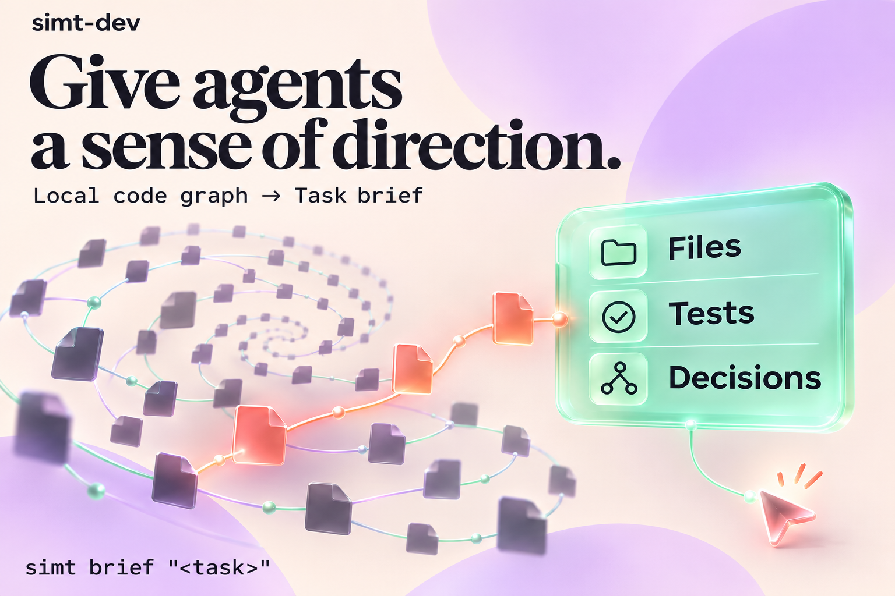
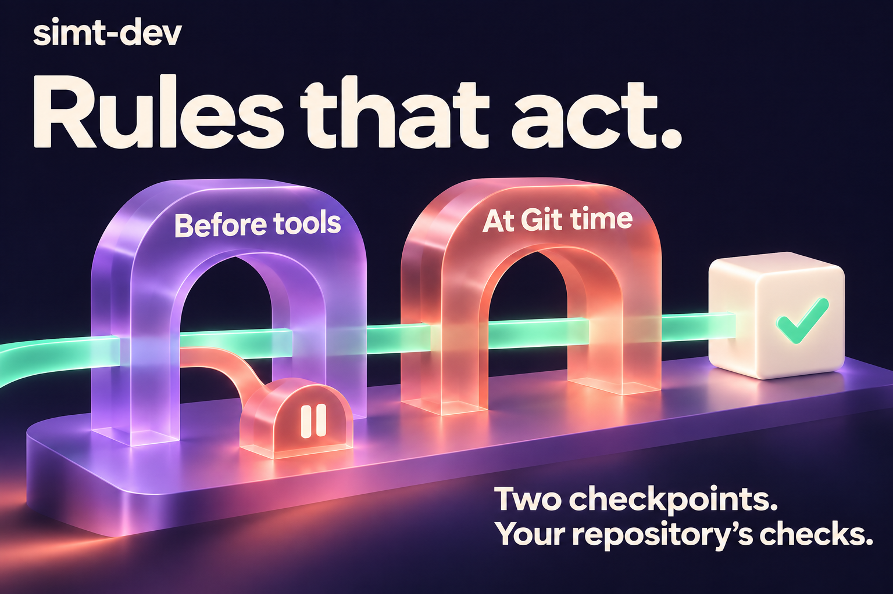
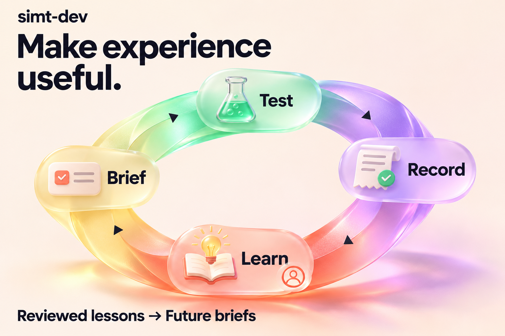

# simt-dev

**Give your coding agent a repository it can understand—and rules it can act on.**

[](https://github.com/QuazarMedia/simt-dev/actions/workflows/simt-dev-check.yml)

[Try it](#try-it-on-one-repository) · [How it helps](#give-agents-a-sense-of-direction) · [Architecture](docs/architecture/overview.md) · [Command reference](docs/commands/README.md)


Your agent can write code. Getting it oriented, keeping it inside the rules, and checking
what it actually did takes more than a good prompt.

**simt-dev is an intelligence amplifier for AI coding agents.** Its `simt` command reads
your repository's build files, projects rules into the files your agent reads, and connects
a local code graph to task briefs, executable gates, test evidence and reviewed lessons.

Works across **Claude Code, Cursor, Codex, Gemini CLI, Copilot and more**.
The default path is **deterministic, local-first and free of runtime dependencies**:
no model and no network. CLI, MCP and hooks use the same underlying functions.

## Is it useful for you?

Start with simt-dev if you want to:

- **Orient agents before they explore.** Give them relevant files, tests and decisions for a task.
- **Keep repository rules consistent across agent tools.** Project them into each tool's native files.
- **Make checks and evidence part of the workflow.** Run declared gates and record which tree they checked.

You bring your agent, repository and test commands; simt-dev connects them.
An ecosystem without a gate profile still gets core rules. Only gates the repository
can actually run are installed.

## Try it on one repository

Requires **Node >= 22.20.0** for npm and PyPI. **macOS and Linux**; use **WSL2** on Windows.
Homebrew and the release binary carry their own Node runtime.

Install once, then run from the repository you want to adopt:

```sh
npm i -g simt-dev
simt init                              # preview the adoption plan
simt init --yes                        # apply it
simt index                             # build the local code graph
simt brief "fix the failing login test"
```

The brief gives your agent the repository's commands, likely files, covering tests and
governing decisions in one bounded packet. Try it with a real task from your backlog.

Prefer another install? Use `npm i -D simt-dev`, `pip install simt-dev`, or
`brew install QuazarMedia/homebrew-tap/simt-dev`.
[Installation guide →](docs/getting-started.md)

Pin the release you adopt: upgrading can change generated rules. Repository writers
preview changes until you pass `--yes`; `index` rebuilds its ignored cache directly.

## Give agents a sense of direction



**Start with the task, then follow its connections.** The local index links code, tests
and repository guidance. A brief brings relevant context together; impact queries show
what a change could reach.

```sh
simt brief "add password reset"
simt why src/auth.ts                    # what governs this file
simt impact src/auth.ts                 # what depends on it
```

Use your own file paths. [See the agent workflow →](docs/guides/agent-playbook.md)

## Rules that act



**Put a check where the decision happens.** Agent hooks can refuse supported tool calls
with a remedy. Git hooks run the checks your repository declares. The evidence ledger
records what ran against which tree.

```sh
simt hooks install --yes                # Git-time gates
simt agent-hooks install --yes          # supported agent-tool checkpoints
simt gate --changed                    # run tests mapped to the change
simt evidence                          # inspect recorded runs
```

Hook support and trust requirements vary by agent tool. Test selection follows the
available mappings; a change with no mapped tests still needs appropriate validation.
[How detection, rules and gates connect →](docs/architecture/pipeline.md)

## Make experience useful



**Give the next task something useful from the last one.** Capture failure-to-fix lesson
candidates, review them, and bring promoted lessons into future briefs. Benchmark tools
mine tasks from Git history so you can compare context choices on your own repository.

The goal is more resolved tasks at a lower cost per resolved task. Those gains are
**hypotheses to measure**, not a promised uplift. Optional local models and external
adapters are off by default; proposals require review before they become projected rules.
[Explore the research and measurement plan →](docs/research/0003-intelligence-amplifier-research-plan.md)

## Go deeper

- **Start:** [installation](docs/getting-started.md) · [agent playbook](docs/guides/agent-playbook.md) · [workspace setups](docs/guides/workspace-shapes.md)
- **Understand:** [architecture](docs/architecture/overview.md) · [module map](docs/reference/modules.md) · [decisions](docs/decisions-index.md)
- **Inspect:** [files written](docs/reference/files-written.md) · [exit codes](docs/reference/exit-codes.md) · [all commands](docs/commands/README.md)
- **Contribute:** [contributor guide](CONTRIBUTING.md) · [report a vulnerability](SECURITY.md)

Apache-2.0 · [Licence](LICENSE)
