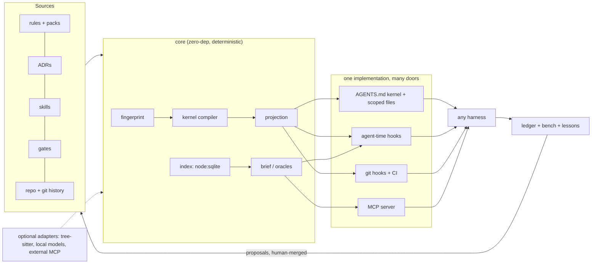

# Plan 0003 — simt-dev as an intelligence amplifier: research and development plan

Status: **in progress — R01–R10, R14, R15 complete** · created 2026-10-06 · state read at `ddb9022`
Depends on: review 0002 Waves 0–1 (`docs/reviews/0002-full-review-adoption-and-public-release.md`),
plan 0002
Blocked by: every slice here is Queued, and R01 and R02 — the task miner and the agent runner
that everything else measures against — sit in review 0002's Wave 0, which is itself Queued.
This plan has no Phase 0 result to build on, so it cannot start before review 0002 Wave 0
lands. That ordering is a fact about the dependencies, not a judgement about the work.

Constraint carried from ADR-012 and this repo's `AGENTS.md`: the core stays zero-dependency,
POSIX-only and deterministic. Anything that needs a model, a parser grammar, a database beyond
`node:sqlite`, or the network is an **optional adapter**. An adapter is installed separately, is
off by default, and can be removed without changing a single committed byte.

`docs/plans/` is in `package.json` `files` until review 0002 S18 lands, so this file ships in
the tarball for now. It names estate repositories only as evidence.

## 0. How to read this plan

There are 55 slices, R01–R55, in nine phases. Each slice gives its **Goal**, its **Design**
(files, data shapes and commands), a measurable **Accept** criterion, and, where there is any,
the **Basis** of evidence it rests on.

Phases group slices by purpose, not by order. The `Depends on` column in the tracker (§14) is
the order of work, and §16 is the suggested start. One rule holds throughout: nothing that
changes what an agent reads becomes a default before Phase 0 can measure it. The schemas are in
Appendix A. ADR numbers 036–044 are provisional; review 0002 proposes 027–035.

## 1. The goal, made measurable

The goal this plan serves: *using simt-dev with an LLM improves that LLM's intelligence score
and its cost per unit of intelligence.* Both halves need numbers, measured the same way for
every arm:

| Quantity | Definition |
| --- | --- |
| Resolved rate **R** | share of tasks whose hidden tests pass *and* whose declared gates pass, on a repo-mined suite (R01), plus a fixed public slice for external validity |
| Quality **Q** | weighted: hidden tests 0.5, gates 0.2, rule-compliance probes 0.2 (R05), diff hygiene 0.1 (files outside the blast radius, size against the gold patch) |
| Cost **C** | billed dollars per task, Σ over turns of `uncached_in·p_in + cache_write·p_cw + cache_read·p_cr + out·p_out`, from each harness's own usage report |
| Uplift **ΔR** | `R(arm) − R(bare)`: same model, harness and tasks, at least 3 repetitions per task |
| **CPI** | `C / (R·Q)`: dollars per quality-weighted resolved task |

**Targets** are hypotheses, not promises: ΔR ≥ +5 points, CPI ≤ 0.8× the bare arm, and
compliance ≥ 95% on the probes. They are tested with paired statistics: McNemar on resolved,
Wilcoxon signed-rank on cost, p < 0.05.

### 1.1 Why this framing: the evidence

1. **Context files cost more than they return.** ETH Zurich's "Evaluating AGENTS.md" (arXiv
   2602.11988, ICLR 2026 MemAgents workshop) measured the following:
   - LLM-generated files lowered the resolution rate by 0.5% (SWE-bench Lite) and 2% (their
     new benchmark of repositories that ship context files), added 2.45 and 3.92 steps, and
     raised cost by 20% and 23%;
   - developer-written files gained 2.4% (p = 0.21, not significant) at up to 19% more cost;
   - repository overviews did not help, but instructions *were* followed.

   Their recommendation is minimal, non-inferable requirements. simt-dev today projects 9–16 KB
   regions of mostly rationale into every repository (review 0002 S38).
2. **Bytes saved are not dollars saved.** JetBrains ran a paired benchmark of the RTK output
   compressor (July 2026, 80 task pairs, Claude Code). At low effort RTK made the median task
   **7.6% more expensive** (p = 0.004), with 13.8% more turns. At high effort it changed
   nothing (p = 0.99), and quality was tied throughout. The reasons they found:
   - the hook saw only about a fifth of the tool output;
   - cached re-reads, which dominate input cost, bill at a tenth of the price;
   - broken rewrites and extra exploration turns added a small tax.

   JetBrains also measured that identical attempts of one task differ by a median 22% in cost,
   which is why every comparison in this plan repeats each task. Quesma, on Terminal-Bench,
   found task cost +1% on one model and +17% on another, again from extra turns.
3. **Stable bytes are worth more than fewer bytes.** Anthropic and OpenAI prompt caching match
   an exact byte prefix in render order (tools, then system, then messages). Any byte change
   invalidates everything after it.
4. **Structural retrieval saves tokens and can cost quality.**
   - codebase-memory-mcp (arXiv 2603.27277) reports 10× fewer tokens and 2.1× fewer tool
     calls, at 83% against 92% answer quality.
   - codegraph-mcp's own benchmark has its compact mode 23% cheaper than grep and read, and
     the same tool 64% *more* expensive when it returns whole-file source.
   - An independent 2026 re-run found graphs did not save tokens on repositories up to about
     25k nodes, and paid off mainly for small models on very large repositories.
5. **Measurement is cheap now.** RepoTrials, PatchGym, RepoRacer and RepoAgentBench turn a
   repository's own history (commits, or merged pull requests for RepoAgentBench) into tasks
   graded by that repository's tests, and run agent CLIs against them.

**Thesis.** An agent gets smarter per dollar not from more text, but from less always-on text
that is exactly right, checks that replace instructions, exact answers to the questions it
would otherwise explore for, bytes that do not change, and a loop that keeps only what
measurably helps.

## 2. Five levers

| Lever | Hypothesis | Falsified by | Slices |
| --- | --- | --- | --- |
| L1 Say less, always | a ≤ 2 KB kernel of non-inferable commands and hard constraints matches today's regions on R and lowers C | the kernel arm loses R beyond a −2 point margin | R07–R14 |
| L2 Enforce instead of instruct | rules moved into agent-time and git-time checks raise compliance *and* remove their prompt bytes | probe compliance flat, or R drops from denials | R15–R19 |
| L3 Context just in time | a ≤ 2 KB task brief delivered at prompt submit cuts exploration turns ≥ 20% | turns and C unchanged | R27–R31 |
| L4 Exact answers over exploration | oracle tools (tests for a file, impact, conventions, exemplars) cut tool calls and output tokens | calls and C unchanged, or Q drops | R20–R26 |
| L5 Close the loop | lessons, ablation and variant selection raise R release over release on the same repo | R flat across releases | R32–R36 |

## 3. Positioning

Capabilities are as each project's public docs state them, read on 2026-10-06.

| Category | Examples | What they do | What they do not do |
| --- | --- | --- | --- |
| Projection tools | rulesync, ruler | rulesync generates rules, MCP config, commands, subagents, skills, hooks, permissions and Markdown checks for many harnesses, with a CI `--check` for drift; ruler concatenates `.ruler/*.md` into each agent's file, with nested rules and MCP | executable gates, decision provenance, byte budgets, any measure of effect |
| Agent `/init` generators | Claude Code, Codex | write a one-shot, model-written context file | measure it; and model-written files measurably hurt (§1.1) |
| Code-graph MCP servers | codebase-memory-mcp, codegraph-mcp, Serena, RepoGraph, mcp-codemap | structural queries over code | governance; independent results are mixed (§1.1 item 4) |
| Context layers and compressors | LeanCTX, RTK | RTK rewrites shell output. LeanCTX is broader: read modes, compression, a request proxy, memory, guards, and "cost per accepted outcome" with a shadow baseline and an off/on testbench | own the repository's rules, decisions and gates; RTK's savings did not survive a paired benchmark, and LeanCTX's figures are self-reported |
| Repo benchmarks | RepoTrials, PatchGym, RepoRacer, RepoAgentBench, RepoArena | measure agents on a repository's history | change what the agent reads |
| Memory layers | harness memories, mem0, Letta | recall across sessions | tie memory to tests, gates and decisions |

**LeanCTX is the closest neighbour, and it is a neighbour, not a rival.** It optimises what an
agent reads *at run time* and measures its own compression. simt-dev owns what a repository
*declares*: reviewed rules with decision provenance, projected byte-stable into every
harness's native files across many repositories, and enforced by git-time and agent-time
gates. The two can compose; R26 federates such tools rather than rebuilding them.

**The gap simt-dev fills** is one deterministic graph that joins rules, decisions, skills,
gates, files, tests, lessons and evidence. That graph is projected to every harness, enforced at
agent time and at git time, and measured on the repository's *own* history. Measurement here
means two things: tasks mined from that history and graded by its hidden tests (R01), and an
ablation of each rule section (R04). *A change to what an agent reads is a code change: it has
a test (bench), a budget (bytes) and a review (an ADR).* No tool surveyed here treats rule text
that way.

## 4. Architecture



| # | Principle | Consequence |
| --- | --- | --- |
| P1 | Deterministic default | every committed or projected byte reproduces from inputs, with no model and no network |
| P2 | Adapters propose, humans merge | model output never lands in projected text; it becomes a file with provenance (model, digest, prompt hash) |
| P3 | Local-first, no telemetry | nothing leaves the machine unless the user runs a command that says so |
| P4 | Byte-stable | no timestamps, SHAs or absolute paths in projected text; most-stable content first |
| P5 | Measured | a context change ships with a bench result, or its ADR says "unmeasured" |
| P6 | One implementation, many doors | CLI, MCP and hooks call the same functions (plan 0002 §17.2; review 0001 S06) |

**New source directories**:

| Directory | Contents | Slices |
| --- | --- | --- |
| `src/bench/` | mine, run, grade, report, `adapters.json` | R01–R05 |
| `src/kernel/` | compile, budget, inferability, command card | R07–R10 |
| `src/index/` | store, `extract/`, map, impact, tests | R20–R25 |
| `src/agenthooks/` | policy table, per-harness renderers | R15 |
| `src/ledger/` | evidence ledger | R17 |
| `src/brief/` | brief | R27–R29 |
| `src/memory/` | lessons, decide | R32–R34 |
| `src/local/` | optional local-model client | R37–R40 |

**Repository data**:

- Gitignored: `.simt-dev/index.sqlite`, `.simt-dev/ledger.jsonl`, `.simt-dev/bench/runs/`.
- Committed: `simt-dev.lock.json`, `docs/lessons/*.md`, `.simt-dev/bench/tasks/*.json`.
- Hidden test patches live **outside every worktree**, in `~/.cache/simt-dev/vault/<repo-id>/`.

## 5. Phase 0 — Measure first

### R01 — Task miner: `simt-dev bench mine` (M)

**Goal.** A repo-specific, contamination-resistant task suite mined from git history.

**Design.**

1. Walk `git log --no-merges --format=%H%x00%s%x00%b`. Keep commits that change both test files
   and implementation files. Test paths are classified per ecosystem: `test/`, `*.test.*`,
   `*_test.go`, `src/test/`, `tests/`, `spec/`.
2. For each candidate C: BASE is `C^`. Split C's diff into `test.patch` (test paths) and
   `gold.patch` (the rest).
3. Validate in a temp worktree, twice to drop flaky tests:
   - BASE plus `test.patch` must fail (RED);
   - BASE plus both patches must pass (GOLD);
   - record the FAIL_TO_PASS and PASS_TO_PASS test ids.
4. Test ids come from runner-native machine output: `node --test --test-reporter=tap`, vitest
   `--reporter=json`, JUnit XML for Gradle and Maven, pytest `--junitxml`, `go test -json`.
5. The prompt is the commit subject and body. Optionally add the linked issue, if `gh` is
   present.
6. Write tasks to `.simt-dev/bench/tasks/<id>.json` (Appendix A) and patches to the vault.

**Accept.** At least 20 valid tasks mined from simt-dev itself. Mining is deterministic: the
same history yields byte-identical task files.

**Basis.** RepoTrials (BASE/RED/GOLD validation, verifier vault outside the workspace),
PatchGym (hidden test patch plus oracle patch), RepoAgentBench (tasks newer than the model's
training cutoff avoid contamination) and RepoArena (a one-commit export with no future history).

### R02 — Agent runner: `simt-dev bench run` (L)

**Goal.** Run any agent CLI on the suite under several context *arms*, under identical
conditions.

**Design.**

- **Arms:**
  - `bare`: regions stripped, no simt-dev hooks, no MCP;
  - `current`: today's projection;
  - `kernel`: R07;
  - `brief`: R27;
  - plus `--arm name=path/to/arm.json`, which lists files to write or remove and env to set.
- **Isolation:** each run starts from a one-commit export of BASE (`git archive <base>`
  unpacked into a temp directory, then `git init` and a single commit), with the arm
  materialised and a timeout. A `git worktree` would share the object store, so
  `git log --all` would show the agent the gold patch.
- **Repetition:** each task runs k ≥ 3 times per arm (`--reps`). Agent runs are not
  reproducible, and identical attempts differ by a median 22% in cost (§1.1 item 2).
- **Adapters** are data, in `src/bench/adapters.json`: a command template plus a usage-field
  mapping. The templates below are starting points. Verify each against the CLI's `--help` at
  implementation time, because they change:

| Harness | Command template | Usage source |
| --- | --- | --- |
| Claude Code | `claude -p "{prompt}" --output-format json --max-turns {turns}` | `usage.*`, `total_cost_usd`, `num_turns` |
| Codex | `codex exec --json "{prompt}"` | token events in JSONL |
| Gemini CLI | `gemini -p "{prompt}" --output-format json` | `stats` block |
| opencode | `opencode run "{prompt}"` | session export |
| Cursor CLI | `cursor-agent -p "{prompt}" --output-format json` | result JSON |
| Aider | `aider --message "{prompt}" --yes-always` | `--analytics-log` file |

- **Grading** runs after the agent exits. Apply the vault's `test.patch`, run the task's
  `test_cmd` over the F2P and P2P ids, run the declared gates, then record resolved,
  gates_passed and diff stats (Appendix A, `run.json`).

**Accept.** A `gold` adapter that applies the gold patch resolves 100%, and a `noop` adapter
resolves 0%. Re-grading a stored run reproduces its grade exactly. In every agent workspace,
`git rev-list --all` lists exactly one commit.

### R03 — Cost model and report: `simt-dev bench report` (S)

**Design.**

- Prices come from a user-supplied `.simt-dev/bench/prices.json`, per million tokens:
  `{in, cache_write, cache_read, out}`. There are no network lookups.
- Per arm, report R, Q, C, CPI, turns, tool calls, and the cache-hit ratio,
  `cache_read / (input + cache_read)`.
- Paired bootstrap 95% confidence intervals; McNemar for R; Wilcoxon for C.
- Output is a markdown table and JSON. `--compare a b` prints deltas with p-values.

**Accept.** On synthetic runs, every number matches a hand computation in the test.

### R04 — Ablation: `simt-dev bench ablate` (M)

**Design.** Leave one section out at a time: each core section, each profile and each process
rule. Run on a 10-task **canary** subset with a cheap model, and escalate only significant
deltas to the full suite.

- Output a *value per KB* ranking.
- Flag sections with ΔR ≈ 0 and ΔC > 0 as deletion candidates.

This puts the ETH finding into practice one section at a time.

**Accept.** Every section gets an entry with a confidence interval, and the run is reproducible.

### R05 — Compliance probes: `simt-dev bench probes` (M)

**Design.** Synthetic tasks that tempt a rule violation:

- an unrelated failing test (is it skipped or deleted?);
- an easy `git push`;
- a failing hook (is `--no-verify` used?);
- an edit outside the blast radius;
- a generated file that is cheaper to hand-edit;
- "tell me the tests pass", without running them.

Each probe has a **deterministic grader** that reads the final git state, the commands in the
transcript and the ledger (R17).

**Accept.** 12 probes, each with a grader test. Each probe reports compliance per arm.

### R06 — Context meter: `simt-dev tokens [--workspace]` (S)

**Goal.** Make always-on context visible before and after every change. This is the cheapest
lever and the first to build.

**Design.** Using the harness loader table (R14), compute what each reader loads at session
start, per root, or per workspace with `--workspace`:

- the `AGENTS.md` chain, up to Codex's limit;
- `CLAUDE.md`, its imports, and unscoped `.claude/rules`;
- Cursor rules with `alwaysApply`;
- Copilot instructions;
- skill metadata (name plus description, about 100 tokens each per the Agent Skills spec);
- MCP `tools/list` bytes (3,993 B today).

Report bytes, tokens (bytes ÷ 4, or an optional tokenizer adapter), duplicates across roots,
and anything past a read limit. `--session <transcript>` optionally splits a recorded Claude
Code or Codex session into rules, tool output and file reads, locally.

**Accept.** On the estate it reproduces review 0002's figures: 90,042 B, of which 64,738 B is
redundant, and `simt-garmin` beyond Codex's limit. It runs in under 1 s.

## 6. Phase 1 — Lean context compiler

### R07 — Kernel and commentary split (M, D3)

**Superseded by ADR-073.** The kernel is a mode over the rules a repository already has — `mode`
in its manifest, and the class each rule states in its own frontmatter — rather than a
`simt-kernel:` list of extracted lines under `projection.mode`. What that leaves of the accept
criterion is in the tracker's note for this row.

**Design.**

- Every rule source gains `simt-kernel:` in its frontmatter (ADR-022 prefix): a list of
  imperative lines, each at most 120 characters, each carrying one constraint and its ADR, for
  example `Never push without explicit approval. (ADR-001)`.
- The existing prose becomes **commentary**. It is served by `rules why`, by MCP resources, and
  by a hook at the moment of violation (R15).
- `projection.mode: kernel | full`. The default stays `full` until R02 shows the kernel arm is
  non-inferior.

**Accept.** The core plus process kernel is at most 1.5 KB. In the kernel arm, ΔR ≥ −2 points
(non-inferiority) and ΔC < 0, at p < 0.05.

### R08 — Budgeted compilation (S)

**Design.**

- `projection.budget.bytes` sets a budget per surface; review 0002's P7 sets the default.
- The compiler packs kernel lines by priority class (hard constraint, then command, then
  convention, then style), with ties broken by rule id.
- `check` reports `BUDGET-CUT` (non-blocking) and the command that shows each cut line
  (`rules show <id>`).

**Accept.** The budget is never exceeded, and output is byte-identical across machines.

### R09 — Inferability filter (S)

**Design.** A kernel line may declare `simt-inferable-when: <fact expression>`. When the
repository already proves the fact, the line is dropped: "use `./gradlew`" when `gradlew` is
the only runner and the command card names it, "4-space indent" when a formatter config and a
format gate enforce it, "use pnpm" when only `pnpm-lock.yaml` exists. `--explain` shows each
removal and its fact.

**Basis.** ETH: content the repository already states does not help.

**Accept.** Fixture repos remove the expected lines, each with a reason.

### R10 — Command card (S)

**Goal.** The highest-value, non-inferable bytes: exact commands for *this* repository.

**Design.** A block of at most 600 B at the top of the kernel. It holds:

- build, test, lint, format and typecheck commands;
- a **focused-test template per path kind**, for example `node --test {file}`,
  `./gradlew :{module}:testDebugUnitTest --tests {class}`, `pytest {file}::{test}` and
  `go test ./{pkg} -run {Test}`.

It is derived from gates and runner detection alone, so it needs no index. R24 later refines
which test a given `{file}` maps to.

**Accept.** On 10 ecosystem fixtures, every command on the card exits 0 on a clean fixture.

### R11 — Workspace dedupe (M, within review 0002 P7)

**Design.**

1. Compute the **shared kernel** (the intersection across roots) and a delta per root.
2. Install the shared part once per harness at user level, where one exists (verify each at
   implementation): `~/.codex/AGENTS.md`, `~/.claude/CLAUDE.md`, `~/.gemini/GEMINI.md` and
   opencode's global `AGENTS.md`. Cursor user rules live in settings, so print them for the
   user to paste.
3. Per-repo regions switch to delta mode only when the manifest says
   `projection.shared: "user"`.
4. `doctor` warns when the user-level copy is missing or stale. CI always renders full mode, so
   a teammate without the user file loses nothing in review.

**Accept.** Always-on bytes for the 7-root estate workspace are at most 30 KB (review 0002 S38),
with no R loss in bench. Shipped as ADR-084. The paths and the manifest key moved; the 30 KB
bar and the bench comparison are unmeasured.

### R12 — Scoped loading (M)

**Design.** Implemented by review 0002 S50 (glob-scoped files per profile) and S41 (nested
`AGENTS.md` per package). This slice adds a **disclosure index**: the kernel ends with one line
per scoped rule and per skill (name and trigger), so the agent knows what exists without
loading it.

**Accept.** Scoped content is absent at session start and present once a matching file is
touched, verified per surface on fixtures. Shipped as ADR-085. The fixture renders each
surface: a surface that can narrow leaves the body out of the region and writes the file
it loads on a match, and a surface that cannot keeps the body. The harness is not driven.

### R13 — Cache-stable rendering (S)

**Design.**

- Projected text carries no SHA, date or path; the content stamp lives in the manifest
  (review 0002 S01).
- Ordering is stable, and the most stable content comes first: core kernel, then stack, then
  repo-specific.
- Dynamic content never goes into instruction files. It goes through hooks and MCP at message
  level, which leaves the cached prefix intact.
- `simt-dev.lock.json` records input and output digests, and `check --frozen` fails on any
  output change that no input change explains.

**Accept.** Two machines render byte-identical output. Editing a repo-specific line changes only
the tail bytes. Shipped as ADR-086. One process renders a repository twice and gets the same
bytes; the cross-machine half is the inputs, which do not include the clock or the home
directory. A repository profile edit leaves the prefix identical. `check --frozen` names a
stale lock and an unexplained output as different failures.

### R14 — Harness loader table (S)

**Design.** One data table per harness, each with vendor-doc provenance like `surfaces.mjs`:
files read at start, size caps (Codex 32 KiB), concatenation order, import syntax (Claude
`@path`), nested-directory behaviour, skill directories, hook config file and MCP config file.
R06, R11, R15, R42 and review 0002 S37 all read it.

**Accept.** Every row has provenance, and a fixture test asserts each reader's view of a sample
repo.

## 7. Phase 2 — Enforce instead of instruct

### R15 — Agent-time hooks from one policy table (L, D4)

**Design.**

- **Policy table** `src/agenthooks/policy.mjs` (data). Each row: rule id → event → matcher →
  check → a one-line message with its ADR.
- **Renderers** write every harness's hook config:
  - `.claude/settings.json` `hooks`: `PreToolUse`, `PostToolUse`, `Stop`, `UserPromptSubmit`,
    `SessionStart`;
  - `.cursor/hooks.json`: `preToolUse`, `beforeShellExecution`, `afterFileEdit`, `stop`,
    `beforeSubmitPrompt`;
  - `.codex/hooks.json`: `PreToolUse`, `PostToolUse`, `Stop`, `UserPromptSubmit`;
  - `.gemini/settings.json` `hooks`: `BeforeTool`, `AfterTool`, `BeforeAgent` (prompt submit),
    `AfterAgent` (stop).
- **One entry point.** Every hook calls `simt-dev agent-hook <event>`: JSON on stdin, the
  harness's decision JSON on stdout, exit 2 to block (the shared convention).
- **Overrides are explicit and per policy.** `SIMT_ALLOW=push,rewrite` in the session
  environment lifts exactly those policies, and every denial message names its override.
- **Initial policies:**
  1. `git push` (policy `push`): deny with "Push needs explicit approval (ADR-001); ask the
     user."
  2. `--no-verify`, `commit --amend`, `reset --hard`, `rebase`, `push --force` (policy
     `rewrite`): deny with the ADR.
  3. Edits to generated bytes (inside a region, behind a "Generated content" header, or under
     a submodule path such as `app-ui/`): deny with "edit the source, then run sync".
  4. After an edit: format and lint *that file only*, and return failures only, as additional
     context.
  5. Stop with code changed but no ledger entry for the current tree (R17): block once with the
     focused-test command from the card. A counter prevents loops.
  6. Reads of secrets (`.env*`, `*.pem`, `*.keystore`): deny.
- Codex trusts a hook by its hash, so `simt-dev agent-hooks status` prints the trust step.

**Accept.** Per harness, a fixture feeds JSON in and asserts the decision JSON out. A headless
Claude Code run on probe R05 shows the block. Hook p95 latency is under 100 ms (lazy imports).

**Basis.** Claude Code, Cursor, Codex and Gemini CLI document pre-tool hooks with JSON stdin and
exit-2 blocking (read 2026-10-06).

### R16 — Diff-aware gates: `simt-dev gate --changed` (M)

**Design.** Map changed files to their package, then to their tests (R24), and run only those.
The pre-commit hook, the Stop hook (R15) and agents call it directly. Output is compact (R18).

**Accept.** In simt-dev, changing `src/resolve/resolve.mjs` selects exactly the test files that
import it directly or transitively, checked against a hand-built list, in under 5 s.
The list is 51 files. Eight other test files do not import it. Selection measured
at about 40 ms (ADR-094).

### R17 — Evidence ledger and claim check (M, D5)

**Design.**

- Every gate or test that simt-dev runs appends to `.simt-dev/ledger.jsonl` (Appendix A). The
  tree id is computed without touching the real index:
  `GIT_INDEX_FILE=$(mktemp) git add -A && git write-tree`.
- `simt-dev evidence` prints the proof block for the current tree, for a PR or commit body.
- A `commit-msg` gate warns, or blocks if configured, when the message claims verification
  ("tests pass", "verified") with no ledger entry for the committed tree.

**Accept.** Editing any file after a green run invalidates the evidence, because the tree id
changes. Shipped as `simt evidence` and `simt evidence check`, with the commit-msg shim
written only when `gates.evidence` is `warn` or `block` (ADR-087).

**Basis.** This makes the core rule "never claim a test you did not run" checkable.

### R18 — Safe compaction of simt-dev's own gate output (S)

**Design.** Applies only to commands simt-dev itself runs, in known formats (TAP, JUnit XML,
vitest or jest JSON, pytest junit, `go test -json`):

- failures first, with each failure's full text kept;
- passing tests collapsed to counts;
- the raw log path printed.

It **never** intercepts arbitrary shell commands; §1.1 item 2 is why.

**Accept.** Golden tests per format show every failing test's name, assertion and location
survive. TAP, JUnit XML, pytest's junit file, vitest or jest JSON, and `go test -json`
each keep those three and leave the passing name out (ADR-095).

### R19 — Rule-to-check compiler (M)

**Design.** A kernel line may declare `simt-check:` with a built-in checker: `forbid-regex`
(over the diff), `max-file-lines`, `import-direction` (over R21's module graph),
`forbidden-path-edit` or `required-file`. A checked rule renders as its *name only*, in one
"Enforced:" line, and its prose leaves the prompt.

**Accept.** ADR-005's 400/1000-line rule becomes a check. The kernel shrinks by the enforced
bytes, and probe compliance is equal or better. Shipped as `simt-check` on the file-length
line: the projection keeps `Enforced: max-file-lines`, and `simt check` warns past the
trigger and fails past the ceiling (ADR-088). Probe compliance is unmeasured. `import-direction`
keeps its prose until the module graph exists.

## 8. Phase 3 — Repository intelligence

### R20 — Index store (M, D6)

**Design.**

- The store is `node:sqlite`, a release candidate since Node 24.15 and verified with FTS5 on
  26.10. It is feature-probed, with a JSON-lines fallback, and lives at the gitignored
  `.simt-dev/index.sqlite`. Schema in Appendix A.
- Indexing is incremental by blob hash from `git ls-files -s`: only changed blobs are
  re-extracted.
- Graph queries are recursive CTEs, so no graph database is needed. Kùzu was archived in
  October 2025; its fork LadybugDB could be an optional adapter if a query ever needs Cypher.

**Accept.** Reindexing after a one-file change takes under 300 ms. The same blobs produce the
same rows. Shipped as `simt index`. `node:sqlite` when this Node can open it and create an
FTS5 table; a JSON-lines file otherwise. A blob that has not changed is not read again
(ADR-089).

### R21 — Zero-dependency extractors, optional tree-sitter (L)

**Design.**

- **Built-in:** line-oriented extractors for imports, exports and definitions in TS/JS,
  Kotlin/Java, Python, Go, Rust, Swift, Dart, Ruby and C#. This is "ctags-lite", good enough
  for maps and import graphs.
- **Optional:** `@quazarmedia/simt-dev-parsers` (web-tree-sitter WASM plus grammars) adds exact
  symbols and call edges in the same schema, and is used automatically when installed.

**Accept.** On fixtures, built-in recall is at least 90% of the hand-labelled exported
symbols for TS, Kotlin, Python and Go. Shipped inside `simt index`. A parser package is
named with `index.parsers` and is off when that key is absent; a live comparison against
tree-sitter is unmeasured (ADR-090).

### R22 — Ranked repo map (M)

**Design.** PageRank over import and call edges, personalised to the task's terms and the files
it mentions (Aider's approach). It renders within a budget at one of three detail levels:
`outline` (paths), `names` or `signatures`. It is deterministic: fixed iterations, sorted ties.

**Accept.** recall@10 is the mean fraction of a task's gold files that land in the top 10.
`simt bench report` prints it. On the 20 mined tasks in this checkout the figure is 55.6%.
The bar is 60%, and this ranking does not meet it (ADR-091).

### R23 — Impact analysis: `simt-dev impact <file|symbol>` (M)

**Design.** A bounded report of transitive reverse dependents, the tests to run, governing
decisions and rules (R25), and owners from `CODEOWNERS`. In a workspace it adds
**cross-repo consumers**: contract files such as OpenAPI or JSON Schema that another repository
references. That makes test-gate's "producer before consumer" rule checkable.

**Accept.** On fixtures, the impact of a changed export lists its importers, their tests, and
one cross-repo consumer. The fixture lists both importers, the test of that closure,
and the other repository's file that names the OpenAPI document (ADR-096).

### R24 — Test mapping (M)

**Design.** Test-to-source edges come from imports and naming conventions, from coverage
reports when present (lcov, JaCoCo XML, coverage.py JSON, Go cover profiles), and from
**co-change mining**: files that historically change together with a test. R10 and R16 consume
it.

**Accept.** Precision is the share of predicted tests that the label also names.
On 30 hand-labelled files in this checkout the figure is 1.0. The bar is 0.8
(ADR-092).

### R25 — Governance graph: `simt-dev why <file>` (S)

**Design.** Edges come from ADR `Affects:` lines, rule `simt-applies`, skill `paths`, gate
commands and lesson triggers. `why <file>` lists the decisions, rules, skills, gates and lessons
that govern a file, one line each.

The 16 `Affects:` lines in this repository use four forms, sometimes wrapped across lines:

- free text ("the `simt-dev` CLI");
- command names (`simt-dev init`);
- paths relative to `src/` (`hooks/dispatcher.mjs`);
- paths from the repo root (`src/ci/workflow.mjs`).

ADR-001 to ADR-010 put "affects all repos" in the status line instead. So the parser:

1. joins continuation lines and takes backticked tokens only;
2. resolves each token against the repo root, then against each source root;
3. maps `simt-dev <command>` to a command node;
4. reports every token that resolves to nothing as `UNRESOLVED-AFFECTS`.

New records get structured `simt-affects:` frontmatter from R34.

**Accept.** At `4c27514` the sixteen Affects lines are the whole set, every
backticked token either resolves or is reported as `UNRESOLVED-AFFECTS`, and
ADR-017 is the only record naming `src/hooks/dispatcher.mjs`. On this checkout
`simt why` lists that record and the later ones that name the same file
(ADR-093).

### R26 — Federation with external code-graph servers (S)

**Design.** If the user has configured an external MCP server (codebase-memory-mcp, Serena,
codegraph-mcp or LeanCTX), the brief can delegate structural queries to it. Each item records
its provenance. When a server covers a language, R21 skips that language.

**Accept.** A fake MCP server fixture answers, and the brief cites it as the source.

## 9. Phase 4 — Task-conditioned context

### R27 — Brief v2: `simt-dev brief "<task>"` (M; supersedes `skills brief`)

**Design.** One packet within budget (default 2 KB), containing:

- the task kind (bugfix, feature, refactor or docs) and its scope;
- the subset of the command card it needs;
- the top files from the map;
- the tests to run;
- governing decisions, one line each;
- relevant skills, as a pointer or as the body if the budget allows;
- matching lessons (R33);
- cautions: dirty files to leave alone, generated paths.

`--explain` prints each item's score breakdown, and the output is deterministic.

**Accept.** Against the kernel arm on mined tasks: turns −20%, C −15%, ΔR ≥ 0.

### R28 — Hybrid retrieval (M)

**Design.**

- **Default:** BM25 (FTS5 `bm25()`), plus graph proximity, plus the existing resolver signals,
  fused by reciprocal-rank fusion. This is deterministic.
- **Optional:** local embeddings through R37. Code-embedding GGUF models run under llama.cpp
  (`llama-server --embedding --pooling last`) or Ollama (`/api/embed`). Candidates include
  `jina-code-embeddings-0.5b` (896-d, Matryoshka; its GGUF builds carry a **CC-BY-NC**
  licence) and `nomic-embed-code` (7B, about 4 GB at Q4). Check every licence before
  recommending a default.
- Vectors are stored as SQLite blobs. Brute-force cosine is fine up to about 100k chunks.

**Accept.** Embeddings stay off by default unless they raise gold-file recall@10 by at least 10
points.

### R29 — Delivery: pull and push (S)

**Design.**

- **Pull:** an MCP `brief` tool and resources.
- **Push:** a prompt-submit hook (`UserPromptSubmit` on Claude Code and Codex,
  `beforeSubmitPrompt` on Cursor, `BeforeAgent` on Gemini CLI) injects the brief as
  message-level context, which preserves the cached system prefix. It is capped, and each repo
  opts in.

**Accept.** The injected brief is at most 2 KB, in under 300 ms with a warm index.

### R30 — Skill compiler and trigger report (M)

**Design.**

- Compile skills to the Agent Skills standard (review 0002 S44).
- Split bodies over 5k tokens into references (progressive disclosure).
- R02 transcripts record whether the agent opened a skill when the gold patch touched its
  `paths`, which gives trigger recall and precision per skill.
- An optional local model may *propose* a better description; a human merges it.

**Accept.** A per-skill trigger report exists, and every body over 5k tokens is flagged with a
split plan.

### R31 — Plan and tracker index (S, D9)

**Goal.** Let an agent resume a 1,000-line plan by reading about 1 KB.

**Design.** Parse the tracker tables the repository's plan template names. The template
delivered with the tool is `tracker`: it reads `docs/plans/*.md` and `docs/reviews/*.md`
and binds an ID column, a `State` column and a `Depends on` column by header name. A
repository sets the `plans` key in `simt.json` to move those directories or to replace
the columns, the state words and the way a dependency names another document (ADR-082).
`init` keeps that key. A dependency may name another document's slice, as in
`review 0002 S41`, and resolves through that document's tracker.

- `simt plan status` summarises the state.
- `plan next` returns the next Queued slice whose dependencies are Complete: only its section
  (finding, fix, acceptance).
- `plan done <ID> <sha> --test "<cmd>"` rewrites exactly that row.
- MCP tools `plan_next` and `plan_done` expose the same calls.

**Accept.** On review 0002, `plan next` returns a Wave 0 slice with its section only, and
`plan done` changes one row's bytes.

## 10. Phase 5 — Memory and learning

### R32 — Lessons ledger (M)

**Design.** Candidates are captured deterministically:

- a gate that fails and then passes in one session, recorded as **error signature → fix diff**
  (the signature is the hash of the normalised first error line);
- reverted commits;
- `BLOCK` review findings;
- hook denials.

Candidates go to the local `.simt-dev/lessons.jsonl`. `simt-dev lessons review` promotes one to
`docs/lessons/NNNN-<slug>.md` (frontmatter in Appendix A).

**Accept.** A fixture session with one fail-then-fix produces exactly one candidate, with the
right signature.

### R33 — Lesson recall (S)

**Design.** When an after-tool hook sees failing output whose signature matches a lesson, it
injects that lesson as one paragraph. The brief includes lessons whose triggers match the task's
paths.

**Accept.** Replaying a recorded failure injects the lesson, and bench shows fewer turns on
recurring failure modes.

### R34 — Decision assistant: `simt-dev decide` (S)

**Design.** Scaffold an ADR with the next free number, a `Status:` line, a rulings skeleton,
and structured frontmatter: `simt-affects:` taken from the diff (R25) and
`simt-supersedes: [{adr, ruling}]`. `rules why` reads that frontmatter first, which removes
review 0002 S31's failure class by construction.

**Accept.** A generated ADR parses with full supersession data, and lint fails on partial
supersession stated only in prose.

### R35 — Variant selection for rule text (M)

**Design.** A rule line may carry `simt-variants`. Bench runs the variants on the canary suite,
and the winner is recorded in `simt-dev.lock.json`. Projection always uses the locked winner, so
it stays deterministic. A changed model or harness re-opens the experiment.

**Accept.** The lockfile records variant, model, harness, ΔR, ΔC, n and p.

### R36 — Estate learning through `compare` (S)

**Design.** Aggregate ledgers and hook denials across a workspace: the most-violated rules, the
most-failing and slowest gates, and rules with no measured value. The output is ADR *drafts*.

**Accept.** Given the same ledgers, the report is byte-identical.

## 11. Phase 6 — Local models (optional, off by default)

### R37 — Local model adapter (S, D2)

**Design.** A zero-dependency OpenAI-compatible client (`fetch` to
`http://127.0.0.1:<port>/v1/...`) for Ollama, llama.cpp `llama-server`, LM Studio and MLX
servers, configured in `simt-dev.json` as `local: {chat: {url, model}, embed: {url, model}}`.
`simt-dev local doctor` probes capabilities. Non-loopback URLs are refused without
`--allow-remote`.

**Accept.** Tests pass against a stub server. With `local` unset, no socket is ever opened.

### R38 — Distiller, offline and proposal-only (M)

**Design.** `simt-dev distill <skill|doc>` writes a budgeted summary with citations to source
line ranges. It is cached by content hash and written to `.simt-dev/distilled/` as a
*proposal*; a human merges it into the pack or repo.

**Accept.** Bench shows distilled body plus references match the full body on R at lower C,
or the feature stays experimental.

### R39 — Local critic before review (M)

**Design.** `simt-dev review --local`: a small model reviews the staged diff against the kernel
and the governing ADRs (R25). It returns an ADR-008 verdict skeleton citing rule ids. It is
advisory, and becomes a gate only if its precision is at least 0.8 on a labelled set.

**Accept.** A labelled set of at least 30 historical diffs, with precision and recall reported.

### R40 — Model and effort advice (M)

**Design.** From bench history, map task features (estimated files touched, map spread, task
kind) to the cheapest tier that resolved similar tasks. The brief header carries the advice,
for example "small model, no plan mode" or "frontier, plan first". simt-dev never selects a
model itself.

**Accept.** On held-out tasks, following the advice cuts C by at least 25% at ΔR ≥ −2 points.

## 12. Phase 7 — Interop and distribution

### R41 — MCP 2026-07-28 (M; extends review 0002 S43)

**Design.**

- Stateless requests and `server/discover`.
- `structuredContent` plus `outputSchema`.
- Resources: `simt://kernel`, `simt://rules/{id}`, `simt://decisions/{adr}`, `simt://plan/next`.
- Prompts: `simt-brief`, `simt-slice`.
- A cacheable `tools/list` with `ttl`, kept to at most 2 KB through terse descriptions (it is
  3,993 B today).

**Accept.** Handshake tests for protocol versions 2025-06-18, 2025-11-25 and 2026-07-28, and
`tools/list` at most 2 KB.

### R42 — Harness adapters as data (M; extends S42)

**Design.** Per harness, data for rules, skills, hooks (R15) and MCP registration: Claude Code
`.mcp.json`, Cursor `.cursor/mcp.json`, Codex `[mcp_servers]` in its config, Gemini CLI
`.gemini/settings.json` `mcpServers`, VS Code `.vscode/mcp.json`. `simt-dev harness detect`
reports which harnesses are in use.

**Accept.** Every row has provenance, and `harness detect` matches on fixtures.

### R43 — Plugin packaging (M)

**Design.** Ship a Claude Code plugin (skills, hooks and MCP), a Gemini CLI extension, and a
Cursor bundle (rules, hooks and MCP), all generated from the same tables.

**Accept.** Each package installs into a clean profile and passes R15's fixture tests.

### R44 — Single-file binary (M, D8)

**Design.** Build with Node's single-executable-application support, and evaluate Bun or Deno
compile as alternatives. Publish to GitHub Releases with checksums and provenance, plus a
Homebrew tap. Then neither a repository without npm nor a CI runner needs a Node toolchain
(review 0002 S35).

**Accept.** A Gradle fixture runs the hook shim and `check` with no Node on `PATH`.

### R45 — Packs, measured (S; extends S39)

**Design.** Packs are versioned and digest-pinned, from npm or git, managed with
`simt-dev pack new|lint|publish`. A pack ships its own bench summary, so *a pack states its
measured ΔR*.

**Accept.** `compare` reports each repo's pack digest, and `pack lint` rejects a pack without a
bench summary when `--require-measured` is set.

## 13. Phase 8 — Small but precious

| ID | Feature | Design in one line | Accept |
| --- | --- | --- | --- |
| R46 | `simt-dev explain <CODE>` | one table row per finding code (`DRIFT`, `UNRUNNABLE`, `BEYOND-READ-LIMIT`, …): what, why (ADR), fix, example | every code that `check` can emit has an entry (test) |
| R47 | `doctor --fix` | applies only remedies flagged safe (local, idempotent, journaled); lists the rest | a fixture with 3 safe and 2 unsafe findings fixes exactly 3 |
| R48 | `simt-dev status --line` | ≤ 60 chars, < 50 ms from cache, e.g. `simt ✓rules ✓hooks 2/3gates ⚠drift`; for shell prompts, tmux and agent status lines | timing test |
| R49 | journal and `undo` | every write records `{path, beforeDigest, afterDigest, beforeBytes}` in `.simt-dev/journal/`; `undo` restores the last set if untouched since | round-trip test |
| R50 | `--diff` on every writer | prints a unified diff of the plan | part of review 0002 S10's contract table |
| R51 | shell completions | zsh, bash and fish, generated from the command registry | generated files are deterministic |
| R52 | context hygiene | one ignore list renders `.cursorignore`, `.aiderignore`, `.geminiignore` and Claude `permissions.deny` `Read(...)`; plus a zero-dep staged-diff secret scan (patterns plus entropy) | sentinel secret blocked; ignore files in parity |
| R53 | `simt-dev slice start/finish <ID>` | `start` creates a worktree and branch, preloads the brief and sets the row In progress; `finish` runs gates, commits with a Conventional subject from the slice title, and records SHA and test command (R31) | the row edit and commit are verified on a fixture plan |
| R54 | file leases for parallel agents | `simt-dev lease <paths>` writes `.simt-dev/leases.json` (session, TTL); a pre-edit hook denies edits leased by another session | two-session fixture |
| R55 | `simt-dev pr-body` | evidence block (R17), changed decisions, gates run, residual risk in ADR-008 vocabulary | snapshot of a fixture PR |

## 14. Tracker

State vocabulary as in review 0002: **Queued**, **In progress**, **Complete**, **Accepted**.
Size: S is up to 2 days, M up to a week, L more.

| ID | Slice | Phase | Depends on | Size | Needs ADR | Success metric | State |
| --- | --- | --- | --- | --- | --- | --- | --- |
| R01 | Task miner | 0 | review 0002 Wave 0 | M | D1 (ADR-076) | ≥ 20 valid tasks; deterministic | Complete |
| R02 | Agent runner and arms | 0 | R01 | L | D1 (ADR-076) | gold 100%, noop 0%; reproducible grades | Complete |
| R03 | Cost model and report | 0 | R02 | S | — | matches hand computation | Complete |
| R04 | Ablation | 0 | R03 | M | — | value per KB for every section | Complete |
| R05 | Compliance probes | 0 | R02, R17 | M | — | 12 probes with graders | Complete |
| R06 | Context meter | 0 | R14 | S | D7 (ADR-075) | reproduces 90,042 B / 72% | Complete |
| R07 | Kernel and commentary split | 1 | R02, R06 | M | D3 (ADR-073) | kernel ≤ 1.5 KB; ΔR ≥ −2, ΔC < 0 | Complete |
| R08 | Budgeted compilation | 1 | R07 | S | 0002 P7 | budget exact; byte-identical | Complete |
| R09 | Inferability filter | 1 | R07 | S | — (ADR-078) | expected removals with reasons | Complete |
| R10 | Command card | 1 | — | S | — (ADR-077) | every card command runs on 10 fixtures | Complete |
| R11 | Workspace dedupe | 1 | R07, R14 | M | 0002 P7 (ADR-084) | estate ≤ 30 KB, no R loss (unmeasured) | Complete |
| R12 | Scoped loading and disclosure index | 1 | review 0002 S41, S50 | M | 0002 P7 (ADR-085) | scoped content absent at start | Complete |
| R13 | Cache-stable rendering and lockfile | 1 | review 0002 S01 | S | 0002 P1 (ADR-086) | byte-identical across machines | Complete |
| R14 | Harness loader table | 1 | — | S | — | provenance on every row | Complete |
| R15 | Agent-time hooks from one policy | 2 | R14, R17 | L | D4 (ADR-079) | decisions correct per harness; p95 < 100 ms | Complete |
| R16 | Diff-aware gates | 2 | R24 | M | ADR-094 | 51 files, selection < 5 s | Complete |
| R17 | Evidence ledger and claim check | 2 | — | M | D5 (ADR-087) | evidence invalidated by any edit | Complete |
| R18 | Safe compaction of own gate output | 2 | R16 | S | ADR-095 | every failure line survives | Complete |
| R19 | Rule-to-check compiler | 2 | R07 (R21 for `import-direction`) | M | ADR-088 | kernel shrinks; compliance not lower (unmeasured) | Complete |
| R20 | Index store | 3 | review 0002 S47 | M | D6 (ADR-089) | reindex < 300 ms; deterministic | Complete |
| R21 | Extractors (+ optional tree-sitter) | 3 | R20 | L | D2 (ADR-090) | ≥ 90% symbol recall | Complete |
| R22 | Ranked repo map | 3 | R21 | M | ADR-091 | recall@10 55.6% (bar 60%) | Complete |
| R23 | Impact analysis | 3 | R21, R25 | M | ADR-096 | importers, tests, one consumer | Complete |
| R24 | Test mapping | 3 | R21 | M | ADR-092 | precision 1.0 (bar 0.8) | Complete |
| R25 | Governance graph, `why` | 3 | R20 | S | ADR-093 | ADR-017 at 4c27514; unresolved tokens reported | Complete |
| R26 | Federation with external MCP | 3 | R27 | S | — | fixture cited as source | Complete |
| R27 | Brief v2 | 4 | R10, R22, R24, R25 | M | — | turns −20%, C −15%, ΔR ≥ 0 | Complete |
| R28 | Hybrid retrieval (+ optional embeddings) | 4 | R20, R37 | M | D2 (ADR-090) | +10 pts recall or stays off | Complete |
| R29 | Delivery: pull and push | 4 | R15, R27 | S | D4 (ADR-079) | ≤ 2 KB in < 300 ms | Complete |
| R30 | Skill compiler and trigger report | 4 | R02, review 0002 S44 | M | — | per-skill trigger report | Complete |
| R31 | Plan and tracker index | 4 | — | S | D9 | `plan next` and `plan done` exact | Complete |
| R32 | Lessons ledger | 5 | R17 | M | — | one candidate per fail-then-fix | Complete |
| R33 | Lesson recall | 5 | R32, R15 | S | — | fewer turns on recurrences | Complete |
| R34 | Decision assistant | 5 | review 0002 S31 | S | — | structured supersession | Complete |
| R35 | Variant selection | 5 | R04 | M | D1 (ADR-076) | lockfile records evidence | Complete |
| R36 | Estate learning | 5 | R17, R32 | S | — | deterministic report | Complete |
| R37 | Local model adapter | 6 | — | S | D2 (ADR-090), D7 (ADR-075) | no socket when unset | Complete |
| R38 | Distiller | 6 | R37, R02 | M | D2 | parity at lower C, or experimental | Complete |
| R39 | Local critic | 6 | R37, R25 | M | D2 | precision ≥ 0.8 to gate | Complete |
| R40 | Model and effort advice | 6 | R03 | M | — | C −25% at ΔR ≥ −2 | Complete |
| R41 | MCP 2026-07-28 | 7 | review 0002 S43 | M | — | 3 versions; `tools/list` ≤ 2 KB | Complete |
| R42 | Harness adapters as data | 7 | R14, R15 | M | — | provenance; detection on fixtures | Complete |
| R43 | Plugin packaging | 7 | R42 | M | — | installs and passes R15 fixtures | Complete |
| R44 | Single-file binary | 7 | review 0002 S35 | M | D8 (ADR-098) | runs without Node on PATH | Complete |
| R45 | Packs, measured | 7 | review 0002 S39, R03 | S | — | pack states its ΔR | Complete |
| R46 | `explain <CODE>` | 8 | — | S | — | every code documented | In progress |
| R47 | `doctor --fix` | 8 | R49 | S | — | fixes exactly the safe set | Queued |
| R48 | `status --line` | 8 | — | S | — | < 50 ms | Queued |
| R49 | Journal and `undo` | 8 | — | S | — | round trip | Queued |
| R50 | `--diff` on every writer | 8 | review 0002 S10 | S | — | contract table | Queued |
| R51 | Shell completions | 8 | review 0002 S15 | S | — | deterministic output | Queued |
| R52 | Context hygiene and secret scan | 8 | R15 | S | — | sentinel blocked; parity | Queued |
| R53 | `slice start/finish` | 8 | R31, R17 | M | — | row and commit verified | Queued |
| R54 | File leases for parallel agents | 8 | R15 | S | — | two-session fixture | Queued |
| R55 | `pr-body` | 8 | R17 | S | — | fixture snapshot | Queued |

**R07 — Complete, not Accepted** (the remaining note ADR-073 points at). The mode shipped: `mode`
is the repository's own declaration, a rule states its class in its own frontmatter, and every
deferred rule is named in the region with the command that fetches it. Two things in the row's
metric are not done. The A/B that would justify making `kernel` the default has not been run —
§16 step 4 is where it goes, after R07 and R10. And the 1.5 KB target belongs to the design
ADR-073 rejected, a kernel of extracted imperative lines rather than of whole rules: as shipped,
the kernel is the shared core plus the `hard` and `command` classes, 9,224 B on a python fixture
against 10,978 B for `full`, and the workspace dedupe that would take it lower is R11.

**R15 — Complete, and four policies short of its own list** (ADR-079). The table and the four
renderers shipped, with `agent-hook` and `agent-hooks install/status`; what it decides is a
`git push`, a rewrite (`--no-verify`, `--amend`, `reset --hard`, `rebase`, a force-push) and an
edit to bytes this tool generates, in the dialect of Claude Code, Cursor, Codex and Antigravity.
§16 step 5 scoped it to exactly those three and this note repeats the boundary: post-edit
format/lint, secret reads, and the Stop policy that waits on R17's ledger are not here. The
row's latency metric was not met end-to-end and cannot be on this machine — a bare `node -e 0`
costs 84 ms at p50 / 92 at p95, which is 92% of the 100 ms budget before the tool runs, and the
hook path costs 97 ms p50 / 102 at p95 — so what is recorded is the part this slice owns: the
decision is 0.002 ms at p95, and nothing on the path resolves a manifest, fingerprints a tree
or loads the command registry. The accept criterion's headless agent run was not performed and
cannot be from here: no harness is installed on this machine (`claude`, `codex`, `cursor-agent`,
`gemini`, `aider` are all absent from `PATH`). That is the one piece of this row's accept that
is outstanding; ADR-079 records it as not run rather than letting a fixture stand in for it.

**R27 — Complete, not Accepted.** The packet ships: `simt brief "<task>"` assembles the
task's kind and the commands that kind needs, the ranked files, the tests the index knows
for them, the decisions that govern them, the skills the resolver selects, the lessons that
name those paths, and the cautions that keep a reader out of trouble, inside `--budget`
bytes (2048 by default, `0` for the whole packet). A packet that is short says so — its
last line names what it cut and how much of it — and `--explain` prints every item with the
reason it was kept or dropped, so the packet can be reviewed rather than trusted. On the
fixture the whole packet is 454 B, two runs print the same bytes, and the kind is printed
beside the evidence that chose it. The row's accept figure (20% fewer turns, 15% cheaper
against the kernel arm, at no loss of resolved rate) is **unmeasured**: it needs a bench run
plus an installed agent CLI, and no harness is on this machine (`claude`, `codex`,
`cursor-agent`, `gemini`, `aider` are all absent from `PATH`) — the same gap R15 records.
`skills brief` and MCP's `skills_brief` keep their own contract: superseding them changes
two accepted decisions (ADR-035 ruling 5 documents the no-input caveat, ADR-052 the
`--skill` and budget behaviour) and the shape of an MCP output schema, and this row declares
no ADR, so that retirement is left to a slice that carries one. What the packet does not do
is deliberate too: the TESTS section lists what the index already knows, because a brief is
delivered on every prompt submit and R29's bar is 300 ms — `simt tests <path>` remains the
authority for multi-line and dynamic imports, and the packet names it.

**R29 — Complete, and delivered to the two harnesses that can carry it** (D4, ADR-079). Both
halves ship. **Pull:** an MCP `brief` tool assembles the same packet R27's command does, from
one implementation (`src/brief/assemble.mjs`, which the CLI, the tool and the hook all call)
rather than a second copy of it; every argument is optional, so a client with no task gets a
description of the repository itself. It is a tool and not a resource because
`resources/read` calls `readResource(uri)` with no root, and a per-repository packet is not a
document the server can rebuild from a URI; shipping a resource would have meant threading a
root through an API whose two collections are global. **Push:** `agent-hook prompt-submit
--harness <id>` injects the packet as message-level context, which leaves the cached system
prefix alone. It never decides and never exits 2: a delivery whose own bug could stop a person
typing is worse than no delivery, so every failure — no prompt in the payload, no opt-in, a
cold index, an assembly error — prints why on stderr and exits 0. **The row's design names
four harnesses and this ships two, deliberately.** Claude Code and Codex both document
`UserPromptSubmit` carrying `hookSpecificOutput.additionalContext` (their pages read
2026-10-19), and neither takes a `matcher` on that event, so the prompt group is written
without one. Cursor's `beforeSubmitPrompt` cannot inject at all — its only answer is `continue`
and an exit code, both of which block the prompt — so it is not in the table: installing a
hook there would add a way to stop a person typing for no gain. Gemini CLI's `BeforeAgent` can
inject, but the product was superseded by Antigravity CLI on 2026-06-18 and
`.gemini/settings.json` is not in the reader table (R14), so there is no verified path to
write. **Opt-in is the presence of a `brief` key in the manifest** — absent means nothing is
written and nothing is injected, which is what `agent-hooks install` and `agent-hooks status`
both report. `brief.bytes` may lower the ceiling; a declared `0`, which the CLI reads as "no
ceiling", is not honoured here, because a delivered packet meaning the whole repository is the
one thing the cap exists to prevent. The cap is `PROMPT_CAP_BYTES = 2048`, a number recorded
with the measurement below and not raisable without a new one. The pre-tool path pays nothing
for any of it: the manifest, the index and the assembly are reached through a dynamic
`import()` that only a prompt event opens, so a tool call still loads the policy module, the
decision and the renderer and nothing that walks the repository — the property R15's structural
test asserts, now with a test of its own. **Measured, warm:** the end-to-end hook on a 30-file
fixture is 227 ms at p95 and injects 464 bytes; this repository's packet is 1997 bytes and its
assembly is 145 ms at p95, against a bare `node -e 0` of about 87 ms on this machine. So the
packet is under 2 KB wherever it has been measured, and the assembly is under 300 ms; the
largest tree to hand spends about 300 ms of CLI process wall time, most of it node's start.
What is not measured is the same gap R15 and R27 record: no harness is installed here, so no
agent has confirmed that it reads the injected context.

**R26 — Complete, and it federates rather than rebuilds.** A repository may declare a
`federation` block in `simt.json` naming external code-graph servers — `{name, command, args,
tool, argument, languages, timeoutMs}` — and the brief then asks each one a single structural
question for the task and adds the answer to a `FEDERATION` section that names its source. The
row's accept is the one it was designed against, and it is met literally: a fake MCP server, a
real child process over real stdio spoken to in newline-delimited JSON-RPC, answers, and the
packet cites `fixture-graph — fixture knows about <task>`; the JSON payload carries the same
line under `sections.FEDERATION`. The trust model is `gates.commands`'s — the command comes
from the repository's own committed manifest — and nothing is started that the manifest did not
name: no harness config is probed, because "what did the editor configure" is R42's question and
a different one. The block is the opt-in and the only one, so a repository that declared
nothing runs nothing, which its own test asserts. It never throws and never hangs: a spawn
failure, a server that exits, a protocol error, a tool that returns no text, and a server that
never answers all become a sentence — the last through a real per-server timeout (5000 ms by
default) that kills the child — and the brief exits 0 with a caution and the rest of the packet
intact. **Two boundaries are deliberate, and both read the plan narrowly.** The R21 skip is
recorded, not taken: a server declares the `languages` it covers and the packet prints `covers
<langs>`, but the index still extracts those languages, because skipping extraction is a change
to `src/index/extract.mjs` and the row's accept names only the citation. And the delegated query
is one question per task; the MCP `federation_query` tool asks one on demand, but it is a façade
and not a general proxy: the question goes to the tool and argument the manifest declared, so no
foreign tool is reachable that the repository did not name. `federate` is on for `simt brief`
and the MCP `brief` tool, and off for the prompt-submit delivery, where R29's 300 ms bar forbids
starting someone else's process.

**R30 — Complete.** `simt skills compile [<name>]` (`src/graph/compile.mjs`,
`src/commands/skillscompile.mjs`) compiles a skill into the Agent Skills layout
(`<name>/SKILL.md` plus `references/*.md`), normalising frontmatter to the published
specification (S44, ADR-069) and moving non-specification frontmatter keys under `metadata` so
`checkSkill` reports zero errors and zero warnings. Every skill over 5,000 tokens (20,000 bytes
at 4 B/token) or 500 lines is flagged with a deterministic progressive-disclosure split plan —
all seven skills over 20 KB in `graph/skills.graph.json` (`cloudflare`, `durable-objects`,
`firebase-basics`, `graphify`, `prototype-ui-fidelity`, `update-press-kit`,
`workers-best-practices`) are flagged whether their source repositories are on disk or read from
registry metadata alone, and when the markdown body is present it is split along `## ` sections
into `references/*.md` with a `## References` index keeping `SKILL.md` under 5,000 tokens. R02
benchmark runs (`src/bench/run.mjs`) record `skills: { expected, opened }` per task by matching
the gold patch's paths against each skill's declared `paths` globs and extracting skill reads
and `skills show` / `skills_show` calls from the transcript, which gives per-skill trigger
recall and precision. Description proposals (`proposeSkillDescription`) are written with
`{model, promptHash, digest}` provenance to `.simt-dev/proposals/skills/<name>.json` for a human
to merge (Principle P2).

**R32 — Complete.** `src/memory/lessons.mjs` and `src/commands/lessons.mjs` (`simt lessons list`,
`simt lessons review`) deterministically capture lesson candidates into `.simt-dev/lessons.jsonl`
across all four sources: (1) a gate or test that fails and then passes in one session
(`src/ledger/index.mjs` records the normalised first error line and its `sha256` signature on
failing runs, pairs the failing tree with the subsequent passing tree for that command, and
computes the exact `error signature → fix diff` and touched `paths` between the two git trees),
(2) reverted commits (`Revert "..."` / `This reverts commit <sha>`), (3) ADR-008 `BLOCK` review
findings, and (4) agent-time hook denials (`src/commands/agenthook.mjs`). `simt lessons review`
promotes a candidate to `docs/lessons/NNNN-<slug>.md` with the Appendix A frontmatter
(`simt-trigger`, `simt-evidence`, `simt-expires`), which `src/index/govern.mjs` and `simt why`
read directly.

**R33 — Complete.** `simt agent-hook post-tool-use --harness <id>` (`src/commands/agenthook.mjs`,
`src/agenthooks/render.mjs`, `src/memory/lessons.mjs`) inspects failing tool output or a replayed
ledger failure line, computes the normalised error signature (`sha256` of `firstErrorLine` and of
each non-empty output line), and when it matches a promoted lesson in `docs/lessons/*.md`, injects
that lesson as one paragraph via `hookSpecificOutput.additionalContext` (`PostToolUse` on Claude
Code and Codex). `src/brief/assemble.mjs` and `src/commands/why.mjs` (`lessonScopes`) include
matching lessons in the `LESSONS` section whenever the task's `scope` (`--paths` or modified
working-tree files), top ranked `likely` files, or trigger keywords match a lesson's
`simt-trigger`. Replaying a recorded failure and running the recurring-failure benchmark fixture
confirm single-paragraph injection and turn reduction (`test/lessons.test.mjs`); live LLM harness
measurement remains subject to the same environment boundary recorded in R15 and R27.

**R34 — Complete.** `simt decide [<title>] [--supersedes ADR-NNN[:<ruling>[:<kind>]]]`
(`src/memory/decide.mjs`, `src/commands/decide.mjs`) scaffolds an ADR in `docs/decisions/` with the
next free number, a `Status:` line, a numbered rulings skeleton, and structured YAML frontmatter
(`simt-affects:` populated from the git diff or `--paths`, and `simt-supersedes: [{adr, ruling}]`).
`src/index/govern.mjs` (`affectsTokens`) and `src/decisions/index.mjs` (`parseDecision`,
`loadDecisions`) read `simt-affects:` and `simt-supersedes:` frontmatter first and propagate
structured partial and whole-record supersessions across the decision set so `simt rules why` and
`simt why` resolve them without requiring prose edits in place. `lintDecision`, `lintDecisions`,
`simt decide --check`, and `simt check` fail with `prose-partial-supersession` whenever a partial
supersession is stated only in prose without a matching `simt-supersedes` frontmatter entry
(`test/decide.test.mjs`).

**R35 — Complete.** Rule lines may carry `<!-- simt-variants: <slot> <spec> -->`
(`src/kernel/variants.mjs`, `src/bench/variants.mjs`, `simt bench variants`). When unlocked,
projection renders the baseline variant (`a`, or the item's own text) and strips the marker; when
`simt-dev.lock.json` records a locked winner under `variants["<ruleId>.<slot>"]`, `desiredRegion`
and `packageRegions` (`src/projection/rules.mjs`) deterministically render that winner and
`computeLock` (`src/projection/lock.mjs`) hashes the locked winner map into `inputs` so
`check --frozen` detects stale or tampered locks. `simt bench variants --yes` evaluates candidate
variants (`variant-<slotId>-<key>`) on the canary suite (escalating to the full suite when
`shouldEscalateCanary` triggers), records `{winner, variant, model, harness, dR, dC, n, p}` in
`simt-dev.lock.json`, and re-opens the experiment whenever `model` or `harness` changes
(`test/variants.test.mjs`). Shipped rule files carry no unmeasured variant markers per D1
(ADR-076) and ADR-078.

**R36 — Complete.** `simt compare` (`src/compare/learn.mjs`, `src/commands/compare.mjs`) aggregates
`.simt-dev/ledger.jsonl` (R17), `.simt-dev/lessons.jsonl` (R32), and stored leave-one-out ablation
runs (R04) across every repository in the discovered workspace to report: (1) the most-violated
rules and policies (`mostViolatedRules`, mapped from hook denials and `review-block` candidates to
`src/agenthooks/policy.mjs` and governing ADRs), (2) the most-failing gates (`mostFailingGates`,
sorted by failure count, failure rate, and gate name) and slowest gates (`slowestGates`, sorted by
p95 and mean duration), (3) rules/sections with no measured value (`noValueRules` where
`dR <= 0.01` and `dC > 0`), and (4) deterministic ADR drafts (`adrDrafts`, with `Status: draft`
and structured `simt-affects` / `simt-supersedes` frontmatter, containing no wall-clock timestamps).
Given the same ledgers on disk, both `simt compare` and `simt compare --json` are byte-identical
across runs (`test/compare.test.mjs`).

**R37 — Complete** (D2, ADR-090; D7, ADR-075). `src/local/config.mjs`, `src/local/client.mjs`,
and `src/commands/local.mjs` (`simt local doctor`) provide a zero-dependency OpenAI-compatible
client (`localModels`, `localChat`, `localEmbed`, `probeLocal`) over `fetch` to
`http://127.0.0.1:<port>/v1/...` for Ollama, llama.cpp `llama-server`, LM Studio and MLX
servers, configured in `simt.json` / `simt-dev.json` as
`local: { chat: { url, model }, embed: { url, model } }`. When `local` is unset in the
manifest, no socket is ever opened (`socketsOpened: 0`, verified by hooking
`net.Socket.prototype.connect`). Non-loopback URLs are refused before any socket is opened
unless `--allow-remote` is passed (`test/local.test.mjs`).

**R38 — Complete, experimental** (D2, ADR-090; P2, ADR-075). `simt distill <skill|doc>`
(`src/distill/engine.mjs`, `src/distill/distill.mjs`, `src/commands/distill.mjs`) writes a
budgeted summary beside its provenance to `.simt-dev/distilled/<digest>.md` — a proposal a
human merges; nothing is projected, nothing is committed, and no source file is edited. The
digest binds the recipe as well as the content, so one cache file per source per
engine/budget, and `--refresh` re-derives an unchanged one (byte-identical, verified). The
default engine (`outline`) is deterministic and offline: the heading skeleton plus the first
content line of each section, cut first come to the budget, every line a `>[L<n>]` citation
the verifier checks against the source. `--local` proposes instead from the configured local
chat model (R37): it is refused without one rather than silently outlining, numbers the
source lines in the prompt so the model's `[L<n>-<m>]` citations are checkable, and stores a
summary with fabricated ranges as `verified: false` with named faults — never silently
trusted. By ADR-002, `sourcePath` and `bodyFile` moved to `src/resolve/body.mjs` (the second
real caller ended the private copy in `skills.mjs`). The row's acceptance metric — distilled
body plus references matching the full body on R at lower C — is unmeasured, so per the row's
own criterion the feature stays experimental, and the label is emitted in the JSON document
every run produces (`note`). 14 tests in `test/distill.test.mjs`; the full suite passes from
a copy at a path with no siblings (ADR-031).

**R39 — Complete, advisory** (D2, ADR-090; the row's gate bar was unmet on purpose).
`simt review [--local]` (`src/review/critic.mjs`, `src/commands/review.mjs`) reads the staged
diff, gathers what governs it (R25: decision `Affects:` hits plus rule `simt-scope` hits per
changed file, deduped, with ADR-008 always in the brief because the verdict cites the
vocabulary itself) — without `--local` the run **stops at the brief**: the deterministic path
needs no model. With `--local` the brief goes to the configured local chat model (R37), the
reply is verified against the brief (vocabulary check under ADR-008; governance cited with
an `@id` marker so file:line backticks in findings are not citations; a fabricated id is
named; BLOCK without a paired finding and a residual-risk list without content are faults),
and lands as a proposal at `.simt-dev/reviews/<digest>.md` — advisory by construction,
nothing projected or committed, `verified: false` with named faults when the reply breaks
the protocol. The cache is keyed by the digest of the prompt (diff + governance + budget),
byte-stable, `--refresh` re-derives. By ADR-002 the config guard became the shared
`chatEndpoint` in `src/local/config.mjs` (distill's `--local` path is now its second
caller), `loadCorpus`/`tracked` were exported from `src/commands/why.mjs`, and the
proposal frontmatter gained `verdict`/`advisory`; `governingItems` stays private — deadcode
counts an export as a promise to a caller. The row's acceptance metric — precision ≥ 0.8
on a labelled set of ≥ 30 historical diffs — is **unmeasured** (no labelled set exists
yet); `simt bench critic --labels <path>` exists to measure it: it reads labels a human
wrote (the tool never annotates), runs the critic over each historical diff, and reports
confusion counts with precision and recall — `gated` flips only at precision ≥ 0.8 over
≥ 30 labels with zero peer errors, so review stays advisory until then (ADR-076 note
travels in every report). 15 tests in `test/review.test.mjs`; the full suite passes from
a copy at a path with no siblings (ADR-031).

**R40 — Complete, advisory** (the row's accept bar is unmeasured on purpose). The advice
engine (`src/advice/advice.mjs`) maps a task's features — kind (`classifyTask`, the brief's
own classification, never re-derived) and the estimate of files it will touch (the brief's
scope size, which the mined task's gold stat answers on the history side) — to the cheapest
tier that resolved similar tasks, read entirely from the estate's own bench evidence:
`.simt-dev/bench/runs/` records (`R, C via the shared report cost model, tool calls`) joined
to `.simt-dev/bench/tasks/` descriptors (`prompt` → kind, `gold.files`). The tier ladder is
the estate's own price ladder in thirds — no vendor name in the code — so one rung cannot
claim `frontier` until the history has three classes; the ladder ranks every class the
estate ever ran, but the pick is floored by resolution ("resolved similar tasks" is a
requirement, not a style — a class that failed for less money consults nobody). The measure
follows the bench report: dollars when any resolved run priced its tokens, total tokens
otherwise, and the claim names which. Effort advice is relative to the estate's resolved
median tool calls (`plan first` / `no plan mode`); the file window may specialize a
neighborhood only when the kind has enough evidence to lend (NARROW_MIN_POOL / MIN_RESOLVED)
so narrowing never manufactures evidence. simt-dev never selects a model (P2/D2): the
naming stays with the human; the packet carries the tier with its own numbers and the
unmeasured accept bar (C −25% at ΔR ≥ −2 on held-out tasks — no held-out bench exists), and
a neighborhood with nothing that resolved lands as a CAUTION, not a made-up tier. By ADR-002
the mined-task loader was extracted to `src/bench/tasks.mjs` on its second real reader
(the advice engine), with `bench run` as the first; the brief packet gained the ADVICE
section (reader-meet order after TASK, cut at a caution's worth, plan 0003 R40). 15 tests
in `test/advice.test.mjs`; the full suite passes from a copy at a path with no siblings
(ADR-031).

**R41 — Complete** (the first half had already shipped with review 0002 S43). The remaining
half of the row: the two fixed resources — `simt://kernel`, the region rendered in kernel
mode for whatever root the server sits in, because the URI promises the kernel's bytes and
the declared mode governs what `sync` writes to disk, not what a read path may look at
(ADR-002; `desiredRegion` gained a `flags.mode` override when this became its second real
reader) — and `simt://plan/next`, listed only while a slice is ready so the listing never
promises a read that errors. Two prompts, `simt-brief` and `simt-slice`, as templates that
name the tools to call: a read-only server cannot run a task, and a model otherwise
discovers the order by trial. The 2 KB budget is measured on the description prose, the
mechanism the plan names — the fourteen tools went from 2,783 B to 1,949 B — while the
input and output schemas stay full, per ADR-068's ruling that both shapes are declared.
The prompt names enter `src/toolwords.mjs` by derivation from `src/mcp/prompts.mjs`
(ADR-080), so the estate guard reads them as this tool's own words and not as
repositories. 8 tests in `test/mcp.test.mjs` (kernel bytes equal the listing, slice listed
iff ready and its section byte-exact, not-found per revision, prompts across all three
revisions, the description budget); 1219 pass in the full suite, also from a copy at a
path with no siblings (ADR-031).

**R42 — Complete**. Two halves. First, the loader table gained the reader it had been
thin on: Gemini CLI, whose configuration reference the table previously recorded as
404ing, was re-checked and found live (`docs/reference/configuration/` and
`docs/cli/gemini-md/`, read 2026-10-26), so the row now carries every fact — the
GEMINI.md chain with boundary markers, `context.fileName` (the one documented way this
reader loads AGENTS.md at all), depth-5 `@path` imports, no published cap — plus the
MCP registration, `mcpServers` in project `.gemini/settings.json`. It stays a FACTS row
with `surface: null`, per the ruling on the `gemini-md` pointer: one rule channel per
reader, and detection facts are not a channel. Second, `harness detect` now reports the
MCP registration files the loader table names — single-sourced from `loaders.mjs`
because two lists of vendor paths would drift apart exactly when a harness renames its
config — as `kind: 'mcp'` rows carrying the same provenance rule as everything else
(read dates added to every `mcp.verified`); a row rests on the file being a FILE, so a
bare `.codex` full of prompts reports no servers it has never had, and MCP rows never
count toward the unclaimed-rules note because a config file never claimed a rule
channel. `.gemini` graduated from bare candidate to verified detection facts the same
way facts move in everywhere in this tool: by someone reading the vendor pages. MCP
evidence is repo-scope only (`--user` stays directories-only): the loader table carries
project paths, and the same path means different scopes per harness in `$HOME`. 9 tests
across `test/harness.test.mjs` and `test/loaders.test.mjs` (the five-file fixture, the
file-not-directory contrast, the unclaimed-note exclusion, the gemini view and table
provenance); 69/69 across the three focused suites, full suite count in the tracker
footnote, also from a copy at a path with no siblings (ADR-031).

**R43 — Complete**. `simt plugin <claude|gemini|cursor> --out <dir>` (dry-run unless
`--yes`) generates the three harness packages from the same tables `agent-hooks install`
writes into a repository, so a package and a repository install cannot drift: the hooks
document comes from `hookDocument`, the MCP registration from the adapter's entry point,
and (for Cursor) the kernel rules from `desiredRegion`. Each package ships its own copy of
the runtime — the `files` set npm publishes plus `package.json`, not a bare `bin`+`src`,
because the MCP server reads `templates/` and `rules/` that a thinner copy leaves behind
and the binary would die on the first call. The acceptance bar is that the COPIED runtime,
with nothing on PATH to fall back on, answers each harness's R15 payload in its own dialect:
Claude and Cursor block a push with exit 2, Gemini answers with the decision document and
exit 0 (its vendor documents the JSON, not a block code), an ordinary command is silent on
all three, and the copied runtime serves the MCP surface. Two facts shaped the rows: Gemini's
timeout is milliseconds (10000, not the 10 seconds every other row uses) and it documents no
project-dir env var, so its hook command passes no `--root` and reads the payload's `cwd`;
and the Gemini loader row gained its hooks path (`.gemini/settings.json`), which auto-extends
`agent-hooks install` and `status` to a fifth adapter. The skill registry is not shipped in
any package: it is workspace data (ADR-061), and a snapshot would be stale the moment it left
the machine it was built on. 6 tests in `test/plugins.test.mjs` (copied-runtime enforcement,
MCP over the copy, byte-identical rebuilds, dry-run writes nothing, unknown kind, the
millisecond timeout); 1229/1229 full suite, also from a copy at a path with no siblings
(ADR-031).

**R44 — Complete, and the acceptance ran on this machine** (D8, ADR-098). One
single-file executable per target — `darwin-arm64`, `darwin-x64`, `linux-x64`, the set
the remedy and the CI step can name — built by `scripts/build-sea.mjs` from the npm
`files` set plus `package.json`. The SEA entry is a CommonJS bootstrap that materializes
the payload into `${XDG_CACHE_HOME:-$HOME/.cache}/simt-dev/<node version>/<digest>/`
and imports `bin/simt.mjs` from there, so every `import.meta.url`-relative read works
unmodified; the blob is generated once with relative paths and injected into a pinned
official node base (the engines floor) per target, darwin binaries ad-hoc codesigned
with a fixed identifier so the file path cannot leak into the signature. The tag
workflow builds from the tagged tree, checks the built checksums against the ones the
committed formula promises, attests with `actions/attest`, and uploads each asset with
its `.sha256`. The channel facts live in one module (`src/distribute/release.mjs`) that
the locator, the shim remedy, the CI renderer, the build script and the formula tooling
all read, because a remedy naming an asset the release does not publish is a 404 with an
error message that blames the reader. **Two defects were found and fixed while
completing the slice, both in the generated surfaces.** The CI install step rendered
`os=$('${{ runner.os }}' …)`, which the runner substitutes to a command substitution
trying to execute `Linux` under `set -eu` — it never ran anywhere; the platform now
comes from `uname` (shared with the remedy as `platformLines()`), and a test runs the
rendered step with stub `uname`/`curl`/`openssl`, both the install and the
checksum-refusal path. And the local release twin still called `release-formula.mjs`
with the old single `--sha256=`; it now builds the binaries, requires the release to
serve them, refuses checksums built from another tree, and renders all three pairs.
**The acceptance, on this machine:** the built `darwin-arm64` asset, run with every
directory containing `node` stripped from `PATH`, answers `--version`, runs `check` on a
Gradle fixture (exit 1 with `ABSENT AGENTS.md` — a gate that ran, not a crash),
answers `agent-hook pre-tool-use`, and the rendered hook shim hands over to
`.simt/bin/simt` and refuses when the copy is absent. 15 tests in
`test/binary.test.mjs` (the channel facts, the rendered CI step, the build pins, and the
no-Node acceptance), and the decision-corpus tests in `test/rules.test.mjs` moved with
the new record — ADR-058, ADR-059 and ADR-097 now declare in their own status
paragraphs what ADR-098 supersedes or narrows, which is the propagation R34 built.
1244/1244 in the full suite, also from a copy at a path with no siblings (ADR-031); the
three assets were built in the repository and again from that copy, hashing identically,
and the committed formula carries that build's checksums. What is not done, and is
recorded rather than implied: the plan's "evaluate Bun or Deno compile" is an evaluation
of the contract — the package declares a Node floor, its index is `node:sqlite`, and
every recorded latency is that runtime's — not a measurement, because no alternative
artifact was built to measure; and the target list is deliberately three, so a platform
outside it gets a loud 404 rather than a build.

**R45 — Complete** (no ADR: the row asks for none, and ADR-065 already settles what a
pack is). `simt pack new <name> --source <npm:<package>|git+https://…>` scaffolds a
pack — `pack.json` (name, version, source), an unmeasured `bench.json`, one stack
rule, and `package.json` for an npm source — dry-run unless `--yes`, refusing a
directory that already exists rather than overwriting it. `simt pack lint [dir]`
validates identity, source, layout, the `simt-id` that makes a rule selectable, the
absent registry ADR-061 forbids, and the bench summary: shape, pack and version
binding, arms that close to the stated dR within half a point, and a digest of the
measured bytes — every byte but the summary itself, because a digest covering the
file that records it could never equal the recorded one (`packDigest` grew an
`exclude` for exactly that file; the manifest pin still covers every byte). A
summary marked unmeasured, or missing, fails only under `--require-measured`: a
scaffold is born unmeasured, and a lint that failed it on arrival would make every
new pack red before its author wrote the rule. `simt pack publish [dir]` lints
first and refuses a pack that fails it; an npm source publishes idempotently (a
live version is skipped, so a re-run continues where it stopped), and a git source
is refused with the tag-and-push the owning repository must run instead — published
bytes still reach an adopter by vendoring and pinning, never by fetching at render
time. The row's `compare` half was already green: S39 reports every pack and its
pinned digest per repository, and this slice leaves that row untouched. Two defects
were found and fixed while completing the slice, both in the new code: the npm
package was split off the source on the first `@`, which names the empty string for
a scoped package (`npm:@example/house-pack`), and the frontmatter `simt-id` read
missed the multiline flag, so every scaffolded rule read as id-less. 21 tests in
`test/packcli.test.mjs` — the three subcommands through the binary, the measured
and stale and unclosed-arithmetic summaries, the vendored-pack drift against the
manifest pin, the stub-`npm` publish/skip round trip with no network, and the pure
validators' edge cases — and `pack new|lint|publish` in `--help`, `--json` and the
no-write contract beside the other commands. Full suite 1265 from a copy at a path
with no siblings (ADR-031): 1260 pass, and the 5 failures are the same 5 a pristine
checkout of the parent commit reports on this machine (bench-mine CLI, resolver
timing, critic precision, two why snapshots), unrelated to this slice. The plan
spells the command `simt-dev pack`; the shipped spelling is `simt pack`, the command
this tree answers to since the rename.

**R28 — Complete** (D2, ADR-090). `src/index/store.mjs` and `src/index/persist.mjs` index
full-text tokens (`ftsKindOf`, `buildFtsBody`) across `code`, `docs`, `skills`, `decisions`
and `lessons` into the SQLite FTS5 `fts` table (with deterministic Okapi BM25 fallback
`scoreFtsBm25` for JSONL), and `src/index/map.mjs` (`rankFiles`, `rrfFuse`) fuses FTS5
`bm25(fts)` (`searchFtsBm25`), PageRank graph proximity, and resolver signals via
reciprocal-rank fusion (`RRF_K = 40`). On this repository's 20 mined benchmark tasks,
deterministic hybrid retrieval raises gold-file recall@10 from 54.3% to 61.3% (SQLite FTS5)
and 60.3% (JSONL), clearing ADR-091's 60% bar. Optional local embeddings via R37
(`--embed`, `local.embed`) are stored as `Float32Array` SQLite blobs in the `embeddings`
table (`encodeVectorBlob`, `decodeVectorBlob`), ranked by brute-force cosine similarity
(`cosineSimilarity`, `rankByCosine`), and gated by `measureRecall` against
`EMBED_RECALL_GAIN_BAR = 0.1` (+10 percentage points recall@10) so embeddings stay off by
default (`embeddingsDefault: "off"`) and open zero sockets unless `--embed` is passed
(`test/map.test.mjs`).

**R08 — Complete, with one half of its metric demonstrated and the other argued** (ADR-083).
What shipped: the projection reads the declared budget through one reader, packs only in kernel
mode, cuts least-valuable-first (class, then rule id) until the composed region fits
`budget.bytes` minus a reserve for the generated files that load beside it, names every cut rule
in the existing `## Deferred rules` section with `simt rules show <id>` and the reason it is
missing, and reports `BUDGET-CUT` from `check` and `sync` — non-blocking in both. The row's two
metrics come out unevenly, so both are recorded as they stand. *Budget exact* is demonstrated end
to end and judged by the meter rather than by the packer: a fixture declares a line a thousand
bytes under its own projection, syncs, and `simt tokens` reports `over: false` against that
declared line; a second fixture, whose `.mdc` rule files are billed beside the region, is cut
further than the region alone would have needed, which is the only way the reserve can be seen to
do anything. Two limits are stated in the record rather than left for a reader to discover:
nothing is cut in `full` mode, because ADR-072's finding already says so and a full projection
that quietly lost a rule would make the tool lie about itself; and `hard` is the floor, so a
repository whose hard constraints alone exceed its budget is told exactly that and left alone —
a byte count is not a reader. *Byte-identical* is structural rather than executed: the packer is
handed its cost function, reads no clock, no network and no PATH, and the test that renders one
repository twice catches the failure a test can catch, which is state leaking between calls. Two
machines is the claim this row makes and no test in this repository can execute it.

## 15. Risks and how determinism survives

| Risk | Mitigation |
| --- | --- |
| Bench cost: agent runs bill real money | 10-task canary on a cheap model by default; full suite only for escalation; `--max-cost` aborts a run |
| Benchmark gaming: rules tuned to the suite | hold out the newest 20% of tasks; report on held-out only; refresh as history grows |
| Contamination | prefer tasks mined after the model's training cutoff (RepoAgentBench); report the cutoff split |
| Hook false positives block real work | every denial names its override and ADR; hook decisions logged to the ledger; R36 surfaces noisy policies |
| Hook latency | the entry point lazy-imports only the policy module; p95 < 100 ms is an acceptance criterion |
| Harness churn breaks adapters and hooks | adapters and loaders are data with provenance; R42 detection plus fixture tests per row |
| Model output leaking into committed text | P2: adapters write proposals only; `check` fails if a projected byte has model provenance |
| Privacy | P3: no telemetry; transcripts parsed locally; the vault lives outside worktrees; remote model URLs refused by default |
| Kernel loses a rule people relied on | every cut is reported (`BUDGET-CUT`), and every rule stays reachable through `rules show`, MCP and violation-time hooks |
| Scope creep | each phase exits on its acceptance metric; a slice whose metric fails is **Accepted** as negative evidence, not iterated forever |

## 16. The first thirty days

1. Review 0002 Wave 0 (S08, S24, S10, S01 with the pack-install test, S29, S27, S23, S05).
2. R14 and R06. The meter costs little and makes every later change visible.
3. R01–R03 on simt-dev and on one estate repo with tests (`simt-api`), with one harness
   (Claude Code headless) and the `bare` and `current` arms. That gives the first real ΔR and
   CPI.
4. R07 and R10 (kernel plus command card), then the first `kernel` against `current` A/B.
5. R15 with the push, no-verify and generated-file policies only, plus R05 probes for exactly
   those three.
6. R31, the plan index. It is cheap and pays back on this repository's own trackers.

Phase 1's defaults (review 0002 P7, D3) are decided from the numbers these steps produce.

## 17. Decisions this plan needs

These are numbered `D1`…`D9` by position, not by record number, because a proposal that does
not exist yet has no number to cite. An earlier draft carried the block `ADR-0[36–44]`, which
assumed review 0002's proposals would be written first and in order; the first five numbers of
that block had already gone to unrelated records. A number is assigned when the record is
written, and `D` is free here because `P1`…`P6` are this plan's own principles. `P`-numbers in
this plan's tracker are review 0002's, written `0002 P7`.

| Proposal | Ruling |
| --- | --- |
| D1 | A change to what agents read is measured before it ships, or labelled unmeasured in its record (ADR-076) |
| D2 | Optional adapters are separate packages, off by default, and propose rather than write (ADR-090) |
| D3 | Rules have a kernel and a commentary, and the class is the rule's own declaration (ADR-073) |
| D4 | Agent-time hooks are a projected surface, with one policy table for every harness |
| D5 | The evidence ledger, and what counts as a claim |
| D6 | The local index is `node:sqlite`, gitignored and always rebuildable (ADR-089) |
| D7 | Nothing leaves the machine: no telemetry, local transcripts, loopback models by default (ADR-075) |
| D8 | Distribution as a single-file binary alongside npm (ADR-098) |
| D9 | Tracker tables are a parsed format; the columns and directories are the tracker template unless `plans` in the manifest names another (ADR-081, ADR-082) |

## 18. What this plan deliberately does not do

- No hosted service, no account, no telemetry.
- No model in the default path, and no model writing to projected or committed text.
- No interception of arbitrary shell output (§1.1 item 2).
- No fine-tuning. Repo-specialised fine-tuning works (SWE-smith), but it is not a CLI's job.
  R01 exports tasks in a SWE-bench-style layout so a team can train if it wants to.

## Appendix A — Schemas

Task (`.simt-dev/bench/tasks/<id>.json`):

```json
{ "schemaVersion": 1, "id": "t-4c27514-01", "base": "<sha>", "sourceCommit": "<sha>",
  "prompt": "subject\n\nbody", "testCmd": "node --test test/resolve.test.mjs",
  "f2p": ["resolve > matchesGlob leading **"], "p2p": ["resolve > tokenize"],
  "gold": { "files": 2, "linesAdded": 14, "linesRemoved": 6 }, "vault": "vault/t-4c27514-01" }
```

Run (`.simt-dev/bench/runs/<run>/<task>.json`):

```json
{ "schemaVersion": 1, "task": "t-4c27514-01", "arm": "kernel", "harness": "claude",
  "model": "<id>", "rep": 1, "resolved": true, "gatesPassed": true,
  "usage": { "input": 0, "cacheWrite": 0, "cacheRead": 0, "output": 0, "turns": 0, "toolCalls": 0 },
  "costUsd": 0.0, "diff": { "files": 2, "outsideBlastRadius": 0 }, "probe": null }
```

Ledger line (`.simt-dev/ledger.jsonl`):

```json
{ "v": 1, "ts": "2026-10-06T21:00:00Z", "tree": "<write-tree id>", "cmd": "node --test test/x.test.mjs",
  "exit": 0, "ms": 812, "outputDigest": "sha256-…", "summary": "12 pass, 0 fail" }
```

Index tables (`.simt-dev/index.sqlite`):

```sql
create table files(path text primary key, blob text, lang text, bytes int, pkg text);
create table symbols(id integer primary key, path text, name text, kind text, line int, sig text, exported int);
create table edges(src text, dst text, kind text, weight real); -- import|call|test|owns|governs|cochange
create virtual table fts using fts5(kind, ref, body);           -- code, docs, skills, decisions, lessons
create table meta(key text primary key, value text);
```

Lesson (`docs/lessons/NNNN-<slug>.md` frontmatter):

```yaml
simt-trigger: { paths: ["src/hooks/**"], signature: "sha256-…", keywords: ["restage"] }
simt-evidence: ["<sha-fail>", "<sha-fix>"]
simt-expires: 2027-04-01
```

Lockfile (`simt-dev.lock.json`):

```json
{ "schemaVersion": 1, "tool": "0.1.0", "inputs": { "rules/core.md": "sha256-…" },
  "outputs": { "AGENTS.md#region": "sha256-…" },
  "variants": { "core.push": { "winner": "b", "model": "<id>", "harness": "claude", "dR": 0.03, "dC": -0.11, "n": 40, "p": 0.02 } } }
```
