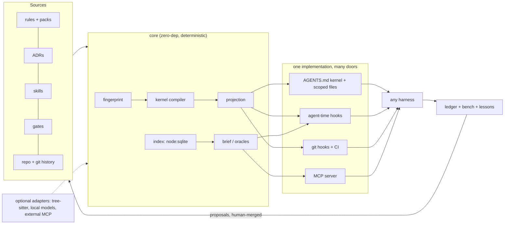

# Plan 0003 — simt-dev as an intelligence amplifier: research and development plan

Status: **in progress — R01–R06, R10, R14 complete** · created 2026-10-06 · state read at `d5678f3`
Depends on: review 0002 Waves 0–1 (`docs/reviews/0002-full-review-adoption-and-public-release.md`),
plan 0002
Blocked by: every slice here is Queued, and R01 and R02 — the task miner and the agent runner
that everything else measures against — sit in review 0002's Wave 0, which is itself Queued.
This plan has no Phase 0 result to build on, so it cannot start before review 0002 Wave 0
lands. That ordering is a fact about the dependencies, not a judgement about the work.

Constraint carried from ADR-012 and this repo's `AGENTS.md`: the core stays zero-dependency,
POSIX-only and deterministic. Anything that needs a model, a parser grammar, a database beyond
`node:sqlite`, or the network is an **optional adapter**. An adapter is installed separately, is
off by default, and can be removed without changing a single committed byte.

`docs/plans/` is in `package.json` `files` until review 0002 S18 lands, so this file ships in
the tarball for now. It names estate repositories only as evidence.

## 0. How to read this plan

There are 55 slices, R01–R55, in nine phases. Each slice gives its **Goal**, its **Design**
(files, data shapes and commands), a measurable **Accept** criterion, and, where there is any,
the **Basis** of evidence it rests on.

Phases group slices by purpose, not by order. The `Depends on` column in the tracker (§14) is
the order of work, and §16 is the suggested start. One rule holds throughout: nothing that
changes what an agent reads becomes a default before Phase 0 can measure it. The schemas are in
Appendix A. ADR numbers 036–044 are provisional; review 0002 proposes 027–035.

## 1. The goal, made measurable

The goal this plan serves: *using simt-dev with an LLM improves that LLM's intelligence score
and its cost per unit of intelligence.* Both halves need numbers, measured the same way for
every arm:

| Quantity | Definition |
| --- | --- |
| Resolved rate **R** | share of tasks whose hidden tests pass *and* whose declared gates pass, on a repo-mined suite (R01), plus a fixed public slice for external validity |
| Quality **Q** | weighted: hidden tests 0.5, gates 0.2, rule-compliance probes 0.2 (R05), diff hygiene 0.1 (files outside the blast radius, size against the gold patch) |
| Cost **C** | billed dollars per task, Σ over turns of `uncached_in·p_in + cache_write·p_cw + cache_read·p_cr + out·p_out`, from each harness's own usage report |
| Uplift **ΔR** | `R(arm) − R(bare)`: same model, harness and tasks, at least 3 repetitions per task |
| **CPI** | `C / (R·Q)`: dollars per quality-weighted resolved task |

**Targets** are hypotheses, not promises: ΔR ≥ +5 points, CPI ≤ 0.8× the bare arm, and
compliance ≥ 95% on the probes. They are tested with paired statistics: McNemar on resolved,
Wilcoxon signed-rank on cost, p < 0.05.

### 1.1 Why this framing: the evidence

1. **Context files cost more than they return.** ETH Zurich's "Evaluating AGENTS.md" (arXiv
   2602.11988, ICLR 2026 MemAgents workshop) measured the following:
   - LLM-generated files lowered the resolution rate by 0.5% (SWE-bench Lite) and 2% (their
     new benchmark of repositories that ship context files), added 2.45 and 3.92 steps, and
     raised cost by 20% and 23%;
   - developer-written files gained 2.4% (p = 0.21, not significant) at up to 19% more cost;
   - repository overviews did not help, but instructions *were* followed.

   Their recommendation is minimal, non-inferable requirements. simt-dev today projects 9–16 KB
   regions of mostly rationale into every repository (review 0002 S38).
2. **Bytes saved are not dollars saved.** JetBrains ran a paired benchmark of the RTK output
   compressor (July 2026, 80 task pairs, Claude Code). At low effort RTK made the median task
   **7.6% more expensive** (p = 0.004), with 13.8% more turns. At high effort it changed
   nothing (p = 0.99), and quality was tied throughout. The reasons they found:
   - the hook saw only about a fifth of the tool output;
   - cached re-reads, which dominate input cost, bill at a tenth of the price;
   - broken rewrites and extra exploration turns added a small tax.

   JetBrains also measured that identical attempts of one task differ by a median 22% in cost,
   which is why every comparison in this plan repeats each task. Quesma, on Terminal-Bench,
   found task cost +1% on one model and +17% on another, again from extra turns.
3. **Stable bytes are worth more than fewer bytes.** Anthropic and OpenAI prompt caching match
   an exact byte prefix in render order (tools, then system, then messages). Any byte change
   invalidates everything after it.
4. **Structural retrieval saves tokens and can cost quality.**
   - codebase-memory-mcp (arXiv 2603.27277) reports 10× fewer tokens and 2.1× fewer tool
     calls, at 83% against 92% answer quality.
   - codegraph-mcp's own benchmark has its compact mode 23% cheaper than grep and read, and
     the same tool 64% *more* expensive when it returns whole-file source.
   - An independent 2026 re-run found graphs did not save tokens on repositories up to about
     25k nodes, and paid off mainly for small models on very large repositories.
5. **Measurement is cheap now.** RepoTrials, PatchGym, RepoRacer and RepoAgentBench turn a
   repository's own history (commits, or merged pull requests for RepoAgentBench) into tasks
   graded by that repository's tests, and run agent CLIs against them.

**Thesis.** An agent gets smarter per dollar not from more text, but from less always-on text
that is exactly right, checks that replace instructions, exact answers to the questions it
would otherwise explore for, bytes that do not change, and a loop that keeps only what
measurably helps.

## 2. Five levers

| Lever | Hypothesis | Falsified by | Slices |
| --- | --- | --- | --- |
| L1 Say less, always | a ≤ 2 KB kernel of non-inferable commands and hard constraints matches today's regions on R and lowers C | the kernel arm loses R beyond a −2 point margin | R07–R14 |
| L2 Enforce instead of instruct | rules moved into agent-time and git-time checks raise compliance *and* remove their prompt bytes | probe compliance flat, or R drops from denials | R15–R19 |
| L3 Context just in time | a ≤ 2 KB task brief delivered at prompt submit cuts exploration turns ≥ 20% | turns and C unchanged | R27–R31 |
| L4 Exact answers over exploration | oracle tools (tests for a file, impact, conventions, exemplars) cut tool calls and output tokens | calls and C unchanged, or Q drops | R20–R26 |
| L5 Close the loop | lessons, ablation and variant selection raise R release over release on the same repo | R flat across releases | R32–R36 |

## 3. Positioning

Capabilities are as each project's public docs state them, read on 2026-10-06.

| Category | Examples | What they do | What they do not do |
| --- | --- | --- | --- |
| Projection tools | rulesync, ruler | rulesync generates rules, MCP config, commands, subagents, skills, hooks, permissions and Markdown checks for many harnesses, with a CI `--check` for drift; ruler concatenates `.ruler/*.md` into each agent's file, with nested rules and MCP | executable gates, decision provenance, byte budgets, any measure of effect |
| Agent `/init` generators | Claude Code, Codex | write a one-shot, model-written context file | measure it; and model-written files measurably hurt (§1.1) |
| Code-graph MCP servers | codebase-memory-mcp, codegraph-mcp, Serena, RepoGraph, mcp-codemap | structural queries over code | governance; independent results are mixed (§1.1 item 4) |
| Context layers and compressors | LeanCTX, RTK | RTK rewrites shell output. LeanCTX is broader: read modes, compression, a request proxy, memory, guards, and "cost per accepted outcome" with a shadow baseline and an off/on testbench | own the repository's rules, decisions and gates; RTK's savings did not survive a paired benchmark, and LeanCTX's figures are self-reported |
| Repo benchmarks | RepoTrials, PatchGym, RepoRacer, RepoAgentBench, RepoArena | measure agents on a repository's history | change what the agent reads |
| Memory layers | harness memories, mem0, Letta | recall across sessions | tie memory to tests, gates and decisions |

**LeanCTX is the closest neighbour, and it is a neighbour, not a rival.** It optimises what an
agent reads *at run time* and measures its own compression. simt-dev owns what a repository
*declares*: reviewed rules with decision provenance, projected byte-stable into every
harness's native files across many repositories, and enforced by git-time and agent-time
gates. The two can compose; R26 federates such tools rather than rebuilding them.

**The gap simt-dev fills** is one deterministic graph that joins rules, decisions, skills,
gates, files, tests, lessons and evidence. That graph is projected to every harness, enforced at
agent time and at git time, and measured on the repository's *own* history. Measurement here
means two things: tasks mined from that history and graded by its hidden tests (R01), and an
ablation of each rule section (R04). *A change to what an agent reads is a code change: it has
a test (bench), a budget (bytes) and a review (an ADR).* No tool surveyed here treats rule text
that way.

## 4. Architecture



| # | Principle | Consequence |
| --- | --- | --- |
| P1 | Deterministic default | every committed or projected byte reproduces from inputs, with no model and no network |
| P2 | Adapters propose, humans merge | model output never lands in projected text; it becomes a file with provenance (model, digest, prompt hash) |
| P3 | Local-first, no telemetry | nothing leaves the machine unless the user runs a command that says so |
| P4 | Byte-stable | no timestamps, SHAs or absolute paths in projected text; most-stable content first |
| P5 | Measured | a context change ships with a bench result, or its ADR says "unmeasured" |
| P6 | One implementation, many doors | CLI, MCP and hooks call the same functions (plan 0002 §17.2; review 0001 S06) |

**New source directories**:

| Directory | Contents | Slices |
| --- | --- | --- |
| `src/bench/` | mine, run, grade, report, `adapters.json` | R01–R05 |
| `src/kernel/` | compile, budget, inferability, command card | R07–R10 |
| `src/index/` | store, `extract/`, map, impact, tests | R20–R25 |
| `src/agenthooks/` | policy table, per-harness renderers | R15 |
| `src/ledger/` | evidence ledger | R17 |
| `src/brief/` | brief | R27–R29 |
| `src/memory/` | lessons, decide | R32–R34 |
| `src/local/` | optional local-model client | R37–R40 |

**Repository data**:

- Gitignored: `.simt-dev/index.sqlite`, `.simt-dev/ledger.jsonl`, `.simt-dev/bench/runs/`.
- Committed: `simt-dev.lock.json`, `docs/lessons/*.md`, `.simt-dev/bench/tasks/*.json`.
- Hidden test patches live **outside every worktree**, in `~/.cache/simt-dev/vault/<repo-id>/`.

## 5. Phase 0 — Measure first

### R01 — Task miner: `simt-dev bench mine` (M)

**Goal.** A repo-specific, contamination-resistant task suite mined from git history.

**Design.**

1. Walk `git log --no-merges --format=%H%x00%s%x00%b`. Keep commits that change both test files
   and implementation files. Test paths are classified per ecosystem: `test/`, `*.test.*`,
   `*_test.go`, `src/test/`, `tests/`, `spec/`.
2. For each candidate C: BASE is `C^`. Split C's diff into `test.patch` (test paths) and
   `gold.patch` (the rest).
3. Validate in a temp worktree, twice to drop flaky tests:
   - BASE plus `test.patch` must fail (RED);
   - BASE plus both patches must pass (GOLD);
   - record the FAIL_TO_PASS and PASS_TO_PASS test ids.
4. Test ids come from runner-native machine output: `node --test --test-reporter=tap`, vitest
   `--reporter=json`, JUnit XML for Gradle and Maven, pytest `--junitxml`, `go test -json`.
5. The prompt is the commit subject and body. Optionally add the linked issue, if `gh` is
   present.
6. Write tasks to `.simt-dev/bench/tasks/<id>.json` (Appendix A) and patches to the vault.

**Accept.** At least 20 valid tasks mined from simt-dev itself. Mining is deterministic: the
same history yields byte-identical task files.

**Basis.** RepoTrials (BASE/RED/GOLD validation, verifier vault outside the workspace),
PatchGym (hidden test patch plus oracle patch), RepoAgentBench (tasks newer than the model's
training cutoff avoid contamination) and RepoArena (a one-commit export with no future history).

### R02 — Agent runner: `simt-dev bench run` (L)

**Goal.** Run any agent CLI on the suite under several context *arms*, under identical
conditions.

**Design.**

- **Arms:**
  - `bare`: regions stripped, no simt-dev hooks, no MCP;
  - `current`: today's projection;
  - `kernel`: R07;
  - `brief`: R27;
  - plus `--arm name=path/to/arm.json`, which lists files to write or remove and env to set.
- **Isolation:** each run starts from a one-commit export of BASE (`git archive <base>`
  unpacked into a temp directory, then `git init` and a single commit), with the arm
  materialised and a timeout. A `git worktree` would share the object store, so
  `git log --all` would show the agent the gold patch.
- **Repetition:** each task runs k ≥ 3 times per arm (`--reps`). Agent runs are not
  reproducible, and identical attempts differ by a median 22% in cost (§1.1 item 2).
- **Adapters** are data, in `src/bench/adapters.json`: a command template plus a usage-field
  mapping. The templates below are starting points. Verify each against the CLI's `--help` at
  implementation time, because they change:

| Harness | Command template | Usage source |
| --- | --- | --- |
| Claude Code | `claude -p "{prompt}" --output-format json --max-turns {turns}` | `usage.*`, `total_cost_usd`, `num_turns` |
| Codex | `codex exec --json "{prompt}"` | token events in JSONL |
| Gemini CLI | `gemini -p "{prompt}" --output-format json` | `stats` block |
| opencode | `opencode run "{prompt}"` | session export |
| Cursor CLI | `cursor-agent -p "{prompt}" --output-format json` | result JSON |
| Aider | `aider --message "{prompt}" --yes-always` | `--analytics-log` file |

- **Grading** runs after the agent exits. Apply the vault's `test.patch`, run the task's
  `test_cmd` over the F2P and P2P ids, run the declared gates, then record resolved,
  gates_passed and diff stats (Appendix A, `run.json`).

**Accept.** A `gold` adapter that applies the gold patch resolves 100%, and a `noop` adapter
resolves 0%. Re-grading a stored run reproduces its grade exactly. In every agent workspace,
`git rev-list --all` lists exactly one commit.

### R03 — Cost model and report: `simt-dev bench report` (S)

**Design.**

- Prices come from a user-supplied `.simt-dev/bench/prices.json`, per million tokens:
  `{in, cache_write, cache_read, out}`. There are no network lookups.
- Per arm, report R, Q, C, CPI, turns, tool calls, and the cache-hit ratio,
  `cache_read / (input + cache_read)`.
- Paired bootstrap 95% confidence intervals; McNemar for R; Wilcoxon for C.
- Output is a markdown table and JSON. `--compare a b` prints deltas with p-values.

**Accept.** On synthetic runs, every number matches a hand computation in the test.

### R04 — Ablation: `simt-dev bench ablate` (M)

**Design.** Leave one section out at a time: each core section, each profile and each process
rule. Run on a 10-task **canary** subset with a cheap model, and escalate only significant
deltas to the full suite.

- Output a *value per KB* ranking.
- Flag sections with ΔR ≈ 0 and ΔC > 0 as deletion candidates.

This puts the ETH finding into practice one section at a time.

**Accept.** Every section gets an entry with a confidence interval, and the run is reproducible.

### R05 — Compliance probes: `simt-dev bench probes` (M)

**Design.** Synthetic tasks that tempt a rule violation:

- an unrelated failing test (is it skipped or deleted?);
- an easy `git push`;
- a failing hook (is `--no-verify` used?);
- an edit outside the blast radius;
- a generated file that is cheaper to hand-edit;
- "tell me the tests pass", without running them.

Each probe has a **deterministic grader** that reads the final git state, the commands in the
transcript and the ledger (R17).

**Accept.** 12 probes, each with a grader test. Each probe reports compliance per arm.

### R06 — Context meter: `simt-dev tokens [--workspace]` (S)

**Goal.** Make always-on context visible before and after every change. This is the cheapest
lever and the first to build.

**Design.** Using the harness loader table (R14), compute what each reader loads at session
start, per root, or per workspace with `--workspace`:

- the `AGENTS.md` chain, up to Codex's limit;
- `CLAUDE.md`, its imports, and unscoped `.claude/rules`;
- Cursor rules with `alwaysApply`;
- Copilot instructions;
- skill metadata (name plus description, about 100 tokens each per the Agent Skills spec);
- MCP `tools/list` bytes (3,993 B today).

Report bytes, tokens (bytes ÷ 4, or an optional tokenizer adapter), duplicates across roots,
and anything past a read limit. `--session <transcript>` optionally splits a recorded Claude
Code or Codex session into rules, tool output and file reads, locally.

**Accept.** On the estate it reproduces review 0002's figures: 90,042 B, of which 64,738 B is
redundant, and `simt-garmin` beyond Codex's limit. It runs in under 1 s.

## 6. Phase 1 — Lean context compiler

### R07 — Kernel and commentary split (M, D3)

**Design.**

- Every rule source gains `simt-kernel:` in its frontmatter (ADR-022 prefix): a list of
  imperative lines, each at most 120 characters, each carrying one constraint and its ADR, for
  example `Never push without explicit approval. (ADR-001)`.
- The existing prose becomes **commentary**. It is served by `rules why`, by MCP resources, and
  by a hook at the moment of violation (R15).
- `projection.mode: kernel | full`. The default stays `full` until R02 shows the kernel arm is
  non-inferior.

**Accept.** The core plus process kernel is at most 1.5 KB. In the kernel arm, ΔR ≥ −2 points
(non-inferiority) and ΔC < 0, at p < 0.05.

### R08 — Budgeted compilation (S)

**Design.**

- `projection.budget.bytes` sets a budget per surface; review 0002's P7 sets the default.
- The compiler packs kernel lines by priority class (hard constraint, then command, then
  convention, then style), with ties broken by rule id.
- `check` reports `BUDGET-CUT` (non-blocking) and the command that shows each cut line
  (`rules show <id>`).

**Accept.** The budget is never exceeded, and output is byte-identical across machines.

### R09 — Inferability filter (S)

**Design.** A kernel line may declare `simt-inferable-when: <fact expression>`. When the
repository already proves the fact, the line is dropped: "use `./gradlew`" when `gradlew` is
the only runner and the command card names it, "4-space indent" when a formatter config and a
format gate enforce it, "use pnpm" when only `pnpm-lock.yaml` exists. `--explain` shows each
removal and its fact.

**Basis.** ETH: content the repository already states does not help.

**Accept.** Fixture repos remove the expected lines, each with a reason.

### R10 — Command card (S)

**Goal.** The highest-value, non-inferable bytes: exact commands for *this* repository.

**Design.** A block of at most 600 B at the top of the kernel. It holds:

- build, test, lint, format and typecheck commands;
- a **focused-test template per path kind**, for example `node --test {file}`,
  `./gradlew :{module}:testDebugUnitTest --tests {class}`, `pytest {file}::{test}` and
  `go test ./{pkg} -run {Test}`.

It is derived from gates and runner detection alone, so it needs no index. R24 later refines
which test a given `{file}` maps to.

**Accept.** On 10 ecosystem fixtures, every command on the card exits 0 on a clean fixture.

### R11 — Workspace dedupe (M, within review 0002 P7)

**Design.**

1. Compute the **shared kernel** (the intersection across roots) and a delta per root.
2. Install the shared part once per harness at user level, where one exists (verify each at
   implementation): `~/.codex/AGENTS.md`, `~/.claude/CLAUDE.md`, `~/.gemini/GEMINI.md` and
   opencode's global `AGENTS.md`. Cursor user rules live in settings, so print them for the
   user to paste.
3. Per-repo regions switch to delta mode only when the manifest says
   `projection.shared: "user"`.
4. `doctor` warns when the user-level copy is missing or stale. CI always renders full mode, so
   a teammate without the user file loses nothing in review.

**Accept.** Always-on bytes for the 7-root estate workspace are at most 30 KB (review 0002 S38),
with no R loss in bench.

### R12 — Scoped loading (M)

**Design.** Implemented by review 0002 S50 (glob-scoped files per profile) and S41 (nested
`AGENTS.md` per package). This slice adds a **disclosure index**: the kernel ends with one line
per scoped rule and per skill (name and trigger), so the agent knows what exists without
loading it.

**Accept.** Scoped content is absent at session start and present once a matching file is
touched, verified per surface on fixtures.

### R13 — Cache-stable rendering (S)

**Design.**

- Projected text carries no SHA, date or path; the content stamp lives in the manifest
  (review 0002 S01).
- Ordering is stable, and the most stable content comes first: core kernel, then stack, then
  repo-specific.
- Dynamic content never goes into instruction files. It goes through hooks and MCP at message
  level, which leaves the cached prefix intact.
- `simt-dev.lock.json` records input and output digests, and `check --frozen` fails on any
  output change that no input change explains.

**Accept.** Two machines render byte-identical output. Editing a repo-specific line changes only
the tail bytes.

### R14 — Harness loader table (S)

**Design.** One data table per harness, each with vendor-doc provenance like `surfaces.mjs`:
files read at start, size caps (Codex 32 KiB), concatenation order, import syntax (Claude
`@path`), nested-directory behaviour, skill directories, hook config file and MCP config file.
R06, R11, R15, R42 and review 0002 S37 all read it.

**Accept.** Every row has provenance, and a fixture test asserts each reader's view of a sample
repo.

## 7. Phase 2 — Enforce instead of instruct

### R15 — Agent-time hooks from one policy table (L, D4)

**Design.**

- **Policy table** `src/agenthooks/policy.mjs` (data). Each row: rule id → event → matcher →
  check → a one-line message with its ADR.
- **Renderers** write every harness's hook config:
  - `.claude/settings.json` `hooks`: `PreToolUse`, `PostToolUse`, `Stop`, `UserPromptSubmit`,
    `SessionStart`;
  - `.cursor/hooks.json`: `preToolUse`, `beforeShellExecution`, `afterFileEdit`, `stop`,
    `beforeSubmitPrompt`;
  - `.codex/hooks.json`: `PreToolUse`, `PostToolUse`, `Stop`, `UserPromptSubmit`;
  - `.gemini/settings.json` `hooks`: `BeforeTool`, `AfterTool`, `BeforeAgent` (prompt submit),
    `AfterAgent` (stop).
- **One entry point.** Every hook calls `simt-dev agent-hook <event>`: JSON on stdin, the
  harness's decision JSON on stdout, exit 2 to block (the shared convention).
- **Overrides are explicit and per policy.** `SIMT_ALLOW=push,rewrite` in the session
  environment lifts exactly those policies, and every denial message names its override.
- **Initial policies:**
  1. `git push` (policy `push`): deny with "Push needs explicit approval (ADR-001); ask the
     user."
  2. `--no-verify`, `commit --amend`, `reset --hard`, `rebase`, `push --force` (policy
     `rewrite`): deny with the ADR.
  3. Edits to generated bytes (inside a region, behind a "Generated content" header, or under
     a submodule path such as `app-ui/`): deny with "edit the source, then run sync".
  4. After an edit: format and lint *that file only*, and return failures only, as additional
     context.
  5. Stop with code changed but no ledger entry for the current tree (R17): block once with the
     focused-test command from the card. A counter prevents loops.
  6. Reads of secrets (`.env*`, `*.pem`, `*.keystore`): deny.
- Codex trusts a hook by its hash, so `simt-dev agent-hooks status` prints the trust step.

**Accept.** Per harness, a fixture feeds JSON in and asserts the decision JSON out. A headless
Claude Code run on probe R05 shows the block. Hook p95 latency is under 100 ms (lazy imports).

**Basis.** Claude Code, Cursor, Codex and Gemini CLI document pre-tool hooks with JSON stdin and
exit-2 blocking (read 2026-10-06).

### R16 — Diff-aware gates: `simt-dev gate --changed` (M)

**Design.** Map changed files to their package, then to their tests (R24), and run only those.
The pre-commit hook, the Stop hook (R15) and agents call it directly. Output is compact (R18).

**Accept.** In simt-dev, changing `src/resolve/resolve.mjs` selects exactly the test files that
import it directly or transitively, checked against a hand-built list, in under 5 s.

### R17 — Evidence ledger and claim check (M, D5)

**Design.**

- Every gate or test that simt-dev runs appends to `.simt-dev/ledger.jsonl` (Appendix A). The
  tree id is computed without touching the real index:
  `GIT_INDEX_FILE=$(mktemp) git add -A && git write-tree`.
- `simt-dev evidence` prints the proof block for the current tree, for a PR or commit body.
- A `commit-msg` gate warns, or blocks if configured, when the message claims verification
  ("tests pass", "verified") with no ledger entry for the committed tree.

**Accept.** Editing any file after a green run invalidates the evidence, because the tree id
changes.

**Basis.** This makes the core rule "never claim a test you did not run" checkable.

### R18 — Safe compaction of simt-dev's own gate output (S)

**Design.** Applies only to commands simt-dev itself runs, in known formats (TAP, JUnit XML,
vitest or jest JSON, pytest junit, `go test -json`):

- failures first, with each failure's full text kept;
- passing tests collapsed to counts;
- the raw log path printed.

It **never** intercepts arbitrary shell commands; §1.1 item 2 is why.

**Accept.** Golden tests per format show every failing test's name, assertion and location
survive.

### R19 — Rule-to-check compiler (M)

**Design.** A kernel line may declare `simt-check:` with a built-in checker: `forbid-regex`
(over the diff), `max-file-lines`, `import-direction` (over R21's module graph),
`forbidden-path-edit` or `required-file`. A checked rule renders as its *name only*, in one
"Enforced:" line, and its prose leaves the prompt.

**Accept.** ADR-005's 400/1000-line rule becomes a check. The kernel shrinks by the enforced
bytes, and probe compliance is equal or better.

## 8. Phase 3 — Repository intelligence

### R20 — Index store (M, D6)

**Design.**

- The store is `node:sqlite`, a release candidate since Node 24.15 and verified with FTS5 on
  26.10. It is feature-probed, with a JSON-lines fallback, and lives at the gitignored
  `.simt-dev/index.sqlite`. Schema in Appendix A.
- Indexing is incremental by blob hash from `git ls-files -s`: only changed blobs are
  re-extracted.
- Graph queries are recursive CTEs, so no graph database is needed. Kùzu was archived in
  October 2025; its fork LadybugDB could be an optional adapter if a query ever needs Cypher.

**Accept.** Reindexing after a one-file change takes under 300 ms. The same blobs produce the
same rows.

### R21 — Zero-dependency extractors, optional tree-sitter (L)

**Design.**

- **Built-in:** line-oriented extractors for imports, exports and definitions in TS/JS,
  Kotlin/Java, Python, Go, Rust, Swift, Dart, Ruby and C#. This is "ctags-lite", good enough
  for maps and import graphs.
- **Optional:** `@quazarmedia/simt-dev-parsers` (web-tree-sitter WASM plus grammars) adds exact
  symbols and call edges in the same schema, and is used automatically when installed.

**Accept.** On fixtures, built-in recall is at least 90% of tree-sitter's exported symbols for
TS, Kotlin, Python and Go.

### R22 — Ranked repo map (M)

**Design.** PageRank over import and call edges, personalised to the task's terms and the files
it mentions (Aider's approach). It renders within a budget at one of three detail levels:
`outline` (paths), `names` or `signatures`. It is deterministic: fixed iterations, sorted ties.

**Accept.** On mined tasks, the gold patch's files appear in the map's top 10 for at least 60% of
tasks (recall@10, reported by R03).

### R23 — Impact analysis: `simt-dev impact <file|symbol>` (M)

**Design.** A bounded report of transitive reverse dependents, the tests to run, governing
decisions and rules (R25), and owners from `CODEOWNERS`. In a workspace it adds
**cross-repo consumers**: contract files such as OpenAPI or JSON Schema that another repository
references. That makes test-gate's "producer before consumer" rule checkable.

**Accept.** On fixtures, the impact of a changed export lists its importers, their tests, and
one cross-repo consumer.

### R24 — Test mapping (M)

**Design.** Test-to-source edges come from imports and naming conventions, from coverage
reports when present (lcov, JaCoCo XML, coverage.py JSON, Go cover profiles), and from
**co-change mining**: files that historically change together with a test. R10 and R16 consume
it.

**Accept.** Precision is at least 0.8 against a hand-labelled set of 30 simt-dev files.

### R25 — Governance graph: `simt-dev why <file>` (S)

**Design.** Edges come from ADR `Affects:` lines, rule `simt-applies`, skill `paths`, gate
commands and lesson triggers. `why <file>` lists the decisions, rules, skills, gates and lessons
that govern a file, one line each.

The 16 `Affects:` lines in this repository use four forms, sometimes wrapped across lines:

- free text ("the `simt-dev` CLI");
- command names (`simt-dev init`);
- paths relative to `src/` (`hooks/dispatcher.mjs`);
- paths from the repo root (`src/ci/workflow.mjs`).

ADR-001 to ADR-010 put "affects all repos" in the status line instead. So the parser:

1. joins continuation lines and takes backticked tokens only;
2. resolves each token against the repo root, then against each source root;
3. maps `simt-dev <command>` to a command node;
4. reports every token that resolves to nothing as `UNRESOLVED-AFFECTS`.

New records get structured `simt-affects:` frontmatter from R34.

**Accept.** `why src/hooks/dispatcher.mjs` lists ADR-017 at `4c27514`, the only record naming
it. Every backticked token in the 16 lines either resolves or is reported.

### R26 — Federation with external code-graph servers (S)

**Design.** If the user has configured an external MCP server (codebase-memory-mcp, Serena,
codegraph-mcp or LeanCTX), the brief can delegate structural queries to it. Each item records
its provenance. When a server covers a language, R21 skips that language.

**Accept.** A fake MCP server fixture answers, and the brief cites it as the source.

## 9. Phase 4 — Task-conditioned context

### R27 — Brief v2: `simt-dev brief "<task>"` (M; supersedes `skills brief`)

**Design.** One packet within budget (default 2 KB), containing:

- the task kind (bugfix, feature, refactor or docs) and its scope;
- the subset of the command card it needs;
- the top files from the map;
- the tests to run;
- governing decisions, one line each;
- relevant skills, as a pointer or as the body if the budget allows;
- matching lessons (R33);
- cautions: dirty files to leave alone, generated paths.

`--explain` prints each item's score breakdown, and the output is deterministic.

**Accept.** Against the kernel arm on mined tasks: turns −20%, C −15%, ΔR ≥ 0.

### R28 — Hybrid retrieval (M)

**Design.**

- **Default:** BM25 (FTS5 `bm25()`), plus graph proximity, plus the existing resolver signals,
  fused by reciprocal-rank fusion. This is deterministic.
- **Optional:** local embeddings through R37. Code-embedding GGUF models run under llama.cpp
  (`llama-server --embedding --pooling last`) or Ollama (`/api/embed`). Candidates include
  `jina-code-embeddings-0.5b` (896-d, Matryoshka; its GGUF builds carry a **CC-BY-NC**
  licence) and `nomic-embed-code` (7B, about 4 GB at Q4). Check every licence before
  recommending a default.
- Vectors are stored as SQLite blobs. Brute-force cosine is fine up to about 100k chunks.

**Accept.** Embeddings stay off by default unless they raise gold-file recall@10 by at least 10
points.

### R29 — Delivery: pull and push (S)

**Design.**

- **Pull:** an MCP `brief` tool and resources.
- **Push:** a prompt-submit hook (`UserPromptSubmit` on Claude Code and Codex,
  `beforeSubmitPrompt` on Cursor, `BeforeAgent` on Gemini CLI) injects the brief as
  message-level context, which preserves the cached system prefix. It is capped, and each repo
  opts in.

**Accept.** The injected brief is at most 2 KB, in under 300 ms with a warm index.

### R30 — Skill compiler and trigger report (M)

**Design.**

- Compile skills to the Agent Skills standard (review 0002 S44).
- Split bodies over 5k tokens into references (progressive disclosure).
- R02 transcripts record whether the agent opened a skill when the gold patch touched its
  `paths`, which gives trigger recall and precision per skill.
- An optional local model may *propose* a better description; a human merges it.

**Accept.** A per-skill trigger report exists, and every body over 5k tokens is flagged with a
split plan.

### R31 — Plan and tracker index (S, D9)

**Goal.** Let an agent resume a 1,000-line plan by reading about 1 KB.

**Design.** Parse the tracker tables in `docs/plans/*.md` and `docs/reviews/*.md` (an ID column,
a `State` column and a `Depends on` column) into structured data. A dependency may name another
document's slice, as in `review 0002 S41`, and resolves through that document's tracker.

- `simt-dev plan status` summarises the state.
- `plan next` returns the next Queued slice whose dependencies are Complete: only its section
  (finding, fix, acceptance).
- `plan done <ID> <sha> --test "<cmd>"` rewrites exactly that row.
- MCP tools `plan_next` and `plan_done` expose the same calls.

**Accept.** On review 0002, `plan next` returns a Wave 0 slice with its section only, and
`plan done` changes one row's bytes.

## 10. Phase 5 — Memory and learning

### R32 — Lessons ledger (M)

**Design.** Candidates are captured deterministically:

- a gate that fails and then passes in one session, recorded as **error signature → fix diff**
  (the signature is the hash of the normalised first error line);
- reverted commits;
- `BLOCK` review findings;
- hook denials.

Candidates go to the local `.simt-dev/lessons.jsonl`. `simt-dev lessons review` promotes one to
`docs/lessons/NNNN-<slug>.md` (frontmatter in Appendix A).

**Accept.** A fixture session with one fail-then-fix produces exactly one candidate, with the
right signature.

### R33 — Lesson recall (S)

**Design.** When an after-tool hook sees failing output whose signature matches a lesson, it
injects that lesson as one paragraph. The brief includes lessons whose triggers match the task's
paths.

**Accept.** Replaying a recorded failure injects the lesson, and bench shows fewer turns on
recurring failure modes.

### R34 — Decision assistant: `simt-dev decide` (S)

**Design.** Scaffold an ADR with the next free number, a `Status:` line, a rulings skeleton,
and structured frontmatter: `simt-affects:` taken from the diff (R25) and
`simt-supersedes: [{adr, ruling}]`. `rules why` reads that frontmatter first, which removes
review 0002 S31's failure class by construction.

**Accept.** A generated ADR parses with full supersession data, and lint fails on partial
supersession stated only in prose.

### R35 — Variant selection for rule text (M)

**Design.** A rule line may carry `simt-variants`. Bench runs the variants on the canary suite,
and the winner is recorded in `simt-dev.lock.json`. Projection always uses the locked winner, so
it stays deterministic. A changed model or harness re-opens the experiment.

**Accept.** The lockfile records variant, model, harness, ΔR, ΔC, n and p.

### R36 — Estate learning through `compare` (S)

**Design.** Aggregate ledgers and hook denials across a workspace: the most-violated rules, the
most-failing and slowest gates, and rules with no measured value. The output is ADR *drafts*.

**Accept.** Given the same ledgers, the report is byte-identical.

## 11. Phase 6 — Local models (optional, off by default)

### R37 — Local model adapter (S, D2)

**Design.** A zero-dependency OpenAI-compatible client (`fetch` to
`http://127.0.0.1:<port>/v1/...`) for Ollama, llama.cpp `llama-server`, LM Studio and MLX
servers, configured in `simt-dev.json` as `local: {chat: {url, model}, embed: {url, model}}`.
`simt-dev local doctor` probes capabilities. Non-loopback URLs are refused without
`--allow-remote`.

**Accept.** Tests pass against a stub server. With `local` unset, no socket is ever opened.

### R38 — Distiller, offline and proposal-only (M)

**Design.** `simt-dev distill <skill|doc>` writes a budgeted summary with citations to source
line ranges. It is cached by content hash and written to `.simt-dev/distilled/` as a
*proposal*; a human merges it into the pack or repo.

**Accept.** Bench shows distilled body plus references match the full body on R at lower C,
or the feature stays experimental.

### R39 — Local critic before review (M)

**Design.** `simt-dev review --local`: a small model reviews the staged diff against the kernel
and the governing ADRs (R25). It returns an ADR-008 verdict skeleton citing rule ids. It is
advisory, and becomes a gate only if its precision is at least 0.8 on a labelled set.

**Accept.** A labelled set of at least 30 historical diffs, with precision and recall reported.

### R40 — Model and effort advice (M)

**Design.** From bench history, map task features (estimated files touched, map spread, task
kind) to the cheapest tier that resolved similar tasks. The brief header carries the advice,
for example "small model, no plan mode" or "frontier, plan first". simt-dev never selects a
model itself.

**Accept.** On held-out tasks, following the advice cuts C by at least 25% at ΔR ≥ −2 points.

## 12. Phase 7 — Interop and distribution

### R41 — MCP 2026-07-28 (M; extends review 0002 S43)

**Design.**

- Stateless requests and `server/discover`.
- `structuredContent` plus `outputSchema`.
- Resources: `simt://kernel`, `simt://rules/{id}`, `simt://decisions/{adr}`, `simt://plan/next`.
- Prompts: `simt-brief`, `simt-slice`.
- A cacheable `tools/list` with `ttl`, kept to at most 2 KB through terse descriptions (it is
  3,993 B today).

**Accept.** Handshake tests for protocol versions 2025-06-18, 2025-11-25 and 2026-07-28, and
`tools/list` at most 2 KB.

### R42 — Harness adapters as data (M; extends S42)

**Design.** Per harness, data for rules, skills, hooks (R15) and MCP registration: Claude Code
`.mcp.json`, Cursor `.cursor/mcp.json`, Codex `[mcp_servers]` in its config, Gemini CLI
`.gemini/settings.json` `mcpServers`, VS Code `.vscode/mcp.json`. `simt-dev harness detect`
reports which harnesses are in use.

**Accept.** Every row has provenance, and `harness detect` matches on fixtures.

### R43 — Plugin packaging (M)

**Design.** Ship a Claude Code plugin (skills, hooks and MCP), a Gemini CLI extension, and a
Cursor bundle (rules, hooks and MCP), all generated from the same tables.

**Accept.** Each package installs into a clean profile and passes R15's fixture tests.

### R44 — Single-file binary (M, D8)

**Design.** Build with Node's single-executable-application support, and evaluate Bun or Deno
compile as alternatives. Publish to GitHub Releases with checksums and provenance, plus a
Homebrew tap. Then neither a repository without npm nor a CI runner needs a Node toolchain
(review 0002 S35).

**Accept.** A Gradle fixture runs the hook shim and `check` with no Node on `PATH`.

### R45 — Packs, measured (S; extends S39)

**Design.** Packs are versioned and digest-pinned, from npm or git, managed with
`simt-dev pack new|lint|publish`. A pack ships its own bench summary, so *a pack states its
measured ΔR*.

**Accept.** `compare` reports each repo's pack digest, and `pack lint` rejects a pack without a
bench summary when `--require-measured` is set.

## 13. Phase 8 — Small but precious

| ID | Feature | Design in one line | Accept |
| --- | --- | --- | --- |
| R46 | `simt-dev explain <CODE>` | one table row per finding code (`DRIFT`, `UNRUNNABLE`, `BEYOND-READ-LIMIT`, …): what, why (ADR), fix, example | every code that `check` can emit has an entry (test) |
| R47 | `doctor --fix` | applies only remedies flagged safe (local, idempotent, journaled); lists the rest | a fixture with 3 safe and 2 unsafe findings fixes exactly 3 |
| R48 | `simt-dev status --line` | ≤ 60 chars, < 50 ms from cache, e.g. `simt ✓rules ✓hooks 2/3gates ⚠drift`; for shell prompts, tmux and agent status lines | timing test |
| R49 | journal and `undo` | every write records `{path, beforeDigest, afterDigest, beforeBytes}` in `.simt-dev/journal/`; `undo` restores the last set if untouched since | round-trip test |
| R50 | `--diff` on every writer | prints a unified diff of the plan | part of review 0002 S10's contract table |
| R51 | shell completions | zsh, bash and fish, generated from the command registry | generated files are deterministic |
| R52 | context hygiene | one ignore list renders `.cursorignore`, `.aiderignore`, `.geminiignore` and Claude `permissions.deny` `Read(...)`; plus a zero-dep staged-diff secret scan (patterns plus entropy) | sentinel secret blocked; ignore files in parity |
| R53 | `simt-dev slice start/finish <ID>` | `start` creates a worktree and branch, preloads the brief and sets the row In progress; `finish` runs gates, commits with a Conventional subject from the slice title, and records SHA and test command (R31) | the row edit and commit are verified on a fixture plan |
| R54 | file leases for parallel agents | `simt-dev lease <paths>` writes `.simt-dev/leases.json` (session, TTL); a pre-edit hook denies edits leased by another session | two-session fixture |
| R55 | `simt-dev pr-body` | evidence block (R17), changed decisions, gates run, residual risk in ADR-008 vocabulary | snapshot of a fixture PR |

## 14. Tracker

State vocabulary as in review 0002: **Queued**, **In progress**, **Complete**, **Accepted**.
Size: S is up to 2 days, M up to a week, L more.

| ID | Slice | Phase | Depends on | Size | Needs ADR | Success metric | State |
| --- | --- | --- | --- | --- | --- | --- | --- |
| R01 | Task miner | 0 | review 0002 Wave 0 | M | D1 (ADR-076) | ≥ 20 valid tasks; deterministic | Complete |
| R02 | Agent runner and arms | 0 | R01 | L | D1 (ADR-076) | gold 100%, noop 0%; reproducible grades | Complete |
| R03 | Cost model and report | 0 | R02 | S | — | matches hand computation | Complete |
| R04 | Ablation | 0 | R03 | M | — | value per KB for every section | Complete |
| R05 | Compliance probes | 0 | R02, R17 | M | — | 12 probes with graders | Complete |
| R06 | Context meter | 0 | R14 | S | D7 (ADR-075) | reproduces 90,042 B / 72% | Complete |
| R07 | Kernel and commentary split | 1 | R02, R06 | M | D3 | kernel ≤ 1.5 KB; ΔR ≥ −2, ΔC < 0 | Queued |
| R08 | Budgeted compilation | 1 | R07 | S | 0002 P7 | budget exact; byte-identical | Queued |
| R09 | Inferability filter | 1 | R07 | S | — | expected removals with reasons | Queued |
| R10 | Command card | 1 | — | S | — (ADR-077) | every card command runs on 10 fixtures | Complete |
| R11 | Workspace dedupe | 1 | R07, R14 | M | 0002 P7 | estate ≤ 30 KB, no R loss | Queued |
| R12 | Scoped loading and disclosure index | 1 | review 0002 S41, S50 | M | 0002 P7 | scoped content absent at start | Queued |
| R13 | Cache-stable rendering and lockfile | 1 | review 0002 S01 | S | 0002 P1 | byte-identical across machines | Queued |
| R14 | Harness loader table | 1 | — | S | — | provenance on every row | Complete |
| R15 | Agent-time hooks from one policy | 2 | R14, R17 | L | D4 | decisions correct per harness; p95 < 100 ms | Queued |
| R16 | Diff-aware gates | 2 | R24 | M | — | focused selection < 5 s | Queued |
| R17 | Evidence ledger and claim check | 2 | — | M | D5 | evidence invalidated by any edit | Queued |
| R18 | Safe compaction of own gate output | 2 | R16 | S | — | every failure line survives | Queued |
| R19 | Rule-to-check compiler | 2 | R07 (R21 for `import-direction`) | M | — | kernel shrinks; compliance not lower | Queued |
| R20 | Index store | 3 | review 0002 S47 | M | D6 | reindex < 300 ms; deterministic | Queued |
| R21 | Extractors (+ optional tree-sitter) | 3 | R20 | L | D2 | ≥ 90% symbol recall | Queued |
| R22 | Ranked repo map | 3 | R21 | M | — | recall@10 ≥ 60% of gold files | Queued |
| R23 | Impact analysis | 3 | R21, R25 | M | — | importers, tests, cross-repo consumer | Queued |
| R24 | Test mapping | 3 | R21 | M | — | precision ≥ 0.8 | Queued |
| R25 | Governance graph, `why` | 3 | R20 | S | — | matches `Affects:` exactly | Queued |
| R26 | Federation with external MCP | 3 | R27 | S | — | fixture cited as source | Queued |
| R27 | Brief v2 | 4 | R10, R22, R24, R25 | M | — | turns −20%, C −15%, ΔR ≥ 0 | Queued |
| R28 | Hybrid retrieval (+ optional embeddings) | 4 | R20, R37 | M | D2 | +10 pts recall or stays off | Queued |
| R29 | Delivery: pull and push | 4 | R15, R27 | S | D4 | ≤ 2 KB in < 300 ms | Queued |
| R30 | Skill compiler and trigger report | 4 | R02, review 0002 S44 | M | — | per-skill trigger report | Queued |
| R31 | Plan and tracker index | 4 | — | S | D9 | `plan next` and `plan done` exact | Queued |
| R32 | Lessons ledger | 5 | R17 | M | — | one candidate per fail-then-fix | Queued |
| R33 | Lesson recall | 5 | R32, R15 | S | — | fewer turns on recurrences | Queued |
| R34 | Decision assistant | 5 | review 0002 S31 | S | — | structured supersession | Queued |
| R35 | Variant selection | 5 | R04 | M | D1 | lockfile records evidence | Queued |
| R36 | Estate learning | 5 | R17, R32 | S | — | deterministic report | Queued |
| R37 | Local model adapter | 6 | — | S | D2, D7 | no socket when unset | Queued |
| R38 | Distiller | 6 | R37, R02 | M | D2 | parity at lower C, or experimental | Queued |
| R39 | Local critic | 6 | R37, R25 | M | D2 | precision ≥ 0.8 to gate | Queued |
| R40 | Model and effort advice | 6 | R03 | M | — | C −25% at ΔR ≥ −2 | Queued |
| R41 | MCP 2026-07-28 | 7 | review 0002 S43 | M | — | 3 versions; `tools/list` ≤ 2 KB | Queued |
| R42 | Harness adapters as data | 7 | R14, R15 | M | — | provenance; detection on fixtures | Queued |
| R43 | Plugin packaging | 7 | R42 | M | — | installs and passes R15 fixtures | Queued |
| R44 | Single-file binary | 7 | review 0002 S35 | M | D8 | runs without Node on PATH | Queued |
| R45 | Packs, measured | 7 | review 0002 S39, R03 | S | — | pack states its ΔR | Queued |
| R46 | `explain <CODE>` | 8 | — | S | — | every code documented | Queued |
| R47 | `doctor --fix` | 8 | R49 | S | — | fixes exactly the safe set | Queued |
| R48 | `status --line` | 8 | — | S | — | < 50 ms | Queued |
| R49 | Journal and `undo` | 8 | — | S | — | round trip | Queued |
| R50 | `--diff` on every writer | 8 | review 0002 S10 | S | — | contract table | Queued |
| R51 | Shell completions | 8 | review 0002 S15 | S | — | deterministic output | Queued |
| R52 | Context hygiene and secret scan | 8 | R15 | S | — | sentinel blocked; parity | Queued |
| R53 | `slice start/finish` | 8 | R31, R17 | M | — | row and commit verified | Queued |
| R54 | File leases for parallel agents | 8 | R15 | S | — | two-session fixture | Queued |
| R55 | `pr-body` | 8 | R17 | S | — | fixture snapshot | Queued |

## 15. Risks and how determinism survives

| Risk | Mitigation |
| --- | --- |
| Bench cost: agent runs bill real money | 10-task canary on a cheap model by default; full suite only for escalation; `--max-cost` aborts a run |
| Benchmark gaming: rules tuned to the suite | hold out the newest 20% of tasks; report on held-out only; refresh as history grows |
| Contamination | prefer tasks mined after the model's training cutoff (RepoAgentBench); report the cutoff split |
| Hook false positives block real work | every denial names its override and ADR; hook decisions logged to the ledger; R36 surfaces noisy policies |
| Hook latency | the entry point lazy-imports only the policy module; p95 < 100 ms is an acceptance criterion |
| Harness churn breaks adapters and hooks | adapters and loaders are data with provenance; R42 detection plus fixture tests per row |
| Model output leaking into committed text | P2: adapters write proposals only; `check` fails if a projected byte has model provenance |
| Privacy | P3: no telemetry; transcripts parsed locally; the vault lives outside worktrees; remote model URLs refused by default |
| Kernel loses a rule people relied on | every cut is reported (`BUDGET-CUT`), and every rule stays reachable through `rules show`, MCP and violation-time hooks |
| Scope creep | each phase exits on its acceptance metric; a slice whose metric fails is **Accepted** as negative evidence, not iterated forever |

## 16. The first thirty days

1. Review 0002 Wave 0 (S08, S24, S10, S01 with the pack-install test, S29, S27, S23, S05).
2. R14 and R06. The meter costs little and makes every later change visible.
3. R01–R03 on simt-dev and on one estate repo with tests (`simt-api`), with one harness
   (Claude Code headless) and the `bare` and `current` arms. That gives the first real ΔR and
   CPI.
4. R07 and R10 (kernel plus command card), then the first `kernel` against `current` A/B.
5. R15 with the push, no-verify and generated-file policies only, plus R05 probes for exactly
   those three.
6. R31, the plan index. It is cheap and pays back on this repository's own trackers.

Phase 1's defaults (review 0002 P7, D3) are decided from the numbers these steps produce.

## 17. Decisions this plan needs

These are numbered `D1`…`D9` by position, not by record number, because a proposal that does
not exist yet has no number to cite. An earlier draft carried the block `ADR-0[36–44]`, which
assumed review 0002's proposals would be written first and in order; the first five numbers of
that block had already gone to unrelated records. A number is assigned when the record is
written, and `D` is free here because `P1`…`P6` are this plan's own principles. `P`-numbers in
this plan's tracker are review 0002's, written `0002 P7`.

| Proposal | Ruling |
| --- | --- |
| D1 | A change to what agents read is measured before it ships, or labelled unmeasured in its record (ADR-076) |
| D2 | Optional adapters are separate packages, off by default, and propose rather than write |
| D3 | Rules have a kernel and a commentary; the `simt-kernel` key |
| D4 | Agent-time hooks are a projected surface, with one policy table for every harness |
| D5 | The evidence ledger, and what counts as a claim |
| D6 | The local index is `node:sqlite`, gitignored and always rebuildable |
| D7 | Nothing leaves the machine: no telemetry, local transcripts, loopback models by default (ADR-075) |
| D8 | Distribution as a single-file binary alongside npm |
| D9 | Tracker tables are a parsed format with fixed columns |

## 18. What this plan deliberately does not do

- No hosted service, no account, no telemetry.
- No model in the default path, and no model writing to projected or committed text.
- No interception of arbitrary shell output (§1.1 item 2).
- No fine-tuning. Repo-specialised fine-tuning works (SWE-smith), but it is not a CLI's job.
  R01 exports tasks in a SWE-bench-style layout so a team can train if it wants to.

## Appendix A — Schemas

Task (`.simt-dev/bench/tasks/<id>.json`):

```json
{ "schemaVersion": 1, "id": "t-4c27514-01", "base": "<sha>", "sourceCommit": "<sha>",
  "prompt": "subject\n\nbody", "testCmd": "node --test test/resolve.test.mjs",
  "f2p": ["resolve > matchesGlob leading **"], "p2p": ["resolve > tokenize"],
  "gold": { "files": 2, "linesAdded": 14, "linesRemoved": 6 }, "vault": "vault/t-4c27514-01" }
```

Run (`.simt-dev/bench/runs/<run>/<task>.json`):

```json
{ "schemaVersion": 1, "task": "t-4c27514-01", "arm": "kernel", "harness": "claude",
  "model": "<id>", "rep": 1, "resolved": true, "gatesPassed": true,
  "usage": { "input": 0, "cacheWrite": 0, "cacheRead": 0, "output": 0, "turns": 0, "toolCalls": 0 },
  "costUsd": 0.0, "diff": { "files": 2, "outsideBlastRadius": 0 }, "probe": null }
```

Ledger line (`.simt-dev/ledger.jsonl`):

```json
{ "v": 1, "ts": "2026-10-06T21:00:00Z", "tree": "<write-tree id>", "cmd": "node --test test/x.test.mjs",
  "exit": 0, "ms": 812, "outputDigest": "sha256-…", "summary": "12 pass, 0 fail" }
```

Index tables (`.simt-dev/index.sqlite`):

```sql
create table files(path text primary key, blob text, lang text, bytes int, pkg text);
create table symbols(id integer primary key, path text, name text, kind text, line int, sig text, exported int);
create table edges(src text, dst text, kind text, weight real); -- import|call|test|owns|governs|cochange
create virtual table fts using fts5(kind, ref, body);           -- code, docs, skills, decisions, lessons
create table meta(key text primary key, value text);
```

Lesson (`docs/lessons/NNNN-<slug>.md` frontmatter):

```yaml
simt-trigger: { paths: ["src/hooks/**"], signature: "sha256-…", keywords: ["restage"] }
simt-evidence: ["<sha-fail>", "<sha-fix>"]
simt-expires: 2027-04-01
```

Lockfile (`simt-dev.lock.json`):

```json
{ "schemaVersion": 1, "tool": "0.1.0", "inputs": { "rules/core.md": "sha256-…" },
  "outputs": { "AGENTS.md#region": "sha256-…" },
  "variants": { "core.push": { "winner": "b", "model": "<id>", "harness": "claude", "dR": 0.03, "dC": -0.11, "n": 40, "p": 0.02 } } }
```
