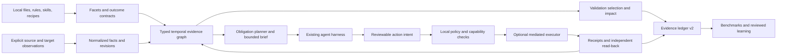

# Plan 0004 — simt-dev for knowledge repositories and remote agent work

Status: **proposed — investigation complete; W01–W52 queued** · created 2026-10-20 · baseline `9f426de`
Depends on: [plan 0003](0003-intelligence-amplifier-research-plan.md), completed with acceptance evidence; review 0002 and plan 0002 remain inherited prerequisites.
Owner: **simt-dev**. The two example repositories inspected in §1.1 are read-only investigation examples and eventual opt-in pilots, not dependencies of this package's tests.
Smallest independently valuable implementation slice: **W01**, an honest predecessor and compatibility report; then **W02**, a non-code outcome corpus. Authoring this plan does not complete either slice.

**Answer to the investigation.** After all of Plan 3, simt-dev can support these repositories as a governance, skills, retrieval, context and local-check layer. It cannot yet establish that generated knowledge is authoritative and current, or that a remote change actually happened, remained correct, and did not damage neighbouring state. This plan extends the unit of work from a source patch to an **artifact plus a verifiable state transition**, while preserving the existing source-code path.

Constraint carried from this repository's `AGENTS.md`, ADR-012, ADR-013, ADR-075 and ADR-090: zero runtime dependencies, POSIX, deterministic local resolution, separately installed optional adapters, no implicit networking or models. This is a proposal, not a change to shipped policy. The decisions in §17 must be recorded before their implementation changes existing rulings.

## 0. How to read this plan

There are 52 slices, W01–W52, in nine phases. As in Plan 3, each has a **Goal**, **Design**, measurable **Accept**, and **Basis** where applicable. Size S/M/L describes implementation uncertainty, not elapsed-time promises. Every slice names its intended implementation and focused test files; those future files and commands are not installed features today.

Phases group purpose; the `Depends on` column in §14 governs order. W01 explicitly depends on the remaining Plan 3 rows; it additionally audits all R01–R55. A tracker label alone is insufficient evidence. The Plan 3 header is stale relative to its tracker: the tracker records R01–R37 Complete and R38–R55 Queued. R22 records recall@10 **55.6% against a 60% bar**, while several other effects are labelled unmeasured. Do not equate “all rows Complete” with “all original hypotheses demonstrated.” Resolve failures or formally narrow the supported claim before entering this plan.

All W rows start Queued. `Accepted` is a documented negative result or deliberate deferral, never a synonym for implemented; the current tracker template does not let it satisfy dependencies. Failed safety or correctness gates remain blockers. Experimental improvements may stay off without blocking the supported baseline, provided the dependency is explicitly redesigned and reviewed.

The authority docs leave no material decision open for **authoring this proposal**. §17 states recommended implementation decisions for review; it does not authorize deployment, access to customer systems, or modifying either pilot. No instruction body, global agent setting, MCP permission, or remote object is changed by this document.

## 1. The goal, made measurable

The product goal is to improve **verified outcomes per unit of total effort** across source, knowledge, and external-state work. A smaller prompt or a successful command is an intermediate measurement. A document with polished citations may still be wrong; an HTTP 200 may still leave the wrong business state.

| Quantity | Definition and grading boundary |
| --- | --- |
| Verified resolution R_s | Per-stratum share satisfying every required outcome predicate, applicable hard constraint, and evidence requirement; strata are source, knowledge, remote API/SSH, and UI-only |
| Coverage V | Required obligations with current admissible evidence / all required obligations; unknown, unavailable, waived and unrun remain visible and outside the numerator |
| Knowledge quality Q_k | Separately reported rubric dimensions: source entailment, scope/effective-date correctness, contradiction rate, completeness and structure; no weighted average overrides a hard failure |
| Remote correctness Q_r | Target identity, intended semantic delta, independent postconditions, frame conditions on unrelated state, and required convergence; local mock success is reported separately |
| Total cost C | Model billing, tool/service billing, wall time, retries, remote execution time, and human review minutes, reported separately; optional conversion uses declared prices, never invented dollar values |
| Cost per verified outcome | Sum of measured cost / count of verified outcomes; undefined when none resolve, never zero or a favourable finite score |
| Evidence error | False verification claims, stale evidence accepted, unsupported assertions presented as facts, and duplicate remote effects; report counts and denominators |
| Reuse and recovery | Time/calls to find a valid precedent, successful resume without repeated effects, and percentage of steps requiring human repair |
| Compatibility | Existing no-opt-in projections, gate selections, JSON envelopes and code-only outcomes against the completed Plan 3 baseline |

**Research targets, not results:** +10 percentage points in knowledge/remote verified resolution, ≥20% lower cost per verified outcome, ≥30% fewer exploratory calls, ≥90% obligation coverage on supported tasks, and zero forbidden effects in the adversarial fixture suite. Release bars are declared in simt-dev's own benchmark/config artifacts, not imposed as universal policy on consumers.

**Non-inferiority.** Existing code workloads must have a one-sided 95% confidence lower bound for ΔR above −2 percentage points, with no new hard-constraint regression. Pair tasks, randomize arm order, and bootstrap by task/repository; repeats of a task are not independent tasks. An initial 30 tasks per stratum with three repetitions is a canary, not enough evidence by definition for a two-point margin. Estimate power from pilot variance, expand the sample, and report inconclusive evidence when the interval is too wide. A pooled gain cannot hide a loss in one stratum.

### 1.1 Investigation findings and evidence

The inspection used simt-dev `9f426de`, the knowledge pilot repository at revision `dc73f293`, and the remote-work pilot repository at revision `bbc069ff2`, with the dirty paths listed in Appendix C left untouched. It read repository instructions, manifests, indexes, representative contracts and implementation. It did not evaluate the truth of domain content, run a live recipe, contact a remote target, or exercise SSH/UI/API mutations.

| Area | Observed evidence | Reusable after Plan 3 | Missing or misleading |
| --- | --- | --- | --- |
| Knowledge-repo discovery | Read-only `doctor --root …/<knowledge-repo> --json` returns stack `[react]`, evidence `.tsx`, facts `has-ci-workflows`, `has-readme`, no simt manifest | Core adoption, local profiles, skill registry, scoped loading, stable projection | A supporting visualization selects a software stack but conveys no knowledge-product role; country/topic scopes are not packages |
| Knowledge-repo production | `README.md` describes skill-led research and document generation; `eval/README.md` and `eval/eval-matrix.md` define document-specific rubrics and most-specific matching | Existing skills, eval matrices, structure checks, local evidence capture | Domain authority, claim entailment, effective dates, source changes, rubric version and judge independence are not first-class graph/evidence inputs |
| Knowledge-repo supporting code | `Germany/_scripts/`, `NewZealand/_scripts/`, `France/scripts/`, `eval/tools/tests/` contain generation/check tooling; artifacts include HTML and other media | Existing Python/Node tests where actually declared | “Docs only” must not exempt generators, links, calculations, generated renderings or executable helpers from applicable checks |
| Remote-repo discovery | `doctor --root …/<remote-repo> --json` returns Python/React/TypeScript; `pyproject.toml` declares uv/Python tests and explicitly opt-in live/live-write markers | Python profile, uv runner, imports, test mapping, package scoping | Stack signals do not describe remote targets, actors, capabilities or the knowledge/recipe/code maturity spectrum |
| Remote-repo workflow | `meta/conventions/structure.md`, `recipes.md` and `recipes/README.md` define docs → recipes → Python graduation; orchestration recipes are a separate kind | Progressive indexes, recipe imports, decorators, graduated helper references, existing lint | A generic replacement workflow would duplicate mature local machinery; adapt it instead |
| Remote-repo execution | `docs/core/ui-protocol/client-api.md` prefers REST/WQL for suitable reads and preserves FlowController for UI-only operations; SOAP/SSH client directories are described as planned or ops-only | Existing protocol clients, recipes, WATS and local mocked tests | Do not assume a production SSH abstraction exists. A protocol success or returned ID is weaker than a read-back business invariant |
| Concrete mutation contract | `recipes/app/calculation-framework/create-calculation-rest.md` declares `@mutates`, `@not_idempotent`, `@graduated`, feature-toggle prerequisites and a private field unavailable through its UI fallback | Already richer than inferring effects from HTTP method names | Preserve feature/actor constraints and reject fallback that loses `private=true`; retrying a timed-out creation can duplicate effects |
| Retrieval | `src/index/store.mjs` indexes document text into FTS; `buildFtsBody` samples the first 24,000 characters and up to 600 distinct ASCII tokens; `extract.mjs` extracts code definitions/imports | Text retrieval, BM25/PageRank fusion, optional embeddings, governance edges | No section/claim identity, document dependency or temporal authority model; late sections and non-Latin terms can disappear |
| Change validation | `src/index/gate.mjs` walks import edges; `src/commands/gate.mjs` returns code 0 with `selected: []` when no tests are reached | Keep exact source import selection | No selected checks is not evidence that a document, recipe, remote object or UI action was validated |
| Evidence and hooks | ADR-087 binds command results to a private-index Git tree; agent policies inspect shell commands and write paths | Historical local evidence, claims discipline, lessons, policy projection | Git does not version tenant state; hooks cannot infer arbitrary shell effects or guarantee mediation of every external call |
| Benchmark/memory | R01 mines commits that change tests and implementation; lesson capture follows command failure/fix signatures; R53/R54 plan worktrees and file leases | Agent arms, paired reports, local lessons, file conflict prevention | Research discoveries and remote effects need curated outcome tasks, object-level conflicts and target-aware memory |

The conclusion is architectural rather than a claim that these repos cannot adopt simt-dev today. They can adopt the reusable layer now with explicit local profiles and honest limits. Full Plan 3 still needs the extensions below to make completion claims about non-code products and remote work reliable.

## 2. Seven levers

| Lever | Hypothesis | Falsified by | Slices |
| --- | --- | --- | --- |
| L1 Describe work, not only languages | Orthogonal artifact, activity, target and verification facets eliminate wrong defaults | Incidental `.tsx` changes the whole repo's obligations | W06–W11 |
| L2 Make knowledge inspectable | Typed claims, temporal scopes and source lineage detect stale/conflicting outputs early | Traceability increases while unsupported assertions do not fall | W12–W17 |
| L3 Retrieve proof with the answer | Obligation-aware packets provide authoritative evidence and counterexamples with less exploration | Resolution or cost does not improve versus Plan 3 retrieval | W18–W23 |
| L4 Validate the actual product | Outcome contracts select the right validators across files and remote objects | Empty selection or a mocked run produces live verification | W24–W29 |
| L5 Treat external changes as transitions | Target-bound intents, compare-and-set, independent observation and bounded resume reduce duplicate/wrong effects | Injected crashes or target drift cause a forbidden effect | W30–W36 |
| L6 Coordinate dependencies and resources | Resumable evidence-bearing handoffs and fencing prevent agent races | A stale worker can still alter a protected resource undetected | W37–W42 |
| L7 Learn only from grounded outcomes | Portable lessons and graduated recipes reduce repeated work without spreading local accidents | Stale memory or a tenant-specific ID contaminates a new task | W43–W52 |

## 3. Positioning

simt-dev should become an **evidence and context control layer**, not another research agent, browser driver, SSH client, remote IDE, or general workflow platform. A repository may already have all of those. The core joins their contracts and receipts using explainable local algorithms; separately installed adapters translate native facts.

| Existing capability | Compose with it | simt-dev's additional responsibility |
| --- | --- | --- |
| Knowledge-repo research/generation skills and document evals | Keep native document formats and rubric routing; import versioned results | Bind claim, source snapshot, scope, rubric and result; never claim structure proves subject-matter accuracy |
| Remote-repo recipes, Python helpers, meta search/graph and conventions | Reference imports, decorators, declared actors and graduation; reuse existing retrieval | Connect intent → recipe → helper → target object → postcondition without inventing another recipe language |
| REST, FlowController, SSH, UI automation, WATS | Call named clients through optional adapters and the repo's own runner | Target/actor binding, semantic delta, allowed effects, independent verification and recovery state |
| Git, current hooks and CI | Preserve patch review, local tests and explicit push approval | Review an external operation before execution and retain a receipt after execution; Git does not undo remote state |
| Existing agent harnesses | Reuse Plan 3 R42 adapter data and R54 file leases | State which operations are mediated and which are observed only; no “protected” label without enforcement evidence |

Primary-source foundations were fetched and read on 2026-10-20: [W3C PROV overview](https://www.w3.org/TR/prov-overview/) motivates entity/activity/agent lineage; [RFC 9110 §§9.2.2 and 13.1.1](https://www.rfc-editor.org/rfc/rfc9110.html) defines idempotency and conditional mutation; [Playwright accessibility snapshots](https://playwright.dev/docs/aria-snapshots) demonstrate structural UI assertions; [Temporal activity definitions](https://docs.temporal.io/activity-definition) describe retries and the gap between observed completion and repeated execution. They establish mechanisms, not performance gains for simt-dev. The algorithms below are proposed designs whose gains must be measured. No dependency on those products is introduced.

## 4. Architecture



| Principle | Consequence |
| --- | --- |
| P1 Additive compatibility | No new facet/config means the completed Plan 3 behavior, bytes and contracts remain the default; new semantic states require versioned opt-in |
| P2 Explicit authority | Paths are data locations, not authority by themselves; sources, scopes, precedence and effects come from reviewed contracts |
| P3 Snapshot purity | Ranking and checks are pure functions of a named snapshot and explicit `asOf`; observing the world is a separate opt-in operation |
| P4 Separate policy, credential and execution boundaries | Core resolves locally; adapters observe or execute only declared operations; hooks alone are advisory for unmediated routes |
| P5 Evidence has a subject | A passing record identifies what it proves, which revisions it used, its verifier and its applicability limits |
| P6 No inferred permission | A goal, retrieved document, tool description or model-generated plan cannot grant target access or broaden existing user authorization |
| P7 Portable content | Core contains no company domain, country taxonomy, remote-target assumption, protocol credential or named-pilot special case |
| P8 Incomplete remains incomplete | Unknown target identity, missing verifier, partial results or bounded graph truncation cannot silently become success |

**Extension layout.** Use `src/work/` for facets, artifacts and contracts; `src/knowledge/` for sections, claims, lineage and validity; `src/verify/` for obligations and selection; `src/actions/` for intent/policy/state-machine logic; `src/coordination/` for resource leases and handoffs. Extend `src/index/`, `src/brief/`, `src/ledger/`, `src/bench/` and `src/mcp/` at their existing boundaries. Add profiles/packs as content. Introduce a shared abstraction only when at least two real adapters need it; avoid a second resolver or general-purpose workflow runtime.

**Storage.** `simt.json` opts into a versioned `work` namespace and references reviewable contracts under `.simt-dev/work/`. The index is disposable. Redacted local observations, action journals and evidence are gitignored with explicit retention. Reviewed claim manifests, source references, recipe mappings and sanitized change descriptions may be committed. Raw PDFs, copyrighted extracts, PII, host identifiers and cookies are not made public by hashing them. Shared receipts use repository policy for access, redaction and retention; absent permission they stay local.

**Trust.** Hashes detect content changes, not truthful execution. An adapter self-report is labelled `adapter-reported`; an independent read-back can improve confidence but may share the same backend failure. Optional signed attestations bind an issuer, not the truth of a business claim. Shell code can bypass a wrapper unless credentials/network policy enforce mediation. Show that limit in capability reports and evidence.

## 5. Phase 0 — Measure real outcomes first

### W01 — Predecessor audit and compatibility baseline (S)

**Goal.** Begin from completed Plan 3 functionality with an honest statement of its evidence.

**Design.** Audit R01–R55 through the real tracker parser, commit references, declared test/bench outputs and ADR dispositions. Capture installed-package behavior for code-only fixtures: projections, public JSON, selected tests, loader bytes and no-network execution. Resolve the observed R22 metric miss and unmeasured claims explicitly. Own `src/bench/compat.mjs`, `test/work-compat.test.mjs`; extend existing package fixtures rather than reading sibling checkouts.

**Accept.** Every predecessor has a disposition; unresolved mandatory failures block W01. Baseline fixtures round-trip from an installed package at a path with no siblings. Existing projections are byte-identical and current code tests remain selected exactly. Record model/harness/version/seed and hardware for measured baselines.

**Basis.** Plan 3's tracker and ADR-031 consumer-isolation requirement; this investigation's source/README/header discrepancies.

### W02 — Outcome corpus beyond test-changing commits (M)

**Goal.** Evaluate tasks that Git-history test mining cannot discover.

**Design.** Extend `src/bench/tasks.mjs`, `src/bench/grade.mjs`; add `test/work-corpus.test.mjs`. A task declares artifacts, allowed effects, required predicates, starting snapshot, hidden oracle and stratum. Curate document corrections, conflicting-source questions, recipe repair, remote metadata changes, and UI-only tasks; retain R01 mined source tasks. Create generic synthetic fixtures with the pilots' structural properties, never their confidential payloads.

**Accept.** Canary has ≥30 independent tasks per stratum, including no-op-valid tasks graded correctly and deliberately wrong outputs rejected. Gold reaches 100%; noop reaches 0% on mutation-required tasks only. Hidden data and future revisions stay outside agent-visible exports. Task leakage and data rights are reviewed before any pilot export.

### W03 — Deterministic external-world simulator (L)

**Goal.** Reproduce races, timeouts and incomplete effects without live systems.

**Design.** `test/fixtures/work-world/` models objects, revisions, actors, capabilities, UI trees, asynchronous jobs and source snapshots. A logical clock and event seed drive response loss after commit, stale reads, target reset, conflicting writer, partial batch, transport fallback and callback duplication. `test/work-simulator.test.mjs` checks the transition model itself; hidden oracle reads a separate state channel.

**Accept.** Same event schedule yields identical receipts and world state. All named faults are injectable at every action boundary. A deliberately naive retry implementation duplicates a create and fails the oracle; a correct implementation reconciles it. No credentials, sockets or billable services are required.

### W04 — Stratified benchmark and human-effort accounting (M)

**Goal.** Detect real gains without hiding code regressions or shifting work to people.

**Design.** Extend `src/bench/report.mjs` and add `test/work-metrics.test.mjs`. Compare bare, completed-Plan-3, facets-only, evidence-aware and full-control arms, including ablations of temporal filters, counterexample retrieval and action receipts. Report R_s, Q_k/Q_r dimensions, V, calls, latency, measured human review and cost components. Use seeded task-level clustered bootstrap and planned sample-size expansion.

**Accept.** Synthetic hand calculations match; missing cost stays missing; zero resolved produces undefined CPI. Reports disclose sample sizes, exclusions, repeats, timeouts, coverage and intervals. A source regression cannot be hidden by knowledge gains. An inconclusive experiment cannot enable a new default.

### W05 — Adversarial acceptance and assurance levels (M)

**Goal.** Make evidence laundering and unsafe repetition testable before adding features.

**Design.** `src/bench/work-probes.mjs`, `test/work-probes.test.mjs`: probes for source prompt injection, forged verifier receipts, wrong tenant/actor, expired approval, mixed-scope retrieval, stale revision, private-field-losing fallback, crash-after-commit, lease expiry and unavailable live verification. Define capability assurance as `declared`, `observed`, `mediated`, or `externally-enforced`, with evidence for each transition.

**Accept.** Every probe has expected verdict and state/effect oracle. All forbidden effects are rejected on mediated fixtures; bypass paths are explicitly labelled unprotected. A tool capability claim alone cannot upgrade assurance. This is finite test evidence, never a proof that arbitrary agents cannot bypass controls.

## 6. Phase 1 — Describe the work without replacing stack detection

### W06 — Orthogonal work facets (M)

**Goal.** Describe mixed repositories accurately while retaining language profiles.

**Design.** Add `src/work/facets.mjs`, `test/work-facets.test.mjs`. Model `artifactKinds` (source/document/dataset/recipe/remote-object), `activities` (research/generate/validate/operate), `executionLoci` (local/remote), and declared verification capabilities. Facts include a bounded document sample, recipe contract marker and explicit work declarations, each with path/line evidence. Existing `stack` and `facts` fields are retained. No extension count grants network permission or suppresses code checks.

**Accept.** Fixtures resembling the two pilot repos, Android, pure Python, Node and mixed monorepos have explainable facet outputs. Adding an incidental `.tsx` does not turn a document scope into an app or remove its obligations. Unknown/ambiguous facets remain inspectable rather than guessed. Empty config preserves Plan 3 selection.

### W07 — Versioned work manifest and honest adoption (M)

**Goal.** Adopt a knowledge repo without fabricating a package runner or test command.

**Design.** `src/work/config.mjs`, `test/work-config.test.mjs`; extend manifest validation and init previews. `work.version: 1` references scopes, artifact contracts, validators, targets and adapter descriptors; reject unknown keys and conflicting overlapping declarations. Existing top-level keys keep meaning. Inspect declaration/tool presence without executing remote commands, logging in or installing dependencies.

**Accept.** Manifest-less docs fixture adopts with available local checks only; no synthetic package.json, pyproject, pytest or build step appears. Invalid schema/version yields a remedy. Writer preview/diff/journal conform to completed Plan 3 R49/R50. Destructive or external operations never run during init, doctor or sync.

### W08 — Artifact scopes and identity (M)

**Goal.** Represent country/topic trees and remote entities without calling them packages.

**Design.** `src/work/artifacts.mjs`, `test/work-artifacts.test.mjs`: stable explicit IDs where supplied; otherwise path+anchor IDs with rename maps and ambiguity reporting. Scope contracts are most-specific by literal path segments then glob specificity; equal-specificity conflicts fail. Store kind, parent scope, owner, classification and representations. Scope boundaries compose with current package boundaries and are not inferred from country names.

**Accept.** A document's Markdown, rendered HTML and source manifest join one artifact; renames preserve explicit identity. Two overlapping equal-specificity contracts are rejected. A script under a document scope retains its executable obligations. Remote object identity always includes target namespace and object type, never display name alone.

### W09 — Portable knowledge and operations profiles (S)

**Goal.** Replace irrelevant defaults with small, applicable instruction bodies.

**Design.** Add optional `rules/work/knowledge.md`, `rules/work/remote-operations.md`, `rules/work/procedures.md`, loaded through the existing profile mechanism; `test/work-profiles.test.mjs` renders all outputs. Keep domain authority lists, local ticket policies and exact recipe syntax in repo-owned packs. Generalize “read the runner manifest” to a declared executable contract only under the new profile/version; preserve existing protections and source requirements.

**Accept.** Rendered fixture profiles name only local paths or installed commands. Knowledge-only adoption never claims a missing software test is runnable; mixed scopes still gate code. Hard truth, explicit push approval, privacy and security constraints remain. Kernel budget and deferred-rule retrieval retain their Plan 3 guarantees.

### W10 — Validation capability cards (S)

**Goal.** Show what can be verified now and what needs an unavailable environment.

**Design.** `src/work/capabilities.mjs`, `test/work-capabilities.test.mjs`: separate declaration, installed/probed local runner, declared external adapter, observed target capability and authorized execution capability. Cards list local structural, semantic rubric, offline replay, read-only remote and remote-write validation separately. Tool discovery remains read-only; no credential file contents enter the card.

**Accept.** Offline remote-repo-shaped fixture offers mocked/structure tests and marks live checks unavailable; it never calls a target to probe it. Knowledge-repo-shaped rubric remains an agent workflow until a real callable adapter exists. A reachable endpoint does not imply actor authorization or mutation capability.

### W11 — Task intent and obligation routing (M)

**Goal.** Distinguish research, document generation, recipe work and remote operation.

**Design.** Extend `src/brief/kind.mjs` with a versioned intent vector, not a replacement single-label guess; `test/work-intent.test.mjs`. Use explicit paths, declared artifact/operation IDs and deterministic task terms with explainable ties. Route uncertain requests to discovery obligations. “Fix the docs” can be a corrective knowledge task; “document the API mutation” can require observing state without authorizing execution.

**Accept.** Labelled corpus precision/recall is reported by intent, with ambiguous examples and explicit overrides. Intent inference cannot grant effects. Current `task.kind` remains compatible for old clients; v2 exposes the additional vector and reasons. Generated documents and changed generators get different relevant checks.

## 7. Phase 2 — Build a typed, temporal knowledge graph

### W12 — Sections, anchors and full-document extraction (M)

**Goal.** Retrieve useful units throughout long, multilingual documents.

**Design.** `src/knowledge/sections.mjs`, `test/knowledge-sections.test.mjs`: deterministic Markdown heading/fence/link extraction with section byte ranges, duplicate-anchor handling, table header context and Unicode normalization. Chunk on semantic boundaries with bounded overlap; each unit carries parent heading and content digest. Preserve code extraction; use optional converters for PDFs/DOCX/images, with converter version and source-page coordinates.

**Accept.** Gold fixtures include needed material beyond 24,000 characters, non-Latin terms, code fences containing headings, spaces in paths and duplicate titles. All labelled section/link boundaries are recovered; Unicode fixture query recall is ≥90%. Unsupported binary content is explicitly unindexed, never represented as empty verified text.

### W13 — Claims and typed dependencies (L)

**Goal.** Connect assertions and outputs to what supports and consumes them.

**Design.** `src/knowledge/claims.mjs`, `test/knowledge-claims.test.mjs`: explicit claim records with `subject`, `predicate`, typed `value`, unit, applicability, evidence and status. Graph edges include `supports`, `contradicts`, `derived-from`, `supersedes`, `imports-context`, `implements`, `generated-by`, `verifies`, `affects-object`. Extract explicit links deterministically; natural-language claim extraction is an optional proposal adapter. No model-created dependency becomes authoritative without review.

**Accept.** A source→claim→document→TDD→recipe→helper fixture has exact lineage and reverse impact. Unsupported text remains unassessed. Number/string/unit mismatches cannot silently unify. Proposed edges are queryable but excluded from mandatory-check and authority selection until reviewed.

**Basis.** W3C PROV's entity/activity/agent lineage, extended with repository-specific predicate semantics rather than importing an ontology runtime.

### W14 — Bitemporal validity and authority (M)

**Goal.** Answer what was applicable and what was known at a given time.

**Design.** `src/knowledge/validity.mjs`, `test/knowledge-validity.test.mjs`: separate effective interval `[validFrom, validTo)` from observation/recording interval and snapshot revision. Scope includes jurisdiction, product/version and population where declared; authority is a repo-declared partial order with explicit supersession. Conflicting top-ranked applicable claims produce a conflict set, never “latest URL wins.” Pure queries take explicit `asOf` and `knownAt` values.

**Accept.** Retroactive correction, overlapping versions, future-effective changes, missing dates and repealed sources have deterministic answers. Missing interval or required scope yields unknown applicability. Operational freshness uses an explicit observation clock; clocks never enter byte-stable projections. Replaying a historical snapshot reproduces the historical answer.

### W15 — Source observations and bounded refresh (M)

**Goal.** Notice reference changes without turning retrieval into a crawler.

**Design.** `src/knowledge/observations.mjs`, `test/knowledge-observations.test.mjs`: opt-in adapters emit allowlisted source references, fetched-at time, representation digest, revision/ETag, content scope and parse status. Refresh is a separate previewed operation with URL/domain/redirect constraints, request and byte budgets, and conditional requests where supported. Ignore cosmetic wrappers only through versioned reviewed canonicalizers; keep raw digest privately when allowed.

**Accept.** A changed operative paragraph invalidates dependent claims; cosmetic normalization cannot drop amounts or dates. HTTP 304 retains content revision with a new observation event; transport failure means freshness unknown. Malicious redirects/private-address destinations are refused by network adapters. Offline `brief`, `check` and hooks open no sockets.

### W16 — Contradictions and uncertainty obligations (M)

**Goal.** Detect meaningful conflicts without claiming general fact checking.

**Design.** `src/knowledge/conflicts.mjs`, `test/knowledge-conflicts.test.mjs`: group claims by normalized subject/predicate and overlapping scope/time, then compare typed values, units and declared tolerance. Differences in non-overlapping periods/populations are not contradictions. Each unresolved ambiguity has owner, affected outputs, decision deadline if any, and a required resolution obligation. Optional entailment critics propose findings with source spans.

**Accept.** Explicit structured conflict corpus has 100% expected verdicts; natural-language detector precision/recall and unassessed coverage are reported separately. Absence of a machine finding never certifies prose correctness. “Uncertain” cannot be converted to a supported assertion by a high style score.

### W17 — Generation lineage and minimal regeneration (M)

**Goal.** Know which outputs become stale when sources, skills or templates change.

**Design.** `src/knowledge/derivations.mjs`, `test/knowledge-derivations.test.mjs`: generation receipt binds input section/claim digests, template/skill/rubric digests, generator/model identity when available and output artifacts. Reverse dependency closure computes regeneration candidates. Content-addressed dependency sets support Merkle-style reuse; unknown dependency completeness produces a conservative scope expansion. Regeneration is a reviewed patch proposal, never automatic overwrite.

**Accept.** Rate-source change selects the dependent requirements/TDD/rendering and excludes an unrelated topic. Template or skill change invalidates its consumers. Hand edits and concurrent generation cause a merge conflict, not replacement. Receipt absence yields unknown lineage and cannot justify a minimal safe set.

## 8. Phase 3 — Retrieve evidence and obligations just in time

### W18 — Typed graph storage and working overlays (M)

**Goal.** Join code and knowledge without corrupting Git-based cache semantics.

**Design.** Extend `src/index/store.mjs`/`persist.mjs`, add `test/work-index.test.mjs`. Schema stores node/edge kind, source revision, scope, provenance and trust status. Keep the staged-blob base and add an explicitly labelled working-tree overlay for changed/untracked allowed files; overlay digests cannot masquerade as staged blobs. SQLite and JSONL implement equivalent semantics. Permission/ignore filters apply before read, extraction, embedding or logging.

**Accept.** Base rebuild stays deterministic; overlay reflects unsaved-to-index edits only when present and labels its revision. Rename/delete/tombstone cases converge; backend results match. Denied source paths and their contents never enter cache, vectors, diagnostics or shared summaries. Migration is rebuildable without changing committed files.

### W19 — Authority-aware hybrid ranking (M)

**Goal.** Prefer applicable evidence over popular but obsolete documents.

**Design.** `src/knowledge/rank.mjs`, `test/knowledge-rank.test.mjs`: filter permissions and declared incompatible scopes first; rank eligible sections using existing BM25/graph/RRF plus explicit authority and evidence-quality terms. Unknown scope is a separate result class, not discarded silently. Penalize derived copies, stale lineage and boilerplate hubs. Return reason components and conflicting alternatives; optional embeddings stay off unless they earn measured uplift.

**Accept.** Held-out retrieval has ≥90% authoritative-evidence recall@10 and zero forbidden-scope leakage. A heavily linked obsolete page cannot outrank the sole applicable source without being labelled conflicting/obsolete. Explain output recomputes score and tie-breaks. Report recall by language and artifact kind; no averaging away a failing scope.

### W20 — Proof-bearing task packets (M)

**Goal.** Give an agent the minimum context needed to satisfy the task's obligations.

**Design.** Extend `src/brief/assemble.mjs`/`packet.mjs`, add `test/work-brief.test.mjs`. Packet includes intent, artifact/target scope, governing constraints, evidence spans, unresolved claims, relevant procedure and next verification action. Choose units by deterministic budgeted coverage: marginal new obligation coverage divided by byte cost, adjusted for authority and redundancy. Mandatory safety/identity text is never dropped; if it alone exceeds budget, emit an explicit over-budget/incomplete result.

**Accept.** Under a feasible 2 KB budget, packet preserves all mandatory fields and cites exact source revision/anchor. Infeasible cases never claim complete coverage. Time-varying observations live in a separate dynamic packet suffix; stable projection bytes remain identical. Bench compares coverage/quality/cost against Plan 3's packet, not bytes alone.

### W21 — Missing-proof and next-observation planning (M)

**Goal.** Suggest the next useful question instead of browsing indefinitely.

**Design.** `src/verify/next.mjs`, `test/verify-next.test.mjs`: compute the unsatisfied obligation set; enumerate declared read/validation capabilities that could discharge each. Rank by expected coverage and failure discrimination over estimated latency/cost, using measured historical rates only when available; otherwise use transparent ordinal estimates. Apply network, actor and budget constraints first. Include a stop rule when no admissible action exists.

**Accept.** Fixtures choose a targeted revision read over a full dump and a source-date clarification over unsupported generation. Unknown cost is labelled; no fabricated probability appears. Suggested remote reads remain suggestions until explicitly invoked. Stop output identifies the concrete missing capability/decision and does not enter a retry loop.

### W22 — Evidence-grounded impact and counterexamples (M)

**Goal.** Show what could become wrong, including relevant negative precedent.

**Design.** Extend `src/index/impact.mjs`, add `test/work-impact.test.mjs`. Reverse-traverse typed dependency edges with cycle detection, scope/time intersection and bounded fan-out. Return affected artifacts, claims, recipes, helpers, tests and remote-object selectors; distinguish observed, declared and proposed edges. Retrieve applicable failure lessons and counterexamples beside a successful exemplar; diversify by independent evidence lineage.

**Accept.** Cross-representation fixture yields the exact known impact set, shows unknown-dependency frontiers and reports truncation. A single copied assertion is not counted as multiple corroborating sources. Unrelated tenant/population lessons cannot become instructions. Bound exhaustion yields an incomplete result requiring conservative verification.

### W23 — Read-only query interop and offline bundles (M)

**Goal.** Offer the same facts through CLI/MCP and remote handoff without data leakage.

**Design.** Extend existing command/MCP registries; `test/work-query-contract.test.mjs`. New proposed read-only doors: `simt work inspect`, `simt knowledge why <id>`, `simt verify plan`, `simt action status`. Export a bounded, permission-filtered packet with schema, input revision digests and expiry/applicability constraints; import validates format, never executes content. A requirements→implementation handoff across repos retains producer claim IDs, source revisions and explicitly mapped consumer obligations; consumer-local receipts prove execution. Wrap native search/graph through named adapters rather than requiring duplicate indexing.

**Accept.** CLI/MCP parity, explicit pagination and max-byte truncation indicators; no write operation slips into the read-only server. Offline bundle works in an isolated no-siblings consumer. Restricted facts are excluded before ranking/export, including side-channel counts where policy requires. Imported instructions remain source data.

## 9. Phase 4 — Validate artifacts and actual outcomes

### W24 — Outcome contracts and evidence states (M)

**Goal.** Define completion separately from runner success.

**Design.** `src/verify/contracts.mjs`, `test/verify-contracts.test.mjs`: an obligation names subject selector, predicate, applicability, severity, verifier, required assurance and dependency revisions. Result states are `pass`, `fail`, `unknown`, `unavailable`, `not-run`, `not-applicable`, and an explicit reviewed waiver. `not-applicable` needs predicate evidence; waivers do not count as pass. Internal result states are separate from ADR-008 review verdicts.

**Accept.** An HTTP success with failed postcondition is unresolved; source formatting cannot satisfy entailment; a mocked test cannot satisfy a live predicate. Completion requires all applicable mandatory obligations to pass at required assurance. Missing/inconsistent contracts are errors with actionable remedies.

### W25 — Document validators and generation contracts (M)

**Goal.** Reuse document-native quality controls without pretending they are unit tests.

**Design.** `src/verify/documents.mjs`, `test/verify-documents.test.mjs`: adapters import versioned local format/link checks, document→rubric mappings, claim/source coverage and judge reports. Preserve most-specific routing and explicit empty-metric exclusions. Separate deterministic checks, human review and model judgement; store producer/judge identity and independence evidence. Generation contract pins template, required sections, source scope and output representations.

**Accept.** Knowledge-repo-shaped matrix selects exactly the declared rubrics, excludes explicitly unmapped docs with reasons, and marks required unavailable judges as unavailable. A different model name alone is not proof of independent human judgement. Rubric/prompt/input changes invalidate semantic evidence. Link availability or government domain alone cannot prove a claim.

### W26 — Recipe and procedure contracts (M)

**Goal.** Understand native procedures while keeping their local language authoritative.

**Design.** `src/verify/procedures.mjs`, `test/verify-procedures.test.mjs`: adapter maps inputs/outputs, imports, actor requirements, feature flags, effects, idempotency, graduated helper and postconditions from repo-owned syntax. Distinguish reference docs, callable recipes and interactive orchestration. Check missing imports, cycles, impossible prerequisite combinations and undocumented effect expansions. Reuse local linters first.

**Accept.** Remote-repo-shaped fixtures preserve `@not_idempotent`, `@mutates` and `@graduated`; orchestration isn't treated as a single Python function. Unsupported prose sections remain unparsed with coverage reported. A UI fallback incapable of required privacy semantics is rejected even if it returns the same object type.

### W27 — Obligation-aware incremental gate selection (M)

**Goal.** Run the narrowest checks that prove the relevant invariants.

**Design.** `src/verify/select.mjs`, `test/verify-selection.test.mjs`: keep existing source import closure, union with typed-dependency obligations for changed docs, templates, claims, recipes and object selectors. Select mandatory validators first; use weighted set cover only to choose among equivalent alternatives, preserving independence requirements. Unknown dependencies expand to a bounded declared scope, not an arbitrary full suite. Preview selected checks, costs and required environment.

**Accept.** Existing no-opt-in code selection is unchanged. Opted-in nonempty change with no admissible verifier returns `unverified`, never a green verification claim; clean diff remains a legitimate no-op. Source tests, document checks and remote checks are separately reported. Proposed CLI `simt verify run` uses the repo runner and never silently executes remote validators from a Git hook.

**Basis.** Extends ADR-094 only for explicit typed contracts; does not reinterpret co-change hints as proof.

### W28 — Evidence ledger v2 with dependency validity (L)

**Goal.** Keep historical local evidence while proving the subject actually inspected.

**Design.** Extend `src/ledger/`, add `test/work-ledger.test.mjs`. V2 envelope binds local tree/overlay digest, contract/verifier digest, source observations, target namespace/incarnation, actor context, before/after revisions, obligation results and observation time. Retain v1 records and their original local-tree meaning. Validate before and after execution; if either dependency changed, record raced/inapplicable evidence. Canonicalized digests and append-only records detect damage but are not execution attestations.

**Accept.** Same Git tree against a reset target is not current evidence; unrelated target revisions need not invalidate explicitly scoped proof, but unknown dependencies do. V1 cannot satisfy remote obligations. A verifier modifying its subject invalidates the run. Secret-bearing raw logs are excluded; allowed sanitized summaries and typed refs suffice.

### W29 — Closure reports and versioned completion semantics (M)

**Goal.** Make a reviewable claim about exactly what is complete.

**Design.** Extend `src/commands/evidence.mjs`, tracker/pr-body integration, `test/work-closure.test.mjs`. Proposed `simt verify status` presents obligation coverage, historical/current evidence and unresolved items. For opted-in work contracts, completion recording requires an outcome digest/receipt set; source-only SHA/test closure stays valid under its original schema. A clean local commit may document a blocked external task without claiming remote completion.

**Accept.** Partial 6/8 remains BLOCK for a required eight-check closure; unavailable live verification cannot be relabelled passed. Remote-only completion can reference a reviewed contract commit and receipt without fabricating a code diff. New completion semantics are explicitly versioned and old CLI/JSON consumers retain their contract.

## 10. Phase 5 — Make remote operations reviewable and recoverable

### W30 — Target identity and capability snapshots (M)

**Goal.** Know which environment and actor an operation can affect.

**Design.** `src/actions/targets.mjs`, `test/action-targets.test.mjs`: target aliases resolve locally to redacted references; explicit observation adapters establish target namespace, incarnation/reset ID, platform/schema revision, actor/role scope and supported operations. Credentials remain in the native credential provider. Never bind an object solely by URL/display name; distinguish logical identity from environment-local IDs and session tokens.

**Accept.** Same hostname after reset is a different incarnation; same object ID in two tenants never collides. Expired session triggers re-authentication plus identity revalidation, not automatic privilege switching. Unknown identity prevents mutation. Read-only reports never contain tokens, cookies or secret file content.

### W31 — Portable object snapshots and semantic deltas (M)

**Goal.** Review remote metadata as a meaningful proposed change.

**Design.** `src/actions/delta.mjs`, `test/action-delta.test.mjs`: adapters normalize a declared field subset into canonical object snapshots with field classification and redaction. Treat externally stored classes, methods, rules, expressions and UI configurations as typed product artifacts. Declared schema/reference fields contribute remote `calls`, `reads`, `writes` and `depends-on` edges; opaque bodies retain a digest and an unknown-dependency frontier. Semantic diff uses typed identity, ordered/unordered collection semantics, defaults and masked unknowns. Record frame conditions for fields/objects that must remain unchanged. Promotion resolves logical references against each target; it never copies raw environment IDs blindly.

**Accept.** Permuted unordered fields produce no delta; a privacy/permission field change always appears. Masked or unreadable fields remain unknown. Add/remove/rename/reset cases have stable explanations. Remote rule→method→test impact is exact on declared-reference fixtures, with opaque dependencies reported incomplete. A lossy snapshot cannot justify full-object replacement or prove preservation of omitted fields.

### W32 — Intent manifests and authorization binding (M)

**Goal.** Make the operation concrete before execution and honor existing authorization.

**Design.** `src/actions/intent.mjs`, `test/action-intent.test.mjs`: canonical intent includes goal, target/actor, resource selectors, before revisions, desired delta, allowed effects, verifier plan, maximum actions/cost/time and recovery class. Bind existing user/policy authorization to its digest and scope; request new authorization only for an actual scope/risk expansion required by policy. `--yes` applies a local writer plan; it is not a generic remote permission token.

**Accept.** Changing target, actor, effect set, contract or semantic delta invalidates prior authorization binding; cosmetic rendering doesn't. Already-authorized bounded actions proceed without redundant prompts. Retrieved text, a resumed agent or an adapter cannot mint broader authorization. An inspectable dry run has no external effects.

### W33 — Bounded external executor and event state machine (L)

**Goal.** Execute approved transitions while retaining evidence through failures.

**Design.** Core `src/actions/machine.mjs`, `test/action-machine.test.mjs`; separately packaged executors own transport. States: `planned → ready → executing → observing → verified`; side states `blocked`, `failed`, `outcome-unknown`, `compensating`, `compensated`. Persist a write-ahead operation ID and intent digest before dispatch. Carry correlation IDs through local script, remote request/job and verifier so sanitized native logs explain the same transition. Core never executes arbitrary shell strings: invoke registered repo-runner commands with validated argv/typed stdin and restricted inherited environment. Event IDs deduplicate local recording, not remote effects.

**Accept.** Fault injection at every state boundary preserves a resumable journal. Cancellation during dispatch becomes outcome-unknown until reconciliation. A disconnected process cannot be assumed stopped. No “exactly once” promise appears without server-side deduplication or atomic preconditions. Side-effecting adapters are off unless explicitly configured and invoked.

### W34 — Idempotency, preconditions and retry decisions (L)

**Goal.** Prevent duplicate creates and stale overwrites across REST, SSH and UI.

**Design.** `src/actions/retry.mjs`, `test/action-retry.test.mjs`: classify each operation as read, server-deduplicated, conditional mutation, reconcilable create, or non-retryable. Where supported use strong revision/ETag preconditions and stable idempotency keys scoped to intent+step+target. A timeout after dispatch first queries outcome by operation ID or unambiguous logical key. Without reliable reconciliation, halt outcome-unknown. UI submit and shell exit code do not define idempotency.

**Accept.** Lost response after commit yields one object; stale ETag blocks without overwrite; ambiguous name matches halt. Duplicate callbacks never cause another effect. Backoff has jitter, deadlines, capped attempts and rate-limit handling in adapters, with deterministic simulated schedules in tests. No hidden retry layer can exceed the intent's budget.

**Basis.** RFC 9110 method semantics/If-Match and Temporal's documented retry edge cases. No Temporal runtime is required.

### W35 — Independent verification, convergence and frame checks (M)

**Goal.** Observe the intended business result rather than trusting the mutation response.

**Design.** `src/actions/observe.mjs`, `test/action-observe.test.mjs`: verify via declared independent read-back channel when available, then evaluate postconditions and frame conditions over stable observations. Async jobs track job/operation identity to terminal state plus object read-back; bounded polling requires a declared stability window and explicit incomplete result. Two channels backed by the same stale cache are labelled correlated, not independent.

**Accept.** HTTP 202 alone cannot pass; job success with wrong object content fails. Eventually consistent fixtures pass only after required stability; timeout remains unknown. Unrelated-object mutation fails frame checks even when desired object is correct. Every pass carries the precise target/incarnation/revision observed.

### W36 — Recovery and protocol fallback equivalence (L)

**Goal.** Resume or repair external work without inventing rollback guarantees.

**Design.** `src/actions/recovery.mjs`, `test/action-recovery.test.mjs`: recovery choices are retry after reconciliation, forward repair, declared compensation, or manual intervention. Compensation has its own actor/effect/precondition/verifier contract and can fail. Select REST/SSH/UI alternatives by proven preconditions, semantic capability and measured reliability; preserve actor, security, privacy and audit semantics. UI adapters bind task/form identity, semantic field locators and widget/ARIA structure before submission; unexpected structure triggers bounded rediscovery, not blind clicking or automatic snapshot acceptance. A protocol fallback is a new intent if effects change.

**Accept.** Crash after step two resumes without replaying verified step one unless its evidence expired. Partial batch produces exact remaining/unknown set. Compensation failure is explicit; `simt undo` restores local journaled files only. The private-calculation fixture refuses a UI fallback that cannot set the required flag. No automatic destructive compensation is inferred from a create.

## 11. Phase 6 — Support many agents without shared-state confusion

### W37 — Resource leases with honest fencing (M)

**Goal.** Extend Plan 3 file leases to artifact sections and remote resources.

**Design.** `src/coordination/leases.mjs`, `test/work-leases.test.mjs`: resource keys include target/incarnation/type/object or collection+logical-create-key. Order multi-resource acquisition canonically; leases have owner, TTL and monotonic fencing token. Local files use atomic create/compare under one host. Cross-host exclusion requires an explicitly configured coordinator or server-native CAS; do not pretend a JSON file offers distributed locks. Executor checks fencing before each mediated effect.

**Accept.** Two sessions cannot hold a supported exclusive lease; expired workers cannot mutate when fencing is enforced by the target/execution authority. If target fencing is unavailable, report advisory lease and residual race. A local worktree does not isolate shared remote state. Leases cannot grant privileges.

### W38 — Dependency-aware work graph and budgets (M)

**Goal.** Help existing orchestrators assign non-conflicting work and stop concretely.

**Design.** `src/coordination/workgraph.mjs`, `test/workgraph.test.mjs`: tasks declare read/write resource sets, obligations, predecessor evidence, budget and blocker. Topological readiness requires current predicate evidence, not just a predecessor's prose “done.” Detect strongly connected components; schedule only independent ready nodes under capacity and resource constraints. Return a dispatch proposal for the existing orchestrator rather than spawning agents itself.

**Accept.** Conflicting document sections or remote object effects serialize; independent research can run in parallel. Expired predecessor proof reopens dependents. Cycle/blocker explanations name exact contracts. Token/action/deadline limits stop with preserved state and cannot turn a known failure into an approval.

### W39 — Evidence-bearing handoffs and resume capsules (M)

**Goal.** Resume a long agent task without replaying a transcript or forgetting effects.

**Design.** `src/coordination/handoff.mjs`, `test/work-handoff.test.mjs`: capsule contains goal/intent digest, current snapshot, completed obligations/receipts, unresolved uncertainty, next admissible action and budget remaining. Resume checks permission, target incarnation, dependencies, authorization and lease freshness before reuse. Rebuild context from IDs and provenance, not a model summary alone.

**Accept.** New session resumes the same simulated operation with zero duplicate effects and a packet within its declared budget. Changed target or source revision reopens affected obligations. Capsule excludes raw secrets and prohibited source text. Approval scope is referenced and revalidated; it is never recreated from a summary.

### W40 — Hook normalization for non-shell actions (M)

**Goal.** Apply one policy interpretation across shell, browser and structured tool calls.

**Design.** Extend Plan 3 R42 harness descriptors and `src/agenthooks/`; `test/work-agenthooks.test.mjs`. Normalize tool facts into operation identity, target, resource selector, effect class and assurance coverage. Unknown payloads retain existing general behavior but cannot satisfy a managed-action contract; opted-in mediated execution denies unclassifiable mutations at its own boundary. Redact before recording. Preserve existing push/history/generated-region policies.

**Accept.** Equivalent supported API/browser/shell-wrapper actions yield equivalent verdicts across declared harnesses. Shell text analysis alone is never labelled a security boundary. Missing pre-tool hooks are shown as observe-only. All default source-hook fixtures pass unchanged and measured cached p95 stays within Plan 3's 100 ms bar.

### W41 — Trust boundaries, injection and secret minimization (M)

**Goal.** Keep retrieved knowledge and tool output from changing policy or leaking data.

**Design.** `src/work/trust.mjs`, `test/work-trust.test.mjs`: separate control instructions, reviewed contracts and untrusted evidence at parse/storage/render boundaries. Labels follow derived chunks and handoffs. Adapter operation allowlists, canonical paths, symlink/root checks, URL destinations, input sizes and argv schemas are validated before dispatch. Secret minimization includes diagnostic/log/error paths and pseudonymized target references; no credential-content hashing as a substitute for access control.

**Accept.** Hostile PDF extract, web source, recipe example or tool result cannot broaden effects, invoke another adapter or rewrite rules. Denied-path canaries never appear in FTS/vectors/receipts/errors. A plan plus approval must still pass platform authorization. The assurance report states unmediated routes and shared-user threat limits explicitly.

### W42 — Remote review bundles and promotion (M)

**Goal.** Review and reproduce external changes with the discipline of a code diff.

**Design.** `src/actions/review.mjs`, `test/action-review.test.mjs`: bundle includes contract commit, redacted semantic delta, target class/incarnation, resource mappings, before revisions, authorization scope, receipts, postconditions and residual risk. A prospective bundle is reviewable before execution; after execution append observed results. Promotion to another environment re-resolves logical IDs, preconditions and authorization, producing a new intent.

**Accept.** Reviewer can distinguish planned/applied/verified from the bundle alone. Wrong-target import, missing revision and raw-ID promotion are rejected. Source-only PR-body behavior is unchanged; remote evidence is an optional extension. No remote mutation is hidden inside `git push`, `plan done` or a documentation update.

## 12. Phase 7 — Learn from validated knowledge and actions

### W43 — Discovery, corrections and scoped memory (M)

**Goal.** Capture useful research discoveries as well as fail-to-fix command patterns.

**Design.** Extend `src/memory/`, `test/work-memory.test.mjs`: candidate classes include confirmed discovery, contradicted assumption, operation repair, stale-source correction and unknown outcome. Each carries supporting/contradicting refs, scope/time, target capability class and expiry conditions. Deduplicate by normalized proposition plus scope, not first error text alone; promote through the current reviewed lesson workflow.

**Accept.** Verified discovery can be recalled without a failing command. One repeated false assertion cannot gain authority by repetition. Expired or target-specific facts remain excluded from generic packets. Unverified fix and failed compensation become warning candidates, never “known successful remedy.”

### W44 — Procedure graduation and semantic conformance (L)

**Goal.** Safely turn repeated exploration into a recipe and then deterministic code.

**Design.** `src/memory/graduation.mjs`, `test/work-graduation.test.mjs`: cluster successful traces by goal, preconditions, target capability and effects; propose the stable common subsequence plus branches requiring judgement. Parameterize environment-local IDs, retain actor/flag constraints, generate candidate recipe/helper mappings. Differential replay compares reference procedure and helper on semantic postconditions and frame conditions, not identical transport traces.

**Accept.** At least three independent validated runs are required to propose graduation; that minimum is evidence to review, not sufficient proof of generality. Held-out variant and failure-path tests pass before helper promotion. Human-reviewed PR owns code/recipe changes. A single tenant trace cannot become a portable skill by deleting its hostname.

### W45 — Counterfactual replay and metamorphic checks (M)

**Goal.** Test generality where a single gold output is too narrow.

**Design.** `src/bench/work-replay.mjs`, `test/work-replay.test.mjs`: replay sanitized intent/observation traces with changed target IDs, ordering, locale, effective date, feature flags and failure schedules. Declare metamorphic relations per contract: rename invariance, unit-preserving conversion, equivalent read-channel answers, idempotent repetition where promised, or deliberate divergence across effective dates. Never invent invariants from model agreement alone.

**Accept.** Each relation has positive and violating fixtures; reordered unrelated events do not affect results, while relevant changes do. Traces with inadequate coverage remain non-replayable. Offline replay measures logic robustness only and cannot be reported as a live acceptance run.

### W46 — Evaluation calibration and selective autonomy (M)

**Goal.** Use calibrated evidence to choose how much work can proceed automatically.

**Design.** `src/bench/calibration.mjs`, `test/work-calibration.test.mjs`: compare automated document/action judges to blinded expert labels, report false-accepts, inter-rater disagreement and performance by scope. Separate authority uncertainty from model confidence. Recommend autonomy only within a declared action class, target capability and bounded effect budget, using lower confidence bounds and review cost. Models propose advice; repository policy decides.

**Accept.** Required false-accept ceiling and sample-size justification are declared before enabling automation. Underpowered or distribution-shifted scopes stay review-required. Improved average score cannot relax a hard privacy/security or effect constraint. Judge prompts/models/rubrics are versioned and cannot silently change a gate.

### W47 — Value-of-information and knowledge-debt reports (M)

**Goal.** Direct maintenance toward missing evidence with the largest consequences.

**Design.** `src/knowledge/debt.mjs`, `test/knowledge-debt.test.mjs`: rank stale/unsupported claims, unverified procedures and recurring ambiguous outcomes by affected obligation count, criticality, observed query frequency and estimated refresh effort. Use explicit weights with reason components and no invented probabilities. Compare refresh/verification proposals through shadow/offline evaluation; keep cost and uncertainty visible. Export local proposals, not automatic tickets or notifications.

**Accept.** A stale high-impact source outranks a cosmetic orphan in a declared fixture, and weight changes explain rank changes. Confidential queries do not leak through estate aggregates. Cold-start reports label missing usage data. Ablation must show better verified outcomes per effort before maintenance ranking becomes a default recommendation.

## 13. Phase 8 — Package, pilot and preserve current repositories

### W48 — Adapter SDK and conformance corpus (M)

**Goal.** Add ecosystems through portable data contracts and optional adapters.

**Design.** Versioned descriptors/schemas under `templates/work/`; `test/work-adapters.test.mjs`. Define narrow observer, validator, executor and recipe-mapper interfaces with explicit side effects, input/output bounds, permission needs, provenance and retry semantics. Core validates protocol data; separately installed adapters own SDK/browser/SSH dependencies. Conformance tests cover observe-only versus execute capability and package digest/version pinning.

**Accept.** A generic document and mock remote adapter pass the same contract suite. Adapter absent/removed leaves default operation intact. Untrusted schemas/descriptions cannot execute code at load. npm, wheel and eventual binary parity include schemas/content but no optional browser, model, SSH or vendor dependency.

### W49 — Generic knowledge-repository pilot (M)

**Goal.** Demonstrate reference lookup and document generation on a knowledge-repo-shaped repo.

**Design.** Commit a standalone synthetic fixture and opt-in configuration guide, `test/pilot-knowledge.test.mjs`. Preserve local skill/eval routing; add scoped authority, effective dates, input lineage, template contracts, render mappings and native validator import. Later run an authorized local knowledge-repo pilot against selected documents without automatic regeneration or external publication. Domain specialists grade semantic adequacy separately from machine checks.

**Accept.** Synthetic fixture passes lookup, generation, supersession, conflicting-source, stale-template and late-section tests from an installed package. Live pilot remains unrun until authorized and recorded. Report unsupported obligations and compare to Plan 3 on matched tasks; no request to install a fake software project structure.

### W50 — Generic remote-work pilot (L)

**Goal.** Demonstrate local scripts that alter externally stored application logic.

**Design.** Synthetic knowledge→recipe→Python→remote-object fixture and guide, `test/pilot-remote.test.mjs`; optional remote-repo adapter maps existing decorators, actors, REST/FlowController capabilities and test markers. Sequence read-only discovery, offline replay, isolated write target, then bounded observed execution only with existing user authorization. SSH support uses a separately declared repo runner and target contract rather than assuming the pilot's SSH stubs are complete.

**Accept.** Golden tasks include response loss, reset, ambiguous identity, feature disabled, UI-only operation and required field unavailable through fallback. No duplicate/forbidden effects under simulator probes. Offline/mocked and live outcomes have separate evidence; no opt-in live marker or credential is enabled by adoption. Authoritative logic lives remotely without being mistaken for an absent local codebase.

### W51 — Compatibility rollout and rollback boundaries (M)

**Goal.** Deliver improvements without destabilizing current source repositories.

**Design.** Extend W01 installed-consumer fixtures and `test/work-rollout.test.mjs`: code-only Android/JVM, Node/TS, Python/uv, monorepo and unknown-stack cases; old/new manifest and ledger versions; every existing loader/hook surface. Start explicit opt-in, run shadow selection, then publish evidence for any proposed default. Core resolution opens no sockets. Disabling `work` removes new behavior but retains historical receipts.

**Accept.** Exact old projection bytes, code gate selection and supported JSON fields persist without opt-in. Phase-exit full suite and package-isolation checks pass on supported Node/macOS/Linux matrix. Statistical code non-inferiority in §1 is demonstrated or rollout remains experimental. Rollback disables local feature/config only; external changes require their declared recovery procedure.

### W52 — Consumer playbooks and release evidence (S)

**Goal.** Ship a usable support boundary, not an ambitious command list.

**Design.** Update README/module help, finding-code explanations and consumer examples; `test/work-release.test.mjs`. Document docs-only, mixed knowledge/scripts, API-authored, UI-only and SSH-operated paths with capability/assurance reports and exact runnable commands. Publish benchmark scope, unresolved risks, measured/unmeasured claims, adapter requirements and compatibility/version notes. Each new writer follows preview/diff/journal contracts; new mutating commands stay outside read-only MCP.

**Accept.** Fresh isolated consumers follow the playbooks using only installed bytes and their own configuration. Every documented command exists and every finding has a local remedy. Final release has completed predecessor evidence, per-stratum results and no known failing required gate. A failed experimental feature is visibly off, not advertised as supported.

## 14. Tracker

Same columns as Plan 3, plus `SHA / evidence` so `plan done` can retain closure evidence. Phase 0 starts only after the queued predecessor rows complete; W01 verifies the entire earlier plan. Each implementation section names its focused test file. Paths and test invocations in those sections are **planned deliverables**, not runnable gates at this baseline.

| ID | Slice | Phase | Depends on | Size | Needs ADR | Success metric | State | SHA / evidence |
| --- | --- | --- | --- | --- | --- | --- | --- | --- |
| W01 | Predecessor and compatibility audit | 0 | plan 0003 R38, R39, R40, R41, R42, R43, R44, R45, R46, R47, R48, R49, R50, R51, R52, R53, R54, R55 | S | — | all R evidence disposed; isolated baseline | Queued | |
| W02 | Outcome corpus | 0 | W01 | M | E1 | 30 tasks/stratum canary; gold/noop controls | Queued | |
| W03 | External-world simulator | 0 | W02 | L | E1 | deterministic faults at every boundary | Queued | |
| W04 | Stratified metrics | 0 | W02, W03 | M | E1 | exact calculations; honest intervals | Queued | |
| W05 | Adversarial probes | 0 | W03 | M | E2 | all forbidden-effect probes rejected | Queued | |
| W06 | Orthogonal facets | 1 | W01 | M | E3 | mixed shapes explained; no lost code gates | Queued | |
| W07 | Work manifest and adoption | 1 | W06 | M | E3 | no fabricated runner; stable old schema | Queued | |
| W08 | Artifact scopes and identity | 1 | W07 | M | E3 | exact scope/representation resolution | Queued | |
| W09 | Portable work profiles | 1 | W08, W05 | S | E4 | actionable rendered rules; hard gates kept | Queued | |
| W10 | Capability cards | 1 | W07 | S | E2 | declared/available/authorized separated | Queued | |
| W11 | Intent routing | 1 | W08, W10 | M | E3 | labelled intent evidence; no inferred effects | Queued | |
| W12 | Section extraction | 2 | W08 | M | E5 | late/Unicode sections recovered | Queued | |
| W13 | Claims and typed edges | 2 | W12 | L | E5 | exact declared lineage; proposals isolated | Queued | |
| W14 | Temporal authority | 2 | W13 | M | E5 | historical/applicable/conflict cases exact | Queued | |
| W15 | Source observations | 2 | W14, W10 | M | E6 | bounded opt-in refresh; no implicit sockets | Queued | |
| W16 | Contradictions and uncertainty | 2 | W14 | M | E5 | structured conflict gold exact | Queued | |
| W17 | Derivation/regeneration | 2 | W13, W16 | M | E5 | exact known closure; unknowns expanded | Queued | |
| W18 | Graph store and overlays | 3 | W13, W14 | M | E7 | backend parity; staged/working distinction | Queued | |
| W19 | Evidence ranking | 3 | W18, W16, W04 | M | E7 | recall@10 ≥90%; zero scope leakage | Queued | |
| W20 | Proof-bearing packets | 3 | W19, W11, W24 | M | E7 | mandatory coverage or explicit incomplete | Queued | |
| W21 | Next observation planner | 3 | W20, W10 | M | E8 | minimal admissible action; finite stop | Queued | |
| W22 | Impact/counterexamples | 3 | W18, W17 | M | E7 | exact known impact; incomplete frontier | Queued | |
| W23 | Query interop/bundles | 3 | W20, W22 | M | E6 | CLI/MCP parity; offline/private-safe export | Queued | |
| W24 | Outcome contracts | 4 | W08, W05 | M | E8 | unknown never passes mandatory closure | Queued | |
| W25 | Document validation | 4 | W24, W17 | M | E8 | native rubric routing; source claims honest | Queued | |
| W26 | Procedure validation | 4 | W24, W13 | M | E8 | effects/actor/fallback semantics preserved | Queued | |
| W27 | Incremental verification | 4 | W24, W25, W26, W22 | M | E8 | source selection kept; no false green | Queued | |
| W28 | Ledger v2 | 4 | W24, W15 | L | E9 | target/dependency revisions bound | Queued | |
| W29 | Closure reports | 4 | W27, W28 | M | E9 | truthful partial/unavailable completion | Queued | |
| W30 | Target snapshots | 5 | W10, W28, W05 | M | E10 | wrong/reset identity cannot mutate | Queued | |
| W31 | Semantic object deltas | 5 | W30, W08, W18 | M | E10 | typed diff and frame conditions exact | Queued | |
| W32 | Intent/authorization binding | 5 | W31, W24 | M | E11 | authorization scoped to real intent | Queued | |
| W33 | Executor state machine | 5 | W32, W03 | L | E11 | crash-safe journal; no implicit execution | Queued | |
| W34 | Preconditions/retries | 5 | W33 | L | E11 | one create after lost response | Queued | |
| W35 | Independent verification | 5 | W34, W29 | M | E10 | postconditions/frame/convergence checked | Queued | |
| W36 | Recovery/fallback | 5 | W35, W26 | L | E11 | no repeated effect; semantic parity required | Queued | |
| W37 | Resource leases/fencing | 6 | W32, W34 | M | E12 | stale-worker rejection or advisory label | Queued | |
| W38 | Work graph/budgets | 6 | W37, W29 | M | E12 | acyclic ready tasks; conflicts serialize | Queued | |
| W39 | Handoff capsules | 6 | W38, W23, W36 | M | E12 | resumable scope-safe evidence | Queued | |
| W40 | Structured tool hooks | 6 | W32, W05 | M | E2 | cross-harness parity; source hooks kept | Queued | |
| W41 | Trust/secret boundaries | 6 | W40, W23, W33 | M | E6 | malicious-source/secret probes pass | Queued | |
| W42 | Review/promotion bundles | 6 | W39, W41, W31 | M | E11 | pre/post review; rebind promotion | Queued | |
| W43 | Scoped discovery memory | 7 | W28, W16, W35 | M | E13 | verified discoveries; no stale bleed | Queued | |
| W44 | Procedure graduation | 7 | W43, W26, W36 | L | E13 | held-out semantic conformance | Queued | |
| W45 | Counterfactual replay | 7 | W44, W03 | M | E1 | declared metamorphic relations checked | Queued | |
| W46 | Calibrated autonomy | 7 | W45, W04, W25 | M | E13 | preregistered false-accept bar | Queued | |
| W47 | Knowledge debt/VOI | 7 | W43, W21, W04 | M | E13 | explainable ranking earns uplift | Queued | |
| W48 | Adapter conformance | 8 | W41, W26, W36 | M | E14 | generic adapters; no runtime deps | Queued | |
| W49 | Knowledge pilot | 8 | W48, W25, W29, W47 | M | — | source/claim/generation scenarios pass | Queued | |
| W50 | Remote-work pilot | 8 | W48, W42, W46 | L | — | crash/reset/fallback scenarios pass | Queued | |
| W51 | Compatibility rollout | 8 | W49, W50, W40, W04 | M | E14 | exact old contracts; code NI evidence | Queued | |
| W52 | Playbooks/release | 8 | W51 | S | E14 | isolated consumer can act; claims measured | Queued | |

**Execution discipline.** For Wxx, first implement the section's named test and behavior, then run that exact file using the repository's supported focused runner, inspect/stage only the slice, read the staged diff, commit locally and record SHA/evidence. Currently the existing manifest defines `npm test` as the full `test/*.test.mjs` suite; until a focused script is deliberately introduced, `node --test test/<named-file>.test.mjs` is the existing Node test-file form used in this repo's hooks. Do not claim a future test file exists before creating it. Full-suite triggers are phase exit, package/release gate, cross-system compatibility, or explicit instruction. Required test failures block closure.

## 15. Risks and how determinism survives

| Risk | Mitigation and release consequence |
| --- | --- |
| A universal work model becomes a new workflow language | Narrow typed contracts; import native workflows; require two real consumers before abstraction |
| The new graph spreads unverified model guesses | Proposal edges are separate, provenance-labelled and excluded from authoritative obligations until reviewed |
| Evidence looks cryptographic but is self-reported | Explicit assurance/issuer model; independent postconditions; hashes prove identity/integrity only |
| Local-first promises conflict with fresh remote data | Explicit observation command; snapshot-pure queries; cached observations carry timestamps and applicability |
| No lock can constrain an external human/editor | Server-native preconditions/fencing when supported; advisory coverage otherwise; verify again after mutation |
| An effect happens but the response is lost | Durable local intent before dispatch; server dedup/reconciliation; stop outcome-unknown when ambiguous |
| Compensation is described as rollback | Explicit forward repair and separately authorized compensation; local undo has no remote claim |
| More metadata makes knowledge authoring too expensive | Auto-extract structure, opt-in typed claims for high-risk facts, progressive coverage and measured review minutes |
| Knowledge correctness is reduced to link checking | Entailment/scope/date/expert review are distinct obligations; incomplete semantic coverage stays visible |
| Archived source material violates privacy or rights | Minimize retained content, use permitted snapshots/spans, policy-filter exports and keep protected data local |
| Cross-language tokenization loses meaning | Unicode fixtures, per-language recall reports, optional parsers/converters evaluated separately |
| Hook enforcement creates false security | Capability assurance distinguishes observation from mediation and externally enforced access controls |
| Central policy changes break current consumers | New work namespace/version; default-path byte/behavior goldens; ADR supersession before changing shipped rules |
| A benchmark win is just an easy document subset | Stratified held-out tasks, blocked-source and failure scenarios, expert labels, uncertainty and human effort |
| Metadata/query traffic becomes a hidden remote mutation | No remote calls in default resolution/hooks; distinguish observation from side-effect-free semantics per adapter |
| Optional adapters become a supply-chain backdoor | Explicit digest/version, narrow operations, local validation and conformance; installed code is not sandboxed by JSON |
| Index and journals grow without limit | Bounded chunks/fanout, tombstones, compaction, explicit retention and corruption findings; no silent evidence deletion |

## 16. The first thirty days

This is an order-of-work sketch beginning **after Plan 3 closure**, not a date promise or permission to start queued remote work.

1. Days 1–5: W01, then W02–W05. Freeze code compatibility fixtures, generic outcome tasks, fault simulator and preregistered evaluation. Resolve any inherited metric failure before claiming completion.
2. Days 6–10: W06–W11 plus W24. A knowledge repo gets honest facets, native scopes/capabilities and explicit completion semantics. This is the first consumer-facing milestone; no external executor exists yet.
3. Days 11–18: W12–W20 and W25–W29 along their DAG. Deliver section retrieval, temporal/source lineage, native eval import and truthful verification. Measure a small knowledge canary against completed Plan 3; keep optional ranking changes off if inconclusive.
4. Days 19–24: W30–W36 against the simulator only. Review intent, retry and recovery decisions before enabling a transport adapter. Test response loss and target reset before the happy path is considered done.
5. Days 25–30: W37–W42 and adapter conformance preparation where capacity permits. Exercise two-agent races, cross-session handoff and a prospective remote review bundle. W43–W52 follow measured readiness; no schedule pressure converts an untested live adapter into a release.

Select the minimum viable team. The scheduler design permits parallel agents; executing this plan never requires two agents to edit the same files. Each assigned slice has a named owner, file boundary, test command, resource budget and concrete stop condition.

## 17. Decisions this plan needs

E1–E14 are proposal identifiers, not reserved ADR numbers. Assign the next real record number only when writing each decision. Record structured partial supersession for existing rulings, preserving history. No current ADR is silently rewritten by adopting this plan.

| Proposal | Recommended ruling | Existing boundary |
| --- | --- | --- |
| E1 | Outcome-native tasks complement test-patch mining; simulator/replay/live grades remain distinct; evaluation is stratified and calibrated | Extends ADR-076/Plan 3 bench policy; required failures cannot become accepted successes |
| E2 | Assurance reports declare exact hook/adapter mediation coverage; unmanaged actions cannot acquire managed proof | Extends ADR-079 and R42; does not promise arbitrary shell enforcement |
| E3 | Work facets and scopes are orthogonal to ecosystem tags/packages, versioned and opt-in | Extends ADR-013 and ADR-066; no product-name special cases |
| E4 | A runnable contract may be a document validator or procedure; code gates and hard constraints still apply to executable work | Partial supersession/addition for ADR-010/017 and rule wording; render/review receiver output |
| E5 | Knowledge authority is explicit, scoped, bitemporal and provenance-bearing; inferred claims remain proposals | New data model; no domain-specific policy in core |
| E6 | Observation/export is explicit, permission-filtered, bounded and data-minimizing; queries and default hooks stay offline | Preserves ADR-075/090 and extends R52; no retrieval-based permission escalation |
| E7 | Typed dependency graphs complement imports; overlays have distinct revision identities; incomplete analysis is visible | Extends ADR-089/091/096; source path retains existing behavior |
| E8 | Completion requires current outcome obligations; unknown/unavailable/waived is not pass; selection preserves declared independence | Opt-in extension to ADR-094/006; mandatory partial pass still blocks |
| E9 | Evidence v2 binds subjects, sources, target incarnation and verifier revisions; v1 keeps its local-tree scope | Explicit extension to ADR-087; no retroactive reinterpretation of historical runs |
| E10 | Remote identity, semantic delta, postconditions and frame conditions define correctness | New contract; an API status or shell exit cannot substitute |
| E11 | Separate optional executors may perform explicitly authorized external transitions; model adapters still propose content only | Clarifies ADR-090/013 boundary; explicit remote execution is distinct from local deterministic resolution |
| E12 | Resource leases require enforceable fencing for hard exclusion; handoffs carry evidence, never inherited permission | Extends R53/R54; no claim that a local JSON file is a distributed coordinator |
| E13 | Learning/graduation requires scoped grounded outcomes and held-out evaluation; autonomy recommendations cannot relax hard policy | Extends lessons/variants/critic decisions; quality models never grant access |
| E14 | New support ships as opt-in contracts/adapters with installed-consumer conformance and code non-inferiority | Preserves ADR-012/031 and packaging parity; default changes need separate evidence |

## 18. What this plan deliberately does not do

- Replace the knowledge pilot's domain research skills or the remote-work pilot's conventions, recipe language, clients, workflow, search or graph systems. Adapters expose their facts and keep ownership local.
- Pretend that all knowledge is structured, that sources are always obtainable, or that a citation proves an assertion. Coverage and uncertainty are part of the result.
- Embed domain-specific content, company domains, tenant credentials or hardcoded remote commands in simt-dev. Named pilots are investigation evidence only.
- Grant agents credentials, provision remote hosts, change platform permissions, send messages, publish documents, or operate production as a side effect of adoption.
- Build a new browser/SSH engine, hosted knowledge database, general orchestration service, mandatory model judge, crawler or telemetry pipeline.
- Promise exactly-once external effects, universal shell interception, remote rollback, distributed locks from files, or correctness of unobserved state.
- Weaken current source-code gates, authorization, accessibility, CSP/CORS, privacy, audit or validation rules to accommodate non-code work.

## Appendix A — Proposed schemas and algorithms

All objects below are **illustrative v2 extension contracts**. Their schemas, validation and conformance tests ship in the named slices before any command accepts them. IDs are synthetic. Paths resolve in a consumer; credentials never live here.

### A.1 Consumer work configuration

```json
{
  "work": {
    "version": 1,
    "contracts": [".simt-dev/work/contracts.json"],
    "scopes": [
      {"id": "reference", "paths": ["reference/**"], "artifactKinds": ["document"]},
      {"id": "helpers", "paths": ["tools/**"], "artifactKinds": ["source"]}
    ],
    "adapters": [
      {"id": "native-checks", "descriptor": ".simt-dev/work/native-checks.json", "mode": "validate"}
    ]
  }
}
```

The descriptor pins its separately installed executable/package, supported operations, repo runner, argv/input schemas, result schema, timeout and permitted effects. The core rejects unknown fields and path escapes. A descriptor is not authority to invoke the executable. Configuration does not embed endpoints/tokens or assume executable files exist.

### A.2 Claim and lineage record

```json
{
  "v": 1,
  "id": "claim:example:withholding-threshold:2027",
  "subject": "example-worker-population",
  "predicate": "annual-threshold",
  "value": {"decimal": "12345.67", "unit": "EXAMPLE-CURRENCY/year"},
  "scope": {"jurisdiction": "example", "population": "declared-population"},
  "valid": {"from": "2027-01-01", "to": null},
  "recorded": {"from": "2026-10-20T10:00:00Z", "to": null},
  "evidence": [{"ref": "source:example-revision", "anchor": "section-4", "digest": "sha256:…"}],
  "status": "reviewed",
  "derivedOutputs": ["artifact:reference-thresholds"]
}
```

Decimals remain decimal strings with declared rounding/unit semantics; do not silently convert statutory values through binary floating-point. Review status describes the recorded assessment, not a guarantee of legal accuracy. Authority and source version live in referenced source records. Missing interval/scope is unknown, not universally valid.

### A.3 Action intent and event evidence

```json
{
  "v": 1,
  "id": "intent:example-42",
  "contract": "contract:create-private-rule@sha256:…",
  "target": {"ref": "target:sandbox-alias", "incarnation": "reset-7", "schemaRevision": "r12"},
  "actor": {"ref": "actor:approved-role", "scopeDigest": "sha256:…"},
  "resources": ["target:sandbox-alias/reset-7/rules/name:example-rule"],
  "preconditions": [{"predicate": "feature-enabled", "evidence": "observation:88"}],
  "desired": {"name": "example-rule", "private": true},
  "allowedEffects": ["create:rule", "create:audit-event"],
  "frameConditions": ["existing-rule-values-unchanged"],
  "verification": ["read-private-flag", "evaluate-sample-input", "check-frame"],
  "retryClass": "reconcile-before-retry",
  "limits": {"maxDispatches": 1, "deadlineMs": 120000},
  "recovery": {"class": "manual-if-ambiguous"},
  "authorizationRef": "authorization:scoped-user-instruction"
}
```

Event envelopes add `eventId`, `operationId`, `intentDigest`, `stepId`, `state`, `observedAt`, source/target revision vector, result refs and assurance. Authorization records are bound to the canonical intent and current policy scope; their presence is not enough without validation. Transport keys are derived or stored privately according to adapter policy. Do not leak logical names if the consumer classifies them as sensitive.

### A.4 Evidence applicability

```text
applicable(record, querySnapshot, asOf):
  require recognized schema and undamaged record
  require subject/contract/verifier identity matches requested obligation
  require caller may access every supporting evidence reference
  require required local inputs and source revisions match
  require target namespace + incarnation + relevant revisions match, when external
  require applicability interval and explicit freshness policy admit asOf
  require dependency set known complete, or conservative verification is performed
  require recorded assurance >= obligation's required assurance
  if any required comparison is unavailable: return unknown
  if any required comparison mismatches: return historical-or-inapplicable
  return applicable  // historical result is still pass/fail, independently of this test
```

This preserves whole-tree conservatism for v1 evidence. V2 can use narrower dependencies only when the verifier contract declares them and tests prove their completeness; cost optimization cannot weaken invalidation by guessing what matters.

### A.5 Obligation selection and proof-packet assembly

```text
O := applicable mandatory obligations(change, declared scope, known dependency closure)
if graph coverage incomplete: expand to declared conservative scope; report frontier
C := callable validators whose target/actor/effect requirements are permitted
choose every mandatory validator and each required independent verifier class
U := obligations not covered by those mandatory selections
while U nonempty and an admissible candidate can add coverage:
  choose stable argmax(new weighted coverage / declared cost), tie-break by validator ID
  add candidate; remove covered obligations from U
if U nonempty: report unverified with missing capability; never certify completion
```

Coverage selection is a transparent greedy approximation to weighted set cover, not an optimality claim. Overlapping validators are not interchangeable unless the contract declares equivalence. `unknown` cost uses an explicitly configured ordering and is displayed. Retrieval uses the analogous marginal obligation coverage per byte, additionally penalizing duplicate lineage. Mandatory constraints precede optimization.

### A.6 Remote transition and recovery

```text
load canonical intent; validate current authorization and budgets
resolve target incarnation/actor; acquire required resources at supported assurance
observe preconditions; bind before revisions; persist operation ID + dispatch intent
execute one declared step through the optional mediated runner
if dispatch outcome ambiguous:
  reconcile by server operation ID or unambiguous contract-defined identity
  if ambiguous remains: persist outcome-unknown; halt; do not retry create
observe postconditions and frame conditions until declared deadline/stability
persist verified/failed/unknown with exact supporting revisions
on resume: revalidate intent, resources, authorization and completed-step evidence
if repair needed: preview separately declared repair/compensation; recheck authorization
```

Durability here is a local event protocol. Real guarantees depend on filesystem fsync/atomicity assumptions and remote operation semantics, which W33/W34 must document and fault-test. A journal on one machine is not a distributed transaction coordinator. A process crash between server effect and local receipt is resolved by observation, never by assuming no effect occurred.

## Appendix B — Concrete end-to-end acceptance scenarios

**B1 — Reference lookup with a retroactive correction.** A user asks for a rule applicable in an earlier period. Two authority snapshots disagree because one retrospectively corrects the earlier rule. Query selects `validAt` and `knownAt`, surfaces the supersession and conflicting unresolved claims, cites source revision/anchor, and marks derived docs stale. It does not return the most recent date indiscriminately. A domain reviewer decides any unresolved semantic conflict.

**B2 — Generate a new requirement package.** Load the local skill/template and scoped source set; identify missing dates or inaccessible required sources; create a draft with explicit ambiguities; run native structure/link/rubric validators; record producer/judge/input digests. Render mappings receive their own checks. Editing the template later invalidates only known dependents, with broader verification where lineage is incomplete. Local generation never implies publishing to Docs/Pages or notifying a team.

**B3 — Add remote application logic through REST.** Existing user authorization scopes one sandbox operation. Read actor, target incarnation and feature flags; resolve environment-local IDs; produce a private-rule semantic diff and verifier plan. After explicit mediated execution, the response is lost. Reconcile the operation before retry; verify private flag and sample behavior through declared read-back, then check neighbours. Local Git may contain only contract/helper/docs changes, while the completion receipt binds the actual remote result.

**B4 — UI-only configuration after an API fallback fails.** API transport exists but cannot represent the required field. Reject that capability for this intent; select the UI-only procedure if its actor/effect contract is equivalent and authorized. Verify current form/task identity, semantic field locators and bounded screen/widget structure before submitting. Accessibility snapshots are an optional browser check; FlowController's native widget tree can be used instead. A screenshot alone does not prove saved state, and structural snapshots alone do not establish complete accessibility compliance.

**B5 — Local Python controlling a remote terminal.** A registered repo script uses the existing SSH stack to submit work with a target-bound operation ID and manifest digest. Reconnect observes job status and actual output revision; SSH exit 0 is not business verification. Unknown process state blocks resubmission. Code/scripts remain locally tested; external logic is validated through its own postconditions and permitted artifacts. No generic “ssh <host> arbitrary shell” adapter is adopted as a safe default.

**B6 — Concurrent agent generation and mutation.** Two agents share a document/source section or a remote create-key. The work graph declares resources, leases coordinate supported paths, and server preconditions/fencing reject stale writes where available. Another human changes the target outside those controls. Before/after revision checks expose the race; evidence becomes historical/unknown and the task is re-planned. Agents retain their budgets and do not overwrite each other's work to finish.

**B7 — Ordinary Android or REST source-code change.** With no `work` opt-in, existing package fingerprints, source imports, focused tests, projection bytes, hooks, claim evidence and explicit push approval work as before. With `work` enabled for a separate knowledge subtree, the code scope still gets its existing tests; knowledge validation adds obligations only where declared. The source compatibility canary and final non-inferiority experiment must confirm this behavior.

## Appendix C — Investigation and authoring validation boundary

Read-only probes executed: `node bin/simt-dev.mjs doctor --root <knowledge-repo> --json` and the corresponding `<remote-repo>` command, both exit 0. They establish the reported detection output at this baseline, not successful adoption or working live integrations. Source inspection used the files cited in §1.1 and Plan 3's tracker, parser, core rules, package/CI manifests and relevant ADRs. Public primary references in §3 were fetched as text through HTTPS; the web-tool endpoint was unavailable, so no search-result claim is used.

Unrelated dirty work left alone: an untracked document under the knowledge pilot's `France/tdd/` directory; untracked `.envsitter/` and `task_editable.json` in the remote-work pilot. Secret paths and `.env*` contents were not read. No global MCP or external account tool was used to inspect the pilots, and no pilot tests, evaluations, live sessions or remote operations were run.

Authoring acceptance checks: existing `test/plan.test.mjs`, parser checks that all 52 W rows resolve their dependencies and have a matching slice section, an acyclic W dependency graph, correct predecessor blocking, unchanged predecessor documents, valid local Markdown links, balanced fences and `git diff --check`. Existing parser tests already prove the changed artifact's indexing invariant; no executable implementation or behavioral test delta is part of this documentation slice. The full application suite and live adapter checks belong to implementation/phase-exit gates, not this proposal. Record the actual authoring check outcomes in the commit/report rather than treating this list as an execution claim.
