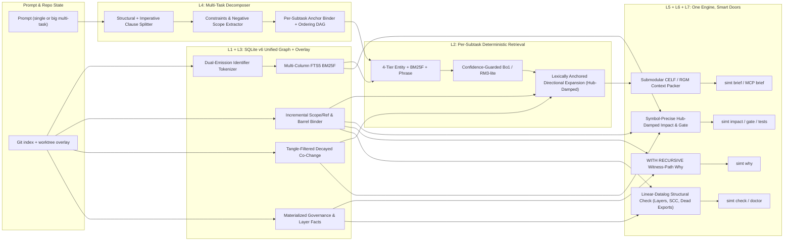

# Plan 0005 — Deterministic Retrieval, Multi-Task Decomposition, and Structural Precision

Status: **proposed — audit and literature review complete; D01–D40 queued** · created 2026-11-22 · baseline `8c38faf`
Depends on: [plan 0003](0003-intelligence-amplifier-research-plan.md) (55/55 Complete) and [plan 0004](0004-knowledge-and-remote-work-intelligence-plan.md) (52/52 Complete).
Owner: **simt-dev**. All research findings are grounded in live code inspection at `8c38faf`, read-only CLI probes on this checkout, and primary 2021–2026 IR/SE literature.
Smallest independently valuable implementation slice: **D01**, an executable baseline audit and live-failure regression suite pinning the four concrete defects exposed below; then **D05** (dual-emission identifier tokenizer) and **D17** (deterministic multi-task prompt segmenter) along disjoint lanes. Authoring this plan does not complete any slice.

**Answer to the review.** After Plans 3 and 4, `simt-dev` has a working SQLite FTS5 index, hybrid map ranker, brief packer, import-closure impact/gate walker, governance resolver, and knowledge/work doors. However, auditing the live implementations of `brief`, `map`, `impact`, `why`, `check`, `gate`, `tests`, and `knowledge rank` reveals five structural bottlenecks that degrade accuracy—especially on **large, composite prompts carrying multiple tasks**—without requiring embeddings or probabilistic models to fix:

1. **Multi-task prompt collapse and waterfall starvation (`brief`, `packet`, `kind`).** Naming one path anywhere in a multi-task prompt short-circuits the entire ranker to that single file; single-label classification picks the first regex hit; fixed `LIKELY_FILES = 3` ignores subtasks 2..N; and waterfall `SECTION_VALUE` cutting spends the whole 2,048-byte budget on verbose `FILES` lines while dropping 100% of `TESTS`, `DECISIONS`, `SKILLS`, and `CAUTIONS`.
2. **Uncalibrated undirected PageRank and single-field FTS5 (`map`, `store`, `knowledge rank`).** `buildLinks` symmetrizes directed imports into an undirected graph and runs static PPR—a strategy that 2026 empirical localization studies prove *underperforms* plain lexical BM25. Meanwhile, `fts` indexes a single unsplit `body` column (no camelCase/snake_case splitting, no multi-column BM25F weights, no phrase boost, and no guarded lexical query expansion).
3. **File-level hub explosion and full-tree disk scans (`impact`, `gate`, `tests`).** `impact` ignores symbol specificity after resolving a symbol to its file, runs flat file-level reverse BFS through hub dispatchers (`cli.mjs`, `api.mjs`) until hitting an alphabetical 64-item cap, and re-reads every tracked source file from disk on every call instead of using the SQLite index plus worktree overlay.
4. **Broad-glob governance leakage and shallow provenance (`why`).** `scopeHits` matches `skill.paths` without checking stack compatibility or tree-wide glob specificity (attributing Cloudflare Durable Objects skills to Node files in `simt-dev`), misses command/importer/git-history provenance, and rejects directories, symbols, and multi-target queries.
5. **Unbuilt architectural checkers and redundant scans (`check`, `doctor`).** `import-direction` remains `check-unbuilt`, structural graph invariants (cycles, layer boundaries, dead exports, hub spikes) are absent despite the index holding edges, and `fileLines` re-reads every tracked file from disk on each run.

Constraint carried from `AGENTS.md`, ADR-012, ADR-013, ADR-075, and ADR-090: **zero runtime dependencies, POSIX-only, 100% deterministic local computation, no embedding models, no LLMs, no stochastic sampling, and no implicit network calls.** Every improvement below runs natively on Node 22+ and `node:sqlite` (FTS5 + `WITH RECURSIVE`), produces byte-identical output for identical inputs, and carries a formal score breakdown or witness path in `--explain` and `--json`.

## 0. How to read this plan

There are 40 slices, **D01–D40**, organized into eight phases across six disjoint parallel lanes (`bench`, `index`, `graph`, `decompose`, `pack`, `impact`, `govern`, `rollout`—with `index`/`graph`/`decompose` runnable concurrently once Phase 0 lands). Each slice defines its **Goal**, **Design** (exact file ownership, algorithms, and data shapes), measurable **Accept** criterion, and **Basis**.

Phases group conceptual themes; the `Depends on` column in §13 governs execution order. Every `D` row starts `Queued`. No ranking or packing algorithm replaces an existing default until Phase 0 benchmarks prove statistically significant uplift without single-task regression. Proposed rulings `P1–P10` in §16 must be recorded as numbered ADRs before their slices change shipped behavior or JSON contracts.

## 1. The goal, made measurable

The product goal is to make `simt-dev`'s deterministic local intelligence commands (`brief`, `map`, `impact`, `why`, `check`, `gate`, `tests`, `knowledge rank`) dramatically more accurate, surgical, and multi-task-capable—matching or beating embedding-based retrieval on code navigation tasks at sub-150 ms latency and zero model cost.

| Quantity | Definition and grading boundary |
| --- | --- |
| Single-task file Recall@10 / MRR | Share of gold files in top-10 and mean reciprocal rank on mined single-task benchmarks (`R01` + expanded corpus), stratified by exact-path, symbol-named, and vocabulary-gap queries |
| Multi-task Min-Subtask-Coverage (MSC) | For a composite prompt with $m$ subtasks $\{T_1,\dots,T_m\}$, $\min_{k \in 1..m} \text{Recall}(T_k \text{ in packet})$ — directly measures whether any subtask was starved or collapsed |
| Multi-task Facet Completeness (MFC) | Share of active facets (`FILES`, `TESTS`, `DECISIONS`, `SKILLS`, `LESSONS`, `CAUTIONS`) with $\ge 1$ relevant item surviving inside the byte ceiling on multi-task prompts |
| Impact Precision@10 / Hub-Noise Ratio | Share of top-10 `impact` results that are true behavioral/call-site dependents or historical co-change partners; Hub-Noise Ratio = share of returned tests/importers reachable *only* via high-degree dispatchers/barrels without symbol usage |
| Governance Precision & Recall (`why`) | Precision (zero incompatible-stack or tree-wide glob false positives) and recall (including direct, command-linked, inherited, and commit-cited ADRs) against a labelled governance gold set |
| Warm Latency (p50 / p95) | Wall-clock ms for warm `brief`, `map`, `impact`, `why`, and `check --changed` on 500-file and 10,000-file synthetic trees; prompt-hook bar remains $\le 300\text{ ms}$ p95 |
| Determinism & Parity | 100% byte-identical output across repeated runs, locales, and OS (macOS/Linux); CLI and MCP JSON envelopes agree identically |

**Research targets (hypotheses, not claims until measured in D37):**

- Single-task Recall@10 $\ge 75\%$ (up from Plan 3's R22 baseline of 55.6% against the 60% bar) and MRR $\ge +15\%$ relative gain on vocabulary-gap tasks without embeddings.
- Multi-task Min-Subtask-Coverage $\ge 85\%$ on 2–6 subtask prompts inside the default 2,048-byte budget (up from 0% on Probe 1/2 failure classes), and Multi-task Facet Completeness $\ge 80\%$ (up from 0% surviving `TESTS`/`DECISIONS`/`SKILLS` on Probe 2).
- Impact Hub-Noise Ratio reduced by $\ge 60\%$ on symbol-targeted and diff-hunk queries while preserving $\ge 95\%$ recall on true dependents/tests (and 100% conservative fallback when symbol binding is incomplete).
- `why` false-positive rate $= 0\%$ on incompatible-stack and tree-wide skill globs.
- Warm `brief` $\le 150\text{ ms}$ p50 ($\le 300\text{ ms}$ p95); `impact` and `gate` $\ge 3\times$ faster via SQLite + worktree overlay instead of full-tree disk re-reads.

### 1.1 Codebase audit findings and live probe evidence (`8c38faf`)

Four read-only probes executed against `simt-dev` at `8c38faf` plus full source inspection exposed concrete, reproducible failure modes across every command in scope:

| Command / Module | Code location | Observed behavior & live probe evidence | Root architectural defect |
| --- | --- | --- | --- |
| `brief` + `map` (multi-task with 1 path) | `src/index/map.mjs:425-430`, `src/brief/assemble.mjs:239,316` | Probe: `brief "Fix the BM25 ranking in map.mjs, add multi-task decomposition to brief, update impact to handle symbol call sites, and fix a typo in README.md"`. Output: `scope README.md`, `FILES: README.md` ONLY (0 code files, 0 tests, only README ADRs). | `spelledPaths` matched `README.md` (not `map.mjs`) and short-circuited `scoreFiles` to return `exact` ONLY, discarding all lexical/symbol/BM25 evidence for the other 3 tasks. |
| `brief` + `packet` (multi-task, no paths) | `src/brief/packet.mjs:50-65,114-121`, `src/brief/assemble.mjs:71,324` | Probe: 4-task prompt (`Refactor auth middleware..., add unit tests..., migrate database schema..., document rate limits...`). Output: `cut 106 of 124 items to fit 2048: files 92, tests 4, decisions 7, skills 1, cautions 2`. Zero `TESTS`, `DECISIONS`, `SKILLS`, or `CAUTIONS` survived! | `SECTION_VALUE` waterfall drops every item in lower sections before trimming verbose `FILES` lines (e.g., `src/api.mjs` printed 25 exported symbol names). Also `LIKELY_FILES = 3` starves subtasks 2..N. |
| `brief` task kind | `src/brief/kind.mjs:126-140` | Probe 1 returned `kind bugfix` (matched `Fix`) and Probe 2 returned `kind refactor` (matched `Refactor`), dropping `build`/`typecheck` verbs needed by `feature` subtasks and `docs` obligations. | First-regex-match single-label classification ignores multi-task prompts; `classifyIntent` (v2) exists in `kind.mjs` but is never wired into `assembleBrief`! |
| `map` + FTS5 store | `src/index/map.mjs:323-390,418-516`, `src/index/store.mjs:152-242`, `src/index/persist.mjs:24` | Probe 2 ranked `src/distribute/acceptance.mjs` and `src/distribute/support.mjs` #1 and #3 (colliding on `"support"`). FTS5 query joined up to 48 terms with flat `OR`; camelCase tokens never split. | Single-column FTS5 (`body`), no BM25F field weights, no identifier splitting, binary `common(freq)` cliff instead of IDF, undirected `buildLinks` symmetrization + uncalibrated PPR, and no guarded PRF. |
| `impact` + `gate` | `src/commands/impact.mjs:41-51`, `src/index/impact.mjs:25-58`, `src/index/gate.mjs:67-89` | Probe: `impact src/index/map.mjs` returned 64 importers and 64 tests (`truncated: 1`), including `test/ci-dependabot.test.mjs`, `test/completions.test.mjs`, `test/help.test.mjs` (642 ms). `impact rankFiles` ignores `rankFiles` during graph walk. | File-level transitive BFS explodes through barrel/CLI hubs (`cli.mjs`, `commands/index.mjs`, `api.mjs`); no symbol-level edges, no hop stratification, no hub damping, and `readEntries` re-reads all tracked files from disk on every run. |
| `why` + `govern` | `src/commands/why.mjs:160-244`, `src/index/govern.mjs:123-166` | Probe: `why src/brief/assemble.mjs` returned `skill durable-objects` and `skill workers-best-practices` (Cloudflare Workers!) alongside `ADR-218`, while missing `ADR-091` / `ADR-093` / `ADR-095` governing `brief`. | `scopeHits` checks `skill.paths` (`src/**`) without enforcing `stackCompatible` or `namesTree` specificity; `governs()` only inspects literal `Affects:` path tokens with no command, importer, or git-history provenance; rejects directories/symbols. |
| `check` + `checks` | `src/kernel/checks.mjs:21,138-217`, `src/commands/sync.mjs:559-702` | `import-direction` returns `check-unbuilt`; `fileLines` reads every tracked file off disk; no structural graph checks (cycles, dead exports, layer violations); no `--changed` incremental check mode. | Graph edges already live in SQLite, yet `check` neither queries them via `WITH RECURSIVE` nor uses the index/overlay for unchanged file metrics. |
| `knowledge rank` | `src/knowledge/rank.mjs:57-74,113-131` | Lexical score is unweighted `hits / terms.length` (`(body + label) / 2`), treating common words identically to rare statutory/technical terms, with no phrase proximity or multi-subquestion diversity. | No IDF, no BM25F length normalization, no multi-facet submodular selection across multi-part questions. |

## 2. Seven deterministic levers

Every lever below is strictly deterministic, explainable, and zero-dependency:

| Lever | Hypothesis | Falsified by | Slices |
| --- | --- | --- | --- |
| **L1 — Multi-field identifier BM25F & hierarchical entities** | Splitting identifiers (preserving whole + parts) and scoring SQLite FTS5 multi-column BM25F + exact entity tiers beats current `scoreFiles` + single-field BM25 on Recall@10 and MRR | Single-task Recall@10 fails to beat 55.6% baseline or degrades exact-path tasks | D05–D10 |
| **L2 — Lexically anchored directional expansion & guarded Bo1/RM3** | Replacing undirected PPR with directional caller/enclosing-scope expansion + inverse-degree hub damping + confidence-guarded Bo1/RM3 bridges vocabulary gaps without drift | MRR drops vs plain BM25F, or guarded PRF hurts already-confident queries | D09, D15–D16 |
| **L3 — Incremental symbol-binding & barrel unwrapping** | File-incremental lexical scope/reference extraction (Stack-Graph-inspired) + worktree overlay gives symbol-level edges at <150 ms warm latency without tree-sitter or full-tree disk scans | Binding recall too low to beat file-level graphs, or warm overlay exceeds latency bar | D11–D14 |
| **L4 — Deterministic multi-task prompt decomposition** | Syntactic/discourse segmentation into atomic subtasks with localized path/symbol anchors, negative constraints, and dependency ordering eliminates single-path collapse and cross-task interference | Decomposer over-splits single tasks into noise or misses compound tasks in corpus | D17–D21 |
| **L5 — Budgeted submodular context packing (CELF / RGM)** | Maximizing concave `(subtask, facet)` coverage under byte budget $B$ with hard floor $M$ eliminates waterfall starvation and maximizes Min-Subtask-Coverage inside 2,048 bytes | Single-task quality drops or multi-task MSC fails to clear $\ge 85\%$ bar | D22–D26 |
| **L6 — Hub-damped symbol `impact` & filtered evolutionary coupling** | Symbol-precise reverse reachability + hop stratification + tangle-filtered decayed Co-Committal Strength + conceptual lexical coupling slashes hub noise without losing true dependents/tests | Hub-Noise Ratio drops $<30\%$ or conservative test recall regresses | D27–D31 |
| **L7 — Relational SQLite Datalog (`why` & structural `check`)** | Materializing governance + architectural rules over SQLite `WITH RECURSIVE` eliminates `why` false positives, produces shortest witness chains, and enables real `import-direction` and cycle checks | False positives remain, recursive queries blow latency budget, or false-red CI gates occur | D32–D36 |

## 3. Research foundations and positioning

All primary-source literature below was retrieved and examined on 2026-11-22 via live web search. None introduces a runtime dependency or model requirement; each establishes a mathematical mechanism adapted to `simt-dev`'s zero-dep Node + SQLite architecture:

| Mechanism | Primary source (read 2026-11-22) | Key empirical finding & direct lesson for `simt-dev` |
| --- | --- | --- |
| **Directional asymmetry & PPR failure** | [GraphScent (arXiv:2611.17527, Nov 2026)](https://arxiv.org/abs/2611.17527) | Across 211 real issues in 86 repos, static undirected and directed PPR *both* underperform plain lexical BM25 (undirected PPR R@5 38.9%, MRR 0.268 vs BM25 R@5 46.5%, MRR 0.357; BM25+PPR fusion MRR 0.342). Enclosing scopes and **upstream callers** separate true targets from lexical distractors, while downstream utilities do not. Directly explains why `map.mjs`'s symmetrized PPR stalled at 55.6% recall. |
| **Lexically anchored local expansion** | [LARGER (arXiv:2605.16352, May 2026)](https://arxiv.org/html/2605.16352v1) | Formalizes *Lexically Anchored Structural Localization*: start from high-precision lexical matches, align to graph anchors, and perform confidence-filtered local expansion rather than global graph diffusion. |
| **Embedding-free BM25F + entity hierarchy** | [Graph Indexer (Nov 2026)](https://graph-indexer.vercel.app/how-it-works/); [LocAgent (arXiv:2503.09089)](https://arxiv.org/abs/2503.09089); [Practical Code RAG (arXiv:2510.20609)](https://arxiv.org/abs/2510.20609) | Embedding-free SQLite FTS5 BM25F with explicit field weights (`name 10, qualname 6, sig 3, doc 2, path 2.5, body 1`) + hierarchical entity lookup reaches 70.3% top-1 accuracy (MRR 0.760) across 8 languages. Sparse BM25 with word-level splitting beats dense encoders on PL→PL at 100× lower latency. |
| **Dual-emission identifier splitting & guarded Bo1/RM3** | [Hyalo BM25F Tokenizer v4](https://docs.rs/hyalo-core/latest/src/hyalo_core/bm25/tokenizer.rs.html); [TU Delft Bo1/KL/RM3 Comparison](http://resolver.tudelft.nl/uuid:e5d59495-35c2-48d3-9447-4a55c8da51bf); [TREC 34 DUTH Deterministic RM3](https://trec.nist.gov/pubs/trec34/papers/DUTH.product.pdf) | Splitting identifiers at `_`, `-`, and camelCase/acronym boundaries while emitting the *joined whole token first* plus constituent parts captures both exact and partial matches. Deterministic Bo1/RM3 pseudo-relevance feedback expands vocabulary gaps without stochasticity; guarding expansion by top-1/top-2 score margin prevents drift on confident queries. |
| **File-incremental symbol binding** | [Stack Graphs (GitHub, arXiv:2211.01224)](https://arxiv.org/abs/2211.01224) | Builds an isolated scope/definition/reference subgraph *per file* without cross-file state, resolving `A.foo` and barrel re-exports via deterministic symbol+scope stack path-finding—making incremental reindexing $O(\text{changed files})$. |
| **Hub suppression in graph propagation** | [TriviumDB Spreading Activation](https://deepwiki.com/YoKONCy/TriviumDB/2.3-graph-engine-and-spreading-activation); [Degree-Penalized Seed Weights](https://theaiarchs.com/n/hub-suppression-keeps-popular-nodes-from-dominating-graph-propagation) | Multiplying edge transfer by inverse in-degree ($1 / \text{deg}_{\text{in}}^{0.55}$) or penalizing hub seeds by $1 / \log(2 + \text{deg})$ stops ubiquitous utilities (`cli.mjs`, `output/index.mjs`) from hijacking graph propagation and impact sets. |
| **Budgeted submodular context packing** | [PACMS (arXiv:2606.20047, Jun 2026)](https://arxiv.org/abs/2606.20047); [PC-SubMax (arXiv:2609.32474, Sep 2026)](https://arxiv.org/abs/2609.32474); [HERO TREC 34](https://trec.nist.gov/pubs/trec34/papers/UvA.ragtime.pdf) | Monotone submodular facility-location / concave coverage maximization under a strict budget constraint—solved deterministically via CELF lazy-greedy or Regularized Greedy+Max ($U(Q) - \ell(Q) \ge \frac{1}{2}U(O) - \ell(O)$)—outperforms top-$k$ and MMR by +8 to +12 points on downstream QA by preventing redundancy and covering all query facets. |
| **Deterministic multi-intent clause splitting** | [Rule-Based Atomic Sentence Extraction (arXiv:2601.00506, Jan 2026)](https://arxiv.org/abs/2601.00506); [RANLP Conditional Splitting](https://aclanthology.org/2021.ranlp-1.167.pdf); [CANDLE (arXiv:2107.03884)](https://arxiv.org/pdf/2107.03884v2.pdf) | Rule-based splitting on structural lists, coordinating conjunctions before imperative verbs, and conditional/negative markers (`if`, `unless`, `without`) cleanly separates multi-action prompts into atomic clauses + constraints without neural parsers. |
| **Filtered evolutionary + conceptual coupling** | [MDPI Co-Committal Study (Mar 2026)](https://www.mdpi.com/2674-113X/5/1/11); [ESEM '24 TARMAQ+SCR](https://dl.acm.org/doi/10.1145/3674805.3686668); [Poshyvanyk WCRE](https://www.cs.wm.edu/~dposhyvanyk/pubs/wcre2010-semplusevol-IA-camera.pdf); [Athena (arXiv:2607.23355)](https://arxiv.org/abs/2607.23355) | Raw co-commit counts fail on tangled/bursty commits; Co-Committal Strength (directional confidence + lift) on small, non-tangled commits fused with structural dependencies and lexical conceptual coupling significantly improves impact precision and recall. |
| **Linear Datalog over SQLite `WITH RECURSIVE`** | [SQLite `WITH` Clause](https://www.sqlite.org/lang_with.html); [Compiling Linear Datalog to SQL (arXiv:2609.06301, Sep 2026)](https://arxiv.org/html/2609.06301) | Linear recursive program analyses (transitive callers, barrel unwinding, layer violation reachability, governance inheritance) compile directly to cycle-safe `WITH RECURSIVE ... UNION` SQLite queries with zero external Datalog engine. |

## 4. Architecture



### Core invariants

| Principle | Consequence |
| --- | --- |
| **I1 Zero embeddings, zero ML, zero runtime deps** | Every tokenizer, ranker, decomposer, submodular packer, and Datalog check runs in pure Node.js ESM + built-in `node:sqlite`. Optional Plan 3 adapters stay strictly opt-in. |
| **I2 Byte-for-byte determinism** | Every score tie breaks on canonical UTF-8 codepoint order (`cmp`), never locale or insertion order; floating-point aggregations use fixed traversal order and rounded public serialization. |
| **I3 Every answer carries its proof** | `brief --explain`, `map --explain`, `impact --json`, `why --json`, and `check --json` expose exact channel contributions, subtask provenance, shortest witness paths, and cut/truncation frontiers. |
| **I4 Subtask isolation before global packing** | A spelled path, constraint, or high-frequency term in Subtask $i$ can never suppress retrieval for Subtask $j$. Subtasks compete fairly only inside the concave submodular packer. |
| **I5 Conservative safety on incomplete graphs** | Whenever symbol binding is partial (dynamic `import()`, reflection, unresolved namespace), `gate --strict` and `impact` explicitly report the unresolved frontier and fall back to file-level closure rather than silently dropping a test. |
| **I6 Additive compatibility** | Existing JSON field names, exit codes, and `PROMPT_CAP_BYTES = 2048` default hold. New fields (`subtasks`, `channels`, `tiers`, `witnesses`) are additive; default behavior changes require Phase 7 statistical proof and an ADR. |

**Extension layout.** Keep changes tight and modular inside existing boundaries:
- `src/text/identifiers.mjs` — dual-emission identifier & CJK tokenizer.
- `src/index/{entities,lexical,prf,references,bind,directional,cochange}.mjs` — retrieval, symbol binding, directional expansion, and evolutionary coupling.
- `src/brief/{decompose,constraints,anchors,plan-graph,submodular,render}.mjs` — multi-task prompt decomposition and budgeted submodular packing.
- `src/kernel/graph-checks.mjs` — Linear-Datalog `import-direction`, Tarjan SCC, dead-export, and hub-budget checks.

## 5. Phase 0 — Measurement, Multi-Task Corpus & Failure Baselines

### D01 — Baseline audit and live-failure regression suite (S)

**Goal.** Freeze the four concrete defects exposed at `8c38faf` and the current code-only behavior as executable fixtures so every later slice measures real progress.

**Design.** Add `test/retrieval-baseline.test.mjs` and fixture pack `test/fixtures/retrieval-v2/` reproducing: (1) multi-task prompt with one spelled path (`README.md`) + three code tasks; (2) 4-task prompt with no spelled paths under 2,048-byte budget; (3) hub-mediated `impact` on a shared module with a single targeted export; (4) `why` on a Node file in a repo carrying multi-stack skills (`src/**`). Snapshot current `brief`, `map`, `impact`, `why`, `gate`, and `check` JSON envelopes as baseline references.

**Accept.** `node --test test/retrieval-baseline.test.mjs` passes at baseline by explicitly recording baseline metrics (e.g., Probe 1 subtask coverage = 0.25, Probe 2 surviving facets = 1/6, Probe 4 foreign skill count > 0) and verifying consumer isolation (no reads outside checkout, ADR-031).

**Basis.** §1.1 live probes at `8c38faf` and Plan 4 W01 baseline discipline.

### D02 — Multi-task and composite-prompt benchmark corpus (M)

**Goal.** Build a graded corpus that exercises big prompts with 2–8 tasks alongside single-task and vocabulary-gap queries.

**Design.** Add `packages/bench/src/multitask-corpus.mjs` and `test/bench-multitask-corpus.test.mjs`. Generate deterministic benchmark sets across four strata (at least 30 tasks per stratum): (a) *single-task lexical* (mined from commit history); (b) *vocabulary-gap* (natural-language symptoms where exact symbol names are absent from the prompt); (c) *composite multi-task* (2–8 subtasks combining bugfix, feature, refactor, tests, schema/config, and docs—with subsets having 1 spelled path, partial basenames like `map.mjs`, and negative constraints like `"do not modify X"`); (d) *symbol-impact & governance gold* (known call sites, barrel re-exports, co-change pairs, and true governing ADRs/rules/skills).

**Accept.** Corpus validator checks schema integrity, hidden-gold separation, zero duplicate task IDs, and balanced subtask counts (2, 3, 4, 6, 8). Synthetic gold oracle achieves 100% and naive baseline fails on composite and vocabulary-gap strata as expected.

**Basis.** Plan 3 R01 mined tasks only capture single-commit diffs and cannot measure multi-task decomposition or facet starvation.

### D03 — Retrieval, multi-task coverage, and impact grading harness (M)

**Goal.** Measure exactly what matters: per-subtask survival, facet balance, hub noise, and latency.

**Design.** Add `packages/bench/src/retrieval-metrics.mjs` and `test/retrieval-metrics.test.mjs`. Compute: single-task Recall@5/10, MRR, NDCG@10; multi-task **Min-Subtask-Coverage (MSC)**, Mean-Subtask-Recall, and **Multi-task Facet Completeness (MFC)** inside strict byte budgets (1024, 2048, 4096); `impact` Precision@10, Recall@full, and **Hub-Noise Ratio**; `why` Precision/Recall; and warm/cold p50/p95 latency. Emit structured JSON and deterministic markdown summaries.

**Accept.** Hand-computed synthetic verification tests match every metric to $10^{-9}$; undefined denominators report `null`, never `0` or `1`; latency benchmarks run deterministically without network calls.

**Basis.** ADR-076 (evidence discipline) and Plan 4 W04 stratified metric design.

### D04 — Ablation runner and determinism/isolation gate (S)

**Goal.** Prove each lever earns its complexity independently and preserves strict determinism.

**Design.** Extend `packages/bench/src/ablate.mjs` and add `test/retrieval-ablation.test.mjs` with toggleable arms: `baseline-v1`, `+bm25f-ident`, `+guarded-prf`, `+directional-graph`, `+symbol-bind`, `+decompose`, `+submodular-pack`, `+cochange`, and `full-v2`. Run paired task-level bootstrap confidence intervals (1,000 seeded resamples) and assert byte-identical output across repeated runs and scrambled input file ordering.

**Accept.** Ablation CLI runs offline in under 5 seconds on the synthetic fixture corpus, flags any non-deterministic tie-break as a hard failure, and refuses to mark an inconclusive arm as winning.

**Basis.** Plan 3 R04 ablation methodology and `AGENTS.md` determinism rule.

## 6. Phase 1 — Multi-Field BM25F, Identifier Splitting & Guarded Lexical Expansion

### D05 — Deterministic dual-emission identifier tokenizer (S)

**Goal.** Make `readSqliteBatch`, `HTMLParser`, `refresh_token`, and `rate-limit` match both exact-identifier and natural-language subword queries without stemming fragility.

**Design.** Create `src/text/identifiers.mjs` and `test/identifiers.test.mjs`. Implement a single pure pipeline shared by indexing and querying:
1. NFKC → NFKD diacritic strip (preserving Japanese combining dakuten/handakuten U+3099/U+309A as in `store.mjs:115`) → case-preserving segmentation.
2. Split compound tokens on `_`, `-`, `.`, `/`, and camelCase / acronym boundaries (`[a-z][A-Z]` and `[A-Z]+[A-Z][a-z]{2,}`, so `HTMLParser` → `html`, `parser`, while `APIs` stays `apis`; digits do not split `utf8` or `sha256`).
3. **Dual emission**: for any compound identifier with $\ge 2$ parts, emit the **joined lowercased whole token** (tagged `exact`) AND each constituent part (`part`, length $\ge 2$). Keep two-letter technical terms (`d1`, `kv`, `r2`, `ci`, `db`, `ui`, `id`).
4. CJK runs emit overlapping character bigrams (and single characters for 1-char runs) alongside the existing trigram path.
5. Add light deterministic plural normalization (`-ies` → `-y`, `-es`/`-s` for length $> 4$, guarding code suffixes like `class`, `status`, `alias`, `process`) applied symmetrically at index and query time.

**Accept.** Unit tests cover camelCase, PascalCase, acronyms, `snake_case`, `kebab-case`, digits, Unicode diacritics, CJK, and round-trip symmetry (`tokenize(code)` matches `tokenize(query)`). Zero runtime deps; throughput $\ge 10\text{ MB/s}$ in Node.

**Basis.** Hyalo BM25F Tokenizer v4 (`tokenizer.rs`) and `src/text/tokens.mjs` two-letter preservation lesson.

### D06 — SQLite Index Schema v6: Multi-column BM25F and hierarchical entities (M)

**Goal.** Upgrade `node:sqlite` FTS5 from a single flat `body` column to weighted multi-field BM25F natively inside SQLite.

**Design.** Extend `src/index/persist.mjs` and `src/index/store.mjs`; add `test/index-bm25f.test.mjs`. Bump `SCHEMA_V` from `'5'` to `'6'` with an ordered `5 -> 6` migration (preserving sidecar safety for newer/older binaries per ADR-115). Replace single-column `fts` with:
```sql
CREATE VIRTUAL TABLE fts USING fts5(
  path_tokens, symbol_names, qual_names, signatures, headings, body,
  node_id UNINDEXED, kind UNINDEXED,
  tokenize = "unicode61 remove_diacritics 2"
);
```
Query natively via SQLite FTS5 weighted BM25: `bm25(fts, 3.0, 10.0, 6.0, 3.5, 2.5, 1.0)` (tuned only on dev split in D04, exported as `BM25F_WEIGHTS`). Also add `code_symbols` lookup indexes on `(name)` and `(lower(name))` and mirror the exact same BM25F formula in pure JS (`scoreFtsBm25F`) for in-memory worktree overlays and unit tests.

**Accept.** v5 databases migrate cleanly in place to v6; SQLite FTS5 `bm25()` and JS `scoreFtsBm25F()` agree on ranking order; a symbol definition `refreshTokenRotation` outranks a comment/doc mention of `"refresh"` and `"token"`; reindex time stays within $+15\%$ of v5.

**Basis.** Graph Indexer (Nov 2026) field weights, SQLite FTS5 native `bm25()` column weighting, and ADR-135.

### D07 — Hierarchical entity index and phrase/proximity scoring (M)

**Goal.** Replace heuristic magic-number cliffs in `scoreFiles` with a clean 4-tier deterministic entity + BM25F + phrase scorer.

**Design.** Create `src/index/entities.mjs` and `test/index-entities.test.mjs`. Implement LocAgent-style top-to-bottom deterministic lookup fused with BM25F:
- **Tier 1 (Exact Path / Basename Anchor):** exact repo-relative path or unambiguous suffix/basename (`map.mjs` when unique or disambiguated by sibling keywords; ambiguous basenames like `index.mjs` score only with directory context).
- **Tier 2 (Exact Qualified / Symbol Name):** direct dictionary lookup on `nodes(kind='symbol')` matching exact whole identifier tokens from the query (`rankFiles`, `assembleBrief`, `AuthMiddleware.rotate`).
- **Tier 3 (Multi-Field BM25F + Proximity):** weighted FTS5 BM25F over dual-emitted tokens, plus an FTS5 `NEAR("t1" "t2", 8)` / adjacent-bigram phrase bonus for consecutive non-stopword query terms (so `"refresh token rotation"` rewards files where those tokens appear together rather than scattered across 500 lines).
- **Tier 4 (Section/Chunk Body BM25F):** line-aligned code/doc sections so late definitions in long files score competitively.
All tier contributions are returned explicitly per candidate for `--explain`.

**Accept.** `map.mjs` resolves to `src/index/map.mjs` even without the `src/index/` prefix; `"refresh token rotation"` ranks a contiguous implementation above a file mentioning `"refresh"` on line 10 and `"rotation"` on line 400; every score reproduces from its printed `components`.

**Basis.** LocAgent (arXiv:2503.09089) hierarchical entity index and Practical Code RAG (arXiv:2510.20609).

### D08 — Continuous IDF and deterministic lexical conceptual coupling (S)

**Goal.** Replace binary 15% frequency cutoffs with continuous IDF and enable embedding-free conceptual similarity between code artifacts.

**Design.** Create `src/index/lexical.mjs` and `test/index-lexical.test.mjs`. Maintain per-term document frequency `df(t)` in a compact SQLite table `term_stats(term PRIMARY KEY, df INTEGER)` updated incrementally during `reindex`. Compute smoothed Okapi IDF $\log(1 + \frac{N - \text{df}(t) + 0.5}{\text{df}(t) + 0.5})$ so ubiquitous repo terms (`src`, `command`, `support`, `schema`) smoothly downweight without abrupt cliffs. Provide a pure deterministic **sparse TF-IDF cosine** over top-$K$ (e.g., $K = 40$) highest-TF-IDF identifier/symbol terms per file (`file_signatures` table) to compute **conceptual coupling** between files with zero neural models.

**Accept.** Common words like `"support"` no longer catapult `src/distribute/support.mjs` to #1 when paired with rare domain words; conceptual coupling identifies sibling implementations sharing domain vocabulary (e.g., two schema validators or auth handlers) even with zero direct import edge.

**Basis.** Poshyvanyk et al. (WCRE) conceptual coupling and standard BM25/TF-IDF information theory.

### D09 — Guarded Bo1 / RM3-lite deterministic query expansion (M)

**Goal.** Bridge natural-language-to-code vocabulary gaps (e.g., `"login timeout"` → `sessionExpiry`, `jwt`, `ttl`) deterministically without embeddings and without query drift.

**Design.** Create `src/index/prf.mjs` and `test/index-prf.test.mjs`. Implement a two-pass deterministic Pseudo-Relevance Feedback module supporting both **DFR Bo1** (Bose-Einstein Divergence from Randomness) and **RM3-lite** (score-weighted term interpolation):
1. Run Pass-1 BM25F retrieval and inspect top-2 scores $(s_1, s_2)$.
2. **Confidence Guard:** if $s_1 > 0$ and $(s_1 - s_2)/s_1 \ge \tau_{\text{guard}}$ (default `0.35`), or if the query carries an exact spelled path/symbol anchor, **skip expansion** and return Pass-1 unchanged.
3. Otherwise take top $R = 3$ pseudo-relevant files (excluding test files and high-degree utility hubs), score candidate identifier terms $t \notin Q$ via Bo1:
   $$S_{\text{Bo1}}(t) = \text{tf}_R(t) \cdot \log_2\!\left(\frac{1 + \lambda_t}{\lambda_t}\right) + \log_2(1 + \lambda_t), \quad \lambda_t = \frac{\text{cf}(t)}{N}$$
   (with RM3-lite variant selectable for D04 ablation), keep top $E = 6$ non-stopword terms with $\text{df}(t) \ge 2$ and $\text{df}(t)/N \le 0.20$, and run Pass-2 with original query weight $\alpha = 0.7$ and expansion weight $1 - \alpha = 0.3$.
4. Record every expanded term and its source file in `expansion[]` for `--explain`.

**Accept.** On vocabulary-gap fixtures (prompt describes behavior without naming the target identifier), guarded PRF improves Recall@10 and MRR over Pass-1; on already-confident exact queries, the guard triggers 100% of the time with zero rank perturbation; fully deterministic and $\le 15\text{ ms}$ overhead.

**Basis.** TU Delft Bo1/KL/RM3 evaluation, TREC 34 DUTH deterministic RM3, and guarded RM3-lite (`bench_ranking_v2.py`).

### D10 — Upgrade `knowledge rank` to BM25F, phrase proximity, and diversity (M)

**Goal.** Bring the same BM25F + identifier/Unicode + proximity precision to `simt knowledge rank` and `brief --scope`.

**Design.** Upgrade `src/knowledge/rank.mjs` and `src/knowledge/query.mjs`; extend `test/knowledge-rank.test.mjs`. Replace flat `hits / terms.length` in `lexicalCoverage` with in-corpus multi-field BM25F over `(label, headings, claims, body)` plus phrase-adjacency boost, normalized to $[0, 1]$ so existing `RANK_WEIGHTS`, authority bonuses, `derived`/`stale`/`hub` penalties, and scope/permission pre-filters remain clean and explainable. Preserve exact `scoreFrom(components)` auditability.

**Accept.** Rare statutory/technical query terms outrank boilerplate sections containing frequent words; non-Latin / CJK / German diacritic fixtures maintain $\ge 90\%$ recall@10; zero scope or permission leakage; existing `knowledge rank` JSON contract remains backward-compatible.

**Basis.** Audit finding in `src/knowledge/rank.mjs:57-74` and Plan 4 W19 requirements.

## 7. Phase 2 — Incremental Symbol-Binding, Barrel Resolution & Directional Graph

### D11 — Named import, alias, and barrel re-export extractor (M)

**Goal.** Capture *which* symbols each file imports, aliases, or re-exports—not merely which file path it imports.

**Design.** Extend `src/index/extract.mjs` and add `test/extract-bindings.test.mjs`. Upgrade language extractors (JS/TS, Python, Rust, Go, Java, Kotlin, C#, Swift, Dart, Ruby) with a zero-dep multi-line statement scanner that emits structured binding records alongside existing `imports[]`:
- `namedImports`: `{ spec, imported, local, isNamespace, isDefault, line }` (handles `import { a as b, c } from './x.mjs'`, `import * as ns from './x.mjs'`, Python `from pkg.mod import Foo as Bar`, Rust `use crate::a::{b, c as d}`).
- `reexports`: `{ spec, exported, original, isStar, line }` (handles `export { foo as bar } from './a.mjs'`, `export * from './b.mjs'`, Python `__all__` / re-imported exports).
Store structured bindings in `sources.props` (JSON) so incremental reindex only re-extracts changed blobs.

**Accept.** Multi-line JS/TS named imports, aliased imports, namespace imports, `export * from` barrels, Python relative `from .foo import bar`, and Rust grouped `use` statements extract accurately across a 10-language fixture suite. Existing `extract().symbols` and `extract().imports` stay backward-compatible.

**Basis.** Audit finding on `src/index/extract.mjs:294-354` (file-only specifiers) and `src/commands/impact.mjs` hub explosion through barrel files.

### D12 — File-incremental symbol reference and call-site scanner (L)

**Goal.** Extract intra-file call sites, member accesses (`obj.method()`), and identifier references per file with zero cross-file state and zero external parser dependencies.

**Design.** Create `src/index/references.mjs` and `test/index-references.test.mjs`. Implement a fast, deterministic, language-aware lexical scanner (comment/string/regex/template-literal aware—never matching identifiers inside comments or string literals!) that walks each file once and produces a **file-local scope & reference chunk** inspired by GitHub's Stack Graphs:
- Track brace/indentation scope depth to map each reference to its **enclosing symbol** (`callerSym`).
- Record call sites (`fn(`, `ns.fn(`, `this.fn(`, `new Cls(`), type/inheritance references (`extends Base`, `implements Iface`, `: TypeName`), and bare identifier references to locally imported names (`importedLocals`).
- Filter out language keywords and single-char loop indices to keep SQLite compact.
- Pure function of `(filePath, text, lang)` so unchanged blobs are never re-scanned.

**Accept.** Ignores comments, string literals, and docblocks; accurately maps `callerSym -> calleeName` and `namespace.member` references in JS/TS, Python, Go, Rust, Java, and Kotlin; scans the entire `simt-dev` repo (~330 files) in $\le 150\text{ ms}$ cold and $\le 5\text{ ms}$ per edited file.

**Basis.** Stack Graphs (arXiv:2211.01224) file-incremental construction principle and GraphScent (arXiv:2611.17527) caller–callee directionality requirement.

### D13 — Deterministic scope-stack symbol binder and barrel unwrapper (L)

**Goal.** Resolve file-local references to canonical `(dstFile, dstSymbol)` definitions across aliases, namespaces, and multi-hop barrel re-exports.

**Design.** Create `src/index/bind.mjs` and `test/index-bind.test.mjs`. Implement a deterministic binder over the per-file chunks from D11–D12:
1. Build an export table `exports(file, exportedName) -> { defFile, defSymbol, viaBarrels[] }` by resolving re-export chains (including `export * from` with cycle detection) to their defining file and symbol.
2. For each file's reference `(callerSym, localName, memberName)`:
   - If `localName` is a named import `{ spec, imported }`, unwind through `exports(resolved(spec), imported)` to emit directed edges `calls_symbol` / `refs_symbol` (`src: sym:caller`, `dst: sym:callee`) and file-level `imports_symbol`.
   - If `localName` is a namespace import (`import * as ns`) and `memberName` is present, unwind `exports(resolved(spec), memberName)`.
   - Emit `contains` (`file -> symbol`), `reexports_symbol` (`barrel -> target`), and `inherits` (`subClass -> baseClass`).
3. Persist edges in SQLite v6 `edges` table with `owner_source_id` so editing one file updates only affected outgoing/incoming edges cleanly.
4. Compute and store `binding_coverage = bound_refs / total_imported_refs` per language so downstream callers know exact graph completeness (Principle I5).

**Accept.** Through a 3-hop barrel chain (`a.mjs` → `barrel1.mjs` → `barrel2.mjs` → `caller.mjs`), `caller.mjs` binds directly to `a.mjs#targetFn` while a sibling file importing `a.mjs#otherFn` creates **no** edge to `targetFn`; re-export cycles terminate cleanly; binding coverage is reported in `index --open --json`.

**Basis.** Stack Graphs (arXiv:2211.01224) symbol/scope stack unwinding and Graph Indexer (Nov 2026) reference binding.

### D14 — Worktree overlay integration for live index queries (M)

**Goal.** Eliminate full-repo disk walks (`readEntries`) while guaranteeing that uncommitted working-tree edits are immediately visible to `brief`, `map`, `impact`, `gate`, `why`, and `check`.

**Design.** Extend `src/index/overlay.mjs` and add `src/index/live.mjs` + `test/index-live-overlay.test.mjs`. On any read-only command:
1. Check `git status --porcelain -z` (or compare against index tree digest) to get the tiny set of modified/added/deleted/untracked worktree paths (typically 0–20 files).
2. Read the committed baseline graph from SQLite v6 in one read transaction.
3. Re-extract symbols, bindings, references, and BM25F rows **in memory only** for those dirty worktree files, merging them over the SQLite snapshot with explicit `provenance: 'worktree'` vs `'committed'` labels (reusing W18 overlay semantics without writing to `.simt/index.sqlite`!).
4. Expose `loadLiveGraph(root, opts)` as the single shared reader for `map`, `brief`, `impact`, `gate`, `tests`, `why`, and `check`.

**Accept.** Editing an uncommitted file and immediately running `brief`, `impact`, or `gate` reflects the new import/symbol/text without mutating `.simt/index.sqlite` and without reading unchanged files from disk; warm `impact` drops from ~640 ms to $\le 120\text{ ms}$ on `simt-dev`.

**Basis.** Audit finding in `src/index/gate.mjs:67` (`readEntries` reading every tracked file on disk) and Plan 4 W18 (`src/index/overlay.mjs`).

### D15 — Directional relevance graph and inverse-degree hub damping (M)

**Goal.** Replace symmetrized undirected PPR in `src/index/map.mjs` with GraphScent/LARGER-inspired **Lexically Anchored Directional Expansion**.

**Design.** Create `src/index/directional.mjs` and `test/index-directional.test.mjs`. Given high-precision lexical/entity anchor seeds $A = \{(v, s_0(v))\}$ (top-$k$ BM25F + entity hits):
1. **Degree-penalized seeding:** discount seed weights for extreme hubs via $w_0(v) = s_0(v) / \log_2(2 + \text{deg}_{\text{in}}(v))$ unless $v$ is an explicit exact anchor (spelled path or exact symbol).
2. **Typed directional edge weights** (respecting GraphScent's directional relevance asymmetry):
   - Enclosing scope / same-file sibling symbol (`contains` / `sibling`): `0.90`
   - Upstream caller (`called_by` / `imported_by_symbol`): `0.85`
   - Type hierarchy (`inherits` / `implements`): `0.75`
   - Co-change partner (tangle-filtered, from D27): `0.60 * strength`
   - Downstream callee (`calls_symbol` / `imports_symbol`): `0.35` (damped—downstream leaf helpers are less likely to be the symptom entry point unless lexically anchored!)
3. **Bounded $H$-hop Spreading Activation ($H = 2$) with Inverse In-Degree Inhibition & Lateral Inhibition:**
   $$\text{score}_{h+1}(u) = \sum_{(v \to u, e)} \frac{\alpha_e \cdot \text{score}_h(v)}{\max(1, \text{deg}_{\text{in}}(u))^\gamma}, \quad \gamma = 0.55$$
   At each hop, retain only the top $L = 24$ activated nodes (lateral inhibition) to prevent graph diffusion noise.
4. Record the highest-weight **witness path** (`seed -> edge -> node`) for every expanded candidate.

**Accept.** On a repository with ubiquitous utility hubs (`output/index.mjs`, `util/sort.mjs`, `cli.mjs`), hub nodes no longer hijack top-10 retrieval; upstream callers and enclosing scopes of a lexically matched helper rank above unrelated downstream utilities; every graph-expanded result explains its exact witness path.

**Basis.** GraphScent (arXiv:2611.17527), LARGER (arXiv:2605.16352), and TriviumDB inverse-degree inhibition ($1/\text{deg}_{\text{in}}^{0.55}$).

### D16 — Calibrated multi-channel fusion and explainable `map --explain` (S)

**Goal.** Fuse hierarchical entity BM25F, guarded PRF, directional structural expansion, evolutionary coupling, and conceptual coupling cleanly with full per-channel transparency.

**Design.** Upgrade `src/index/map.mjs` and `src/commands/map.mjs`; extend `test/map.test.mjs`. Replace `rankFiles`'s old 3-list RRF over undirected PPR with calibrated Weighted RRF + exact-anchor preservation:
- Channel 1 (`entity`): Tier 1–2 exact path/symbol anchors (highest priority).
- Channel 2 (`bm25f`): Multi-field BM25F + phrase proximity + guarded PRF (weight `2.0`).
- Channel 3 (`directional`): Lexically anchored directional structural expansion (weight `1.0`).
- Channel 4 (`coupling`): Filtered evolutionary co-change + lexical conceptual coupling from top anchors (weight `0.6`).
Add `--explain` flag to `simt map` printing per-file channel ranks, matched fields/symbols, expanded PRF terms, and structural witness paths. Keep optional `--embed` strictly opt-in behind ADR-131.

**Accept.** `simt map --task "..." --explain` explains every ranked file from deterministic numbers; `basis: 'matched' | 'unmatched'` accurately distinguishes true matches from fallback context; no-task `simt map` still returns structural repository importance via degree-normalized centrality.

**Basis.** Audit finding in `src/index/map.mjs:108-143` and ADR-091 explainability invariant.

## 8. Phase 3 — Deterministic Multi-Task Prompt Decomposition & Task Graph

### D17 — Structural and discourse prompt segmenter (M)

**Goal.** Deterministically decompose large prompts containing multiple tasks into clean atomic subtask clauses without any LLM or probabilistic POS tagger.

**Design.** Create `src/brief/decompose.mjs` and `test/brief-decompose.test.mjs`. Implement a multi-stage rule-based parser:
1. **Protected-span masking:** preserve fenced code blocks, inline backticks (`` `...` ``), quoted strings, URLs, and file paths containing punctuation so splitting never tears a path, regex, or code snippet in half.
2. **Macro-structure pass:** detect Markdown headings (`## Task 1`, `### ...`), numbered lists (`1.`, `2)`), bullet lists (`- `, `* `, `• `), task checkboxes (`- [ ]`), and blank-line paragraphs. Each list item / section becomes a candidate block; shared preamble context (e.g., `"In the auth service:"`) attaches as inherited context rather than a standalone orphan task.
3. **Sentence & clause pass:** split prose blocks on sentence terminators (`.`, `;`, newline) and coordinating/sequential conjunctions **only when followed by a curated deterministic imperative verb or modal obligation phrase** (e.g., `, and (add|fix|update|refactor|migrate|document|verify|remove|implement|create|test|check|...)`, `, then <verb>`, `, also <verb>`, `, plus <verb>`). Never split noun-phrase conjunctions like `"fix login and signup"` or `"update foo.mjs and bar.mjs"` into spurious subtasks!
4. **Cap & merge guard:** enforce a deterministic maximum subtask count (`MAX_SUBTASKS = 12`); if more raw items exist, cluster adjacent items sharing identical directory/scope prefixes while preserving full original clause IDs.

**Accept.** Probe 1 (`"Fix the BM25 ranking in map.mjs, add multi-task decomposition to brief, update impact to handle symbol call sites, and fix a typo in README.md"`) decomposes into exactly **4 atomic subtasks**; Probe 2 decomposes into **4 atomic subtasks**; single-task prompts like `"Fix login and signup validation in auth.ts"` stay **1 subtask** (no over-splitting!); 20-bullet markdown specs decompose cleanly with inherited preamble context.

**Basis.** Rule-Based Atomic Sentence Extraction (arXiv:2601.00506), CANDLE (arXiv:2107.03884), and RANLP conditional/imperative splitting.

### D18 — Conditional, constraint, and negative-scope extraction (M)

**Goal.** Separate "do not touch X / without breaking Y / keep Z compatible" constraints from positive action targets so negations stop polluting search queries.

**Design.** Create `src/brief/constraints.mjs` and `test/brief-constraints.test.mjs`. Scan each decomposed clause for deterministic constraint & negation patterns:
- **Negative path/scope markers:** `do not (touch|edit|modify|change|break) <target>`, `leave <target> alone`, `without (changing|modifying|touching|breaking) <target>`, `except <target>`, `never use <term>`.
- **Conditional guards:** `if <condition>, <action>`, `unless <condition>, <action>`, `only when <condition>`.
Strip negative-target tokens from the subtask's positive retrieval query (so `"Refactor auth without touching src/billing/invoice.mjs"` does NOT rank `invoice.mjs` as a file to edit!), and emit structured `constraints[]` that surface in `CAUTIONS` and act as hard negative filters or warning badges if a candidate collides with a forbidden path.

**Accept.** `"Fix brief packing without changing src/kernel/budget.mjs"` removes `src/kernel/budget.mjs` from positive edit targets and emits a `CAUTIONS` line pinning that constraint; conditional clauses preserve both condition and action metadata.

**Basis.** RANLP Conditional Sentence Splitting (2021) and real agent failure mode where negative instructions ("do not touch X") cause lexical retrievers to rank X #1.

### D19 — Per-subtask anchor binding and localized `spelledPaths` (S)

**Goal.** Bind explicit paths, basenames, symbols, ADRs, and work scopes to the *individual subtask* that mentioned them, eliminating Probe 1's single-path collapse.

**Design.** Create `src/brief/anchors.mjs` and `test/brief-anchors.test.mjs`. For each subtask $T_k$:
1. Extract full repo paths (`src/index/map.mjs`), unambiguous basenames (`map.mjs` → `src/index/map.mjs`, rejecting ambiguous names like `index.mjs` unless qualified by a directory word in $T_k$ such as `"index.mjs in plan"` → `src/plan/index.mjs`!), backticked or camelCase/snake_case symbol tokens (`rankFiles`, `assembleBrief`), ADR citations (`ADR-091`), and declared work scope IDs.
2. Bind anchors strictly to $T_k$: Subtask 4 naming `README.md` gives Subtask 4 an exact anchor on `README.md`, while Subtasks 1, 2, and 3 still execute full BM25F + entity + directional retrieval!
3. Propagate explicit `--paths` CLI flag as a global scope constraint only when the caller explicitly passed `--paths`.

**Accept.** On Probe 1, Subtask 1 binds `src/index/map.mjs`, Subtask 2 targets `src/brief/assemble.mjs` & `src/brief/packet.mjs`, Subtask 3 targets `src/commands/impact.mjs` & `src/index/impact.mjs`, and Subtask 4 binds `README.md`—all four tasks resolved simultaneously!

**Basis.** Direct fix for Probe 1 defect at `src/index/map.mjs:425-430`.

### D20 — Per-subtask intent vectors, command union, and execution ordering (M)

**Goal.** Give every subtask its own intent vector and obligations, synthesize the safe union of required repo commands, and infer deterministic execution order.

**Design.** Extend `src/brief/kind.mjs` and add `test/brief-multi-intent.test.mjs`.
1. Run `classifyIntent` (v2) per subtask $T_k$ using $T_k$'s localized anchors and text—preserving backward-compatible top-level `kind` (choosing the widest/most-requiring kind across subtasks: `feature > refactor > bugfix > docs`, never letting an incidental `"fix typo"` downgrade a feature task to `bugfix`!).
2. Compute the **command verb union** across all subtasks so a prompt mixing bugfix + feature + docs includes `test`, `focused`, `lint`, `format`, `typecheck`, `build` as declared by the repo's card.
3. Infer **deterministic subtask edges** (`before` / `after`) from two pure signals: (a) explicit discourse sequencing (`first`, `then`, `after`, `before`, `finally`), and (b) **structural producer→consumer dependency** from the SQLite import/symbol graph (e.g., if Subtask A edits `src/index/map.mjs` and Subtask B edits `src/brief/assemble.mjs` which imports `map.mjs`, order `A -> B`!). Break cycles cleanly via Tarjan SCC and label mutual dependencies explicitly.

**Accept.** Probe 1 synthesizes top-level command union including `test`, `focused`, `lint`, `build`/`typecheck` where declared; subtask ordering places `map.mjs` before `brief` automatically from the import graph; single-task `classifyTask` behavior remains 100% compatible.

**Basis.** Audit finding in `src/brief/kind.mjs:126-140` and Plan 4 W11 (`classifyIntent` already built, now wired end-to-end).

### D21 — Subtask clustering, deduplication, and blast-radius overlap matrix (S)

**Goal.** Handle huge prompts with redundant instructions and tell the agent (or orchestrator) which subtasks share files vs which can run in parallel lanes.

**Design.** Create `src/brief/plan-graph.mjs` and `test/brief-plan-graph.test.mjs`. After per-subtask top-file retrieval:
1. Merge near-duplicate clauses (Jaccard overlap $\ge 0.8$ on normalized tokens and identical anchors) while preserving all original clause indices.
2. Compute the **file/symbol overlap graph** across subtasks $\{T_1,\dots,T_m\}$:
   - Connected components with disjoint file sets are labeled **independent lanes** (safe for parallel worktrees per `AGENTS.md` / `simt slice`).
   - Overlapping subtasks are labeled **coupled** with their shared files/symbols listed explicitly.
3. Emit `subtasks[]` and `lanes[]` in `brief --json` and a compact 1–2 line summary in text output when $m > 1$.

**Accept.** A 6-task prompt where 4 tasks touch 2 independent subsystems and 2 touch a shared module produces exact independent lane groupings and overlap warnings; deterministic across input permutations of independent bullets.

**Basis.** `AGENTS.md` multi-agent lane rule ("never direct two agents to edit the same files concurrently") and Plan 4 W38 (`workgraph.mjs`).

## 9. Phase 4 — Budgeted Submodular Context Packing & Smart `brief`

### D22 — Concave multi-task facility-location objective and CELF / RGM packer (L)

**Goal.** Replace waterfall `SECTION_VALUE` truncation with mathematically guaranteed, deterministic **budgeted monotone submodular maximization** so every subtask and every facet gets fair, non-redundant coverage inside the byte ceiling.

**Design.** Create `src/brief/submodular.mjs` and `test/brief-submodular.test.mjs`. Model candidate packet items $C = \{c_1, \dots, c_n\}$ where each item $c$ has byte cost $b(c)$, priority (`hard` mandatory floor $M \subseteq C$ vs `soft`), section facet $a \in \{\text{FILES}, \text{TESTS}, \text{DECISIONS}, \text{SKILLS}, \text{LESSONS}, \text{CAUTIONS}, \text{KNOWLEDGE}, \text{FEDERATION}, \text{ADVICE}\}$, and a sparse relevance map $r(c, (k, a)) \ge 0$ to each `(subtask k, facet a)` pair.

Define the monotone submodular utility function (concave saturating coverage + facility-location diversity):
$$F(S) = \sum_{k=1}^{m} \sum_{a \in \mathcal{A}} w_k \cdot w_a \cdot \log\!\left(1 + \beta_a \sum_{c \in S} r(c, (k, a))\right) - \lambda_{\text{dup}} \cdot \text{dup}(S)$$
Because $\log(1 + \cdot)$ is strictly concave, the **marginal gain** $\Delta(c \mid S) = F(S \cup \{c\}) - F(S)$ automatically obeys diminishing returns:
- The **1st file** for Subtask 2, the **1st test** for Subtask 1, and the **1st governing ADR** for Subtask 3 all yield vastly higher marginal gain per byte than the **5th file** for Subtask 1!
- Optimize $F(S)$ subject to $M \subseteq S$ and $\text{bytes}(S) \le B$ deterministically via **Khuller–Moss–Naor / CELF lazy-greedy** (comparing $\arg\max \Delta(c \mid S)/b(c)$ against best single feasible item and **Regularized Greedy+Max** `RGM` for exact $(1/2)$ / $(1-1/e)/2$ guarantees).
- Break all ties deterministically by `(-gainPerByte, sectionOrder, subtaskIndex, cmp(id))`.

**Accept.** On Probe 2 (4-task prompt, 2,048-byte ceiling), the packer selects relevant `FILES` for all 4 subtasks **and** retains `TESTS`, `DECISIONS`, `SKILLS`, and `CAUTIONS` (MFC $\ge 80\%$, MSC $= 100\%$ vs baseline 0%!); mandatory `hard` floor is never dropped; runtime $\le 5\text{ ms}$ for $n = 200$ candidates.

**Basis.** PACMS (arXiv:2606.20047), PC-SubMax (arXiv:2609.32474), and HERO TREC 34 facility-location submodular selection.

### D23 — Query-focused compact rendering and facet floors (M)

**Goal.** Stop single barrel files (`src/api.mjs` with 25 exported names) from consuming 20% of a 2,048-byte packet on irrelevant symbols.

**Design.** Create `src/brief/render.mjs` and `test/brief-render.test.mjs`. Upgrade how `FILES`, `TESTS`, `DECISIONS`, and `SKILLS` lines are rendered for `brief`:
- For each file in `FILES`, show only **query-matched symbols** + top-2 structural entry-point symbols (capped at 4 symbols per line, with `+N` overflow indicator), plus compact subtask tags `[T1,T3]` when $m > 1$!
- Compress multi-file test mappings cleanly (`file -> test1 test2 (+3)`), avoiding redundant boilerplate lines when budget is tight.
- Reserve lightweight soft-floor bonuses for the first item of every non-empty active facet (`FILES`, `TESTS`, `DECISIONS`, `CAUTIONS`) so no facet is silently zeroed while bytes remain.
- Preserve exact `SECTIONS` display order (`TASK`, `SUBTASKS` [only when $m > 1$], `ADVICE`, `COMMANDS`, `KNOWLEDGE`, `FILES`, `TESTS`, `DECISIONS`, `FEDERATION`, `SKILLS`, `LESSONS`, `CAUTIONS`) so agents scan predictably.

**Accept.** `src/api.mjs` renders in $\le 95$ bytes instead of 340+ bytes; single-task packets remain clean and concise without a `SUBTASKS` header; multi-task packets clearly show which files/tests/decisions belong to which subtask.

**Basis.** Probe 2 byte-usage audit (`src/api.mjs` and `src/index/persist.mjs` symbol lists consuming >600 bytes).

### D24 — Multi-task retrieval orchestration in `assembleBrief` (M)

**Goal.** Wire Phases 1–4 end-to-end into `assembleBrief` (serving CLI `simt brief`, MCP `brief`, and the prompt-submit hook from one implementation).

**Design.** Upgrade `src/brief/assemble.mjs` and add `test/brief-multitask.test.mjs`:
1. Call `decomposePrompt(task)` → `{ subtasks, constraints, order }`.
2. Load the live graph once via `loadLiveGraph(root)` (SQLite v6 + worktree overlay, respecting `build: false` for prompt hooks!).
3. For each subtask $T_k$ (deduplicating identical queries):
   - Bind localized anchors (`D19`), run BM25F + guarded PRF + directional expansion (`D15–D16`), gather top-3 likely files *per subtask* (not 3 globally!), gather their direct tests, governing decisions, stack-compatible skills, and matching lessons.
   - Annotate every candidate item with its `subtaskIds` and normalized relevance score.
4. Pack the unified candidate pool with `submodular.mjs` (`D22`) and compact rendering (`D23`), respecting `PROMPT_CAP_BYTES = 2048` on hook delivery.
5. Keep single-task fast path ($m = 1$) overhead under 5 ms.

**Accept.** Both Probe 1 and Probe 2 return accurate, balanced packets covering every subtask and every active facet inside 2,048 bytes; warm `assembleBrief` runs in $\le 150\text{ ms}$ p50 and $\le 300\text{ ms}$ p95 on `simt-dev`; CLI, MCP, and hook produce identical section content.

**Basis.** Audit findings in `src/brief/assemble.mjs:71,239,316,356` and ADR-095 single-implementation invariant.

### D25 — Adaptive drill-down pointers, `--subtask`, and explainable JSON envelope (S)

**Goal.** When a big prompt carries more detail than 2,048 bytes can hold, give the agent exact, zero-guesswork follow-up commands instead of a vague `cut 106 items` footer.

**Design.** Extend `src/commands/brief.mjs` and `src/mcp/tools-read.mjs`; add `test/brief-drilldown.test.mjs`.
- Add `--subtask <n>` (1-indexed) so an agent can zoom into any single subtask from a multi-task brief with the full byte budget dedicated to that subtask.
- Upgrade the cut footer to report per-subtask coverage and concrete next commands (e.g., `cut 18 items; drill down: simt brief "<task>" --subtask 3 --budget 4096 | simt impact src/index/map.mjs`).
- Add additive `subtasks`, `constraints`, `lanes`, and `subtaskCoverage` fields to `brief --json` (and MCP `brief`) while keeping every existing JSON field intact.
- Upgrade `--explain` to print marginal submodular gain per byte, subtask attributions, PRF expanded terms, and structural witness paths.

**Accept.** `--subtask 2` isolates Subtask 2 deterministically; every command named in a drill-down footer is runnable in the receiving repo (`AGENTS.md` receiver rule); existing `test/brief.test.mjs` and `test/jsoncontract.test.mjs` stay green.

**Basis.** `AGENTS.md` receiver-actionability rule ("command, not location") and multi-task usability.

### D26 — Submodular proof-packet upgrade (`brief --scope` and `--proof`) (S)

**Goal.** Unify `src/brief/proof.mjs` onto the concave submodular engine so multi-question knowledge briefs balance obligations and citations across sub-questions without redundant lineage.

**Design.** Upgrade `src/brief/proof.mjs` and `src/brief/local-work.mjs`; extend `test/work-packet.test.mjs`. Replace the linear greedy loop in `buildProofPacket` with regularized submodular selection that penalizes duplicate lineage/source documents while still enforcing mandatory units as an uncuttable floor, strict citation presence (`no-citation` rejection), and explicit `complete: false` when mandatory obligations exceed budget.

**Accept.** Multi-question knowledge briefs select diverse authoritative sources across all sub-questions rather than repeating two sections from one document; all existing Plan 4 W20 invariants (`overBudget`, `omittedObligations`, `no-citation`, dynamic suffix separation) pass unchanged.

**Basis.** Plan 4 W20 and PACMS facility-location diversity guarantee.

## 10. Phase 5 — Hub-Damped Symbol `impact`, Evolutionary Coupling & Precision `gate`/`tests`

### D27 — Tangle-filtered, temporally decayed evolutionary coupling (M)

**Goal.** Capture implicit non-import dependencies (config↔code, schema↔docs, CLI↔tests) from git history without tangled-commit noise.

**Design.** Create `src/index/cochange.mjs` and `test/index-cochange.test.mjs`. Incrementally mine up to the last `COCHANGE_WINDOW = 500` non-merge commits into SQLite v6 `cochange(src_path, dst_path, confidence, lift, support, decayed_weight)`:
1. **Tangle filter:** drop bulk/refactor/formatting commits touching $> 15$ non-test files or $> 8$ test files, and weight each remaining commit of size $k$ by $1 / \log_2(1 + k)$ (downweighting medium multi-concern commits).
2. **Temporal decay:** apply exponential commit-index decay $\delta_i = 2^{-i / H}$ (half-life $H = 100$ commits) so stale historical couplings fade smoothly.
3. **Co-Committal Strength (not raw count):** compute directional confidence $P(B \mid A) = \frac{w(A, B)}{w(A)}$, lift $\frac{P(B \mid A)}{P(B)}$, and require support $\ge 2$ commits and confidence $\ge 0.25$ before persisting an edge (capped at top-12 partners per file).
4. Persist `last_cochange_sha` in `meta` so subsequent runs only scan new commits since the last indexed commit!

**Accept.** Bulk formatting commits touching 50 files produce zero co-change edges; genuine co-evolving pairs (e.g., `src/commands/spec.mjs` ↔ `src/commands/index.mjs`, or a parser ↔ its test) surface with high confidence and lift; incremental update after 1 commit takes $\le 15\text{ ms}$.

**Basis.** MDPI Co-Committal Study (Mar 2026) and ESEM '24 TARMAQ+SCR.

### D28 — Symbol-precise, barrel-unwrapping reverse reachability and hop stratification (M)

**Goal.** Eliminate Probe 3's hub explosion (`impact src/index/map.mjs` dumping 64 alphabetically truncated files including unrelated CLI tests) by walking symbol edges and stratifying by hop distance and hub damping.

**Design.** Upgrade `src/index/impact.mjs` and add `test/impact-precision.test.mjs`.
1. **Symbol-first walk:** when a symbol is given (e.g., `simt impact rankFiles` or `simt impact src/index/map.mjs#rankFiles`), walk reverse `calls_symbol`, `refs_symbol`, `imports_symbol`, and `reexports_symbol` edges from that exact symbol—ignoring files that import `map.mjs` only for `spelledPaths` or `DEFAULT_BUDGET`!
2. **Hop stratification & hub damping:** classify every reached dependent into:
   - `direct` (hop 1: directly imports/calls the target file or symbol),
   - `transitive` (hop 2..k along non-hub edges, ranked by damped propagation score $\prod \frac{1}{\text{deg}_{\text{in}}(v)^{0.55}}$),
   - `hubMediated` (reached only after crossing a high-fan-in dispatcher/barrel whose in-degree or out-degree exceeds `HUB_DEGREE_THRESHOLD`, e.g., `cli.mjs`, `commands/index.mjs`, `api.mjs`).
3. Sort by `(tier, -impactScore, hop, cmp(path))` instead of flat alphabetical truncation, so the 64-item cap always shows the highest-risk direct callers first and explicitly counts suppressed hub-mediated files!
4. Preserve conservative transparency: report `bindingCoverage` and flag `conservativeFallback: true` whenever dynamic/unresolved imports force file-level expansion.

**Accept.** On `simt impact rankFiles`, only true callers of `rankFiles` (and their direct tests) appear in `direct`/`transitive`, while `test/ci-dependabot.test.mjs` and `test/help.test.mjs` drop out or stay isolated in `hubMediated`; `impact` ranks direct callers above 5-hop CLI wrappers every time.

**Basis.** Probe 3 failure evidence, Stack Graphs binding (D13), and hub-suppression literature.

### D29 — Multi-channel impact fusion and multi-target `--changed` / `--task` CLI (M)

**Goal.** Let `simt impact` answer real change-set questions (multiple files, `--changed` diff hunks, or `--task`) using the warm SQLite + worktree overlay.

**Design.** Upgrade `src/commands/impact.mjs` and `src/mcp/tools-read.mjs`; extend `test/impact.test.mjs`.
- Accept multiple positional `<file|symbol>` arguments, `--changed` (parses `git diff -U0` line ranges to identify the **exact modified symbols** inside each changed file!), or `--task "<prompt>"` (resolving anchor files/symbols via D19).
- Read from `loadLiveGraph(root)` (D14) instead of `readEntries` disk walks.
- Fuse four typed, clearly separated channels in output and JSON:
  1. `structural` (`direct`, `transitive`, `hubMediated` importers & symbol call sites),
  2. `tests` (direct symbol/import tests vs hub-mediated tests),
  3. `cochange` (high-confidence evolutionary coupling partners not already in `structural`),
  4. `conceptual` (top-3 high-TF-IDF-cosine sibling files when `--all` or no structural dependents exist), plus existing `governs`, `owners`, and cross-repo `consumers`.

**Accept.** `simt impact --changed` isolates the modified function's callers from unchanged functions in the same file; warm latency drops $\ge 3\times$ vs baseline; existing single-argument `impact <file>` keeps backward-compatible top-level JSON keys (`importers`, `tests`, `governs`, `owners`, `consumers`, `truncated`) with additive `tiers`, `cochange`, and `symbols` fields.

**Basis.** ESEM '24 TARMAQ+SCR + Poshyvanyk multi-coupling fusion and audit of `src/commands/impact.mjs:34,41`.

### D30 — Symbol-aware precision test selection for `gate` and `tests` (M)

**Goal.** Cut unnecessary test runs on hub-connected edits while keeping `--strict` / `--conservative` 100% honest about what is proven.

**Design.** Upgrade `src/index/gate.mjs`, `src/index/coverage.mjs`, `src/commands/gate.mjs`, and `src/commands/tests.mjs`; add `test/gate-precision.test.mjs`.
- Use `loadLiveGraph(root)` (D14) instead of re-reading all tracked files on every `gate` invocation.
- Add symbol-hunk precision mode (`--precise` initially opt-in; promoted only after D37 proves $\ge 99\%$ regression-catching recall): when `git diff` touches only specific exported symbols and `bindingCoverage` is high with no dynamic/star imports on the path, select tests that reach those symbols plus direct file importers, reporting any `hubMediated` tests skipped and offering `--conservative` for full file-level closure.
- Upgrade `simt tests <path> --cochange` to use D27's tangle-filtered decayed co-change confidence (ranked by confidence instead of raw commit count).

**Accept.** Editing one private or single-caller helper in a shared module no longer triggers 60 unrelated CLI integration tests in precise mode, while editing a shared barrel or dynamic-import module automatically falls back to conservative file-level closure and says why.

**Basis.** Audit of `src/commands/gate.mjs` and `src/index/tests.mjs` raw co-change counts.

### D31 — Unified code + knowledge impact bridge (S)

**Goal.** Connect code `impact` and knowledge `knowledge impact` so mixed repos (code + docs + claims + recipes) see cross-domain blast radius in one command.

**Design.** Add `src/index/unified-impact.mjs` and `test/unified-impact.test.mjs`. When a repository declares `work` scopes or `.simt/knowledge/` inputs and a caller passes `impact --with-knowledge` (or `knowledge impact --changed`), bridge code file/symbol nodes to matching knowledge artifacts, claims, derivations, and verification obligations via exact path/artifact identity—keeping both sub-reports cleanly separated and never failing code-only repos.

**Accept.** Editing a generator script or schema file surfaces both its code importers/tests AND the generated documents/claims that depend on it; code-only repos without `work` pay zero overhead and see identical output.

**Basis.** Plan 4 W22 (`src/knowledge/impact.mjs`) and W27 (`src/verify/select.mjs`) integration gap.

## 11. Phase 6 — Relational Governance (`why`) & Linear-Datalog Structural `check`

### D32 — Governance graph materialization and `why` precision fixes (M)

**Goal.** Eliminate Probe 4's false-positive Cloudflare skills on Node files and stop re-parsing every ADR/rule file from disk on every `why` call.

**Design.** Upgrade `src/index/govern.mjs` and `src/commands/why.mjs`; add `test/why-precision.test.mjs`.
1. **Immediate correctness fix in `scopeHits`:** pass `repoSignals` (from `fingerprint(root)`) and `tree` (tracked files) into `scopeHits`; filter skills through `stackCompatible(skill, repoSignals)` AND `namesTree(tree, glob)` (the exact two guards `src/resolve/resolve.mjs` already enforces, missing in `govern.mjs`!). Also filter out `superseded` ADRs into a separate `historical` bucket rather than mixing them silently with active rulings.
2. **Materialize governance facts into SQLite v6:** index `decision`, `rule`, `skill`, `gate`, `lesson`, and `owner` nodes plus `governs_path`, `governs_command`, `supersedes`, and `applies_to_stack` edges during `reindex` (invalidated automatically when `docs/decisions/`, `rules/`, `simt.json`, or `graph/skills.graph.json` change).

**Accept.** `simt why src/brief/assemble.mjs` returns **zero** Cloudflare or incompatible-stack skills and **zero** tree-wide `src/**` noise; superseded ADRs are labeled `superseded by ADR-NNN`; warm `why` answers in $\le 30\text{ ms}$ from SQLite.

**Basis.** Probe 4 failure evidence (`durable-objects` & `workers-best-practices` on `src/brief/assemble.mjs`) and `src/resolve/resolve.mjs:95,174`.

### D33 — Multi-hop witness-path `why` and git-commit ADR provenance (M)

**Goal.** Answer *why* a file, symbol, directory, or diff is governed—even when no ADR spells its literal filename—with shortest auditable witness chains.

**Design.** Upgrade `src/commands/why.mjs` and create `src/index/why-graph.mjs` + `test/why-graph.test.mjs`.
1. **Broaden subjects:** accept tracked files, **directories** (aggregating subsystem governance with file counts), **symbols** (`rankFiles`, `src/index/map.mjs#rankFiles`), multiple paths, and `--changed`.
2. **Four provenance tiers via SQLite `WITH RECURSIVE`:**
   - `direct`: ADR `simt-affects` / rule `simt-scope` / stack-compatible narrow skill / gate / lesson / CODEOWNERS naming the path directly.
   - `command`: ADR governing a CLI command (`simt brief`, `simt map`) whose dispatch module reaches the target file (within 2 hops of `src/commands/<cmd>.mjs`), solving Probe 4's missing `ADR-091` / `ADR-093` / `ADR-095` on `src/brief/assemble.mjs`!
   - `inherited`: ADR governing a contract or direct dependency edge (1 hop, labeled `via <file>`).
   - `historical`: commits touching the file whose commit message cites `ADR-NNN` (extracted incrementally into SQLite `commit_citations(path, adr_id, sha)`).
3. Every non-direct hit prints its exact **witness path** (e.g., `command  ADR-095  via simt brief -> src/commands/brief.mjs -> src/brief/assemble.mjs`), strictly ordered by tier and shortest path length.

**Accept.** `simt why src/brief/assemble.mjs` surfaces `ADR-095` (command witness), `ADR-218` (direct), and relevant commit-cited ADRs with exact witness strings; `simt why src/brief/` summarizes the subsystem cleanly; `simt why --changed` summarizes governance for the whole working diff.

**Basis.** SQLite `WITH RECURSIVE` Linear Datalog (arXiv:2609.06301) and Probe 4 missing-ADR audit.

### D34 — Real `import-direction` and architectural layer checker (M)

**Goal.** Turn the currently unbuilt `import-direction` check marker (`src/kernel/checks.mjs:138`) into a real, enforced, Linear-Datalog architectural gate.

**Design.** Create `src/kernel/graph-checks.mjs` and extend `src/kernel/checks.mjs` + `src/manifest/schema.mjs`; add `test/check-architecture.test.mjs`.
1. Allow repositories to declare an opt-in `architecture` block in `simt.json` (data, not hardcoded repo assumptions per ADR-013):
   ```json
   "architecture": {
     "layers": [
       { "id": "commands", "paths": ["src/commands/**"], "mayImport": ["brief", "index", "kernel", "util"] },
       { "id": "index", "paths": ["src/index/**"], "mayImport": ["text", "util", "sys"] }
     ],
     "forbid": [{ "from": "src/util/**", "to": "src/commands/**", "reason": "utilities must stay leaf modules" }]
   }
   ```
2. Compile layer rules and forbidden reachability (direct and optional `transitive: true`) into cycle-safe SQLite `WITH RECURSIVE` queries over `loadLiveGraph(root)`!
3. When a rule carries `<!-- simt-check: import-direction -->` and `architecture` is declared, enforce it in `check` with exact witness paths (`src/util/a.mjs -> src/commands/b.mjs`) and concrete remedies; when undeclared, keep the honest non-blocking `check-unbuilt` finding.

**Accept.** Forbidden direct and transitive layer violations fail `simt check` with exact file, line number, import specifier, and shortest violation path; repositories without `architecture` keep identical baseline behavior.

**Basis.** Audit finding in `src/kernel/checks.mjs:138-145` and Linear Datalog-to-SQL compilation (arXiv:2609.06301).

### D35 — Structural graph invariants in `check` (SCC cycles, dead exports, hub budgets) (M)

**Goal.** Give `simt check` high-signal, zero-false-positive structural health checks backed by the SQLite symbol and import graph.

**Design.** Extend `src/kernel/graph-checks.mjs` and add `test/check-graph-invariants.test.mjs`. Add opt-in manifest-configured structural checkers under `limits.graph`:
- **Circular dependency detection (Tarjan SCC):** deterministic $O(V + E)$ Tarjan strongly connected components over directed `import` edges; reports minimal canonical cycle witnesses (`a.mjs -> b.mjs -> a.mjs`), with explicit `exclude` list for legacy cycles so repos can ratchet cleanly.
- **Unresolved internal relative imports:** flags relative imports (`./foo.mjs`, `../bar`) that resolve to no tracked or worktree file (catching broken renames/deletes before runtime!).
- **Dead / unreferenced exported symbols (advisory / opt-in):** queries SQLite `nodes(kind='symbol', exported=1)` with zero incoming `imports_symbol` / `refs_symbol` / `reexports_symbol` edges outside declared `entrypoints` (e.g., `bin/**`, `src/api.mjs`, `package.json` `exports`)—gated on `bindingCoverage >= 0.90` for that language so incomplete binding never triggers false alarms!
- **Hub fan-in/fan-out alert (advisory):** warns when a single module exceeds a declared fan-out threshold.

**Accept.** Tarjan SCC detects 2-node and $k$-node cycles deterministically in canonical lexicographic rotation; broken relative imports fail fast; dead-export checker skips languages below the binding-coverage floor and reports why; all checks run in $\le 50\text{ ms}$ warm.

**Basis.** Deterministic graph theory (Tarjan 1972) and ADR-017 (never emit an unactionable or false-positive gate).

### D36 — Index-backed incremental `check --changed` and root-cause finding grouping (S)

**Goal.** Make `simt check` fast on large repos and dramatically clearer when one defect triggers cascading symptoms.

**Design.** Upgrade `src/commands/sync.mjs`, `src/kernel/checks.mjs`, and `src/commands/doctor.mjs`; add `test/check-incremental.test.mjs`.
- Read unchanged file line counts from SQLite `sources.props.lines` (populated during `reindex`) and only read dirty worktree files from disk in `fileLines()`, avoiding full-tree I/O on every `check`.
- Add `simt check --changed` to focus file-level and graph-invariant checks on the dirty diff + its 1-hop neighborhood while still validating manifest/region integrity.
- Add deterministic **root-cause finding grouping** (e.g., group 10 `unrunnable` findings caused by 1 missing runner binary or 1 malformed manifest under their root finding with `causedBy` metadata in JSON, preserving flat `findings[]` for backward compatibility).

**Accept.** Warm `check` avoids reading unchanged tracked files from disk; `check --changed` runs in $\le 100\text{ ms}$ on a 1,000-file fixture; cascading findings report explicit `rootCause` links without breaking existing `test/jsoncontract.test.mjs`.

**Basis.** Audit of `src/kernel/checks.mjs:180-217` (reading every tracked file on every `check`) and `doctor` ergonomics.

## 12. Phase 7 — Evaluation, Compatibility, Rollout & Playbooks

### D37 — Full paired ablation and multi-task benchmark run (M)

**Goal.** Empirically measure every lever against the `8c38faf` baseline and enforce honest accept bars before promotion.

**Design.** Run `packages/bench/src/ablate.mjs` across all strata from D02–D04 (single-task lexical, vocabulary-gap, 2–8 subtask composite prompts, symbol impact, governance `why`, and synthetic 10,000-file scale stress test). Record exact point estimates, 95% clustered bootstrap CIs, per-lever marginal uplift, and p50/p95 latencies in a committed evidence report under `docs/research/evidence/0005-benchmark-report.md`.

**Accept.** Every lever is classified `promote`, `keep-opt-in`, or `reject` strictly by preregistered metrics (§1). Any lever that regresses single-task Recall@10 beyond $-1$ point or breaches the 300 ms p95 hook bar is blocked from default promotion.

**Basis.** Plan 3 R04 / Plan 4 W04 empirical discipline ("never claim a check you did not run").

### D38 — Zero-regression compatibility and isolated consumer verification (M)

**Goal.** Guarantee installed consumers (npm, wheel, binary; macOS and Linux) suffer zero regressions and zero sibling-checkout assumptions.

**Design.** Add `test/retrieval-v2-compat.test.mjs`. Exercise all updated commands (`brief`, `map`, `impact`, `why`, `check`, `gate`, `tests`, `knowledge rank`) from a packed install staged in a temp directory with no sibling checkouts (ADR-031): test code-only Node/TS, Python/uv, Go, Rust, Kotlin/Android, knowledge-only, and mixed monorepo fixtures; verify CLI/MCP schema parity, cold-index behavior (`build: false` never blocks), and v5→v6 SQLite upgrade/sidecar safety.

**Accept.** Full test suite (`npm test`) and isolated-copy suite pass 100% with zero skipped tests, zero runtime dependencies in `package.json`, and zero unexpected changes to projected `AGENTS.md` regions.

**Basis.** ADR-012, ADR-031, and Plan 4 W51 compatibility rollout bar.

### D39 — Progressive opt-in rollout and ADR ratification (S)

**Goal.** Record the numbered ADRs for promoted levers and expose clear opt-in/opt-out flags for experimental ones.

**Design.** Author numbered ADRs in `docs/decisions/` corresponding to accepted proposals `P1–P10` (§16), recording structured partial supersession for ADR-091, ADR-093, ADR-094, ADR-095, and ADR-096 without editing historical rulings in place. Gate any experimental or high-sensitivity feature (`--precise` test selection, dead-export checking) behind explicit manifest/CLI opt-ins with documented rollback switches (`simt.json` keys).

**Accept.** `simt decide lint` and `simt check` pass cleanly; disabling any v2 opt-in restores documented fallback cleanly without index corruption.

**Basis.** `AGENTS.md` decision-record rule ("supersede by writing a new record, never rewrite history in place").

### D40 — Command reference, explain codes, and multi-task consumer playbooks (S)

**Goal.** Make every new capability discoverable, self-explaining, and actionable by a consumer who has only the receiving repository.

**Design.** Regenerate `docs/commands/` via `node bin/simt.mjs docs commands --yes`; register new `src/explain.mjs` finding codes (`import-direction-violation`, `import-cycle`, `broken-relative-import`, `dead-export`, `hub-fanout-warn`); add a concise consumer guide covering multi-task `brief`, symbol `impact --changed`, witness-path `why`, and `architecture` layer checks. Verify every rendered rule and help string against `AGENTS.md`'s receiving-repo checklist.

**Accept.** `node --test test/docs.test.mjs test/spec.test.mjs test/genericity.test.mjs` pass 100%; every new finding code resolves in `simt explain <CODE>`; every cited command and path resolves in an isolated receiving repo.

**Basis.** `AGENTS.md` primary rule ("every byte that leaves this repository must be readable and actionable by someone who has only the receiving repository").

## 13. Tracker

Columns follow `templates/plan/tracker.json` (`Lane` names disjoint subsystems so parallel agents can work `index`, `graph`, and `decompose` simultaneously without touching the same files). All `D` rows start `Queued`. Paths and test commands in §§5–12 are planned deliverables, not installed features at `8c38faf`.

| ID | Slice | Phase | Lane | Tier | Depends on | Size | Needs ADR | Success metric | State | SHA / evidence |
| --- | --- | --- | --- | --- | --- | --- | --- | --- | --- | --- |
| D01 | Baseline audit & live-failure fixtures | 0 | bench | S | research 0004 W52 | S | — | 4 live failure classes pinned; ADR-031 isolated | Complete | e96cec228a6b776b3e9dd2c315a1e241425b144f · test: node --test test/retrieval-baseline.test.mjs |
| D02 | Multi-task & composite benchmark corpus | 0 | bench | M | D01 | M | P1 | >=30 tasks/stratum across 4 strata; gold 100% | Complete | bc52d28f1a7291b643f58ab0bcb601909ec00561 · test: node --test test/bench-multitask-corpus.test.mjs |
| D03 | Retrieval, MSC & impact grading harness | 0 | bench | M | D02 | M | P1 | exact MSC/MFC/MRR/Hub-Noise/latency metrics | Complete | b03b64ecd2ae97c39532fccb6f5b97061b14758e · test: node --test test/retrieval-metrics.test.mjs |
| D04 | Ablation runner & determinism gate | 0 | bench | S | D03 | S | P1 | paired bootstrap CIs; strict byte determinism | Complete | 5ad795f8c9b160ff6b5060312646e25a434617f1 · test: node --test test/retrieval-ablation.test.mjs |
| D05 | Dual-emission identifier tokenizer | 1 | index | S | D01 | S | P2 | camelCase/snake/kebab/CJK round-trip; >=10 MB/s | Complete | 24a6c99f35f91579efc5a2af004a0dee4bca6369 · test: node --test test/identifiers.test.mjs test/index.test.mjs test/index-tri.test.mjs test/retrieval-baseline.test.mjs |
| D06 | SQLite v6 multi-column BM25F schema | 1 | index | M | D05 | M | P2 | v5->v6 migration; SQLite/JS BM25F parity | Complete | b2bcb2c8b4dbcaa48f5cb7d18d11959d58897e58 · test: node --test test/index-bm25f.test.mjs test/index.test.mjs test/index-tri.test.mjs test/retrieval-baseline.test.mjs test/map.test.mjs test/index-open-error.test.mjs |
| D07 | Hierarchical entity index & phrase boost | 1 | index | M | D06 | M | P2 | 4-tier lookup + FTS5 NEAR phrase scoring | Complete | 7243821d2f0d2a87584498b192b7bc7ade348456 · test: node --test test/index-entities.test.mjs test/index-bm25f.test.mjs test/retrieval-baseline.test.mjs |
| D08 | Continuous IDF & lexical conceptual coupling | 1 | index | S | D06 | S | P2 | smooth IDF; zero-embedding TF-IDF file cosine | Complete | 2512ee373059fff9bb12c75664ea7490f1c71912 · test: node --test test/index-lexical.test.mjs test/index-entities.test.mjs test/index-bm25f.test.mjs test/retrieval-baseline.test.mjs |
| D09 | Guarded Bo1 / RM3-lite query expansion | 1 | index | M | D07, D08 | M | P3 | vocab-gap MRR gain; 0% drift when guard fires | Complete | f5cfbca3467af6e75ad0c5a12e7a86d561b003da · test: node --test test/index-prf.test.mjs test/index-lexical.test.mjs test/index-entities.test.mjs test/index-bm25f.test.mjs test/retrieval-baseline.test.mjs |
| D10 | BM25F + proximity upgrade for knowledge rank | 1 | index | M | D05, D08 | M | P2 | >=90% Unicode recall@10; zero scope leakage | Complete | e0db001e8b48e0f24de51a05f781908028f2af7b · test: node --test test/knowledge-rank.test.mjs test/work-query.test.mjs test/work-query-contract.test.mjs test/retrieval-baseline.test.mjs test/index-bm25f.test.mjs test/index-prf.test.mjs |
| D11 | Named import, alias & barrel extractor | 2 | graph | M | D01 | M | P4 | 10-lang named imports & re-export extraction | Complete | 6d72ab66f7a3721f32ab03bb4c0a3b4ea7ad8ffc · test: node --test test/extract-bindings.test.mjs test/extract.test.mjs test/index.test.mjs test/index-bm25f.test.mjs test/retrieval-baseline.test.mjs |
| D12 | File-incremental symbol reference scanner | 2 | graph | L | D11 | L | P4 | comment/string-safe call/ref chunks; <=150ms repo | Complete | 2462b91f09a4acdb0657453140b46f4f108872cb · test: node --test test/index-references.test.mjs test/extract-bindings.test.mjs test/index.test.mjs test/retrieval-baseline.test.mjs |
| D13 | Scope-stack symbol binder & barrel unwrapper | 2 | graph | L | D06, D12 | L | P4 | 3-hop barrel unwind; cycle-safe; coverage metric | Complete | 4b252506cc3f7a538d6ff5427a9717829632bd20 · test: node --test test/index-bind.test.mjs test/index-references.test.mjs test/extract.test.mjs test/index.test.mjs test/index-bm25f.test.mjs test/retrieval-baseline.test.mjs |
| D14 | Live worktree overlay for index readers | 2 | graph | M | D13 | M | P4 | dirty edits visible without cache write or full walk | Complete | c25345c7b85c58d23e374f7943c10fe8b9bde05a · test: node --test test/index-live-overlay.test.mjs test/index.test.mjs test/index-bind.test.mjs test/map.test.mjs test/brief.test.mjs test/impact.test.mjs test/gate.test.mjs test/checks.test.mjs test/why-subject.test.mjs test/work-index.test.mjs test/retrieval-baseline.test.mjs |
| D15 | Directional relevance graph & hub damping | 2 | graph | M | D07, D13 | M | P3 | caller > leaf; hub suppression; witness paths | Complete | bf3961f62e43b8de1c372a6b29375fe4c11ef0c0 · test: node --test test/index-directional.test.mjs test/index-bind.test.mjs test/map.test.mjs test/retrieval-baseline.test.mjs |
| D16 | Calibrated fusion & explainable `map` | 2 | graph | S | D09, D14, D15 | S | P3 | channel attribution in `--explain`; Recall@10 up | Complete | 8e8c05163fd09431b8a3780c36dd99dc08e75026 · test: node --test test/map.test.mjs test/index-directional.test.mjs test/index-live-overlay.test.mjs test/index-bm25f.test.mjs test/index-entities.test.mjs test/index-prf.test.mjs test/retrieval-baseline.test.mjs test/docs.test.mjs test/spec.test.mjs |
| D17 | Structural & discourse prompt segmenter | 3 | decompose | M | D01 | M | P5 | 4/4 Probe 1 & 2 splits; 0% single-task oversplit | Complete | 19b407b9a284b43a068dbcbf9fc5dfe8f4e0c41d · test: node --test test/brief-decompose.test.mjs test/brief.test.mjs test/retrieval-baseline.test.mjs |
| D18 | Conditional & negative-scope extractor | 3 | decompose | M | D17 | M | P5 | negative targets stripped from positive queries | Complete | 6e6eae69095b42db40541aa99f9c5ad91b93c5ec · test: node --test test/brief-constraints.test.mjs test/brief-decompose.test.mjs test/retrieval-baseline.test.mjs |
| D19 | Per-subtask anchor binding & localized paths | 3 | decompose | S | D17, D07 | S | P5 | Probe 1 resolves all 4 tasks despite README.md | Complete | cec963c367102f56b58ca21e2fc8a04c1997743a · test: node --test test/brief-anchors.test.mjs test/brief-constraints.test.mjs test/brief-decompose.test.mjs test/index-entities.test.mjs test/map.test.mjs test/retrieval-baseline.test.mjs |
| D20 | Per-subtask intent, command union & ordering | 3 | decompose | M | D18, D19, D13 | M | P5 | safe command union; import-derived task order | Complete | 6b36a90bddf1b79522ddfa9b8f8c1d05293e4e3b · test: node --test test/brief-multi-intent.test.mjs test/brief-anchors.test.mjs test/brief-decompose.test.mjs test/work-intent.test.mjs test/workgraph.test.mjs test/map.test.mjs test/retrieval-baseline.test.mjs |
| D21 | Subtask clustering & overlap lane matrix | 3 | decompose | S | D20 | S | P5 | disjoint lanes & shared-file overlap detected | Complete | a790a9d6e4b94f5db59cf14226adb3aba2710b8e · test: node --test test/brief-plan-graph.test.mjs test/brief-multi-intent.test.mjs test/brief-anchors.test.mjs test/workgraph.test.mjs test/retrieval-baseline.test.mjs |
| D22 | Concave submodular CELF / RGM packer | 4 | pack | L | D03, D20 | L | P6 | Probe 2 MSC=100%, MFC>=80% in 2048 B; <=5ms | Complete | 56c07043ec34597cab4dc091f8bb20871e1274dd · test: node --test test/brief-submodular.test.mjs test/brief-plan-graph.test.mjs test/retrieval-metrics.test.mjs test/retrieval-baseline.test.mjs |
| D23 | Query-focused compact rendering & floors | 4 | pack | M | D22 | M | P6 | barrel lines <=95 B; clean subtask tags | Complete | f82e00d9ca5065a69d9f1b6ce7d55c371c093b4f · test: node --test test/brief-render.test.mjs test/brief-submodular.test.mjs test/packet.test.mjs test/retrieval-baseline.test.mjs |
| D24 | Multi-task orchestration in `assembleBrief` | 4 | pack | M | D16, D21, D23 | M | P6 | <=150ms p50 / <=300ms p95; CLI/MCP/hook parity | Complete | df589ebf765b88505fb1ad9d3891fb347d61a593 · test: node --test test/decisions-index.test.mjs test/brief-multitask.test.mjs test/brief-anchors.test.mjs test/index-live-overlay.test.mjs test/index-bind.test.mjs test/index-directional.test.mjs test/map.test.mjs test/brief.test.mjs test/agenthooks-delivery.test.mjs test/docs.test.mjs test/mcp-spec.test.mjs test/retrieval-baseline.test.mjs |
| D25 | Drill-down pointers, `--subtask` & JSON v2 | 4 | pack | S | D24 | S | P6 | `--subtask N` exact; actionable cut remedies | Complete | 2d222ad5ba8f557cd97dd922159ab4d4d1458a8b · test: node --test test/brief-drilldown.test.mjs test/brief-multitask.test.mjs test/brief.test.mjs test/work-query.test.mjs test/jsoncontract.test.mjs test/docs.test.mjs test/mcp-spec.test.mjs test/retrieval-baseline.test.mjs |
| D26 | Submodular proof-packet upgrade | 4 | pack | S | D22 | S | P6 | diverse lineage in `brief --scope`; W20 intact | Complete | d504a75aef337abe0d953f114faa9402f3324976 · test: node --test test/work-brief.test.mjs test/work-query.test.mjs test/brief-submodular.test.mjs test/brief-drilldown.test.mjs test/wires.test.mjs |
| D27 | Tangle-filtered decayed co-change mining | 5 | impact | M | D06 | M | P7 | bulk commits filtered; incremental <=15ms | Complete | 6d310dc0cda04924021d74827c7dd78868a08f7e · test: node --test test/index-cochange.test.mjs test/index-live-overlay.test.mjs test/index-directional.test.mjs test/map.test.mjs test/decisions-index.test.mjs test/index.test.mjs |
| D28 | Symbol-precise hop-stratified reverse impact | 5 | impact | M | D13, D15 | M | P7 | Hub-Noise Ratio >=-60%; direct callers first | Queued | |
| D29 | Multi-channel & `--changed`/`--task` impact | 5 | impact | M | D14, D08, D27, D28 | M | P7 | diff-hunk symbol impact; >=3x faster warm | Queued | |
| D30 | Precision test selection for `gate` & `tests` | 5 | impact | M | D14, D27, D28 | M | P8 | symbol precision + conservative fallback | Queued | |
| D31 | Unified code + knowledge impact bridge | 5 | impact | S | D29 | S | P7 | cross-domain code->doc->claim blast radius | Queued | |
| D32 | Governance graph materialization & `why` fix | 6 | govern | M | D06, D14 | M | P9 | 0% Probe 4 foreign-skill noise; <=30ms warm | Queued | |
| D33 | Multi-hop witness-path `why` & commit ADRs | 6 | govern | M | D13, D32 | M | P9 | files/dirs/symbols/`--changed`; command witnesses | Queued | |
| D34 | Real `import-direction` Datalog layer check | 6 | govern | M | D14, D32 | M | P10 | manifest layers enforced via WITH RECURSIVE | Queued | |
| D35 | Structural graph checks (SCC, dead, broken) | 6 | govern | M | D13, D14, D34 | M | P10 | Tarjan SCC cycles + broken imports + dead exports | Queued | |
| D36 | Incremental `check --changed` & root-cause | 6 | govern | S | D14, D35 | S | P10 | no unchanged-file disk reads; rootCause links | Queued | |
| D37 | Full paired ablation & scale benchmark run | 7 | rollout | M | D04, D25, D26, D30, D31, D33, D36 | M | P1 | preregistered bars evaluated & reported honestly | Queued | |
| D38 | Compatibility & isolated-consumer verification | 7 | rollout | M | D37 | M | — | full suite + ADR-031 isolated install 100% pass | Queued | |
| D39 | Progressive rollout & ADR ratification | 7 | rollout | S | D38 | S | P1 | numbered ADRs landed; clean rollback flags | Queued | |
| D40 | Docs, explain codes & multi-task playbooks | 7 | rollout | S | D39 | S | — | docs/spec/genericity tests pass; receiver-clean | Queued | |

## 14. Risks and how determinism survives

| Risk | Mitigation and release consequence |
| --- | --- |
| **Over-splitting single-task prompts** (e.g., splitting `"fix login and logout"` into 2 tasks) | Splitting on `and` requires an explicit imperative verb phrase after the conjunction (D17); single-task precision corpus in D02 explicitly tests compound noun phrases and blocks promotion on false splits. |
| **PRF query drift** on short or noisy repos | Confidence margin guard $(s_1 - s_2)/s_1 \ge \tau$ skips expansion whenever top-1 already dominates or an exact anchor exists (D09); cap expansion terms at $E = 6$ with $\alpha = 0.7$ original weight and test via D04 ablation. |
| **Zero-dep lexical scanner mis-binding complex syntax** (macros, dynamic `require`, decorators, C++ templates) | Never claim 100% soundness: track per-language `bindingCoverage` (D13), report unresolved frontiers explicitly, and fall back to conservative file-level closure for `gate --strict` and `impact` whenever dynamic/unresolved edges cross the path. |
| **Submodular packing overhead breaching 300 ms hook bar** | CELF lazy-greedy evaluates marginal gain only on the top priority-queue candidates (typically $O(n \log n)$ over $n \le 200$ items, $< 5\text{ ms}$); hook keeps `build: false` and bounds candidate pool per subtask. |
| **Floating-point tie nondeterminism across platforms/CPUs** | Quantize comparable scores to fixed precision ($10^{-6}$) before sorting, accumulate sums in canonical sorted ID order, and break every tie on UTF-8 codepoint `cmp()`. Verified by D04 permutation tests. |
| **SQLite v6 index size bloat on 50k-file monorepos** | Bound per-file `file_signatures` to top-40 TF-IDF terms, bound `cochange` to top-12 partners per file, keep `BLOB_CAP = 16 MiB`, and store only references to locally imported or exported symbols rather than every local variable. |
| **Breaking existing JSON consumers or projected `AGENTS.md` bytes** | All new JSON fields are strictly additive; single-task default `brief` stays within `PROMPT_CAP_BYTES = 2048`; no shipped rule prose changes without explicit ADR supersession and rendered-receiver review. |
| **False-red CI gates from dead-export or cycle checks** | Structural graph checks (`D34–D35`) are strictly opt-in via `simt.json` (`architecture`, `limits.graph`), dead-export requires `bindingCoverage >= 0.90` + explicit entrypoints, and legacy cycles support explicit `exclude` ratchets. |

## 15. Order of work (first four waves)

| Wave | Slices | Parallel lanes | Exit criterion |
| --- | --- | --- | --- |
| **Wave 0: Pin & measure** | D01, D02, D03, D04 | `bench` | All 4 live defects reproduced as tests; 4-stratum multi-task + impact + governance benchmark runs offline with bootstrap CIs. |
| **Wave 1: Core engines** | D05, D06, D07, D08, D09, D10, D11, D12, D13, D14, D15, D16, D17, D18, D19, D20, D21 | `index`, `graph`, `decompose` (3 parallel lanes) | Multi-field BM25F + guarded PRF + symbol binder + live overlay + directional graph + multi-task decomposer all unit-green. |
| **Wave 2: Smart doors** | D22, D23, D24, D25, D26, D27, D28, D29, D30, D31, D32, D33, D34, D35, D36 | `pack`, `impact`, `govern` (3 parallel lanes) | Submodular multi-task `brief`, symbol-precise hub-damped `impact`/`gate`, witness-path `why`, and Datalog `check` all green. |
| **Wave 3: Prove & ship** | D37, D38, D39, D40 | `rollout` | Paired ablation clears preregistered targets; isolated-package full suite passes; ADRs, explain codes, and docs landed. |

## 16. Decisions this plan needs

`P1–P10` are proposal identifiers, not reserved ADR numbers. Assign the next real ADR number only when authoring each decision record during implementation, using structured partial supersession where an existing ruling is refined.

| Proposal | Recommended ruling | Existing boundary |
| --- | --- | --- |
| **P1** | Multi-task Min-Subtask-Coverage (MSC), Facet Completeness (MFC), and Hub-Noise Ratio join Recall@10/MRR as official retrieval/impact bench metrics | Extends ADR-076 and Plan 3 bench policy |
| **P2** | Index schema v6 adopts multi-column SQLite FTS5 BM25F with dual-emission identifier splitting and continuous `term_stats` IDF; `knowledge rank` uses the same BM25F foundation | Partially supersedes ADR-089 / ADR-135 schema details; preserves sidecar policy (ADR-115) |
| **P3** | Static undirected PPR is replaced by lexically anchored directional expansion with inverse-degree hub damping and confidence-guarded Bo1/RM3 PRF | Partially supersedes ADR-091; keeps optional `--embed` off by default (ADR-131) |
| **P4** | File-incremental lexical symbol-binding, barrel unwrapping, and in-memory worktree overlays become the shared live graph for read commands | Extends ADR-089 and Plan 4 W18; preserves ADR-012 zero runtime deps |
| **P5** | Composite prompts decompose deterministically into atomic subtask clauses with localized anchors, extracted negative constraints, unioned command verbs, and dependency-ordered lanes | Extends ADR-095 (`brief`) and W11 (`classifyIntent`) |
| **P6** | Brief and proof-packet selection uses deterministic budgeted monotone submodular maximization (CELF / RGM) with query-focused compact rendering, replacing waterfall `SECTION_VALUE` cutting | Partially supersedes ADR-095 packing order; preserves `PROMPT_CAP_BYTES = 2048` and uncuttable hard floor |
| **P7** | `impact` uses symbol-precise reverse reachability, hop/hub-mediated stratification, and tangle-filtered decayed Co-Committal Strength fused with conceptual lexical coupling | Partially supersedes ADR-096; keeps backward-compatible JSON keys |
| **P8** | `gate` and `tests` support symbol-hunk precision mode with automatic conservative file-level fallback whenever binding coverage is incomplete | Extends ADR-092 and ADR-094; preserves `--strict` honesty (ADR-198) |
| **P9** | `why` enforces stack compatibility and `namesTree` specificity on skills, materializes governance edges in SQLite, and resolves multi-hop command/inherited/historical witness chains for files, symbols, and directories | Partially supersedes ADR-093 |
| **P10** | `import-direction` and opt-in structural graph invariants (Tarjan SCC cycles, broken relative imports, dead exports, hub budgets) execute as Linear Datalog (`WITH RECURSIVE`) checks over the live graph | Completes ADR-088 unbuilt `import-direction` checker; opt-in via `simt.json` |

## 17. What this plan deliberately does not do

- Introduce any embedding model, local/remote LLM, neural reranker, or runtime npm dependency into core retrieval, decomposition, packing, impact, or checking (ADR-012, ADR-090).
- Replace Tree-sitter or compiler LSPs for full semantic type inference; optional adapters can still plug into the same SQLite v6 edge table, while core stays fast, deterministic, and zero-dependency.
- Silently drop required tests when symbol binding is uncertain: incomplete binding always reports its frontier and falls back conservatively.
- Hardcode domain concepts, repo names, or proprietary directory layouts in core (`AGENTS.md` / ADR-013); architectural layers and scope contracts remain repository-declared data.
- Rewrite historical ADRs or break existing no-opt-in JSON envelopes and byte-stable projections.

## Appendix A — Algorithms and data contracts

All schemas and algorithms below are **illustrative v2 design specifications** that ship with unit and conformance tests in their respective slices before any CLI command enables them.

### A.1 Dual-emission identifier tokenization (`D05`)

```text
tokenizeIdentifier(word):
  // Preserve whole compound + split parts symmetrically on index & query
  norm := stripNonDakutenDiacritics(NFKC(word))
  if hasCJK(norm):
    return cjkBigramsAndRuns(norm)
  rawParts := splitOn(_ | - | camelBoundary | acronymBoundary, norm)
  // camelBoundary:  (?<=[a-z0-9])(?=[A-Z])
  // acronymBoundary: (?<=[A-Z])(?=[A-Z][a-z]{2,})   // HTMLParser -> HTML, Parser; APIs -> APIs
  lowerWhole := lower(rawParts.join(''))
  parts := rawParts.map(lower).filter(len >= 2)
  if parts.length >= 2:
    return [{ tok: lowerWhole, role: 'whole' }, ...parts.map(p => { tok: p, role: 'part' })]
  return parts.length === 1 ? [{ tok: parts[0], role: 'whole' }] : []
```

### A.2 Confidence-guarded Bo1 / RM3-lite query expansion (`D09`)

```text
guardedExpand(queryTerms, pass1Hits, termStats, opts = { R: 3, E: 6, alpha: 0.7, guard: 0.35 }):
  if hasExactAnchor(queryTerms) or pass1Hits.length < 2:
    return { expandedTerms: [], skipped: 'anchored-or-short' }
  (s1, s2) := (pass1Hits[0].score, pass1Hits[1].score)
  if s1 > 0 and (s1 - s2) / s1 >= opts.guard:
    return { expandedTerms: [], skipped: 'confident-top1' }
  R := top opts.R non-test, non-hub hits from pass1Hits
  candidates := map()
  for doc in R:
    for (t, tf) in doc.identifierTermFreqs:
      if t in queryTerms or isStopword(t) or len(t) < 3: continue
      df := termStats.df(t)
      if df < 2 or df / N > 0.20: continue
      lambda := max(1e-9, termStats.cf(t) / N)
      bo1 := tf * log2((1 + lambda) / lambda) + log2(1 + lambda)
      candidates[t] += bo1
  picked := top opts.E entries of candidates (tie-break by cmp(term))
  // Normalize expansion weights to sum to (1 - alpha); original terms sum to alpha
  return { expandedTerms: normalize(picked, 1 - opts.alpha), skipped: null }
```

### A.3 Deterministic multi-task prompt decomposition (`D17–D20`)

```text
decomposePrompt(rawText, repoIndex):
  masked, spans := maskProtectedSpans(rawText)         // code fences, `inline`, quotes, URLs, paths
  blocks := extractStructuralBlocks(masked)            // headings, numbered/bulleted lists, paragraphs
  preamble := extractSharedPreamble(blocks)            // context line ending with ':' or intro clause
  clauses := []
  for block in blocks:
    for sentence in splitSentences(block):
      // Split on `, and <IMPERATIVE>` / `; <IMPERATIVE>` / `, then <IMPERATIVE>`
      // Never split noun-phrase `and` (e.g. "login and signup")
      clauses.push(...splitImperativeClauses(sentence))
  subtasks := []
  for (i, clause) in clauses:
    restored := unmask(clause, spans)
    { positiveText, constraints, negTargets } := extractConstraints(restored)
    anchors := bindLocalAnchors(positiveText, repoIndex)   // full paths, unique basenames, symbols, ADRs
    intent := classifyIntent(positiveText, { paths: anchors.paths })
    subtasks.push({ id: `T${i+1}`, text: positiveText, anchors, intent, constraints, negTargets })
  order := topologicalOrder(subtasks, discourseEdges(clauses) ∪ importGraphEdges(subtasks))
  return { subtasks, order, constraints: unionConstraints(subtasks) }
```

### A.4 Budgeted monotone submodular context packer — CELF / RGM (`D22`)

```text
packSubmodular(items, subtasks, budget):
  // Mandatory floor M is always kept; report floorHeld / overBudget honestly if bytes(M) > budget
  S := [item for item in items if item.priority === 'hard']
  used := renderBytes(S)
  if used > budget:
    return { kept: S, cut: softItems(items), floorHeld: true, overBudget: true }

  // Concave utility over (subtask k, facet a): diminishing returns prevent facet/task starvation
  F(set):
    total := 0
    for k in subtasks:
      for a in FACETS:
        cov := sum(item.rel(k, a) for item in set)
        total += w_task(k) * w_facet(a) * log(1 + beta[a] * cov)
    return total - dupPenalty(set)

  // CELF Lazy-Greedy by marginal gain per byte, plus best-single-item RGM check
  pq := maxHeap of { item, upperGainPerByte: marginalGain(item, S) / item.bytes }
  while pq not empty:
    top := pq.pop()
    if used + top.bytes > budget: continue
    actual := marginalGain(top.item, S) / top.bytes
    if actual <= 0: continue
    if pq not empty and actual < pq.peek().upperGainPerByte:
      pq.push({ item: top.item, upperGainPerByte: actual })   // lazy re-evaluation
      continue
    S.push(top.item)
    used := renderBytes(S)

  // Khuller-Moss-Naor safeguard: compare S against best single feasible soft item + M
  bestSingle := argmax_{c in soft, bytes(M ∪ {c}) <= budget} F(M ∪ {c})
  final := F(M ∪ {bestSingle}) > F(S) ? M ∪ {bestSingle} : S
  return { kept: final, cut: items \ final, score: F(final), bytes: renderBytes(final) }
```

### A.5 Hub-damped symbol impact & Linear-Datalog `why` / `check` (`D28`, `D33`, `D34`)

```sql
-- Linear-Datalog transitive layer violation check in SQLite (D34)
WITH RECURSIVE reach(src_file, dst_file, depth, via_path) AS (
  SELECT s.path, d.path, 1, s.path || ' -> ' || d.path
  FROM edges e
  JOIN nodes sn ON sn.id = e.src_id AND sn.kind = 'file'
  JOIN sources s ON s.id = sn.source_id
  JOIN nodes dn ON dn.id = e.dst_id AND dn.kind = 'file'
  JOIN sources d ON d.id = dn.source_id
  WHERE e.kind = 'import' AND s.path LIKE :fromPrefix
  UNION
  SELECT r.src_file, d.path, r.depth + 1, r.via_path || ' -> ' || d.path
  FROM reach r
  JOIN sources cs ON cs.path = r.dst_file AND cs.kind = 'blob'
  JOIN nodes cn ON cn.source_id = cs.id AND cn.kind = 'file'
  JOIN edges e ON e.src_id = cn.id AND e.kind = 'import'
  JOIN nodes dn ON dn.id = e.dst_id AND dn.kind = 'file'
  JOIN sources d ON d.id = dn.source_id
  WHERE r.depth < :maxDepth AND instr(r.via_path, d.path) = 0
)
SELECT src_file, dst_file, MIN(depth) AS hops, via_path
FROM reach
WHERE dst_file LIKE :forbiddenPrefix
GROUP BY src_file, dst_file
ORDER BY hops ASC, src_file ASC, dst_file ASC;
```

## Appendix B — Concrete end-to-end acceptance scenarios

**S1 — Composite 4-task prompt with one root spelled path (Probe 1 fixed).**
Prompt: `"Fix the BM25 ranking in map.mjs, add multi-task decomposition to brief, update impact to handle symbol call sites, and fix a typo in README.md"`.
Expected deterministic output inside 2,048 bytes:
- `SUBTASKS`: `T1` (`src/index/map.mjs`, bugfix), `T2` (`src/brief/assemble.mjs`, feature), `T3` (`src/commands/impact.mjs` / `src/index/impact.mjs`, feature), `T4` (`README.md`, docs); execution order `T1 -> T2` inferred from import graph.
- `COMMANDS`: safe union covering `test`, `focused`, `lint`.
- `FILES`: compact symbol-filtered entries covering **all 4 subtasks** (`MSC = 100%`).
- `TESTS` & `DECISIONS`: surviving entries for `map.test.mjs`, `brief.test.mjs`, `impact.test.mjs`, and `ADR-091` / `ADR-095` / `ADR-096` (none starved out by verbose symbol lists!).

**S2 — Large 6-task Markdown spec with negative constraints.**
Prompt contains 6 bullet points across auth, schema, API docs, and a constraint `"Do not modify src/billing/ledger.mjs"`.
Expected: 6 subtasks grouped into disjoint parallel lanes where files do not overlap; `src/billing/ledger.mjs` stripped from positive retrieval and emitted as a `CAUTIONS` hard guard; every subtask represented in `FILES` and `TESTS` inside 2,048 bytes, with exact `--subtask <n>` drill-down commands for overflow.

**S3 — Vocabulary-gap bug report (zero exact symbol matches).**
Prompt: `"Users get logged out right after their token expires instead of silently renewing the session"`.
Expected: identifier-split BM25F finds `refresh_token` / `rotateSession` files; if top-1 margin is low, guarded Bo1 expands deterministic domain terms (`ttl`, `expiry`, `cookie`) and directional caller expansion surfaces the enclosing auth middleware—raising gold Recall@10 with zero embeddings and zero network calls.

**S4 — Surgical symbol `impact` through barrel re-exports.**
Command: `simt impact rankFiles` (or `simt impact --changed` after editing only `rankFiles` inside `src/index/map.mjs`).
Expected: symbol binder unwinds barrels and reports only callers of `rankFiles` in `direct`/`transitive`, isolating unrelated `cli.mjs` hub tests into `hubMediated` (or omitting them under precise selection) and surfacing high-confidence evolutionary co-change partners separately.

**S5 — Clean, witness-bearing `why` on a file and a directory.**
Command: `simt why src/brief/assemble.mjs` and `simt why src/brief/`.
Expected: zero Cloudflare or tree-wide `src/**` false-positive skills; surfaces direct (`ADR-218`), command-witnessed (`ADR-095 via simt brief -> src/commands/brief.mjs -> src/brief/assemble.mjs`), and commit-cited ADRs cleanly in $\le 30\text{ ms}$.

**S6 — Enforced architectural layering and cycle detection in `check`.**
A repository declares `architecture.layers` in `simt.json` forbidding `src/util/**` from importing `src/commands/**`, plus a rule carrying `<!-- simt-check: import-direction -->`. Adding a forbidden import or a 2-file cycle fails `simt check --changed` in $\le 100\text{ ms}$ with exact shortest witness paths and remedies.

## Appendix C — Investigation and authoring validation boundary

Read-only probes executed on `simt-dev` at `8c38faf`:
- `node bin/simt.mjs brief "Fix the BM25 ranking in map.mjs, add multi-task decomposition to brief, update impact to handle symbol call sites, and fix a typo in README.md" --explain` (exit 0)
- `node bin/simt.mjs brief "Refactor the authentication middleware to support refresh token rotation, add unit tests for expired sessions, migrate database schema for audit logs, and document the new rate limits in the API guide" --explain` (exit 0)
- `node bin/simt.mjs impact src/index/map.mjs` (exit 0)
- `node bin/simt.mjs why src/brief/assemble.mjs` (exit 0)
- `node bin/simt.mjs map --recall --json` (exit 0; reported `no gold patches`, 20 missing in checkout)

Source files audited directly: `src/commands/{brief,why,impact,map,gate,tests,explain,review,sync,doctor,status,spec}.mjs`, `src/brief/{assemble,packet,kind,proof,local-work}.mjs`, `src/index/{map,impact,govern,store,extract,persist,coverage,gate,tests}.mjs`, `src/knowledge/{rank,impact,query}.mjs`, `src/resolve/resolve.mjs`, `src/kernel/checks.mjs`, `src/text/tokens.mjs`, `src/advice/advice.mjs`, `src/verify/select.mjs`, `src/plan/index.mjs`, and `templates/plan/tracker.json`.

Web research conducted on 2026-11-22 via live web search across primary 2021–2026 academic and engineering references cited in §3. No source code, manifest, rule, or index was modified by authoring this proposal.

Authoring validation checks to run on this document: `node --test test/plan.test.mjs`, `node bin/simt.mjs plan next` / tracker dependency graph verification (40 `D` rows, zero unknown deps, acyclic DAG, all `### Dxx` headings present), and `git diff --check`.
