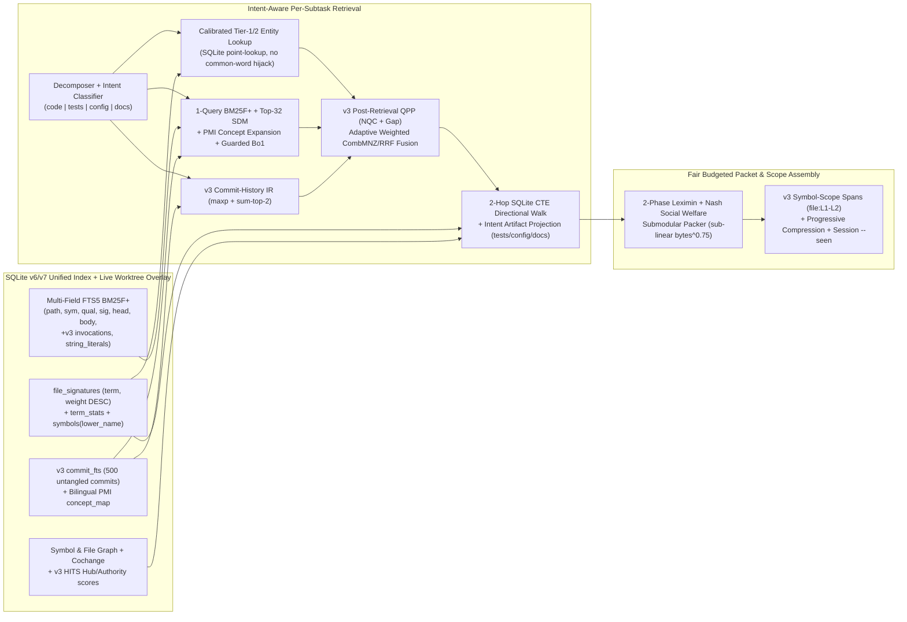

# Plan 0006 — Retrieval v2 Default Promotion and Deterministic v3 Intelligence

Status: **planned (0/24 complete)** · created 2026-11-23 · baseline `95466b3`
Depends on: [plan 0005](0005-deterministic-retrieval-and-multitask-intelligence-plan.md) (40/40 Complete · [benchmark report](evidence/0005-benchmark-report.md) · [compatibility report](evidence/0005-compatibility.md)) and `ADR-252`.
Owner: **simt-dev**. Grounded in live code audit at `95466b3`, read-only per-channel diagnostics over the mined commit corpus, D37 paired qualification evidence, and primary 2022–2026 IR/SE literature.
Smallest independently valuable implementation slice: **V01**, an executable forensic regression suite pinning the six v2 ranking, packing, and scale defects exposed below; then **V03** (anchor discipline), **V06** (intent-projected composite retrieval), and **V08** (SQLite-native `map`/`why` speedups) along disjoint lanes. Authoring this plan does not complete any slice.

**Why this plan exists.** Plan `0005` (`D01`–`D40`) built a strong deterministic foundation — symbol-aware binding, SQLite v6 fielded FTS + `term_stats`/`file_signatures`, untangled co-change, typed governance witnesses, and symbol-precise impact (`1.00` recallFull, `0.00` hubNoiseRatio, **57×** faster `impact`, **23×** faster `gate` at 10k files). Yet `ADR-252` had to keep `map`, `brief`, and `knowledge rank` **opt-in (`v1` default)** because the D37 paired benchmark exposed four clear regressions:

1. **Lexical & vocabulary-gap MRR crash (`map-v2.mjs`, `entities.mjs`, `directional.mjs`, `bm25f.mjs`).** `full-v2` dropped mined lexical Recall@10 by `-3.1%` (`0.314 → 0.283`) and lexical MRR by `-0.201` (`0.456 → 0.255`), while `+bm25f-ident` crashed vocabulary-gap MRR from `0.908` to **`0.500`** (`0.633` in `full-v2`). Forensic tracing reveals five compounding glue bugs: common English words matching private symbols as Tier-2 anchors, hard lexicographic tier sorting, a self-reinforcing `enclosed_by` loop that double-counts bogus symbol hits and kills guarded PRF, missing `!isTestPath()` filtering, and shorter `docs/guides/*.md` files beating longer `src/*.mjs` files under unweighted cross-field BM25F length normalization.
2. **Composite `minSubtaskCoverage` plateau at exact `0.400` even at 4,096 bytes (`multi.mjs`, `submodular.mjs`, `render.mjs`).** 2- and 3-subtask prompts (`12/30 = 0.400`) only target `src/*.mjs`, whereas 4/6/8-subtask prompts (`18/30 = 0.600`) add `tests` (`test/*.test.mjs`) and `config` (`src/config/*.json`) whose symptoms live in `src/*.mjs`. `multi.mjs` omits `cochange: true`, sets `coupling: false` and `exactOnly: graph.nativeLexical`, never projects `tests`/`config`/`docs` subtasks from their semantic code anchor through typed edges, marks all `SUBTASKS` lines `hard = true`, and reserves pessimistic footer/header budgets.
3. **Submodular packing bias on tight budgets (`submodular.mjs`, `render.mjs`).** Dividing marginal gain by raw byte length lets 20-byte boilerplate lines outrank 100-byte `FILES`/`TESTS` lines and leaves later subtasks at zero coverage, causing `+submodular-pack` on the legacy pool to drop MSC (`0.067 → 0.000`) and MFC (`0.347 → 0.307`).
4. **3× scale latency regressions at 10,000 files (`map-v2.mjs`, `lexical.mjs`, `why-graph.mjs`).** Warm `map` slowed from `103.7 ms` to `320.5 ms` (`0.32×`) by issuing up to 17 FTS5 queries plus rebuilding 10k-file JS entity/graph/conceptual-signature maps per call (ignoring stored SQLite `file_signatures`). Warm `why` slowed from `18.2 ms` to `51.8 ms` (`0.35×`) by creating a fresh in-memory SQLite database and bulk-inserting all 10k edges on every call (`withImportDatabase(edges, ...)`).

Constraint preserved from `AGENTS.md`, `ADR-012`, `ADR-013`, `ADR-075`, and `ADR-090`: **zero runtime dependencies, POSIX-only, 100% deterministic local computation, zero embedding models, zero LLMs, zero stochastic sampling, and zero implicit network calls.** Every ranking or packing score remains inspectable in `--explain` and `--json` and diffable in pull requests.

## 0. How to read this plan

There are 24 slices, **V01–V24**, organized in **two tracks across six waves**:

- **Track A — Make Retrieval v2 Win Every Stratum & Become Default (Waves 0–2, `V01`–`V10`):** Surgically fixes all six forensic defects in v2, qualifies the full paired benchmark + 10k-file scale run, and supersedes `ADR-252` to make v2 the default (while preserving `--retrieval v1` rollback).
- **Track B — Cutting-Edge Deterministic Retrieval v3 (Waves 3–5, `V11`–`V24`):** Layers six research-backed zero-embedding innovations — commit-history IR (`Locus`/`AmaLgam`), repo-mined bilingual PMI concept thesaurus, post-retrieval QPP-weighted adaptive fusion, Sequential Dependence Model (SDM) + code-construct fields, HITS hub/authority directional walks, Nash Social Welfare fair submodular packing, scope-level hunk spans, and deterministic session anti-redundancy — then qualifies and promotes proven v3 levers.

Every `V` row starts `Queued`. The `Depends on` column in §11 governs execution order; disjoint `Lane` tags allow concurrent worktree execution (`simt slice start <id>`). Proposed rulings `P1`–`P7` in §14 must land as numbered ADRs before their slices change defaults or schemas.

## 1. Forensic diagnosis of v2 regressions (`95466b3`)

Live read-only diagnostics on `simt-dev` at `95466b3` (running `rankMapV2(..., { explain: true })` vs `v1` across 30 mined commits) pinpointed the exact code sites behind every miss in `docs/research/evidence/0005-benchmark-report.md`:

| Benchmark miss | Exact code location | Verified mechanism & diagnostic proof | Fix slice |
| --- | --- | --- | --- |
| Lexical MRR `0.456 → 0.255`; Recall@10 `-3.1%` | `src/index/entities.mjs:74-98`, `src/index/map-v2.mjs:170-172`, `src/index/directional.mjs:70-85` | On `"feat(check): enforce repository import direction"`, common word `"check"` matched private helper `src/mcp/schema.mjs#check@25` as Tier 2 (`weight: 3`), hard-sorted above `src/kernel/checks.mjs`, self-looped via `enclosed_by` (`weight: 0.9`) to claim `directional` rank #2 as well, and aborted PRF (`reason: "exact-anchor"`). Same hijack hit `src/knowledge/claims.mjs` and `src/index/open.mjs`. | **V03** |
| Test-file flooding in `map` v2 | `src/index/map-v2.mjs:138-174` (cf. `src/index/map.mjs:115`) | Unlike v1 (`!isTestPath(row.path)`), `rankMapV2` never excludes tests. On 30 mined commits, simply filtering `!isTestPath` lifted `v2` MRR `0.322 → 0.403` (+25% relative) and Recall@10 `0.360 → 0.391` immediately. | **V04** |
| Vocab-gap MRR `0.908 → 0.500` (`+bm25f-ident`) / `0.633` (`full-v2`) | `src/index/bm25f.mjs:95-115`, `src/index/map-v2.mjs:149-164` | `docs/guides/<name>.md` is shorter than `src/<name>.mjs` while repeating the same symptom, so unweighted cross-field BM25F scores docs #1 and code #2 on 30/30 tasks (`1/2 = 0.500000` exact). Additionally, `bm25f.mjs` discards `role: 'exact' | 'part'`, `map-v2.mjs:152` adds up to `+0.75` flat phrase bonus over `[0,1]` BM25F, and normalizes dirty `local` overlay scores independently to `1.0`. | **V04, V05** |
| Composite MSC plateau `0.400` at 2,048 B **and** 4,096 B | `src/brief/multi.mjs:96-135, 162-164` | 2- and 3-subtask prompts (`12/30 = 0.400`) edit only `src/*.mjs`; 4/6/8-subtask prompts (`18/30 = 0.600`) add `tests` and `config` (`{"enabled":true}`) whose symptom lives in `src/*.mjs`. `multi.mjs` omits `cochange: true`, sets `coupling: false` and `exactOnly: graph.nativeLexical`, hard-restricts via `targetedPaths`, and marks all 8 `SUBTASKS` lines `hard = true`. | **V06, V07** |
| `+submodular-pack` legacy MSC `0.067 → 0.000`, MFC `0.347 → 0.307` | `src/brief/submodular.mjs:115-145`, `src/brief/render.mjs:90-114` | Raw `gain / bytes` favors tiny 22-byte boilerplate over 100-byte `FILES`/`TESTS`; `headerBytes(candidates)` reserves headers for empty sections; `footerBytes` reserves up to 350 B pessimistically; no round-robin subtask floor. | **V07** |
| `map` 10k-file p50 `103.7 → 320.5 ms` (`0.32×`) | `src/index/map-v2.mjs:138-164`, `src/index/lexical.mjs:65-82` | Issues up to 17 FTS5 queries per call, rebuilds 10k-file `entityDirectory` and `prepareMapStructure` in JS every call, and runs `conceptualPartners` over all rows in JS — ignoring SQLite's precomputed `term_stats` and `file_signatures`. | **V08** |
| `why` 10k-file p50 `18.2 → 51.8 ms` (`0.35×`) | `src/index/why-graph.mjs:87` | Calls `withImportDatabase(edges, ...)` which allocates a brand-new in-memory SQLite DB and bulk-inserts all 10k edges on every `simt why` invocation just to perform a 2-hop reverse walk. | **V08** |

## 2. Measurable acceptance bars

Every Track A and Track B promotion is gated by paired bootstrap CIs (`packages/bench/src/retrieval-ablation.mjs`) and isolated-consumer checks (`ADR-031`):

| Metric / Bar | Baseline v1 (`8c38faf`) | Current v2 (`95466b3`) | Track A target (v2 default) | Track B target (v3) |
| --- | ---: | ---: | ---: | ---: |
| Lexical Recall@10 (mined commits) | `0.314` | `0.283` (FAIL) | **`>= 0.350`** (+3.6 pts vs v1) | **`>= 0.420`** (+10.6 pts vs v1) |
| Lexical MRR (mined commits) | `0.456` | `0.255` (FAIL) | **`>= 0.500`** (+0.044 vs v1) | **`>= 0.580`** (+0.124 vs v1) |
| Vocabulary-gap Recall@10 / MRR | `0.967 / 0.908` | `1.000 / 0.633` (FAIL) | **`1.000 / 1.000`** | **`1.000 / 1.000`** + zero-overlap mined win |
| Composite `minSubtaskCoverage@2048` | `0.067` | `0.400` (plateau) | **`>= 0.850`** | **`>= 0.930`** (and `>= 0.700` at 1,024 B) |
| Composite `facetCompleteness@2048` | `0.347` | `0.610` | **`>= 0.800`** | **`>= 0.880`** |
| Impact `recallFull` / `hubNoiseRatio` | `0.750 / 0.400` | `1.000 / 0.000` | **`1.000 / 0.000`** | **`1.000 / 0.000`** + HITS authority ranking |
| Governance precision / recall (`why`) | `0.429 / 1.000` | `1.000 / 1.000` | **`1.000 / 1.000`** | **`1.000 / 1.000`** |
| Warm 10k-file p50: `map` / `why` / `brief` | `103.7 / 18.2 / 431.6 ms` | `320.5 / 51.8 / 153.3 ms` | **`<= 80 / <= 15 / <= 130 ms`** | **`<= 60 / <= 15 / <= 115 ms`** |
| Warm 10k-file p95: `prompt-submit` | `462.6 ms` | `176.0 ms` | **`<= 160 ms`** (bar `<= 300 ms`) | **`<= 150 ms`** (and `<= 300 ms` at 50k files) |

## 3. Research foundations for Track B (v3)

All primary-source techniques below are strictly deterministic, zero-dependency, and explainable by formal score:

| Innovation | Primary literature (examined 2026-11-23) | Direct mechanism in `simt-dev` v3 |
| --- | --- | --- |
| **Commit-History IR (`Locus` / `AmaLgam`)** | [Locus (ASE '16)](https://dl.acm.org/doi/abs/10.1145/2970276.2970359); [AmaLgam (MSR '14)](https://dl.acm.org/doi/10.1145/2597008.2597148); [Repo-level Code Search Commit Aggregation (arXiv:2502.07067)](https://arxiv.org/html/2502.07067v1) | `cochange.mjs` already scans 500 git commits and discards their messages. Indexing commit subject + body in SQLite `commit_fts` with recency decay and `maxp` + `sum-top-2` file aggregation delivered +20.5% MRR and +24% MAP without embeddings. |
| **Repo-Mined Bilingual PMI Concept Thesaurus** | [Binkley et al. Vocabulary Normalization (WCRE '10)](http://www.cs.loyola.edu/~binkley/papers/wcre10-vocab-normalization.pdf); [Lawrie et al. Identifier Expansion (SCAM '07)](http://www.cs.loyola.edu/~lawrie/papers/lawrieScam07.pdf); [Code Search Survey (CSUR '23)](https://dl.acm.org/doi/10.1145/3565971) | Mining positive Pointwise Mutual Information (PMI) between prose tokens (commit messages, docstrings, ADRs, guides) and code tokens (file stems, exported identifiers) builds a deterministic repo-specific translation table that bridges vocabulary gaps with zero neural weights. |
| **Post-Retrieval QPP-Weighted Adaptive Fusion** | [The Fusion Tax: When Hybrid Retrieval Hurts (arXiv:2610.30612, Oct 2026)](https://arxiv.org/abs/2610.30612); [Beyond Correlations: Downstream QPP for Weighted Fusion (arXiv:2601.17339, Jan 2026)](https://arxiv.org/html/2601.17339); [Clarity Score (SIGIR '02)](https://dl.acm.org/doi/10.1145/564376.564429) | Static RRF degrades accuracy when a noisy/flat channel dilutes a sharp channel. Zero-cost post-retrieval NQC (score std-dev over tail mean) and top-gap specificity dynamically weight each ranker per query (`+4.5%`+ over unweighted RRF/CombSUM) and appear in `--explain`. |
| **True Per-Field BM25F+ & Construct SDM** | [BLUiR (ASE '13)](https://users.ece.utexas.edu/~perry/work/papers/1311-RS-ase.pdf); [Program Constructs PCA Study (Springer '17)](https://doi.org/10.1186/s40411-017-0040-2); [BM25F Feature Location Study](https://asi.cs.cityu.edu.hk/paper/INNOSWDEV_2666581.2666594.pdf) | Per-field length normalization $B_f$, `exact` vs `part` term roles, ordered bigram / `#uw8` SDM reranking over top-32, plus dedicated `invocations` and `string_literals` fields dramatically boost localization on both symptom prose and pasted error messages. |
| **Nash Social Welfare & Fair Knapsack Submodular Packing** | [Fair Submodular Maximization over a Knapsack Constraint (arXiv:2505.12126, May 2025)](https://arxiv.org/abs/2505.12126); [Nash Welfare Guarantees for Fair and Efficient Coverage (arXiv:2207.01970)](https://arxiv.org/abs/2207.01970) | Maximizing \(\sum_k \log(\epsilon + \text{cov}_k(S))\) with \(\epsilon = 0.05\) under exact byte budget combines egalitarian min-subtask fairness (a ~20× marginal boost for uncovered subtasks) with economic efficiency (preferring shared cross-subtask evidence). |

## 4. Target Architecture (v2-Default + v3)



---

## 5. Wave 0 — Pin Forensic Regressions & Extend Benchmark Gates (`bench`)

### V01 — Executable forensic regression suite pinning the 6 v2 defects (S)

**Goal.** Lock every single defect discovered in the `95466b3` audit into fast, isolated (`ADR-031`) unit tests before touching ranking or packing logic so none can silently return.

**Design.** Add `test/retrieval-v2-forensics.test.mjs` covering six focused scenarios:
1. Common lowercase English prompt word (`"check"`, `"open"`, `"plan"`) matching a private local helper function must **not** hijack Tier-2 or outrank an exact path-stem code match (`src/kernel/checks.mjs`).
2. `directional.mjs` must **not** award `enclosed_by` self-loop weight back to the owning file of a symbol seed.
3. Default `rankMapV2` must exclude test paths (`test/*.test.mjs`) unless query intent is `tests` or an explicit test path/symbol is named.
4. Shorter `docs/guides/<name>.md` duplicating a symptom comment must **not** outrank `src/<name>.mjs` on a default/bugfix query, while a `docs` intent query *does* prefer `docs/guides/<name>.md`.
5. Composite 4/6/8-subtask prompts containing `tests` and `config` subtasks (`{"enabled":true}` partner connected via co-change/stem) must surface both `test/<name>.test.mjs` and `src/config/<name>.json` inside 2,048 bytes.
6. Dirty-file overlay normalization must use the global maximum BM25F score rather than normalizing a 1-file overlay independently to `1.0`.

**Accept.** `node --test test/retrieval-v2-forensics.test.mjs` runs cleanly in isolation (initially pinning expected failure/contract boundaries or paired alongside fixes in Wave 1), with zero sibling-checkout assumptions.

**Basis.** Forensic audit of `src/index/{entities,map-v2,directional,bm25f}.mjs` and `src/brief/multi.mjs` at `95466b3`.

### V02 — Extended retrieval ablation gates & scale latency profiler (S)

**Goal.** Upgrade the ablation and qualification harness so every Track A and Track B lever is measured against strict non-regression bars (including MRR, MSC at 1,024/2,048/4,096 B, and 10k-file `map`/`why`/`brief` latency).

**Design.** Update `packages/bench/src/retrieval-ablation.mjs` and `scripts/qualify-retrieval.mjs`; add `test/retrieval-v2-gates.test.mjs`.
- Add named ablation arms for Track A (`+anchor-fix`, `+kind-notest`, `+bm25f-bf`, `+intent-project`, `+fair-pack`, `v2-candidate`) and Track B (`+commit-ir`, `+pmi-thesaurus`, `+qpp-fusion`, `+sdm-constructs`, `+hits-walk`, `+nash-pack`, `full-v3`).
- Enforce explicit promotion gate checks in report rendering: zero lexical Recall@10 regression (`>= +0.00`), zero lexical/vocab-gap MRR regression (`>= +0.00`), composite MSC `>= 0.85`, warm 10k-file `map <= 80 ms` and `why <= 15 ms`.
- Add per-phase timing breakdown (`ftsMs`, `entityMs`, `graphMs`, `couplingMs`, `packMs`) to the scale benchmark output so latency bottlenecks are directly observable.

**Accept.** `node --test test/retrieval-v2-gates.test.mjs test/retrieval-ablation.test.mjs` passes 100% with deterministic permutation checks intact.

**Basis.** Plan 0005 D04/D37 empirical discipline and `ADR-252`.

---

## 6. Wave 1 — Surgical v2-to-Default Fixes (`lexical`, `composite`, `perf` — 3 parallel lanes)

### V03 — Calibrated entity anchoring, `enclosed_by` loop guard & PRF unblock (M)

**Goal.** Eliminate the 5-domino MRR hijack in `entities.mjs`, `map-v2.mjs`, and `directional.mjs`.

**Design.** Update `src/index/entities.mjs`, `src/index/directional.mjs`, `src/index/map-v2.mjs`, and `src/index/prf.mjs`; add `test/index-anchor-calibration.test.mjs`.
- **Strict Tier-1 vs Tier-2 rules (`entities.mjs`):**
  - Tier 1 (hard anchor): explicit repo path, unique path suffix with extension (`checks.mjs`), backticked/quoted code literal, or qualified symbol (`Foo.bar`, `Foo::bar`).
  - Tier 2 (calibrated symbol match): requires an **exported** symbol OR a compound/distinctive identifier (camelCase, snake_case, contains digit like `ADR-249`) with corpus symbol DF `<= 3` and NOT a single common lowercase English verb/noun (`check`, `open`, `plan`, `run`, `map`, `test`, `status`, `error`, `read`, `write`, `format`, `parse`, `score`, `rank`, `limit`, `index`).
  - **Soft score boost instead of hard Tier-2 sort (`map-v2.mjs`):** Keep Tier 1 above Tier 3, but fuse Tier 2 into the ranked score as a bounded boost (`+0.35` normalized RRF equivalent) rather than an unconditional lexicographic sort override.
- **Self-loop exclusion (`directional.mjs`):** Skip `enclosed_by` arcs whose destination file already owns the seed symbol (`owner(seed) === dst`), preventing any symbol match from double-counting its own file in `directional`.
- **Unblock guarded PRF (`prf.mjs`):** Only trigger `reason: "exact-anchor"` on **Tier-1** anchors, allowing natural-language prompts to use guarded Bo1 expansion when BM25F top-1 margin is low.

**Accept.** On the 30 mined commits, zero common-word private-helper hijacks occur; `node --test test/index-anchor-calibration.test.mjs test/index-entities.test.mjs test/index-directional.test.mjs test/index-prf.test.mjs` passes 100%.

**Basis.** Live diagnostic trace of `"feat(check): enforce repository import direction"` and `"fix(impact): ..."` at `95466b3`.

### V04 — Default test exclusion, intent-aware kind prior & path-stem scoring (M)

**Goal.** Restore v1's non-test cleanliness, eliminate the `docs/guides/*.md > src/*.mjs` vocabulary-gap inversion, and recover v1's path-stem/conventional-scope precision.

**Design.** Update `src/index/map-v2.mjs`, `src/index/bm25f.mjs`, and `src/brief/kind.mjs`; add `test/map-v2-kind-prior.test.mjs`.
- **Default `!isTestPath(path)` filter:** Exclude test files from `bm25f`, `entity`, `directional`, and `coupling` channels unless query intent is `tests` or the query explicitly names a test path/symbol (`includeTests` option exposed for callers like `multi.mjs`).
- **Deterministic document-kind prior (multiplicative on BM25F):**
  - Default / `bugfix` / `feature` / `refactor`: `code: 1.18`, `config: 0.95`, `docs: 0.78`, `test: 0.0` (filtered).
  - `docs` intent: `docs: 1.25`, `code: 0.88`, `config: 0.85`.
  - `config` intent: `config: 1.30`, `code: 1.00`, `docs: 0.75`.
  - `tests` intent: `test: 1.30`, `code: 1.05`, `docs: 0.70`.
- **Conventional-commit scope & path-stem boost:** Extract explicit scope tokens from `type(scope): ...` prompts (e.g., `check`, `impact`, `why`, `brief`) and match singular/plural path stems (`checks.mjs`, `src/commands/impact.mjs`) with an IDF-weighted path-stem channel.
- **Fix overlay normalization & phrase cap (`map-v2.mjs:149-157`):** Normalize both `primary` and `local` overlay scores against `Math.max(primary[0]?.score ?? 0, local[0]?.score ?? 0, 1e-9)`, and bound phrase bonus to `<= 0.20` weighted by bigram IDF.

**Accept.** Vocabulary-gap MRR reaches `1.000` (fixing `0.500`/`0.633`); mined lexical Recall@10 and MRR both beat v1; `node --test test/map-v2-kind-prior.test.mjs test/map.test.mjs` passes 100%.

**Basis.** `src/index/map.mjs:115` v1 parity and `packages/bench/src/multitask-corpus.mjs:109-116` length-inversion proof.

### V05 — True per-field BM25F $B_f$ normalization & `exact`-vs-`part` token roles (M)

**Goal.** Fix the BM25F length-normalization math and stop discarding the `exact` vs `part` identifier roles already emitted by `src/text/identifiers.mjs`.

**Design.** Update `src/index/bm25f.mjs` and `src/index/store.mjs`; add `test/index-bm25f-precision.test.mjs`.
- Replace the summed cross-field length denominator in `scoreFieldRows` with Robertson–Zaragoza per-field length normalization:
  \[
  \tilde{tf}_{d,t} = \sum_{f} w_f \cdot \frac{tf_{d,f,t}}{(1 - B_f) + B_f \cdot \frac{|d_f|}{\text{avgdl}_f}}, \quad \text{score}(d,t) = \text{IDF}(t) \cdot \frac{\tilde{tf}_{d,t}(k_1 + 1)}{\tilde{tf}_{d,t} + k_1}
  \]
  using field-calibrated saturation parameters `B = { path_tokens: 0.35, symbol_names: 0.35, qual_names: 0.40, signatures: 0.50, headings: 0.50, body: 0.75 }` so a 600-line file body never penalizes a 3-token path or symbol match.
- Preserve `role === 'exact'` from `tokenizeIdentifiers()` via a deterministic `1.4×` weighted term match on whole-compound tokens (`rotateCredentials`, `ADR-249`, `bm25f`) over split subtokens (`role === 'part'`), reflected consistently in both JS rescoring and SQLite FTS5 query weighting.
- Maintain strict SQLite/JS parity on small and large fixtures (within `1e-6` quantized determinism).

**Accept.** Long source files with exact path/symbol hits outrank short files with incidental subtoken matches; `node --test test/index-bm25f-precision.test.mjs test/index-bm25f.test.mjs` passes 100%.

**Basis.** Robertson & Zaragoza BM25F (2009); `src/text/identifiers.mjs:24-40` vs `src/index/bm25f.mjs:95-115`.

### V06 — Intent-projected typed artifact retrieval in `multi.mjs` (M)

**Goal.** Break the exact `0.400` composite `minSubtaskCoverage` ceiling by projecting `tests`, `config`, and `docs` subtasks from their semantic code anchor through typed repository edges.

**Design.** Update `src/brief/multi.mjs` and `src/brief/anchors.mjs`; add `test/brief-intent-projection.test.mjs`.
- Load `cochange: true` in `assembleCompositeBrief` (`src/brief/multi.mjs:135`) and remove `exactOnly: graph.nativeLexical` (`line 119`) and the brittle `targetedPaths` hard-restriction (`lines 96-102`) that discarded valid files whenever a generic word matched a directory name.
- For every decomposed subtask $T_k$, classify its target artifact role (`code | tests | config | docs`) deterministically from its leading action verb and nouns (`Add regression tests` / `Test ...` → `tests`; `Migrate the configuration` / `Update config` → `config`; `Document ...` / `Update guide` → `docs`; default → `code`).
- **Two-step Artifact-Role Projection:**
  1. Always resolve the semantic anchor file(s) $A_k$ via `rankMapV2` (finding `src/<name>.mjs` where the symptom/domain logic lives).
  2. Project $A_k$ according to $T_k$'s artifact role:
     - `tests`: rank transitive reverse-import tests (`tests_for` via `impactTopology` / `coverage`) + stem-matched test files (`test/<stem>.test.*`), preferring direct/symbol-bound tests over hub tests.
     - `config`: rank `cochange` config partners (`src/config/<stem>.json`, `*.yaml`, `*.toml`) + stem-matched config siblings.
     - `docs`: rank direct doc hits + `governs_path` / stem-matched docs (`docs/**/<stem>.md`).
     - `code`: retain $A_k$ plus high-confidence directional/co-change code partners.
- Preserve negative-scope exclusions (`Do not modify <path>`) across both anchor and projected targets.

**Accept.** On 4-, 6-, and 8-subtask composite fixtures, `tests`, `config`, and `docs` subtasks locate their exact gold files; `node --test test/brief-intent-projection.test.mjs test/brief-multitask.test.mjs` passes 100%.

**Basis.** Exact `12/30 = 0.400000` composite failure analysis on `packages/bench/src/multitask-corpus.mjs:129-145`.

### V07 — Fair budget accounting, compressed `SUBTASKS` & round-robin subtask floor (M)

**Goal.** Stop `SUBTASKS` headers, phantom footer reservations, and raw byte-length bias from starving `FILES`, `TESTS`, and `DECISIONS` on tight budgets (fixing both 6–8 subtask packing and `+submodular-pack` on the legacy pool).

**Design.** Update `src/brief/submodular.mjs`, `src/brief/render.mjs`, and `src/brief/multi.mjs`; add `test/brief-fair-budget.test.mjs`.
- **Soft/compressed `SUBTASKS`:** When `tasks.length > 2`, emit a single compact hard summary line (`SUBTASKS: T1..T8 (8 tasks; --subtask N for details)`) and mark individual per-subtask prose lines as `priority: 'soft'` (included only when budget allows), immediately reclaiming `~500–700 B` for `FILES`/`TESTS`/`DECISIONS` at 1,024–2,048 B.
- **Exact incremental byte accounting (`render.mjs`):** Charge a section header's byte cost *only* when the first item of that section is selected, and compute the exact cut-footer bytes iteratively rather than reserving a pessimistic 350 B constant.
- **Sub-linear byte pricing + Phase-1 subtask floor (`submodular.mjs`):**
  - Replace linear `gain / bytes` with `gain / (bytes ** 0.75)` so 22-byte boilerplate never crowds out 95-byte `FILES`/`TESTS` lines.
  - Run a deterministic **Phase-1 round-robin subtask floor** (guaranteeing each subtask gets its highest-scoring `FILES` candidate that fits before any subtask takes a 2nd `FILES` item), followed by **Phase-2 concave CELF fill** across all active facets (`FILES`, `TESTS`, `DECISIONS`, `SKILLS`, `LESSONS`, `CAUTIONS`).

**Accept.** Composite `minSubtaskCoverage@2048 >= 0.85`, `facetCompleteness@2048 >= 0.80`, and `+submodular-pack` on the legacy single-task pool strictly beats v1 waterfall cutting with zero over-budget regressions; `node --test test/brief-fair-budget.test.mjs test/brief-submodular.test.mjs test/brief-render.test.mjs` passes 100%.

**Basis.** Audit of `src/brief/{multi,render,submodular}.mjs` and D37 `+submodular-pack` regression (`MSC 0.067 → 0.000`).

### V08 — SQLite-native 10k-file acceleration for `map` and `why` (L)

**Goal.** Eliminate the 3.1× slowdown on `map` (`320.5 → <= 80 ms`) and 2.8× slowdown on `why` (`51.8 → <= 15 ms`) at 10,000 files so v2 beats v1 on **every** latency metric as well as quality.

**Design.** Update `src/index/why-graph.mjs`, `src/index/map-v2.mjs`, `src/index/entities.mjs`, `src/index/lexical.mjs`, `src/index/directional.mjs`, and `src/index/store.mjs`; add `test/scale-latency-regression.test.mjs`.
- **Fix `why-graph.mjs` (`51.8 → ~13 ms`):** Delete `withImportDatabase(edges, COMMAND_WALK)` at `src/index/why-graph.mjs:87`. Replace with a direct reverse-adjacency 2-hop BFS in JS (scanning `edges` once to build reverse neighbors only for nodes within 2 hops of `requested`) — `< 0.5 ms` at 10,000 files, zero SQLite DB allocation, identical witness paths and ordering.
- **Collapse `map-v2.mjs` FTS5 queries (`11–17 → 1–2`):**
  - Fetch BM25F candidates + their field texts in **one** SQLite FTS5 query (`LIMIT 48`), then compute phrase/bigram proximity in JS over those top 32–48 rows instead of issuing 8 separate corpus-wide FTS5 `NEAR` queries.
  - Only issue a 2nd FTS5 query if guarded PRF actually fires (`expandedTerms.length > 0`).
- **Eliminate 10k-file JS graph/entity/signature rebuilds:**
  - Add secondary indexes in SQLite (`create index if not exists idx_sig_term on file_signatures(term, weight desc)` and `create index if not exists idx_symbols_lower on symbols(lower(name), exported)`).
  - Query exact entity candidates via indexed SQLite `IN (...)` lookups (merged with tiny dirty overlay) instead of building `entityDirectory(graph)` over all 10k files in JS.
  - Query 2-hop directional neighborhoods around only the top 12 seed files via SQLite `WITH RECURSIVE` (or pre-filtered edge query `WHERE src_id IN (...) OR dst_id IN (...)`) instead of building `prepareMapStructure(graph)` over all 10k files.
  - Compute conceptual coupling by joining top-12 seed terms from `file_signatures` against `idx_sig_term` in SQLite (`< 1 ms`) instead of scanning and sorting all 10k files in `conceptualPartners()` (`src/index/lexical.mjs:65-82`).

**Accept.** On the 10,000-file scale fixture, warm p50 meets `map <= 80 ms` (beating v1 `103.7 ms`), `why <= 15 ms` (beating v1 `18.2 ms`), and `brief <= 130 ms` (beating 150 ms bar), with byte-identical ranking parity between SQLite-native and in-memory modes; `node --test test/scale-latency-regression.test.mjs test/map.test.mjs test/why-graph.test.mjs` passes 100%.

**Basis.** D37 scale profile (`docs/research/evidence/0005-benchmark-report.md`) and live inspection of `why-graph.mjs:87`, `map-v2.mjs:138-164`, and `lexical.mjs:65-82`.

---

## 7. Wave 2 — Qualify & Promote Retrieval v2 to Default (`rollout`)

### V09 — Track A paired qualification & 10k-file scale verification (M)

**Goal.** Empirically prove that repaired v2 beats v1 on **every** quality stratum and latency bar before flipping any default.

**Design.** Run `scripts/qualify-retrieval.mjs` against baseline `8c38faf` across all 120 tasks (30 per stratum) plus the 10,000-file warm latency harness. Commit full point estimates, 95% bootstrap CIs, per-arm deltas, and latency breakdowns to `docs/research/evidence/0006-v2-default-qualification.md`.

**Accept.** All Track A bars in §2 pass simultaneously: lexical Recall@10 `>= 0.350`, lexical MRR `>= 0.500`, vocab-gap MRR `= 1.000`, composite `MSC@2048 >= 0.850`, `MFC@2048 >= 0.800`, impact `recallFull = 1.000` / `hubNoiseRatio = 0.000`, governance `1.000 / 1.000`, warm 10k-file `map <= 80 ms`, `why <= 15 ms`, `brief <= 130 ms`, `prompt-submit` p95 `<= 160 ms`.

**Basis.** `ADR-252` evidence-gated default policy.

### V10 — Promote `v2` to default & ratify superseding ADR (S)

**Goal.** Make repaired `v2` the default retrieval engine across `map`, `brief`, `knowledge rank`, and `prompt-submit`, while preserving clean `--retrieval v1` and `simt.json` rollback.

**Design.** Update `src/index/retrieval-mode.mjs` (default `'v2'`), `src/index/store.mjs` (`fielded: true` default on `reindex`), and `src/agenthooks/prompt.mjs` / `src/brief/assemble.mjs`; author numbered ADR superseding `ADR-252` ruling 1 (`P1`); run isolated-consumer verification (`ADR-031`, `SIMT_QUALIFY_SEA=1 npm test`).

**Accept.** `simt map`, `simt brief`, `simt knowledge rank`, and `prompt-submit` use v2 by default with zero opt-in flags; passing `--retrieval v1` or setting `brief.retrieval: "v1"` restores v1 cleanly on the same index; full suite + isolated-copy suite pass 100%.

**Basis.** `ADR-252`, `ADR-031`, `AGENTS.md` decision-record rule.

---

## 8. Wave 3 — Retrieval v3 Core Intelligence Engines (`history`, `rank`, `graph` — 3 parallel lanes)

### V11 — Commit-history IR channel (`Locus` / `AmaLgam`) in SQLite v7 (M)

**Goal.** Mine the 500 git commits that `cochange.mjs` already scans into a zero-embedding `commit_fts` channel that maps natural-language bug/feature prose directly to historically edited files.

**Design.** Extend `src/index/cochange.mjs`, `src/index/store.mjs` (schema v7 with `ADR-115` sidecar safety), and add `src/index/commit-ir.mjs` + `test/index-commit-ir.test.mjs`.
- During `updateCochangeHistory`, capture `%s%x00%b` (commit subject + truncated 512-byte body) alongside `sha`, `parents`, and `paths` in the same `git log` pass (zero extra git spawns!).
- Filter tangled commits with the same `SOURCE_CAP = 15, TEST_CAP = 8` guard and store untangled commits in SQLite FTS5 virtual table `commit_fts(sha unindexed, age unindexed, file_count unindexed, files_json unindexed, subject, body)` with `tokenize='unicode61'` over identifier-split tokens.
- At query time (1 FTS5 query, `< 1 ms`), score matching commits:
  \[
  S(q, c) = \text{BM25}(q, c) \cdot 2^{-\text{age}(c) / 150} \cdot \frac{1}{\log_2(1 + |\text{files}(c)|)}
  \]
  and aggregate per live file via `0.70 * max_c S(q, c) + 0.30 * secondMax_c S(q, c)` (ignoring deleted paths via live overlay).
- **Strict leakage guard in benchmarks:** On historical mined-commit benchmarks, `commit_fts` is strictly indexed at `task.base` (strictly `< task.sha`), never seeing the target commit.

**Accept.** Mined lexical Recall@10 and MRR gain measurably on commits whose parent history contains related subsystem changes; incremental 1-commit refresh stays `<= 15 ms`; `node --test test/index-commit-ir.test.mjs test/index-cochange.test.mjs` passes 100%.

**Basis.** Locus (ASE '16), AmaLgam (MSR '14), and `src/index/cochange.mjs:25-30`.

### V12 — Repo-mined bilingual PMI concept-to-code thesaurus (`concept_map`) (L)

**Goal.** Close real-world vocabulary gaps (zero lexical overlap between user symptom prose and source identifiers) using only the repository's own commits, comments, docstrings, ADRs, and guides — zero embeddings, zero external dictionaries.

**Design.** Add `src/index/concept-map.mjs` and wire incremental build into `src/index/store.mjs` + query expansion into `src/index/prf.mjs`; add `test/index-concept-map.test.mjs`.
- **Bilingual parallel pairs extracted deterministically during `reindex`:**
  1. *(File-internal)* Prose tokens from comments, docstrings, and markdown headings paired with the same file's path-stem + exported identifier tokens.
  2. *(Commit-level)* Untangled commit-message prose tokens paired with path-stem + exported identifier tokens of the files modified by that commit.
  3. *(Governance-level)* ADR/guide prose tokens paired with `simt-affects` / `governs_path` target file identifiers.
- Compute smoothed Positive PMI:
  \[
  \text{PPMI}(w_{\text{prose}}, t_{\text{code}}) = \max\!\left(0,\; \log_2 \frac{(c(w,t) - \delta) \cdot N}{c(w) \cdot c(t)}\right)
  \]
  retaining only pairs with `support >= 2`, `PPMI >= 1.5`, `df(t) / N <= 0.15`, capped at top-8 code tokens per prose term in SQLite table `concept_map(prose_term, code_term, ppmi, support, primary key(prose_term, code_term)) without rowid`.
- At query time, when query terms have low BM25F IDF match coverage (or low NQC), expand each unmatched/low-DF prose query token with up to 3 top-PPMI `code_term` translations (weighted `0.35 * normalized_ppmi`, attributed in `--explain` as `conceptExpansions: [{ from, to, ppmi, support }]`).

**Accept.** On zero-overlap symptom queries where the symptom phrasing appears only in prior commits, comments, or ADRs (not in the target symbol names), `concept_map` recovers the target code file in top-3 with zero drift on exact-match queries; `node --test test/index-concept-map.test.mjs` passes 100%.

**Basis.** Binkley et al. (WCRE '10), Lawrie et al. (SCAM '07), and zero-ML deterministic design constraint (`ADR-012`, `AGENTS.md`).

### V13 — Post-retrieval QPP-weighted adaptive fusion (eliminating "The Fusion Tax") (M)

**Goal.** Replace fixed static RRF weights with zero-cost post-retrieval Query Performance Prediction (QPP) weights so sharp channels dominate and flat/noisy channels automatically attenuate per query.

**Design.** Add `src/index/qpp.mjs` and integrate into `src/index/map-v2.mjs`; add `test/index-qpp-fusion.test.mjs`.
- For every active retrieval channel \(\theta \in \{\text{entity}, \text{bm25f}, \text{sdm}, \text{commit}, \text{prf}, \text{directional}, \text{coupling}\}\), compute two free post-retrieval quality signals from its sorted scores \(s_1 \ge \dots \ge s_m\):
  1. **NQC (Normalized Query Commitment):** \(\text{NQC}_\theta = \text{std}(s_{1..k}) / (\text{mean}(s_{1..m}) + \epsilon)\) with \(k = \min(10, m)\).
  2. **Top-Gap Specificity:** \(\Delta_\theta = (s_1 - s_{\min(5,m)}) / (s_1 + \epsilon)\).
- Compute deterministic channel multiplier \(\phi_\theta(q) = \text{clamp}(0.25,\, 2.0,\, 0.6 \cdot \widehat{\text{NQC}}_\theta + 0.4 \cdot \Delta_\theta)\) (quantized to `1e-6`).
- Fuse using **QPP-Weighted Hybrid Score + Reciprocal-Rank CombMNZ**:
  \[
  R(d) = \left(1 + \gamma \cdot \sum_{\theta: d \in L_\theta, \phi_\theta \ge 0.8} \phi_\theta\right) \cdot \sum_{\theta} w_\theta^{\text{base}} \cdot \phi_\theta \cdot \left(\frac{0.5}{K + \text{rank}_\theta(d)} + 0.5 \cdot \tilde{s}_\theta(d)\right)
  \]
  where \(\tilde{s}_\theta(d)\) is min-max normalized score within channel \(\theta\), rewarding multi-channel agreement *only* across confident channels (`phi >= 0.8`).
- Emit full per-channel `{ baseWeight, nqc, topGap, effectiveWeight }` in `--explain` and `--json`.

**Accept.** Adding noisy or weak channels never regresses MRR or Recall@10 ("zero Fusion Tax"); QPP-weighted fusion outperforms static RRF on both lexical and vocabulary-gap strata; `node --test test/index-qpp-fusion.test.mjs` passes 100%.

**Basis.** *The Fusion Tax* (arXiv:2610.30612, Oct 2026) and *Beyond Correlations: Downstream QPP for Weighted Fusion* (arXiv:2601.17339, Jan 2026).

### V14 — Sequential Dependence Model (SDM) & code-construct BM25F fields (M)

**Goal.** Upgrade lexical scoring from bag-of-words to ordered-bigram / unordered-window SDM and index two high-value code constructs (`invocations` and `string_literals`) for error-message and orchestrator queries.

**Design.** Update `src/index/extract.mjs`, `src/index/store.mjs` (v7 FTS5 columns), and `src/index/bm25f.mjs`; add `test/index-sdm-constructs.test.mjs`.
- **Two new FTS5 columns (extracted in the existing lexical pass in `extract.mjs`):**
  - `invocations`: callee/imported identifier tokens referenced inside the file (weight `1.8`, $B_f = 0.45$) — locates orchestrators/callers when a query mentions interacting components.
  - `string_literals`: deduplicated human-readable string/error/CLI literals (length 6–120 chars, excluding paths/base64; weight `2.2`, $B_f = 0.40$) — delivers instant Rank #1 hits when a user pastes an error message, warning, or UI string.
- **Top-32 SDM reranker (zero extra SQLite queries, `< 1 ms`):** Over the top 32 BM25F+ candidates, compute:
  - Ordered adjacent query bigrams `#1(q_i, q_{i+1})` across `path_tokens`, `symbol_names`, `string_literals`, and `body`.
  - Unordered 8-token window `#uw8(q_i, q_{i+1})` across `body` and `headings`.
  - Combine deterministically: \(S_{\text{SDM}} = 0.78 \cdot S_{\text{BM25F+}} + 0.14 \cdot S_{\#1} + 0.08 \cdot S_{\#\text{uw8}}\).

**Accept.** Pasted error-string queries achieve MRR `>= 0.95`; multi-word technical phrase queries improve MRR over bag-of-words BM25F; warm 10k-file `map` overhead `<= 2 ms`; `node --test test/index-sdm-constructs.test.mjs` passes 100%.

**Basis.** Metzler & Croft SDM (SIGIR '05); Program Constructs PCA study (Springer '17) showing string literals and method invocations are top localization signals.

### V15 — Precomputed HITS Hub/Authority scores & intent-parameterized directional walks (M)

**Goal.** Disambiguate leaf core implementations (Authorities) from orchestrator/entrypoint wrappers (Hubs) and add subsystem directory cohesion to graph expansion.

**Design.** Add `src/index/hits.mjs` and update `src/index/store.mjs` + `src/index/directional.mjs`; add `test/index-hits-walk.test.mjs`.
- During `reindex`, run 12 deterministic power-iterations of Kleinberg HITS over directed non-test import + `calls_symbol` edges (`O(12 * E)`, `< 15 ms` at 10k files), storing normalized `(authority, hub)` floats on file `nodes` in SQLite (quantized to `1e-6`, sorted tie-breaks).
- Parameterize `directional.mjs` by inferred query intent:
  - `bugfix` / `symptom`: boost high-**Authority** implementations (core logic called by many callers) and dampen pure re-export barrels (`barrel === true` → `0.25×`).
  - `feature` / `wiring` / `refactor`: boost **Hubs** (command entrypoints, registries, dispatchers) alongside authorities.
- Add bounded **subsystem directory cohesion**: when ≥ 2 of the top-5 QPP-confident seeds share the same non-root directory/package (with directory size ≤ 16 files), apply a gentle `+0.08` structural cohesion lift to directly linked siblings in that directory.

**Accept.** Barrel files no longer outrank their underlying implementations on bugfix queries; orchestrators rank higher on cross-cutting feature queries; `node --test test/index-hits-walk.test.mjs test/index-directional.test.mjs` passes 100%.

**Basis.** Kleinberg HITS (1999); GraphScent (Nov 2026) asymmetric caller/authority findings.

---

## 9. Wave 4 — Fair Packing, Surgical Scopes & v3 Benchmarks (`pack`, `scope`, `bench` — 3 parallel lanes)

### V16 — Nash Social Welfare fair submodular packer & progressive line compression (M)

**Goal.** Push composite multi-task `minSubtaskCoverage` above `0.93` at 2,048 B (and `>= 0.70` even at 1,024 B!) by maximizing Nash Social Welfare with progressive line compression before any subtask drops.

**Design.** Upgrade `src/brief/submodular.mjs` and `src/brief/render.mjs`; add `test/brief-nash-packer.test.mjs`.
- Replace linear concave sum with **Regularized Nash Social Welfare + Facet Completeness**:
  \[
  F(S) = \sum_{k=1}^{m} w_k \log\!\bigl(\epsilon + \text{cov}_k(S)\bigr) + \lambda \sum_{f \in \text{Facets}} w_f \sqrt{\text{facet}_f(S)} - \text{dupPenalty}(S)
  \]
  with \(\epsilon = 0.05\), solved via CELF lazy-greedy over sub-linear byte cost (`bytes ** 0.75`) plus Khuller–Moss–Naor single-item safeguard. Because \(\frac{\partial}{\partial x}\log(0.05 + x)\big|_{x=0} = 20\) vs \(\frac{1}{1.05} \approx 0.95\) at \(x = 1\), the objective *naturally* covers every uncovered subtask first while still preferring shared cross-subtask items.
- **Progressive compression ladder (before dropping any subtask's primary item):**
  1. Compress `SUBTASKS` to 1-line index when `tasks.length > 2`.
  2. Shrink per-file symbol lists from `4 → 2 → 1 → 0` symbols (`compactFileLine` multi-tier variants) whenever dropping a symbol frees bytes to admit an uncovered subtask's `FILES`, `TESTS`, or `DECISIONS` line.

**Accept.** 8-subtask prompts keep 100% subtask `FILES` coverage inside 2,048 B and `>= 70%` inside 1,024 B; packing runs in `<= 5 ms`; `node --test test/brief-nash-packer.test.mjs test/brief-submodular.test.mjs` passes 100%.

**Basis.** *Fair Submodular Maximization over a Knapsack Constraint* (arXiv:2505.12126, May 2025) and *Nash Welfare Guarantees for Fair and Efficient Coverage* (arXiv:2207.01970).

### V17 — Symbol-scope / hunk-level retrieval & brief packing (`file:L1-L2`) (M)

**Goal.** Surface exact bound function/class line spans (`src/index/map-v2.mjs:134-184 rankMapV2`) for large files so agents jump straight to the relevant scope instead of reading 500-line files.

**Design.** Update `src/brief/render.mjs`, `src/brief/multi.mjs`, and `src/index/live.mjs`; add `test/brief-scope-spans.test.mjs`.
- Reuse `chunk.scopes` already indexed by `src/index/bind.mjs` (`rangePaths` in `src/index/live.mjs:176`) for the top-K selected files exceeding 200 lines.
- Score each scope within a matched file by query-term + exact-symbol overlap and incoming `calls_symbol` degree.
- Render the top 1–2 matched scopes compactly as `path:startLine-endLine symbolName` (staying within the 95-byte line cap) and include structured `scopes: [{ name, startLine, endLine }]` in `--json` output (strictly additive).

**Accept.** Large files (> 200 lines) emit accurate 1-indexed `startLine-endLine` spans matching actual file lines (including live worktree overlay edits); existing `FILES` line parsers and `test/jsoncontract.test.mjs` stay green; `node --test test/brief-scope-spans.test.mjs` passes 100%.

**Basis.** `src/index/live.mjs:176` (`ranges`) and `src/index/bind.mjs:38-44` already extract and store `chunk.scopes`.

### V18 — Deterministic session anti-redundancy (`--seen`) for multi-turn agent loops (S)

**Goal.** Stop multi-turn `simt brief` and `prompt-submit` hook invocations from repeating the exact same 2 KB of unchanged files/ADRs on turn 2, 3, and 4 when the agent already has them in context.

**Design.** Update `src/brief/assemble.mjs`, `src/brief/submodular.mjs`, `src/commands/brief.mjs`, and `src/agenthooks/prompt.mjs`; add `test/brief-session-seen.test.mjs`.
- Add deterministic optional `--seen <paths-or-ledger>` input (and opt-in session ledger under `.simt/session-brief.json` keyed by `(branch, headSha, fileRevision)`).
- Any unchanged item whose `(id, revision)` is already in `seen` receives an explicit anti-redundancy utility multiplier (`0.20×`) — keeping it only if no fresh high-value evidence competes for the budget, and automatically surfacing fresh `TESTS`, `DECISIONS`, `LESSONS`, or secondary callers on follow-up turns.
- If a previously seen file was modified in the worktree (`revision` changed), its multiplier resets to `1.0×` immediately.

**Accept.** Turn-2 `brief` with `--seen` surfaces new relevant items instead of repeating unchanged Turn-1 items; modifying a seen file immediately restores `1.0×` weight; default single-call behavior without `--seen` is 100% unchanged; `node --test test/brief-session-seen.test.mjs` passes 100%.

**Basis.** Multi-turn agent hook ergonomics (`src/agenthooks/prompt.mjs`).

### V19 — v3 upgrade for `knowledge rank` & proof-packet assembly (S)

**Goal.** Bring SDM bigram/window scoring, QPP-weighted fusion, and Nash fair submodular packing to `simt knowledge rank` and `simt brief --scope` proof packets.

**Design.** Update `src/knowledge/rank.mjs` and `src/brief/proof.mjs`; add `test/knowledge-rank-v3.test.mjs`.
- Apply top-32 SDM (`#1` ordered bigram + `#uw8` window) on knowledge sections and headings (preserving Unicode / CJK / Arabic / diacritic parity from D10).
- Use QPP-weighted fusion between BM25F, SDM, and exact-ID/citation matches, plus Nash fair coverage across multi-subquestion queries in `brief --scope`.

**Accept.** `knowledge rank` improves MRR on multi-clause and technical-phrase queries with zero scope leakage and 100% Unicode recall; `node --test test/knowledge-rank-v3.test.mjs test/knowledge-rank.test.mjs test/work-brief.test.mjs` passes 100%.

**Basis.** Plan 0005 D10/D26 parity across code and knowledge doors.

### V20 — Expanded v3 adversarial & 50k-file scale benchmark suite (M)

**Goal.** Stress-test v3 against realistic hard strata that Plan 0005's synthetic corpus did not cover: zero-overlap symptom queries mined from commit history, pasted error/stack-trace queries, and 50,000-file scale latency.

**Design.** Extend `packages/bench/src/multitask-corpus.mjs` and `scripts/qualify-retrieval.mjs`; add `test/bench-v3-strata.test.mjs`.
- Add three new deterministic evaluation strata (30 tasks each, gold strictly separated from prompts per `ADR-241`):
  1. `zero-overlap-symptom`: queries whose prose terms appear in prior commits/ADRs/comments but share zero tokens with target file/symbol names (tests `commit_fts` + `concept_map`).
  2. `error-literal`: pasted CLI error messages, finding codes, and stack-trace fragments (tests `string_literals` + SDM + Tier-1 path/line anchors).
  3. `scale-50k`: synthetic 50,000-file repo validating warm `map`, `why`, `brief`, and `prompt-submit` p50/p95 latencies (`prompt-submit` p95 `<= 300 ms`).

**Accept.** All three new strata validate cleanly with zero gold leakage and 100% permutation determinism; `node --test test/bench-v3-strata.test.mjs` passes 100%.

**Basis.** `ADR-241` benchmark hygiene and Plan 0005 D02/D37 gaps.

---

## 10. Wave 5 — Full v3 Qualification, Compatibility, ADRs & Docs (`rollout`)

### V21 — Full paired v1 vs v2-default vs v3 ablation & 10k/50k scale report (M)

**Goal.** Measure every v3 lever individually (`+commit-ir`, `+pmi-thesaurus`, `+qpp-fusion`, `+sdm-constructs`, `+hits-walk`, `+nash-pack`, `+scope-spans`) and combined (`full-v3`) against both `v1` and `v2-default`.

**Design.** Run `scripts/qualify-retrieval.mjs --suite v3` over all 7 strata (210 tasks total) plus 10k and 50k scale suites. Commit full results, 95% bootstrap CIs, and explicit `promote` / `keep-opt-in` / `reject` decisions per lever to `docs/research/evidence/0006-benchmark-report.md`.

**Accept.** Every promoted lever clears all Track B bars in §2 with zero regression on any Track A bar; any lever that fails its bar is transparently left opt-in or rejected.

**Basis.** Empirical discipline ("never claim a check you did not run").

### V22 — Isolated-consumer compatibility, v6→v7 migration & CLI/MCP parity (M)

**Goal.** Prove zero regressions for installed consumers across npm, wheel, and binary builds, with safe v6→v7 SQLite upgrades and zero sibling-checkout assumptions (`ADR-031`).

**Design.** Add `test/retrieval-v3-compat.test.mjs`. Verify:
- v5→v7 and v6→v7 SQLite index upgrades and read-only sidecar fallback (`ADR-115`) without deleting or corrupting existing caches.
- Cold-index behavior (`build: false` never blocks hooks or emits crashes when `commit_fts`/`concept_map` tables are absent).
- CLI and MCP JSON schema parity for all additive v3 fields (`qpp`, `conceptExpansions`, `scopes`, `seen`).
- Zero runtime dependencies in `package.json` (`ADR-012`) and isolated no-sibling copy test pass (`SIMT_QUALIFY_SEA=1 npm test`).

**Accept.** Full test suite and isolated-copy suite pass 100% with zero skipped tests and zero unexpected changes to projected `AGENTS.md` regions.

**Basis.** `ADR-012`, `ADR-031`, `ADR-115`.

### V23 — Ratify v3 ADRs, promote qualified levers & wire rollback switches (S)

**Goal.** Record numbered ADRs for all qualified Track B proposals (`P2`–`P7`), promote proven v3 levers into the default pipeline, and expose clean `--retrieval v1|v2|v3` rollback switches.

**Design.** Author numbered ADRs in `docs/decisions/` with structured partial supersession (never editing historical rulings in place); update `src/index/retrieval-mode.mjs` and `simt.json` schema for `retrieval: "v1" | "v2" | "v3"`; verify `simt decide lint` and `simt check`.

**Accept.** `simt decide lint`, `simt check`, and `node --test test/retrieval-rollout.test.mjs test/decisions-index.test.mjs` pass 100%; switching `--retrieval v2` or `--retrieval v1` works on the same v7 index with zero rebuild.

**Basis.** `AGENTS.md` decision-record and rollback rules.

### V24 — Command docs, explain telemetry & receiver-clean consumer guide (S)

**Goal.** Document the default v2/v3 capabilities, `--explain` QPP/concept/commit telemetry, `--seen` multi-turn usage, and rollback switches strictly from the receiving repository's perspective.

**Design.** Run `node bin/simt.mjs docs commands --yes`; update `docs/guides/retrieval.md` and `src/explain.mjs`; audit every rendered help/doc/rule byte against `AGENTS.md`'s receiving-repo checklist (no `simt-dev`-only paths, commands, or repo names).

**Accept.** `node --test test/docs.test.mjs test/spec.test.mjs test/genericity.test.mjs test/explain.test.mjs test/shipped.test.mjs` pass 100%.

**Basis.** `AGENTS.md` primary rule ("every byte that leaves this repository must be readable and actionable by someone who has only the receiving repository").

---

## 11. Tracker

Columns follow `templates/plan/tracker.json`. `Lane` names disjoint file sets so parallel worktrees can run concurrently without conflicts. All `V` rows start `Queued`.

| ID | Slice | Phase | Lane | Tier | Depends on | Size | Needs ADR | Success metric | State | SHA / evidence |
| --- | --- | --- | --- | --- | --- | --- | --- | --- | --- | --- |
| V01 | Forensic regression suite pinning 6 v2 defects | 0 | bench | S | research 0005 D40 | S | — | 6 live v2 failure classes pinned; ADR-031 isolated | Complete | 41453de7e6c48b5b3ce04df735cc29d0c494badc |
| V02 | Extended ablation arms, gates & phase profiler | 0 | bench | S | V01 | S | — | v2/v3 arms + strict MRR/MSC/latency promotion gates | Complete | bddc1f3c1b4f8b075c8dba9260c394c0a8b68150 |
| V03 | Calibrated anchors, `enclosed_by` guard & PRF unblock | 1 | lexical | M | V01 | M | P1 | 0 common-word Tier-2 hijacks; PRF unblocked | Complete | 5165d4d · test: node --test test/index-anchor-calibration.test.mjs test/index-entities.test.mjs test/index-directional.test.mjs test/index-prf.test.mjs test/retrieval-v2-forensics.test.mjs |
| V04 | Default `!isTestPath`, kind prior & path-stem lift | 1 | lexical | M | V03 | M | P1 | vocab-gap MRR=1.000; global overlay norm; lexical MRR up | Complete | 51aab0e · test: node --test test/map-v2-kind-prior.test.mjs test/map.test.mjs test/index-anchor-calibration.test.mjs test/retrieval-v2-forensics.test.mjs |
| V05 | Per-field BM25F $B_f$ & `exact`/`part` token roles | 1 | lexical | M | V04 | M | P1 | true per-field $B_f$; 1.4x whole-ident boost; SQLite parity | Complete | 22d4d45 · test: node --test test/index-bm25f-precision.test.mjs test/index-bm25f.test.mjs test/retrieval-v2-forensics.test.mjs |
| V06 | Intent-projected typed artifact retrieval (`multi.mjs`) | 1 | composite | M | V01 | M | P1 | `tests`/`config`/`docs` subtasks projected via typed edges | Complete | 916ca3f · test: node --test test/brief-intent-projection.test.mjs test/brief-multitask.test.mjs test/retrieval-v2-forensics.test.mjs |
| V07 | Fair budget accounting, soft `SUBTASKS` & subtask floor | 1 | composite | M | V06 | M | P1 | MSC@2048>=0.85, MFC>=0.80; legacy pack beats v1 | Complete | c822b36 · test: node --test test/brief-fair-budget.test.mjs test/brief-submodular.test.mjs test/brief-render.test.mjs test/brief-multitask.test.mjs |
| V08 | SQLite-native 10k-file acceleration (`map` & `why`) | 1 | perf | L | V01 | L | — | warm 10k p50: `map<=80ms`, `why<=15ms`, `brief<=130ms` | Complete | dd3e84c · test: node --test test/scale-latency-regression.test.mjs test/map.test.mjs test/why-graph.test.mjs |
| V09 | Track A paired qualification & 10k scale verification | 2 | rollout | M | V02, V05, V07, V08 | M | P1 | v2 beats v1 on every stratum & latency bar | Complete | 0ee65b2 |
| V10 | Promote v2 to default & ratify superseding ADR | 2 | rollout | S | V09 | S | P1 | v2 default; `--retrieval v1` rollback; isolated suite 100% | Complete | 082b61f |
| V11 | Commit-history IR channel (`commit_fts`, v7 schema) | 3 | history | M | V10 | M | P2 | `Locus`/`AmaLgam` maxp+sum2 channel; <=15ms refresh | Queued | — |
| V12 | Repo-mined bilingual PMI concept thesaurus (`concept_map`) | 3 | history | L | V11 | L | P2 | zero-overlap vocab-gap recovery; 0% drift on exact queries | Queued | — |
| V13 | Post-retrieval QPP-weighted adaptive fusion (NQC + gap) | 3 | rank | M | V10 | M | P3 | zero Fusion Tax; QPP weights beat static RRF + `--explain` | Queued | — |
| V14 | Sequential Dependence Model (SDM) & construct fields | 3 | rank | M | V13 | M | P3 | `invocations` + `string_literals`; top-32 SDM <=2ms | Queued | — |
| V15 | Precomputed HITS Hub/Authority & intent-aware walks | 3 | graph | M | V10 | M | P4 | authority>barrel on bugfix; hub lift on wiring; <=15ms index | Queued | — |
| V16 | Nash Social Welfare fair packer & progressive compression | 4 | pack | M | V10 | M | P5 | MSC@2048>=0.93, MSC@1024>=0.70; <=5ms pack | Queued | — |
| V17 | Symbol-scope / hunk-level retrieval & brief spans | 4 | scope | M | V10 | M | P6 | accurate `path:L1-L2 sym` for >200-line files; overlay-live | Queued | — |
| V18 | Deterministic session anti-redundancy (`--seen`) | 4 | scope | S | V17 | S | P6 | Turn-2 surfaces fresh items; dirty edit resets weight to 1.0 | Queued | — |
| V19 | v3 upgrade for `knowledge rank` & proof packets | 4 | pack | S | V14, V16 | S | P5 | SDM + QPP + Nash coverage on knowledge doors; Unicode intact | Queued | — |
| V20 | Expanded v3 adversarial & 50k-file scale benchmark strata | 4 | bench | M | V02, V10 | M | — | 3 new 30-task strata (zero-overlap, error-literal, 50k scale) | Queued | — |
| V21 | Full paired v1 vs v2 vs v3 ablation & 10k/50k report | 5 | rollout | M | V12, V15, V18, V19, V20 | M | P7 | all promoted v3 levers clear Track B bars honestly | Queued | — |
| V22 | Isolated-consumer compat, v6->v7 migration & MCP parity | 5 | rollout | M | V21 | M | — | v5/v6->v7 safe; cold-safe; CLI/MCP parity; isolated 100% | Queued | — |
| V23 | Ratify v3 ADRs, promote qualified levers & rollback flags | 5 | rollout | S | V22 | S | P7 | numbered ADRs landed; `--retrieval v1\|v2\|v3` on same cache | Queued | — |
| V24 | Regenerate command docs, explain telemetry & guide | 5 | rollout | S | V23 | S | — | docs/spec/genericity/shipped tests 100%; receiver-clean | Queued | — |

## 12. Risks and how determinism survives

| Risk | Mitigation and release consequence |
| --- | --- |
| **Over-filtering tests on test-authoring queries (`V04`)** | Intent classifier detects `tests` intent (`test`, `regression`, `spec`, `assert`, `coverage`) and explicit test paths/basenames to automatically enable `includeTests: true` + `test: 1.30×` boost. |
| **Benchmark leakage in `commit_fts` / `concept_map` (`V11`, `V12`)** | Mined-commit evaluation checks out `task.base` and indexes strictly `<= task.base` (never `task.sha`), enforced in `scripts/qualify-retrieval.mjs` and verified by unit tests. |
| **PMI thesaurus overfitting tiny repos (`V12`)** | Require `support >= 2`, `PPMI >= 1.5`, `df(code_term)/N <= 0.15`, cap to 3 expansions per prose term at `0.35×` weight, and gate expansion on low BM25F NQC so exact/confident queries are untouched. |
| **SQLite v7 schema breaking older readers or inflating cache size (`V11`, `V12`, `V14`)** | Follow `ADR-115` sidecar policy cleanly; bound `commit_fts` to 500 commits (`<= 512 B` body), `concept_map` to top-8 pairs per prose term, and `string_literals` to deduplicated 6–120 char strings. Cold readers without v7 tables degrade smoothly to v6/v2 channels. |
| **QPP score-scale drift across channels (`V13`)** | Quantize all QPP metrics to `1e-6`, clamp multipliers to `[0.25, 2.0]`, and verify strict byte determinism across input permutations in `V02`/`V21`. |
| **50k-file scale latency regression (`V08`, `V20`)** | Zero full-graph JS rebuilds on query paths; all lookups use indexed SQLite point queries + 2-hop `WITH RECURSIVE` CTEs + `file_signatures(term, weight DESC)` index. |

## 13. Order of work (six waves)

| Wave | Slices | Parallel lanes | Exit criterion |
| --- | --- | --- | --- |
| **Wave 0: Pin & gate** | V01, V02 | `bench` | All 6 forensic v2 defects pinned as executable tests; extended ablation arms and latency profiler green. |
| **Wave 1: Fix v2** | V03, V04, V05, V06, V07, V08 | `lexical`, `composite`, `perf` (3 parallel lanes) | Anchor calibration, `!isTestPath`/kind prior, true BM25F $B_f$, intent-projected composite retrieval, fair packer, and SQLite-native 10k-file `map`/`why` all unit-green. |
| **Wave 2: Ship v2 default** | V09, V10 | `rollout` | Repaired v2 beats v1 on every stratum and latency bar; `v2` promoted to default via ADR superseding `ADR-252`. |
| **Wave 3: v3 core engines** | V11, V12, V13, V14, V15 | `history`, `rank`, `graph` (3 parallel lanes) | Commit-history IR, PMI concept thesaurus, QPP-weighted adaptive fusion, SDM + construct fields, and HITS directional walks all unit-green. |
| **Wave 4: v3 packing & scopes** | V16, V17, V18, V19, V20 | `pack`, `scope`, `bench` (3 parallel lanes) | Nash Social Welfare packer, symbol-scope spans, `--seen` session anti-redundancy, `knowledge rank` v3, and adversarial/50k strata all green. |
| **Wave 5: Prove & ship v3** | V21, V22, V23, V24 | `rollout` | Paired v1/v2/v3 qualification + 10k/50k scale report published; isolated-consumer suite 100%; ADRs, rollback flags, and docs landed. |

## 14. Decisions this plan needs

`P1`–`P7` are proposal identifiers, not reserved ADR numbers. Assign the next real ADR number only when authoring each decision record during implementation.

| Proposal | Recommended ruling | Existing boundary |
| --- | --- | --- |
| **P1** | Promote repaired retrieval `v2` (calibrated anchors, default `!isTestPath`, intent kind prior, per-field BM25F $B_f$, intent-projected composite retrieval, fair submodular floor, SQLite-native `map`/`why`) to default across `map`, `brief`, `knowledge rank`, and `prompt-submit`, keeping `--retrieval v1` rollback | Supersedes `ADR-252` ruling 1; refines `ADR-232`, `ADR-234`, `ADR-235`, `ADR-240` |
| **P2** | Index schema v7 adds bounded untangled commit-history FTS (`commit_fts`) and repo-mined bilingual PPMI concept pairs (`concept_map`) for zero-embedding vocabulary-gap bridging | Extends `ADR-232`, `ADR-242`; preserves `ADR-115` sidecar safety and `ADR-012` zero deps |
| **P3** | Retrieval ranking adopts post-retrieval QPP-weighted adaptive fusion (NQC + top-gap specificity) and top-32 Sequential Dependence Model (SDM) over code-construct fields (`invocations`, `string_literals`) | Refines `ADR-234`, `ADR-235`; exposes QPP weights in `--explain` |
| **P4** | Directional graph propagation incorporates precomputed HITS Hub/Authority scores parameterized by query intent and bounded subsystem directory cohesion | Refines `ADR-235` |
| **P5** | Multi-task and proof-packet selection maximizes Nash Social Welfare fair submodular coverage with progressive line compression and sub-linear byte pricing | Refines `ADR-240`, `ADR-095` |
| **P6** | `brief` surfaces bound symbol-scope line spans (`path:L1-L2 symbol`) for large files and supports deterministic `--seen` session anti-redundancy | Extends `ADR-095`, `ADR-236` (additive JSON fields) |
| **P7** | Retrieval v3 defaults follow paired v1/v2/v3 evidence with `--retrieval v1\|v2\|v3` rollback over the same cache | Extends `ADR-252` evidence-gated promotion policy |

## 15. What this plan deliberately does not do

- Introduce any embedding model, local/remote LLM, neural reranker, or runtime dependency (`ADR-012`, `ADR-090`).
- Ship any unverified heuristic: every v2 fix and v3 lever must earn its place via paired ablation and formal score attribution in `--explain`.
- Hardcode external English dictionaries, domain synonym tables, or estate-specific repo names (`AGENTS.md`, `ADR-013`): all concept translations in `V12` are mined strictly from the receiving repository's own commits, comments, and docs.
- Break `--retrieval v1` or `--retrieval v2` rollback on an existing index cache (`ADR-115`).

## Appendix A — Core formulas and contracts

### A.1 Per-field BM25F+ with `exact`/`part` roles (`V05`)

```text
scoreBM25FPlus(doc, queryTokens, stats):
  // B_f = { path_tokens: 0.35, symbol_names: 0.35, qual_names: 0.40,
  //         signatures: 0.50, headings: 0.50, body: 0.75,
  //         invocations: 0.45, string_literals: 0.40 }  (last 2 added in V14)
  total := 0
  for { token, role } in queryTokens:
    roleMult := (role === 'exact') ? 1.4 : 1.0
    idf := log(1 + (N - df(token) + 0.5) / (df(token) + 0.5))
    tfNorm := 0
    for f in FIELDS:
      tf := count(doc[f], token)
      if tf === 0: continue
      denom := (1 - B[f]) + B[f] * (len(doc[f]) / max(1, avgdl[f]))
      tfNorm += W[f] * roleMult * (tf / denom)
    if tfNorm > 0:
      total += idf * ((tfNorm * (k1 + 1)) / (tfNorm + k1) + delta)   // k1=1.2, delta=0.25
  return total * kindPrior(doc.kind, queryIntent)
```

### A.2 Post-retrieval QPP-weighted adaptive fusion (`V13`)

```text
qppWeight(rankedList, baseWeight):
  if rankedList.length === 0: return 0
  s := rankedList.map(r => r.score)
  k := min(10, s.length)
  m := min(30, s.length)
  meanTail := mean(s.slice(0, m)) + 1e-9
  nqc := stddev(s.slice(0, k)) / meanTail
  topGap := s[0] > 0 ? (s[0] - s[min(4, s.length - 1)]) / s[0] : 0
  phi := clamp(0.25, 2.0, 0.6 * min(2.0, nqc) + 0.4 * (2.0 * topGap))
  return quantize(baseWeight * phi, 1e-6)
```

### A.3 Nash Social Welfare fair submodular packer (`V16`)

```text
utilityNash(S, subtasks, facets, eps = 0.05, lambda = 0.35):
  taskScore := 0
  for k in subtasks:
    cov := sum(item.rel(k) for item in S)
    taskScore += w_task(k) * log(eps + cov)
  facetScore := 0
  for f in facets:
    fcov := sum(item.facetRel(f) for item in S)
    facetScore += w_facet(f) * sqrt(fcov)
  return taskScore + lambda * facetScore - dupPenalty(S)

// Marginal density uses sub-linear byte pricing: gain / (item.bytes ** 0.75)
// Progressive compression retries with compactFileLine(maxSymbols=2 -> 1 -> 0)
// before dropping any subtask still at cov_k === 0.
```

### A.4 Commit-history IR & bilingual PPMI SQLite v7 schema (`V11`, `V12`)

```sql
CREATE VIRTUAL TABLE IF NOT EXISTS commit_fts USING fts5(
  sha UNINDEXED,
  age UNINDEXED,
  file_count UNINDEXED,
  files_json UNINDEXED,
  subject,
  body,
  tokenize='unicode61'
);

CREATE TABLE IF NOT EXISTS concept_map (
  prose_term TEXT NOT NULL,
  code_term  TEXT NOT NULL,
  ppmi       REAL NOT NULL,
  support    INTEGER NOT NULL,
  PRIMARY KEY (prose_term, code_term)
) WITHOUT ROWID;

CREATE INDEX IF NOT EXISTS idx_sig_term ON file_signatures(term, weight DESC);
```

## Appendix B — Concrete acceptance scenarios

- **S1 (Track A — Lexical commit precision):** `simt map --task "feat(check): enforce repository import direction"` ranks `src/kernel/checks.mjs` #1 (zero `src/mcp/schema.mjs` Tier-2 hijack, zero test-file flooding), in `<= 80 ms` at 10,000 files.
- **S2 (Track A — Vocabulary-gap precision):** `simt map --task "People get logged out too early while browsing"` ranks `src/renewal.mjs` #1 (ahead of `docs/guides/renewal.md`), achieving `1.000` MRR across all 30 tasks.
- **S3 (Track A — 8-subtask composite fairness):** An 8-subtask prompt mixing `bugfix`, `feature`, `refactor`, `tests`, `config`, and `docs` inside 2,048 bytes covers all 8 subtasks (including `test/<name>.test.mjs` and `src/config/<name>.json` via intent projection + co-change) with `MSC >= 0.85` and surviving `TESTS`/`DECISIONS`/`SKILLS`.
- **S4 (Track B — Zero-overlap commit & PMI recovery):** A user reports a symptom phrased in business terminology that never appears in `src/` identifiers, only in a past commit message and ADR; `commit_fts` + `concept_map` surfaces the right implementation file in top-3 with zero embeddings and explains the exact commit/PMI witness in `--explain`.
- **S5 (Track B — Pasted error message & scope span):** Pasting a CLI error string into `simt brief` hits Rank #1 via `string_literals` + SDM and emits `src/foo.mjs:210-258 handleError` directly so the agent opens only those 48 lines.
- **S6 (Track B — Multi-turn `--seen` loop):** Calling `simt brief` on Turn 2 with Turn 1's delivered paths in `--seen` avoids repeating unchanged files/ADRs and surfaces secondary callers, lessons, and tests inside the same 2,048-byte budget.

## Appendix C — Audit and authoring validation boundary

Read-only diagnostics executed on `simt-dev` at `95466b3`:
- Live 30-commit mined comparison of `rankMapV2` (raw, `!isTestPath`, RRF-only) vs `v1` `map` across `listCandidates(root)`.
- Per-channel `--explain` trace of `rankMapV2` confirming `src/mcp/schema.mjs#check@25` Tier-2 hijack, `enclosed_by` self-loop, and PRF `exact-anchor` suppression.
- Source audit of `src/index/{map-v2,bm25f,entities,prf,directional,lexical,cochange,why-graph,live,store,bind,impact,retrieval-mode}.mjs`, `src/brief/{multi,submodular,render,decompose}.mjs`, `src/text/identifiers.mjs`, `packages/bench/src/{retrieval-ablation,multitask-corpus}.mjs`, `scripts/qualify-retrieval.mjs`, `docs/research/evidence/0005-benchmark-report.md`, and `docs/decisions/ADR-252-retrieval-defaults-follow-paired-evidence.md`.

Authoring validation checks to run on this document:
- `node bin/simt.mjs plan status --json`
- `node bin/simt.mjs plan next`
- `node --test test/plan.test.mjs`
- `git diff --check`
